# General Pathology detailed structured study source

Authority: the unchanged supplied lecture PDFs. No outside teaching sources.

References below use **PDF page**, starting at 1 in each file. A printed slide number is recorded separately only when visible. Covers and administrative pages are retained in the page ledger and excluded from assessment. Source inconsistencies and unclear labels are preserved and blocked from determining scored answers.

This document is the consolidated extraction. The adjacent lecture files preserve editing boundaries; `page-ledger.json`, `concept-index.json`, `coverage-ledger.csv`, and `uncertainties.json` provide machine-readable traceability. Activity availability is distinct from source coverage and from a student's performance.

## Chapter 1 — Part 1: Cover

Authority: unchanged supplied PDF only. Page headings use one-based PDF pages; printed labels are recorded only when visibly present. Original extracted text is preserved below, with separately identified visual transcription. No outside teaching content.

### PDF page 1 — Cover

> Source: ch1-part-01, PDF page 1. Printed slide: 1. Classification: cover.

#### Preserved source text

Introduction
                      to
              Pathology

Dr. Mahmoud Kiswani
Al-Quds University
Faculty of Medicine
Pathology Department                            1

#### Visual transcription / figure record

Full page visually inspected; extracted text and visible layout compared. Illustrative image retained in original full-page render.

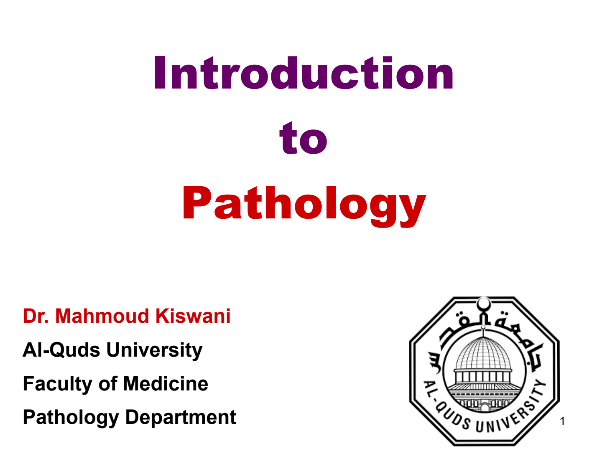

### PDF page 2 — Pathology: definition

> Source: ch1-part-01, PDF page 2. Printed slide: not reliably labelled. Classification: teaching.

#### Preserved source text

Definition of Pathology
• Path   + ology    : The study (logos) of suffering
  (pathos)
• The scientific study of disease          including the
  patterns, causes, mechanisms and effects of
  disease
• That branch of medicine treating the essential
  nature of disease, especially of the changes
  in the body tissue and organs, which cause or
  are caused by disease
                                                          2
                        (24th edition of Dorland’s medical dictionary)

#### Visual transcription / figure record

Full page visually inspected; extracted text and visible layout compared. Illustrative image retained in original full-page render.

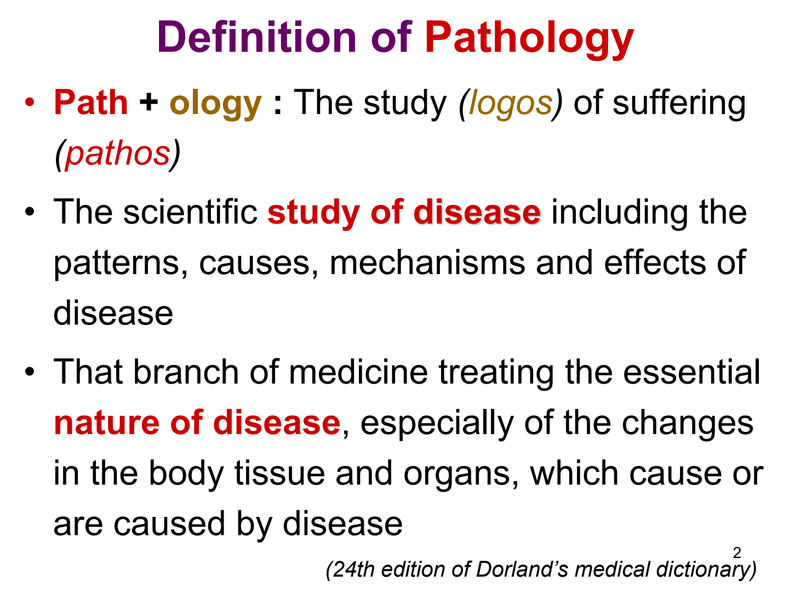

### PDF page 3 — Pathology bridges basic and clinical science

> Source: ch1-part-01, PDF page 3. Printed slide: 3. Classification: teaching.

#### Preserved source text

Definition of Pathology

It is  a  bridging   discipline  involving   both   basic
science   and  clinical practice   and  isdevoted   to the
study  of the  structural   and  functional   changes    in
cells, tissues,   and   organs    that underlie  disease.
By    the    use    of    molecular,     microbiologic,
immunologic,       and     morphologic       techniques,
pathology    attempts    to   explain   the   whys    and
wherefores   of the signs   and  symptoms     manifested
by  patients  while  providing  a  sound   foundation   for
rational clinicalcare  and  therapy.                    3

#### Visual transcription / figure record

Full page visually inspected; extracted text and visible layout compared. Illustrative image retained in original full-page render.

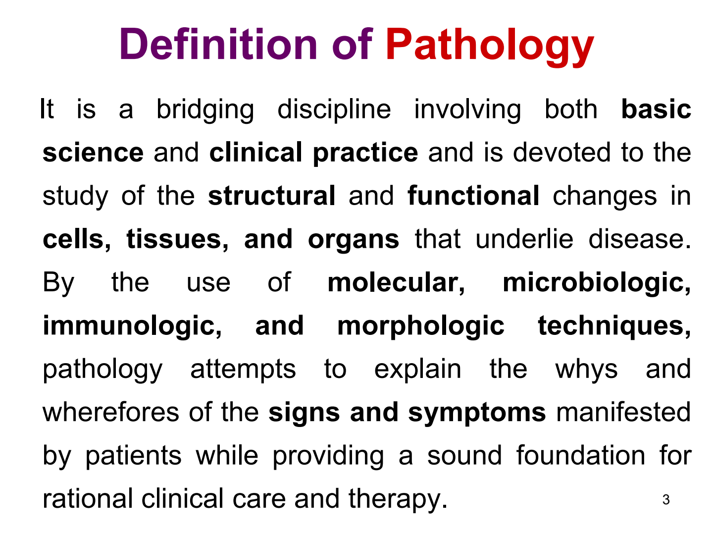

### PDF page 4 — Disease: definition

> Source: ch1-part-01, PDF page 4. Printed slide: 4. Classification: teaching.

#### Preserved source text

Definition of Disease

•An abnormality of the body         that
 causes loss of normal health

•Expression of discomfort due to
 structural   or functional    abnormality

#### Visual transcription / figure record

Full page visually inspected; extracted text and visible layout compared. Illustrative image retained in original full-page render.

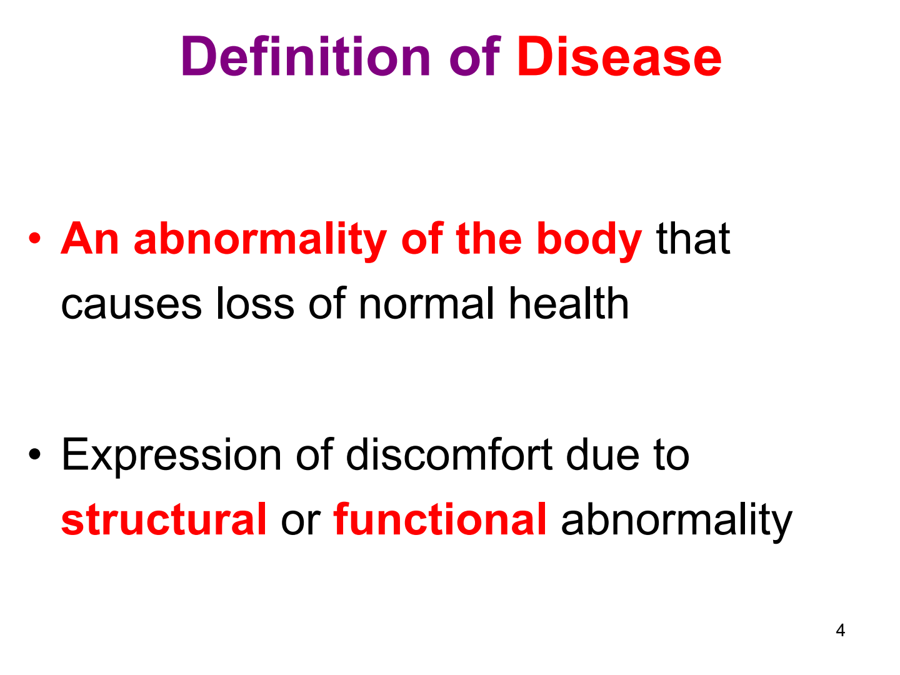

### PDF page 5 — Disease classifications

> Source: ch1-part-01, PDF page 5. Printed slide: 5. Classification: teaching.

#### Preserved source text

Classification of Diseases
• Physical / Mental
• Acute / Chronic
  – Acute   – short, days to weeks.
  – Chronic   – long, months to years.
• Congenital / Acquired
• Genetic / Environmental
• Mild / Moderate / Severe
• Inflammatory / Neoplastic / Degenerative         5

#### Visual transcription / figure record

Full page visually inspected; extracted text and visible layout compared. Illustrative image retained in original full-page render.

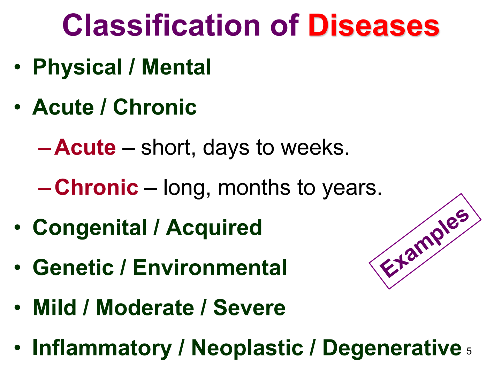

### PDF page 6 — Aspects of disease

> Source: ch1-part-01, PDF page 6. Printed slide: not reliably labelled. Classification: teaching.

#### Preserved source text

Aspects of Disease             Process
• Epidemiology
• Etiology
• Pathogenesis
• Morphologic changes
• Clinical significance
• Diagnosis
• Management
• Complications
• Prognosis
                                                    6
• Prevention

#### Visual transcription / figure record

Full page visually inspected; extracted text and visible layout compared. Illustrative image retained in original full-page render.

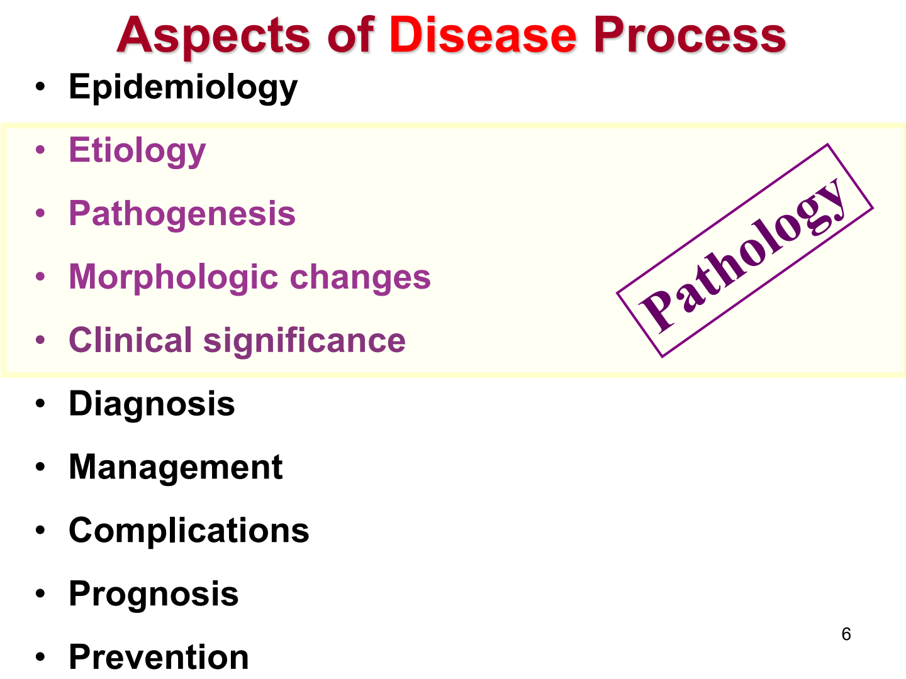

### PDF page 7 — Etiology overview

> Source: ch1-part-01, PDF page 7. Printed slide: 7. Classification: teaching.

#### Preserved source text

Aspects of Disease           Process

• Etiology

• Pathogenesis
• Morphologic changes
• Clinical significance

#### Visual transcription / figure record

Full page visually inspected; extracted text and visible layout compared. Illustrative image retained in original full-page render.

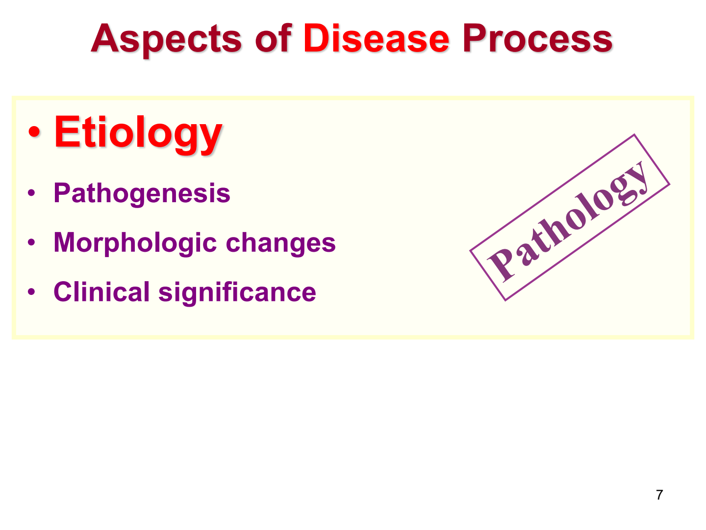

### PDF page 8 — Etiology categories

> Source: ch1-part-01, PDF page 8. Printed slide: 8. Classification: teaching.

#### Preserved source text

Etiology: What is the cause?
• Environmental or Acquired Factors:
       • Physical
       • Chemical
       • Nutritional
       • Infections
       • Immunological
       • Psychological
• Genetic or Intrinsic Factors:
• Multi-factorial:
       • Diabetes
       • Hypertension
       • Cancer

#### Visual transcription / figure record

Full page visually inspected; extracted text and visible layout compared. Illustrative image retained in original full-page render.

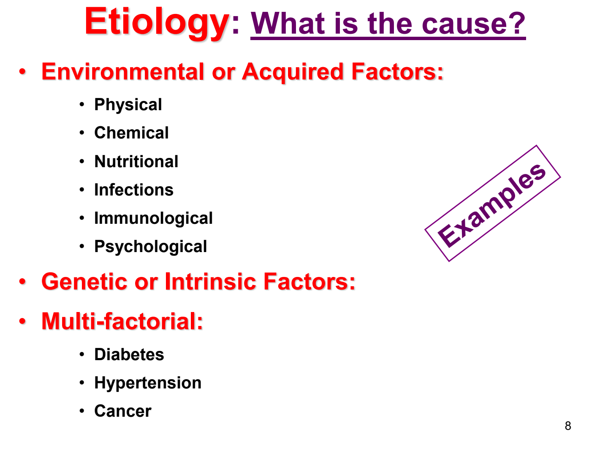

### PDF page 9 — Pathogenesis overview

> Source: ch1-part-01, PDF page 9. Printed slide: 9. Classification: teaching.

#### Preserved source text

Aspects of Disease          Process

•Etiology
•Pathogenesis

•Morphologic changes
•Clinical significance

#### Visual transcription / figure record

Full page visually inspected; extracted text and visible layout compared. Illustrative image retained in original full-page render.

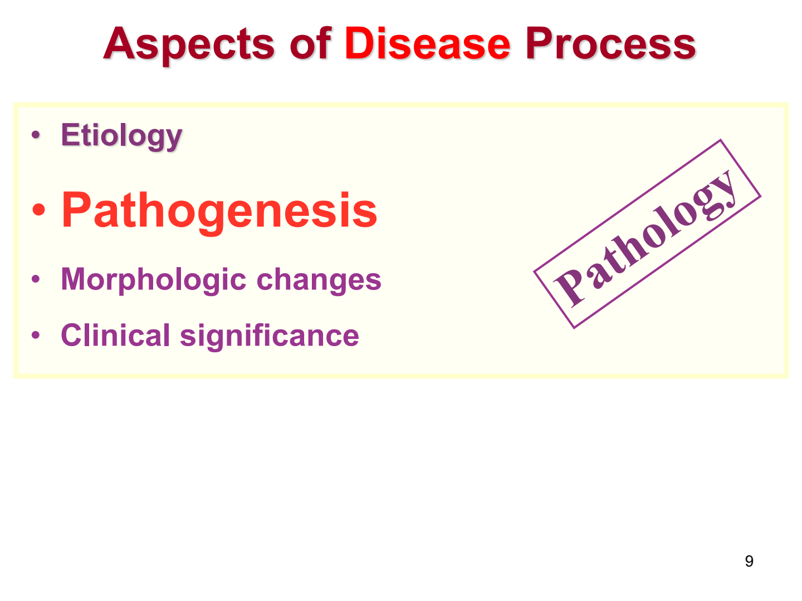

### PDF page 10 — Pathogenesis definition

> Source: ch1-part-01, PDF page 10. Printed slide: 10. Classification: teaching.

#### Preserved source text

Pathogenesis:           Definition
•  How  does  disease  develop?
•  The  mechanisms     of disease   development
•  Sequence   of events  in the response   ofcells &
   tissues to a stimulus/pathogen    starting  from
   the   initial   stimulus    to    the   ultimate
   expression   of disease.

#### Visual transcription / figure record

Full page visually inspected; extracted text and visible layout compared. Illustrative image retained in original full-page render.

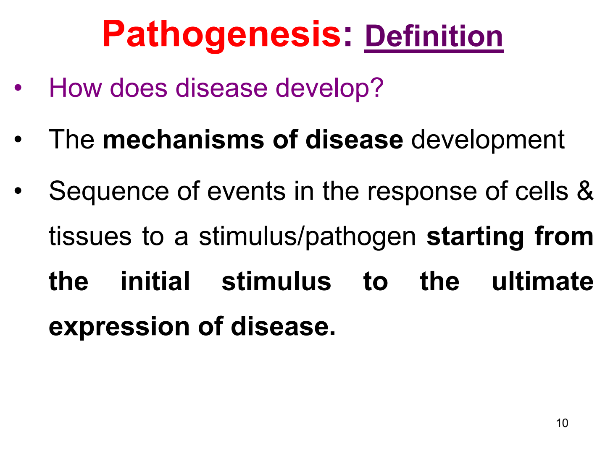

### PDF page 11 — Morphologic changes overview

> Source: ch1-part-01, PDF page 11. Printed slide: 11. Classification: teaching.

#### Preserved source text

Aspects of Disease         Process

•Etiology
•Pathogenesis
•Morphologic changes

•Clinical significance

#### Visual transcription / figure record

Full page visually inspected; extracted text and visible layout compared. Illustrative image retained in original full-page render.

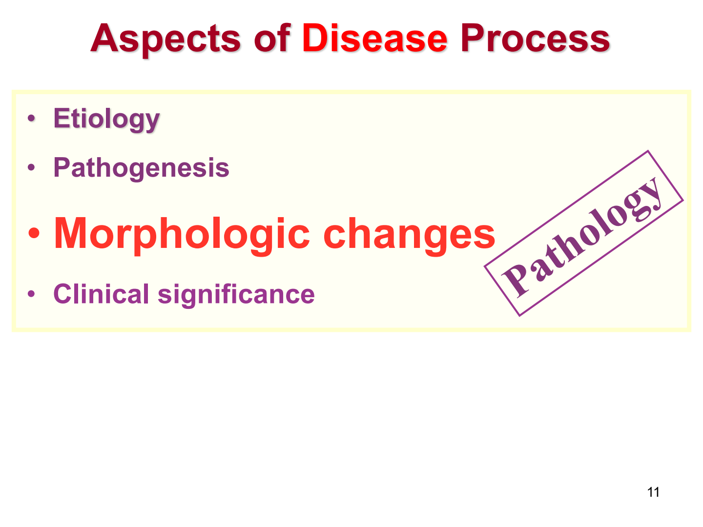

### PDF page 12 — Morphologic changes

> Source: ch1-part-01, PDF page 12. Printed slide: 12. Classification: teaching.

#### Preserved source text

Morphologic changes
- Morphologic       changes      are   the   structural
  alterations induced  by  the disease in the cells and
  organs  ofthe body
- They   include:
   gross  changes           microscopic   changes

                   Alcoholic Cirrhosis.              12

#### Visual transcription / figure record

Full page visually inspected; extracted text and visible layout compared. Illustrative image retained in original full-page render.

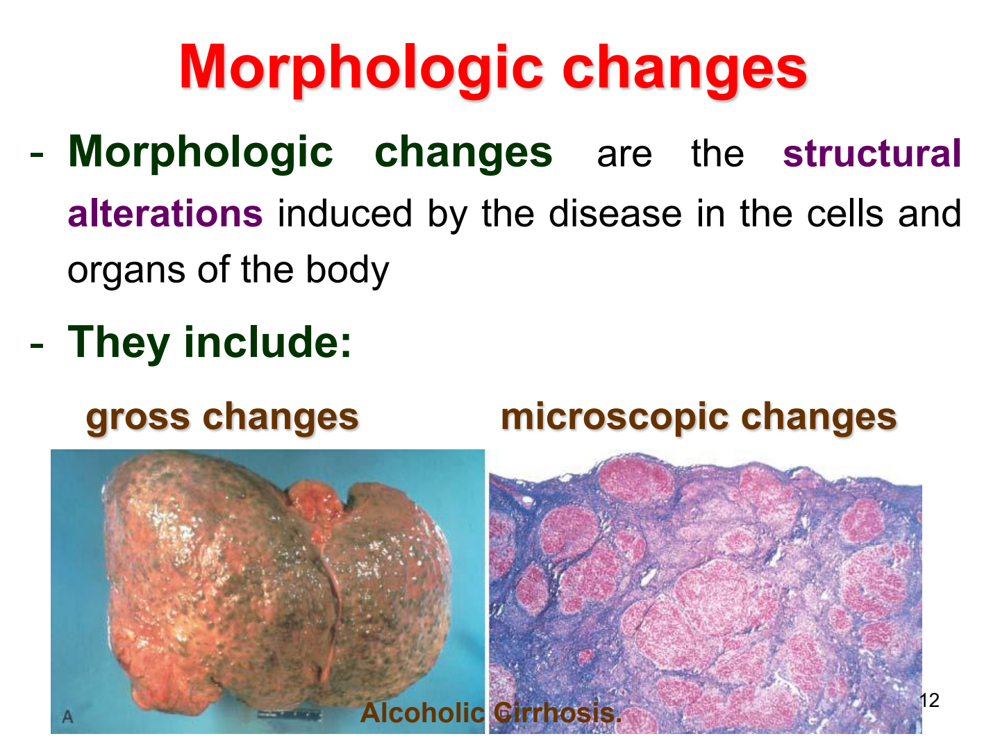

### PDF page 13 — Unlabelled morphology illustrations

> Source: ch1-part-01, PDF page 13. Printed slide: 13. Classification: teaching.

#### Preserved source text

13

#### Visual transcription / figure record

Unlabelled histologic image beside an unlabelled gross surgical specimen; no diagnosis is supplied. Preserve the images without inventing an identification.

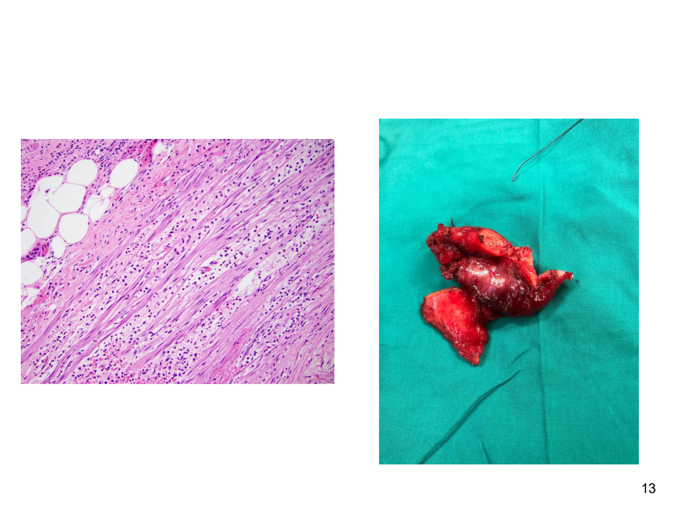

### PDF page 14 — Clinical significance overview

> Source: ch1-part-01, PDF page 14. Printed slide: 14. Classification: teaching.

#### Preserved source text

Aspects of Disease         Process

•Etiology
•Pathogenesis
•Morphologic changes
•Clinical significance

#### Visual transcription / figure record

Full page visually inspected; extracted text and visible layout compared. Illustrative image retained in original full-page render.

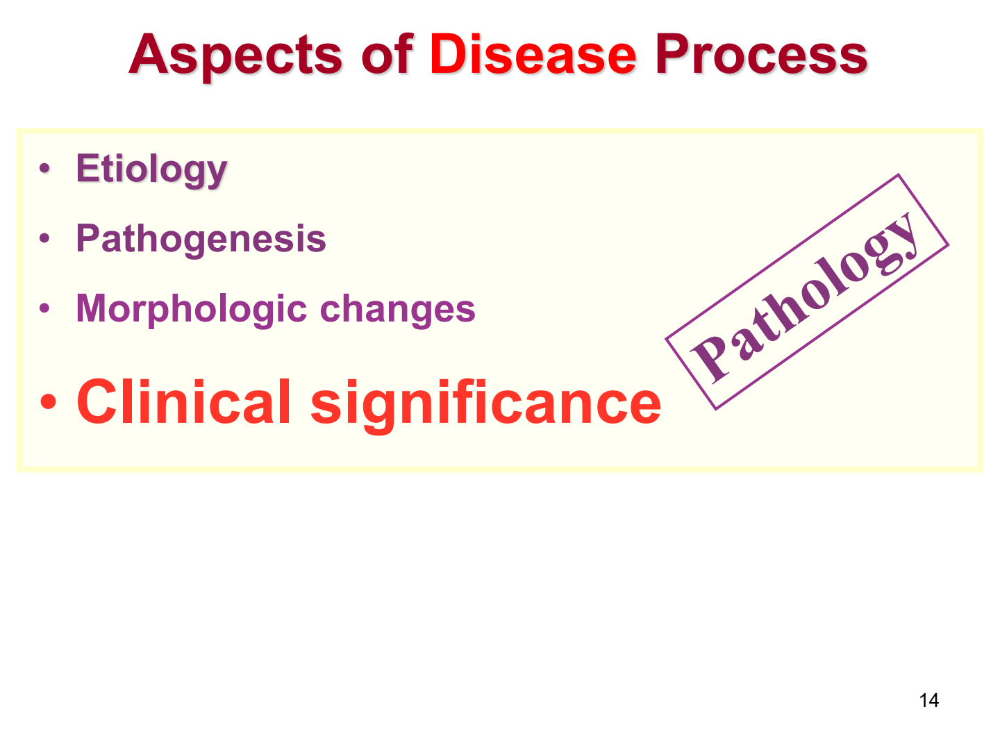

### PDF page 15 — Clinical features

> Source: ch1-part-01, PDF page 15. Printed slide: 15. Classification: teaching.

#### Preserved source text

Clinical significance

- ClinicalManifestations   =Clinical features
- The functional  consequences    ofthe morphologic changes

- Clinicalfeatures  include:
     Symptoms                              Signs

                      Examples

#### Visual transcription / figure record

Full page visually inspected; extracted text and visible layout compared. Illustrative image retained in original full-page render.

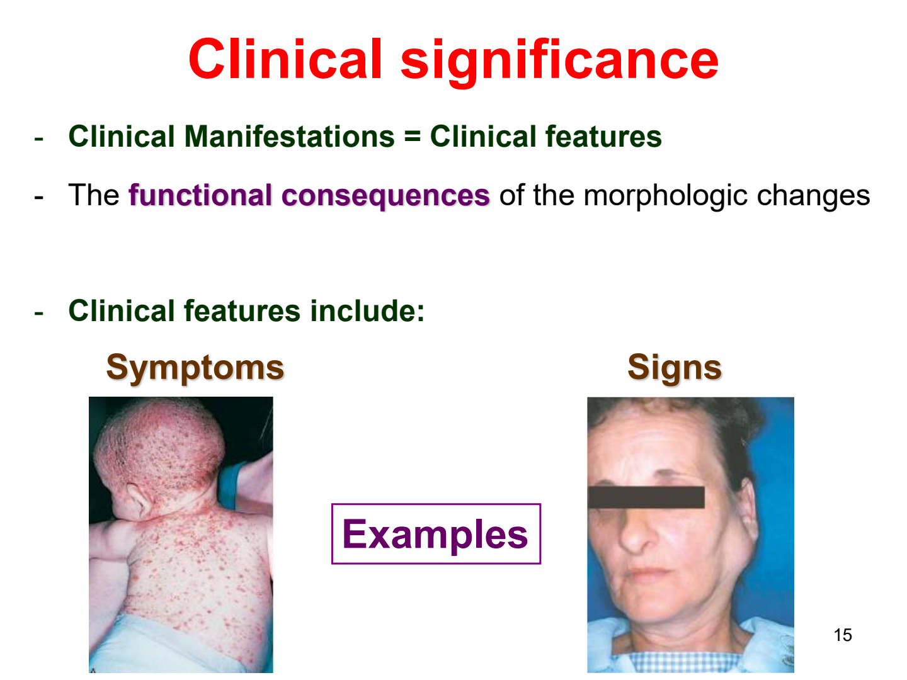

### PDF page 16 — Diagnosis

> Source: ch1-part-01, PDF page 16. Printed slide: 16. Classification: teaching.

#### Preserved source text

Diagnosis

•  Based on the symptoms & Signs and the
   results of Pathology tests

•  Needs knowledge of different diseases, their
   characteristics

•  Important for patient management &
   prognosis

#### Visual transcription / figure record

Full page visually inspected; extracted text and visible layout compared. Illustrative image retained in original full-page render.

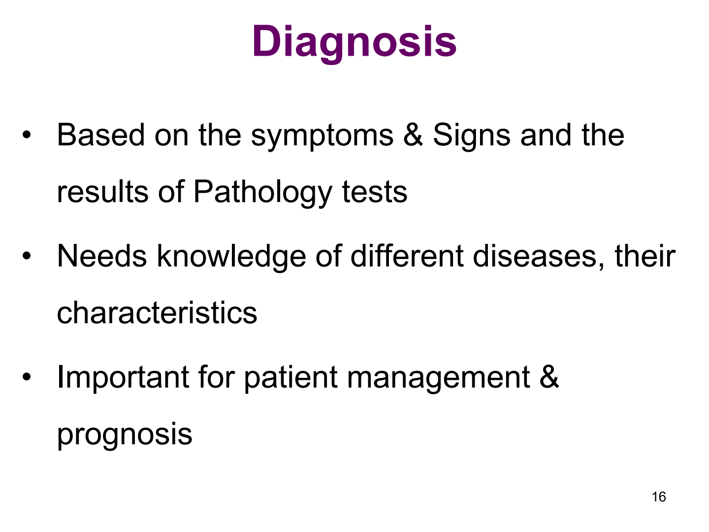

### PDF page 17 — Diagnostic levels

> Source: ch1-part-01, PDF page 17. Printed slide: 17. Classification: teaching.

#### Preserved source text

Diagnosis:         Levels of study

• Gross pathology
  – Patient or autopsy
• Macroscopic
  – Surgical specimen
• Tissues
  – Microscopic sections
• Special investigations
  – Immunohistochemistry, tumor markers
• Genome                                          17

#### Visual transcription / figure record

Full page visually inspected; extracted text and visible layout compared. Illustrative image retained in original full-page render.

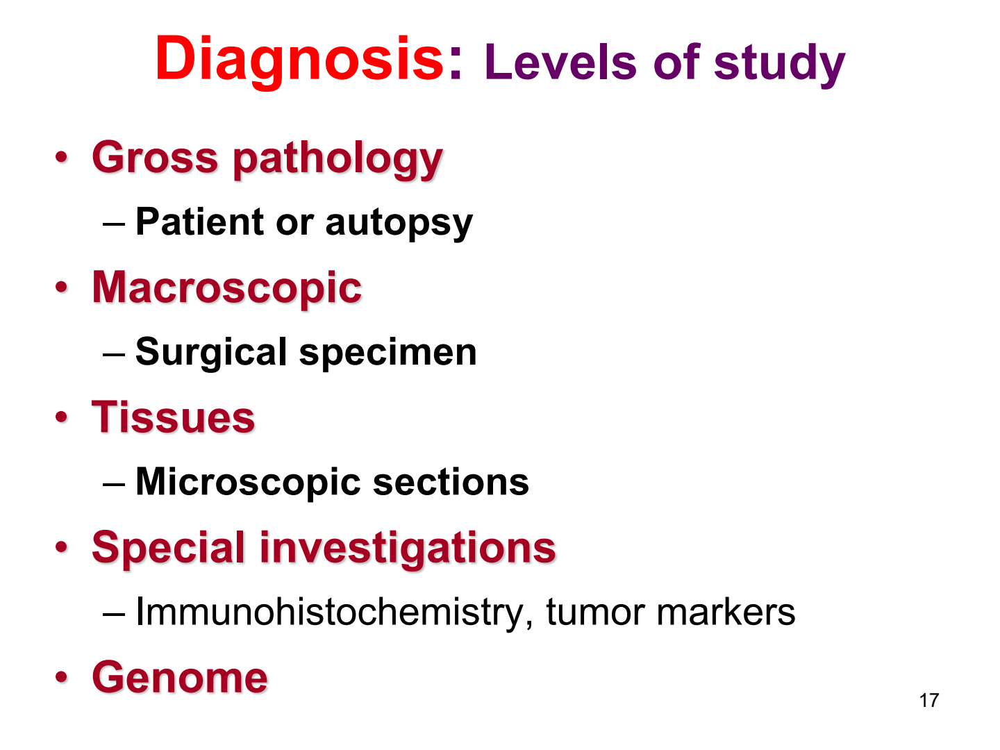

### PDF page 18 — Pathology divisions

> Source: ch1-part-01, PDF page 18. Printed slide: 18. Classification: teaching.

#### Preserved source text

Divisions of Pathology

1)General   pathology

2)Systemic    pathology

#### Visual transcription / figure record

Full page visually inspected; extracted text and visible layout compared. Illustrative image retained in original full-page render.

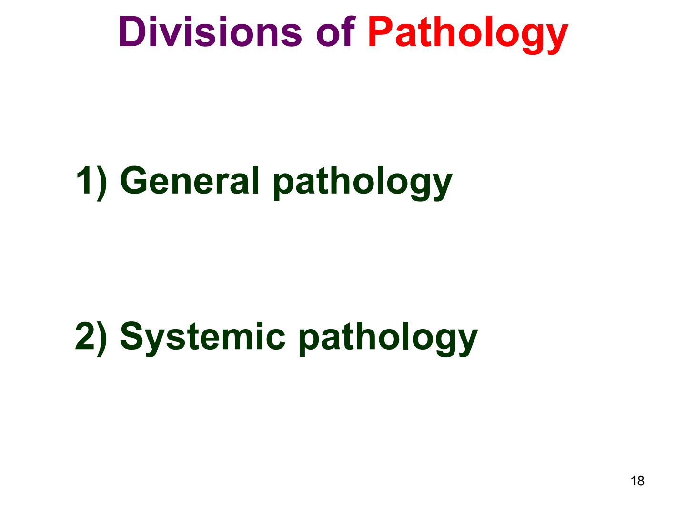

### PDF page 19 — General pathology

> Source: ch1-part-01, PDF page 19. Printed slide: 19. Classification: teaching.

#### Preserved source text

Divisions of Pathology
1) General   pathology:

• The   basic  reactions    of cells  and   tissues   to
  abnormal     stimuli  that underlie  all diseases

• Involved   the  mechanisms      and  characteristics
  of the  principle types  of disease   processes

• Examples:      cell injury, adaptation,  inflammation,
  repair, hemostasis,  neoplasia

#### Visual transcription / figure record

Full page visually inspected; extracted text and visible layout compared. Illustrative image retained in original full-page render.

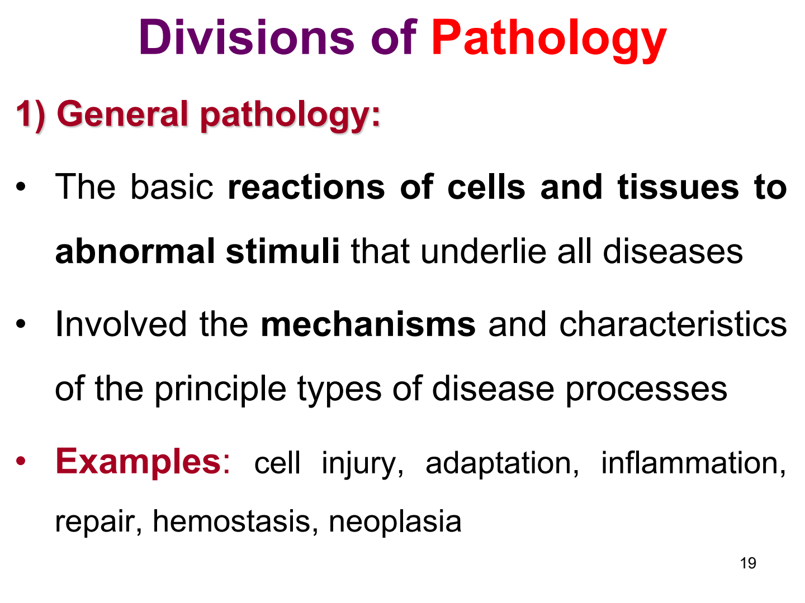

### PDF page 20 — Systemic pathology

> Source: ch1-part-01, PDF page 20. Printed slide: 20. Classification: teaching.

#### Preserved source text

Divisions of Pathology

2) Systemic    pathology:

• descriptions   of specific diseases   as  they affect
  individual  organs   or organ   systems

• Examples:     cardiovascular pathology, renal
  pathology, dermatopathology, endocrine
  pathology,  gastrointestinal pathology

#### Visual transcription / figure record

Full page visually inspected; extracted text and visible layout compared. Illustrative image retained in original full-page render.

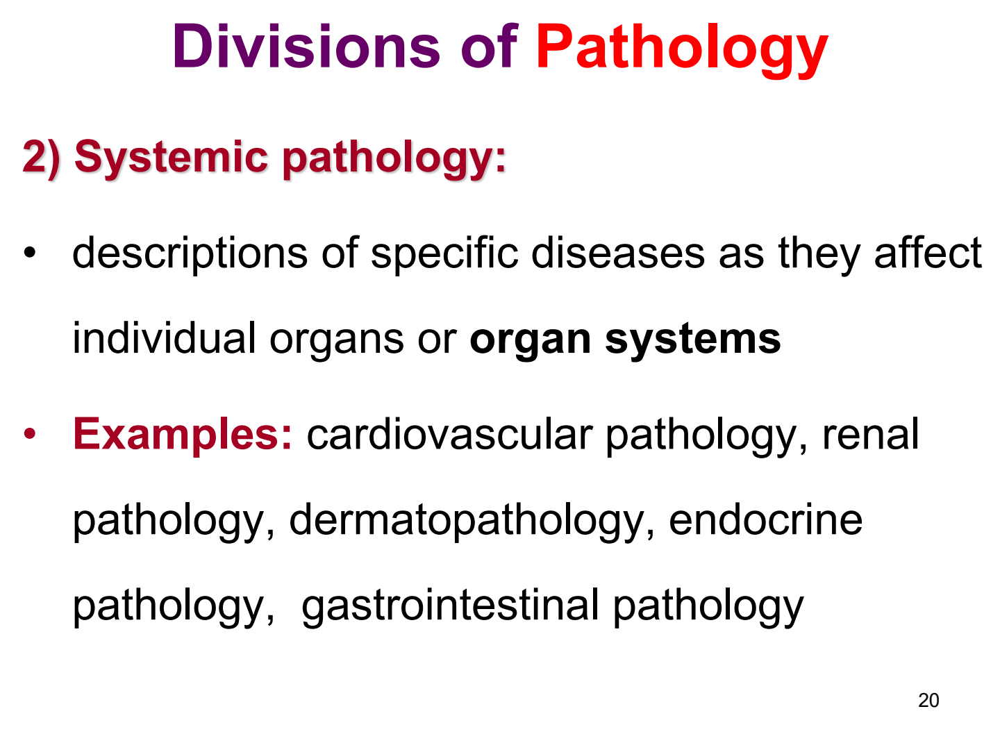

### PDF page 21 — Pathology subdivisions

> Source: ch1-part-01, PDF page 21. Printed slide: 21. Classification: teaching.

#### Preserved source text

Subdivisions of Pathology

1. Histopathology

2. Cytopathology

3. Hematology

4. Forensic pathology

5. Chemical pathology

6. Microbiology

7. Immunology                            21

#### Visual transcription / figure record

Full page visually inspected; extracted text and visible layout compared. Illustrative image retained in original full-page render.

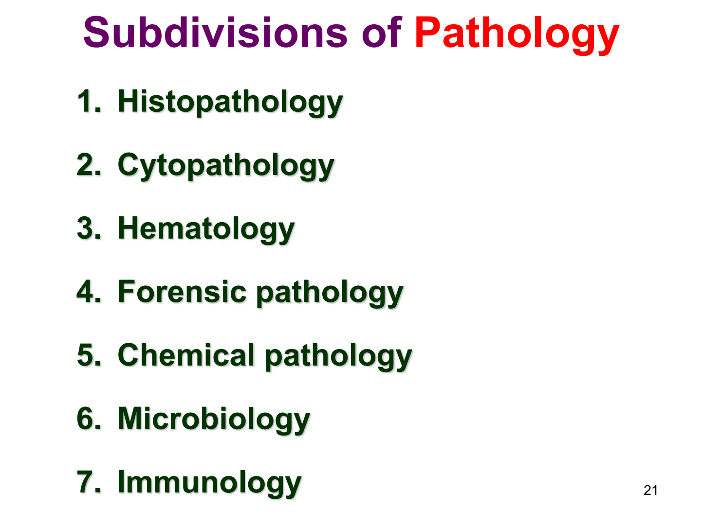

### PDF page 22 — Histopathology

> Source: ch1-part-01, PDF page 22. Printed slide: 22. Classification: teaching.

#### Preserved source text

Subdivisions of Pathology (1)
• Histopathology:

  Investigation and diagnosis of disease from the
  examination of tissues.
(e.g., Surgical specimen, Microscopic sections)

#### Visual transcription / figure record

Full page visually inspected; extracted text and visible layout compared. Illustrative image retained in original full-page render.

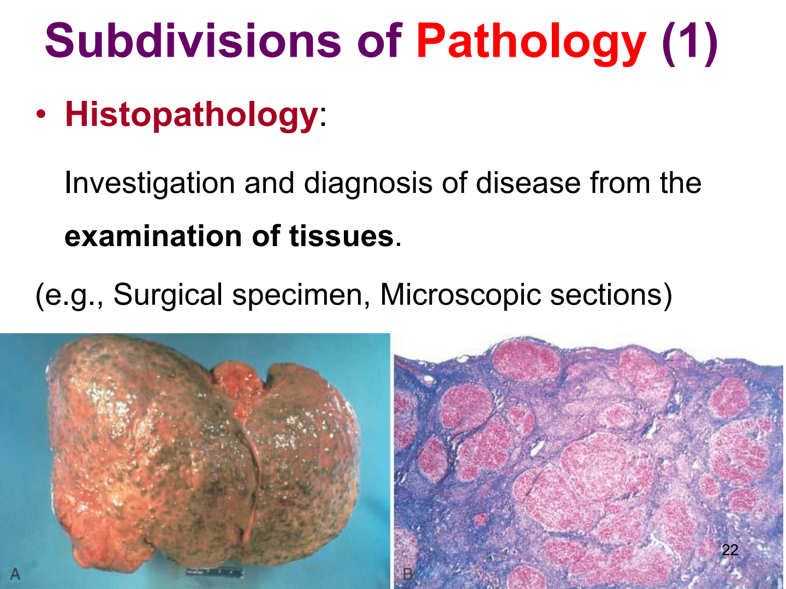

### PDF page 23 — Cytopathology

> Source: ch1-part-01, PDF page 23. Printed slide: 23. Classification: teaching.

#### Preserved source text

Subdivisions of Pathology (2)

• Cytopathology:

  Investigation and diagnosis of disease from the
  examination of isolated cells.

(e.g., Pap smears, FNA -Fine Needle Aspiration).

#### Visual transcription / figure record

Full page visually inspected; extracted text and visible layout compared. Illustrative image retained in original full-page render.

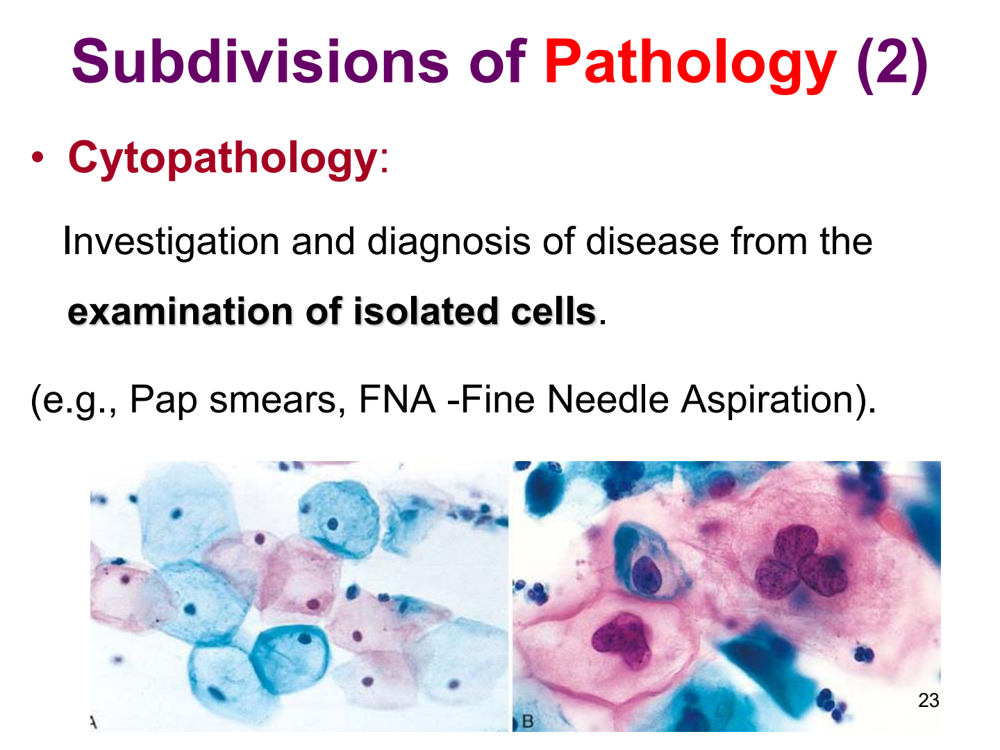

### PDF page 24 — Tissue and cell illustrations

> Source: ch1-part-01, PDF page 24. Printed slide: 24. Classification: teaching.

#### Preserved source text

24

#### Visual transcription / figure record

Comparison shows a skin tissue section above isolated squamous cells. No additional diagnostic label is supplied.

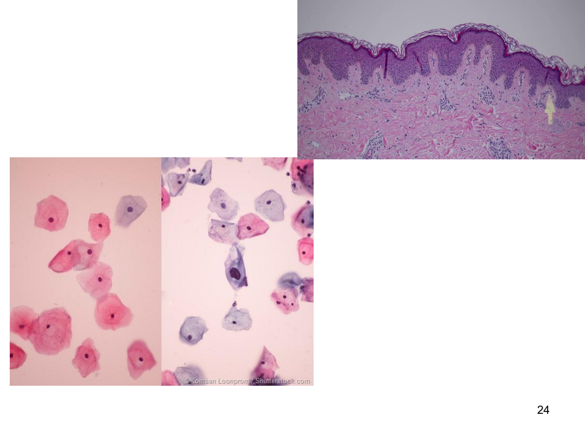

### PDF page 25 — Hematology

> Source: ch1-part-01, PDF page 25. Printed slide: 25. Classification: teaching.

#### Preserved source text

Subdivisions of Pathology (3)

• Hematology:
  Study   of   disorders   of  the   cellular   and
  coagulable   components    ofthe  blood.
  (e.g. Peripheral  blood   smear,  bone   marrow,
  coagulation  disorders)

#### Visual transcription / figure record

Full page visually inspected; extracted text and visible layout compared. Illustrative image retained in original full-page render.

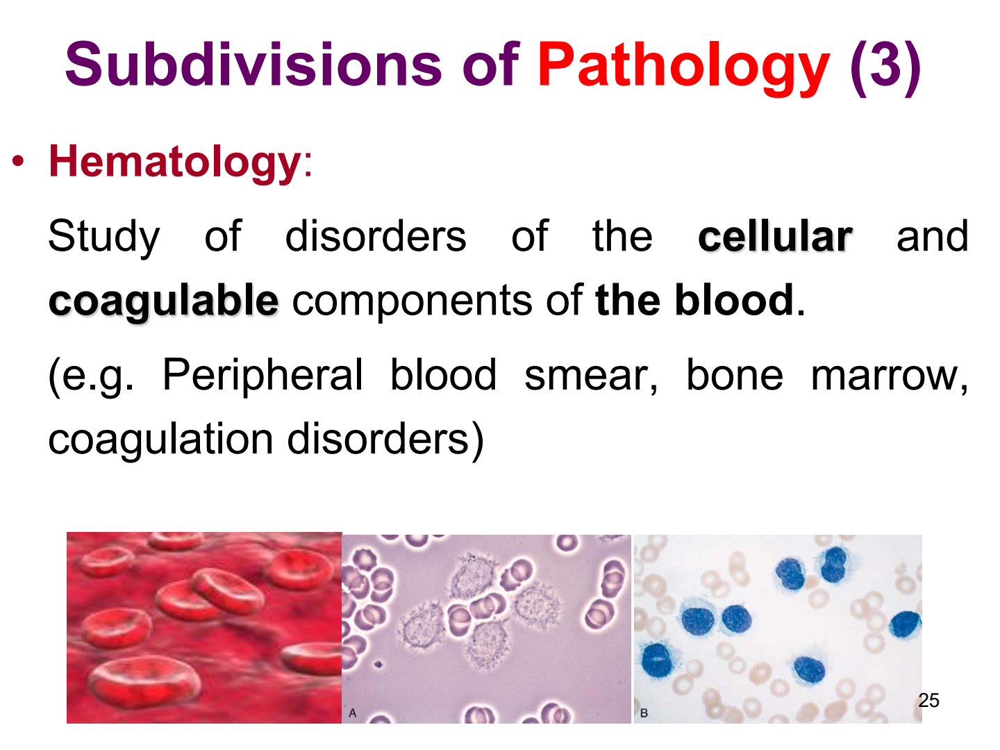

### PDF page 26 — Forensic pathology

> Source: ch1-part-01, PDF page 26. Printed slide: 26. Classification: teaching.

#### Preserved source text

•Subdivisions of Forensic pathology:Pathology (4)

  Application of pathology to legal purposes
  e.g. investigation of death in suspicious
  circumstances (e.g. autopsy)

#### Visual transcription / figure record

Full page visually inspected; extracted text and visible layout compared. Illustrative image retained in original full-page render.

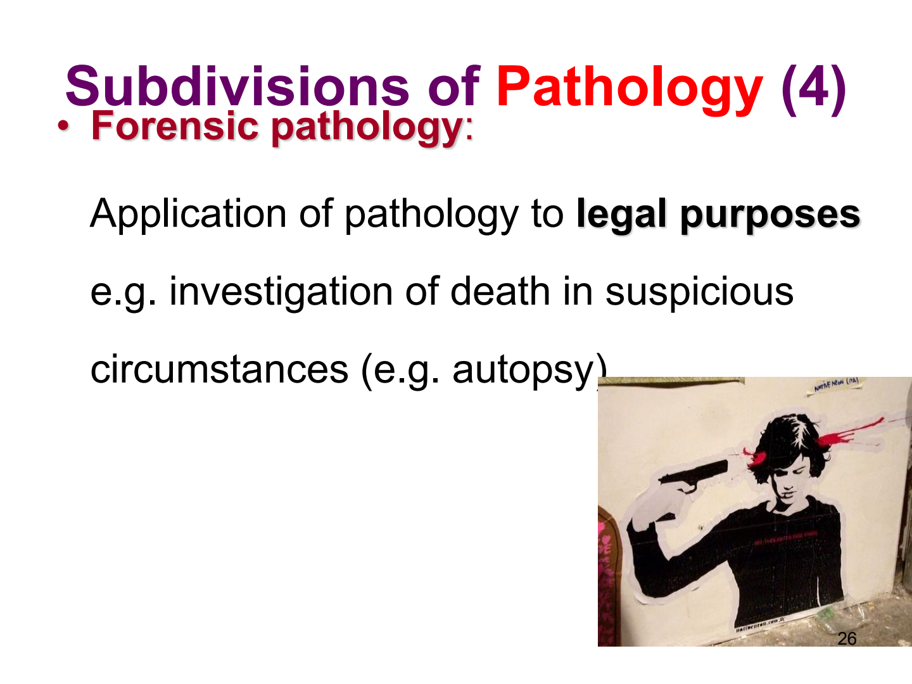

### PDF page 27 — Chemical pathology

> Source: ch1-part-01, PDF page 27. Printed slide: 27. Classification: teaching.

#### Preserved source text

Subdivisions of Pathology (5)

• Chemical pathology:

  Investigation of biochemical disorders(e.g. blood,

  urine, cerebrospinal fluid, effusions)

#### Visual transcription / figure record

Embedded image labels cytosolic hepatocellular enzymes: serum aspartate aminotransferase (AST), alanine aminotransferase (ALT), lactate dehydrogenase (LDH).

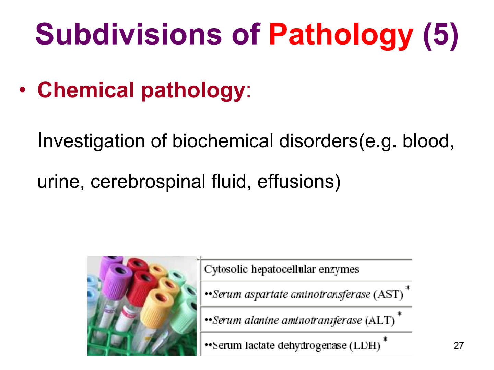

### PDF page 28 — Immunology

> Source: ch1-part-01, PDF page 28. Printed slide: 28. Classification: teaching.

#### Preserved source text

Subdivisions of Pathology (6)
• Immunology:
  Study of specific defence mechanisms         of the
  body and the diseases that arise from them
  (e.g, AIDS, allergic disorders)

#### Visual transcription / figure record

Illustrations include pollen exposure, an immune-response schematic (bacterium, macrophage, antigen, MHC marker, antigen-MHC complex, virgin B cell, membrane-bound antibody, receptor, helper T cell, activated B cell, memory B cell, plasma cell secreting antibodies) and inhaler use.

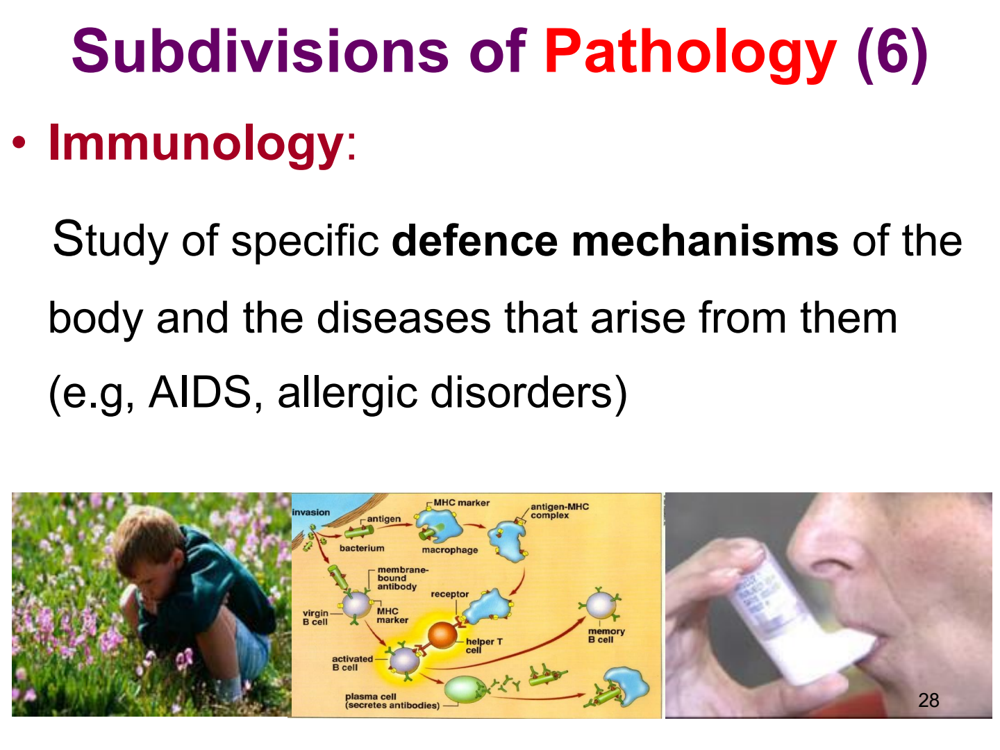

### PDF page 29 — Microbiology

> Source: ch1-part-01, PDF page 29. Printed slide: 29. Classification: teaching.

#### Preserved source text

Subdivisions of Pathology (7)

• Microbiology:
Study of infectious diseases
(e.g, Malaria, influenza)

#### Visual transcription / figure record

Full page visually inspected; extracted text and visible layout compared. Illustrative image retained in original full-page render.

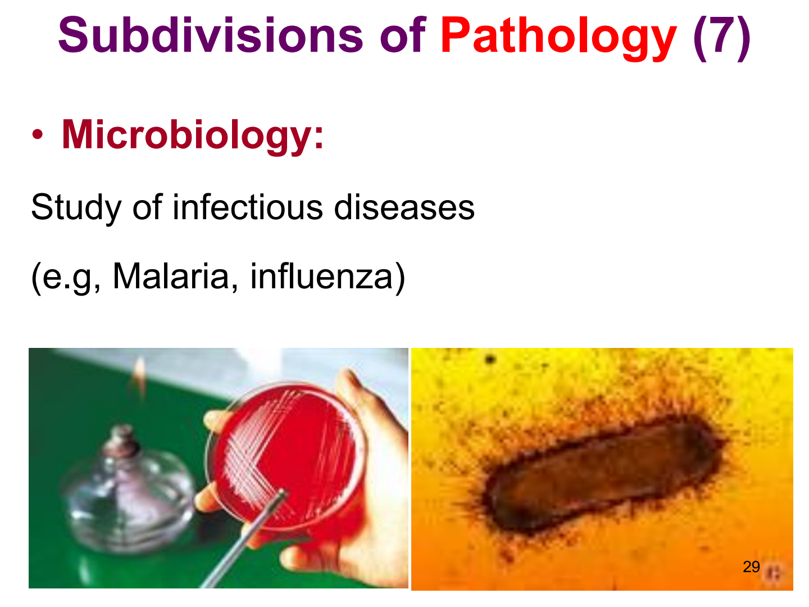

### PDF page 30 — Prefixes

> Source: ch1-part-01, PDF page 30. Printed slide: 30. Classification: teaching.

#### Preserved source text

Nomenclature (1)

Prefix   Meaning                          Example

Ana-     Absence                          Anaphylaxis

Dys-     Disordered                       Dysplasia

Hyper-   Excess over normal               Hyperthyroidism

Hypo-    Deficiency below normal          Hypothyroidism

Meta-    Change from one state to         Metaplasia
         another

#### Visual transcription / figure record

Full page visually inspected; extracted text and visible layout compared. Illustrative image retained in original full-page render.

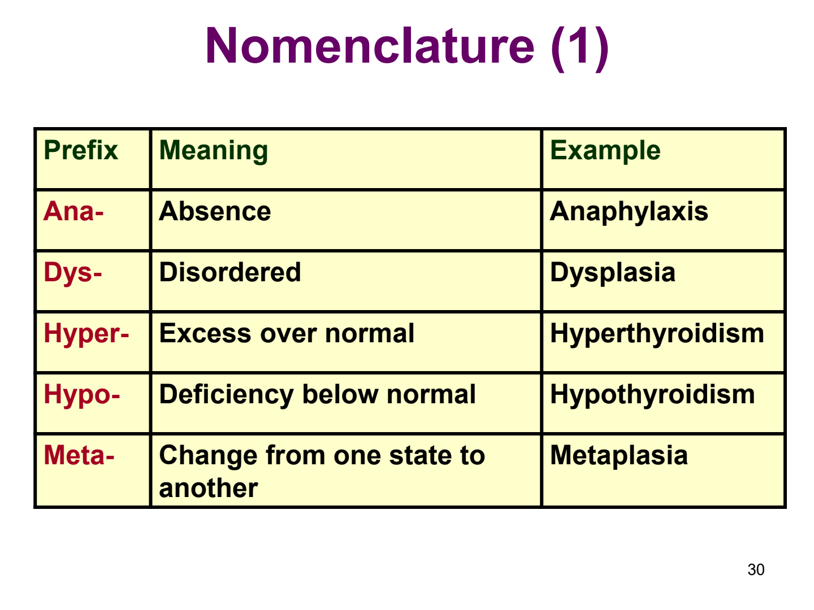

> **Source note:** Prefix table gives Ana- as absence with Anaphylaxis example. Example/meaning pairing is doubtful; preserve without correction, exclude this table from scoring.

### PDF page 31 — Suffixes

> Source: ch1-part-01, PDF page 31. Printed slide: 31. Classification: teaching.

#### Preserved source text

Nomenclature (2)

Suffix     Meaning                         Example
-itis      Inflammatory process            Appendicitis
-emia      Vascular                        Ischemia
-oma       Tumour                          Carcinoma
-osis      State or condition              Osteoarthrosis
-oid       Bearing a resemblance to        Rheumatoid disease
-penia     Lack of                         Thrombocytopenia
-cytosis   Increased number of cells       Leukocytosis
-ectasis   Dilation                        Bronchiectasis
-plasia    Disorder of growth              Hyperplasia

#### Visual transcription / figure record

Full page visually inspected; extracted text and visible layout compared. Illustrative image retained in original full-page render.

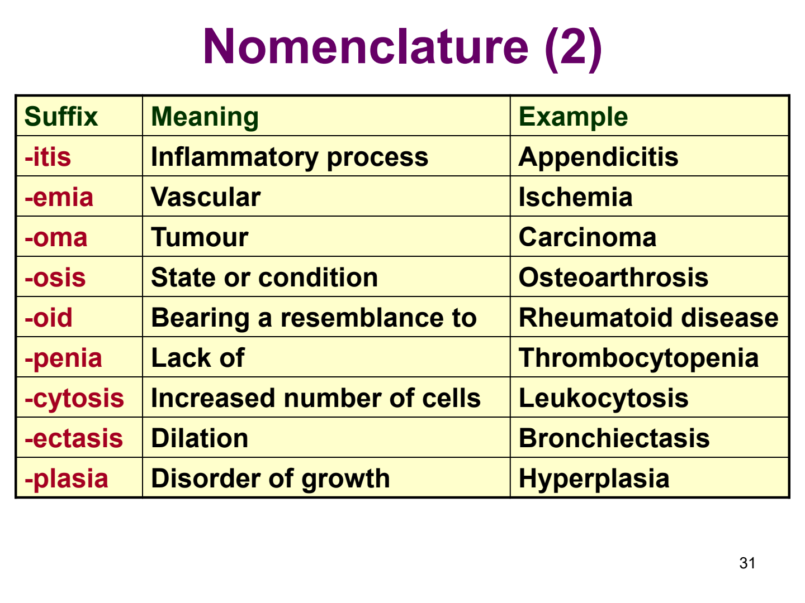

> **Source note:** Suffix table gives -emia as vascular with ischemia example, and -plasia as disorder of growth. Terminology is insufficiently precise for scored distinctions; preserved, table excluded from scoring.

### PDF page 32 — Closing quotation

> Source: ch1-part-01, PDF page 32. Printed slide: 32. Classification: administrative.

#### Preserved source text

32

#### Visual transcription / figure record

Closing quotation: YOUR LIFE RIGHT NOW IS A RESULT OF WHAT YOU DID A YEAR AGO. YOUR LIFE A YEAR FROM NOW WILL BE A RESULT OF WHAT YOU DO RIGHT NOW. ACT ACCORDINGLY!

---

## Chapter 1 — Part 2: Cover

Authority: unchanged supplied PDF only. Page headings use one-based PDF pages; printed labels are recorded only when visibly present. Original extracted text is preserved below, with separately identified visual transcription. No outside teaching content.

### PDF page 1 — Cover

> Source: ch1-part-02, PDF page 1. Printed slide: 1. Classification: cover.

#### Preserved source text

Causes &
Targets of
Cell   Injury

Dr. Mahmoud Kiswani
Al-Quds University
Faculty of Medicine
Pathology Department                                    1

#### Visual transcription / figure record

Full page visually inspected; extracted text and visible layout compared. Illustrative image retained in original full-page render.

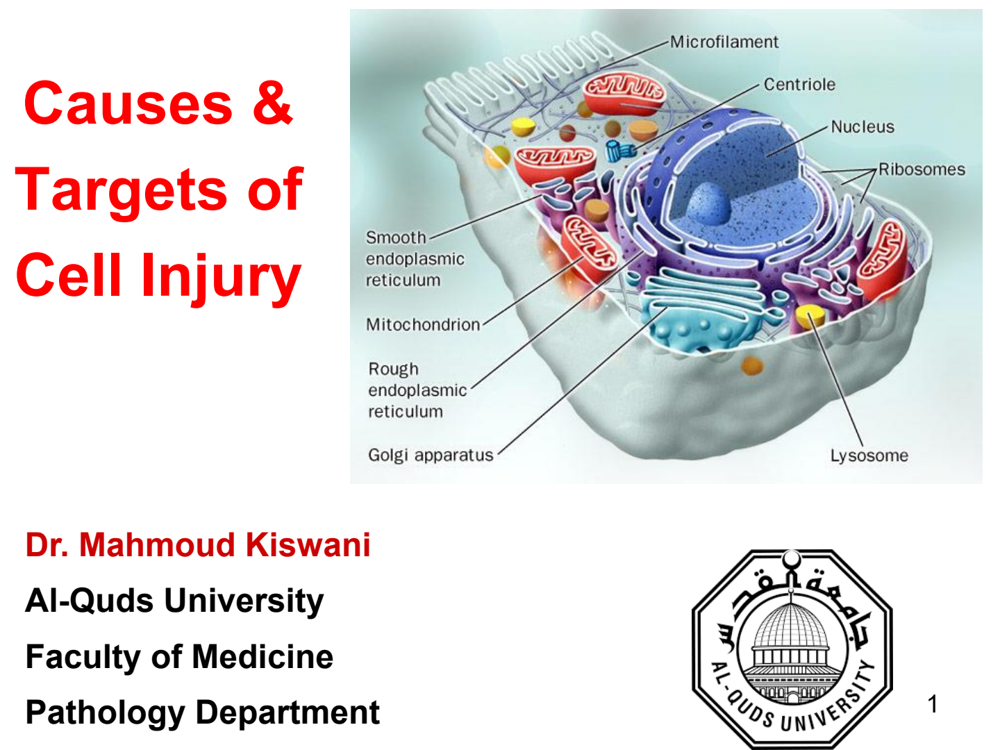

### PDF page 2 — Stress responses

> Source: ch1-part-02, PDF page 2. Printed slide: not reliably labelled. Classification: teaching.

#### Preserved source text

(Homeostasis)

                                               stress
If the stress is
removed

                           Injury                                                                Adaptation

                       Reversible                        Irreversible
                                                         (cell death)

                                                         *If the stress
                                                         was severe or
                                                         progressive

#### Visual transcription / figure record

Homeostatic cell under stress may adapt or undergo injury. Injury is reversible or irreversible (cell death); severe or progressive stress leads to irreversible injury. Removal of stress allows return from reversible injury.

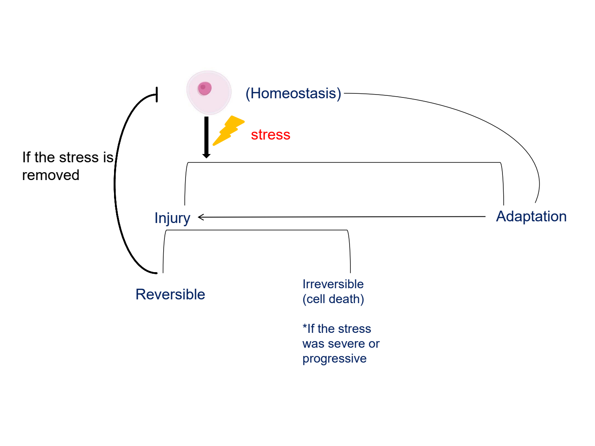

### PDF page 3 — Stages of cell injury

> Source: ch1-part-02, PDF page 3. Printed slide: 3. Classification: teaching.

#### Preserved source text

3

#### Visual transcription / figure record

Normal cell/homeostasis -> stress -> adaptation. Inability to adapt -> injury. Mild transient injury -> reversible injury -> normal cell. Severe progressive injury -> irreversible injury -> necrosis or apoptosis (cell death).

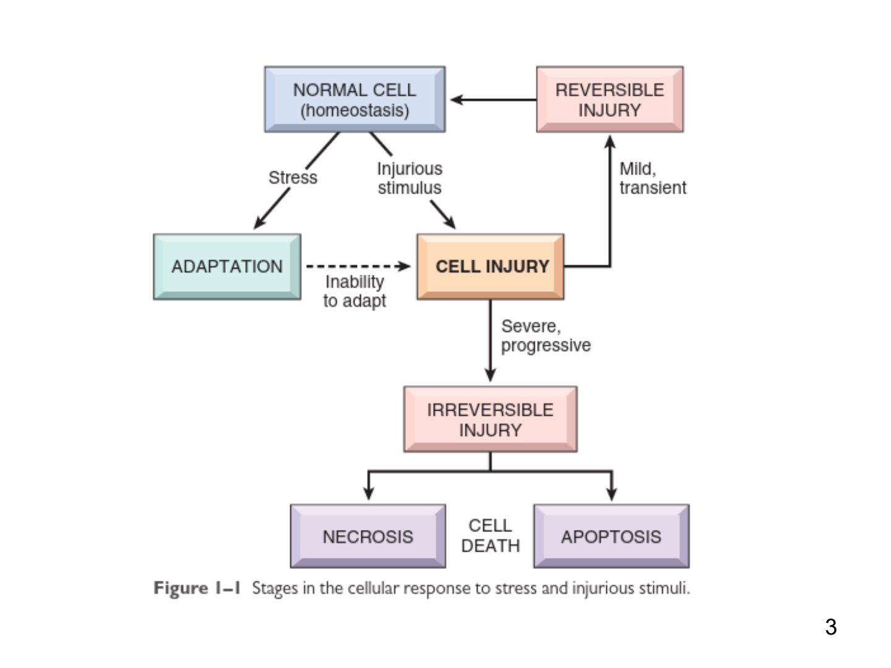

### PDF page 4 — Adaptive responses diagram

> Source: ch1-part-02, PDF page 4. Printed slide: 4. Classification: teaching.

#### Preserved source text

4

#### Visual transcription / figure record

Normal cells: reversible changes in size/number -> hyperplasia, hypertrophy, atrophy; reversible changes in structure/type -> dysplasia or metaplasia. Severe stress/inability to adapt -> irreversible injury, necrosis or apoptosis. Persistent chronic irritant is connected to neoplasia, labelled generally irreversible.

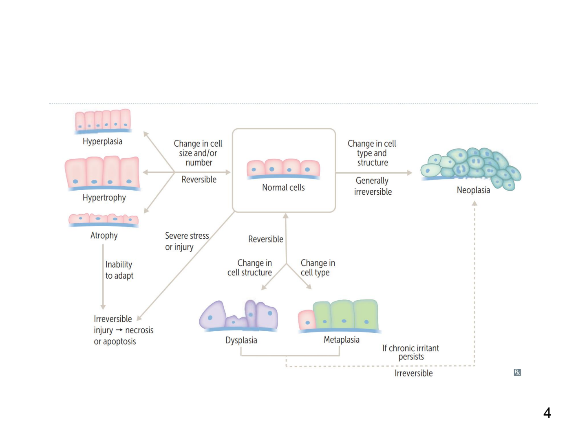

### PDF page 5 — Reversible and irreversible morphology

> Source: ch1-part-02, PDF page 5. Printed slide: 5. Classification: teaching.

#### Preserved source text

5

#### Visual transcription / figure record

Reversible injury: cellular/mitochondrial swelling, ribosomal detachment, membrane blebbing, nuclear chromatin clumping. Irreversible injury: plasma membrane damage, lysosome rupture/autolysis, nuclear degradation, increased mitochondrial permeability -> necrosis.

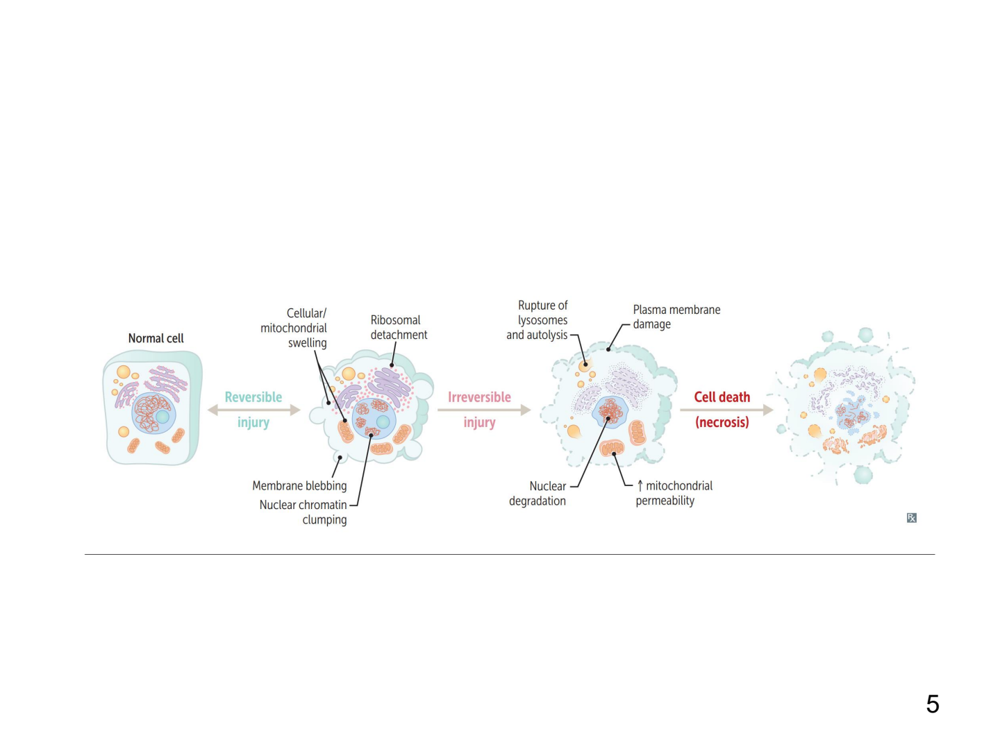

### PDF page 6 — Causes of cell injury

> Source: ch1-part-02, PDF page 6. Printed slide: 6. Classification: teaching.

#### Preserved source text

Cell injury: What are the causes?

  1.Physical
  2.Chemical
  3.Infectious
  4.Immunological
  5.Nutritional
  6.Genetic
  7.Oxygen Deprivation
  8.Aging                                     6

#### Visual transcription / figure record

Full page visually inspected; extracted text and visible layout compared. Illustrative image retained in original full-page render.

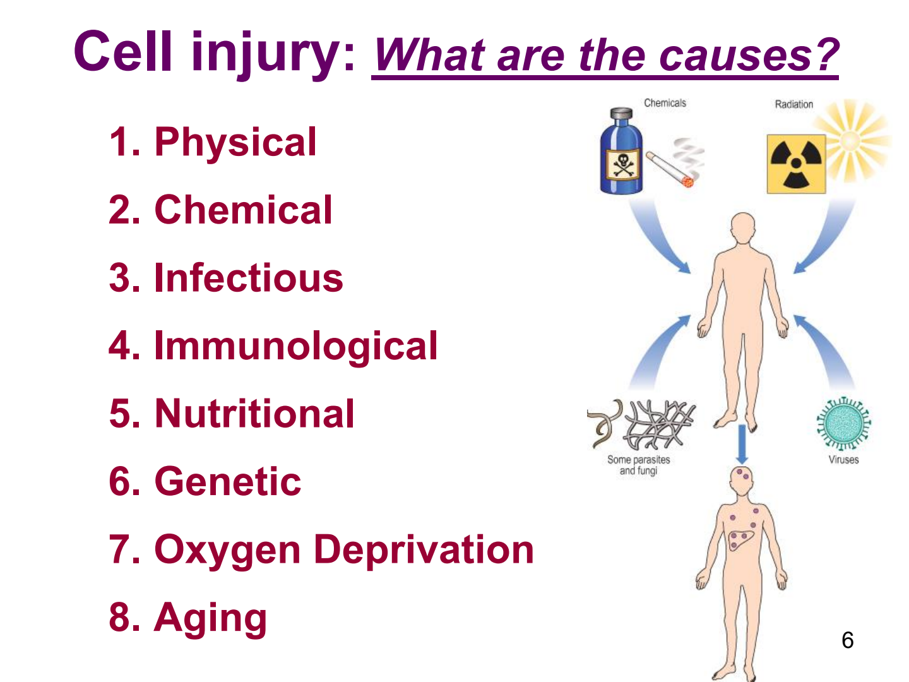

### PDF page 7 — Physical agents

> Source: ch1-part-02, PDF page 7. Printed slide: 7. Classification: teaching.

#### Preserved source text

1.   Physical agents

Mechanical trauma                   Thermal: heat or cold

 Electrical shock                       Radiation       7

#### Visual transcription / figure record

Full page visually inspected; extracted text and visible layout compared. Illustrative image retained in original full-page render.

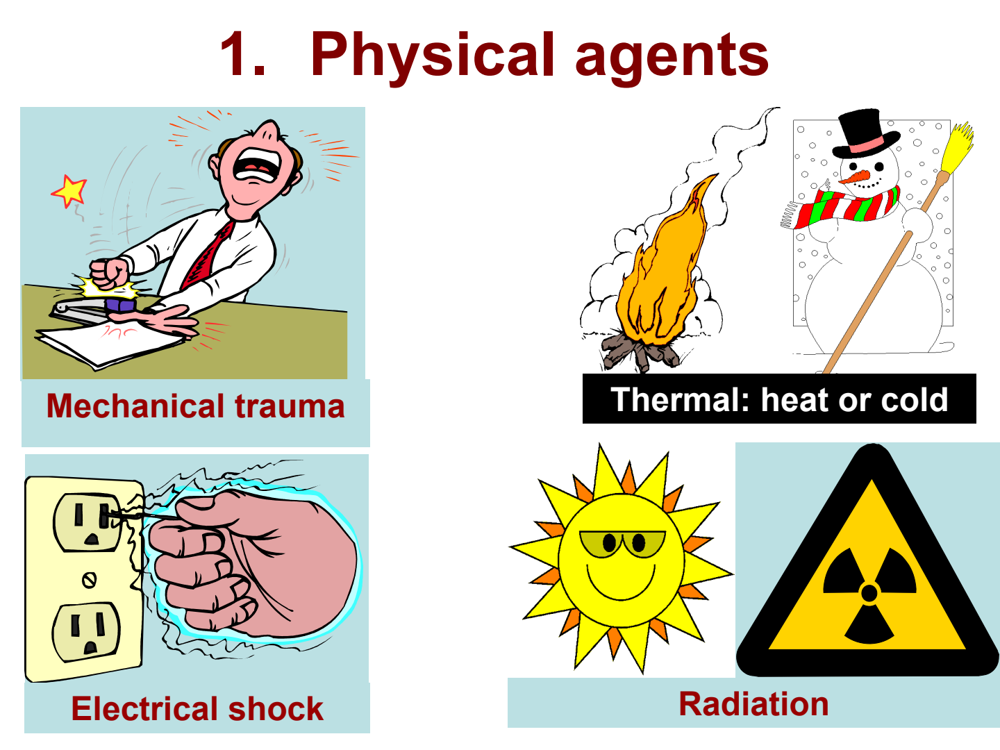

### PDF page 8 — Chemical agents

> Source: ch1-part-02, PDF page 8. Printed slide: 8. Classification: teaching.

#### Preserved source text

2.  Chemical agents

      Drugs & Poisons

#### Visual transcription / figure record

Full page visually inspected; extracted text and visible layout compared. Illustrative image retained in original full-page render.

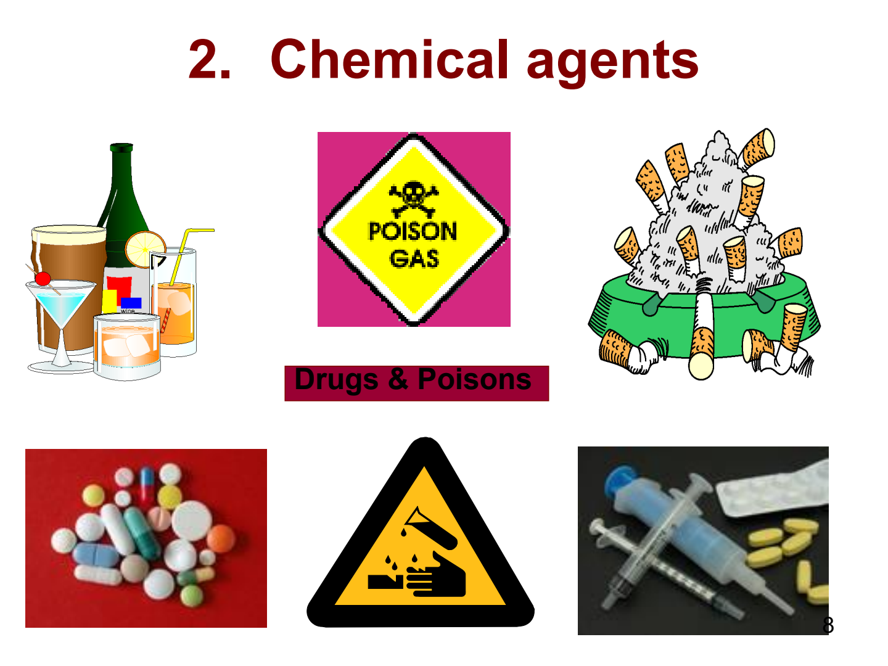

### PDF page 9 — Infectious agents

> Source: ch1-part-02, PDF page 9. Printed slide: 9. Classification: teaching.

#### Preserved source text

3.    Infectious       agents

Viruses, bacteria, fungi, parasites, tapeworms

#### Visual transcription / figure record

Full page visually inspected; extracted text and visible layout compared. Illustrative image retained in original full-page render.

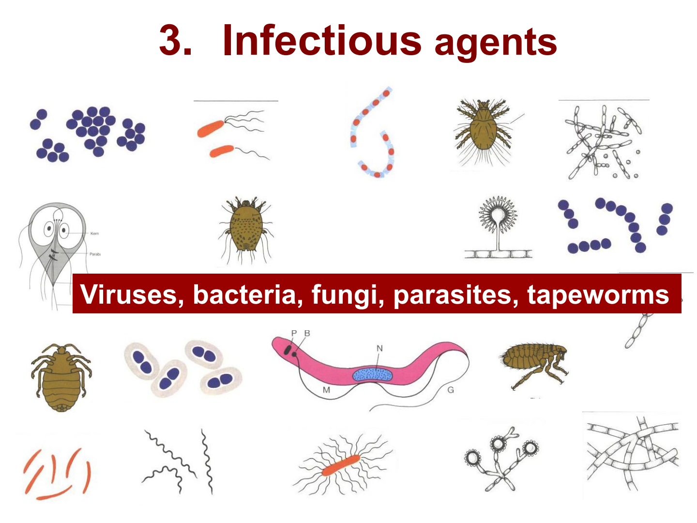

### PDF page 10 — Immune reactions

> Source: ch1-part-02, PDF page 10. Printed slide: 10. Classification: teaching.

#### Preserved source text

4.    Immunological reactions
           Antigen –     antibody reactions

              ➢  Major role in defence against
                 infectious pathogens

               If overridden or improperly operating it
                  will result in diseases:
               1. Anaphylactic reaction:
               •   reaction to a foreign protein or a drug
               2.  Autoimmune diseases:
               •   reactions to endogenous self-antigens10

#### Visual transcription / figure record

Full page visually inspected; extracted text and visible layout compared. Illustrative image retained in original full-page render.

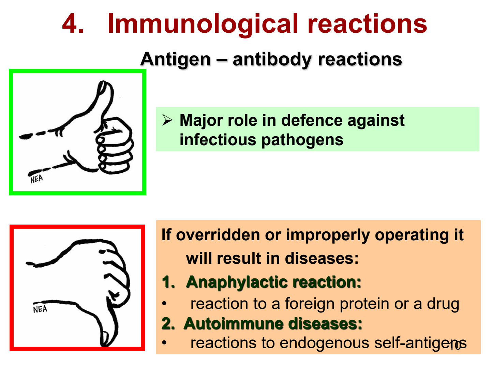

### PDF page 11 — Immune complex injury

> Source: ch1-part-02, PDF page 11. Printed slide: 11. Classification: teaching.

#### Preserved source text

4.  Immunological reactions
        Antigen – antibody reactions

#### Visual transcription / figure record

Immune-damage sequence labelled post-streptococcal glomerulonephritis: cocci bearing antigens -> free antigen -> antigen-antibody immune complexes -> glomerulonephritis.

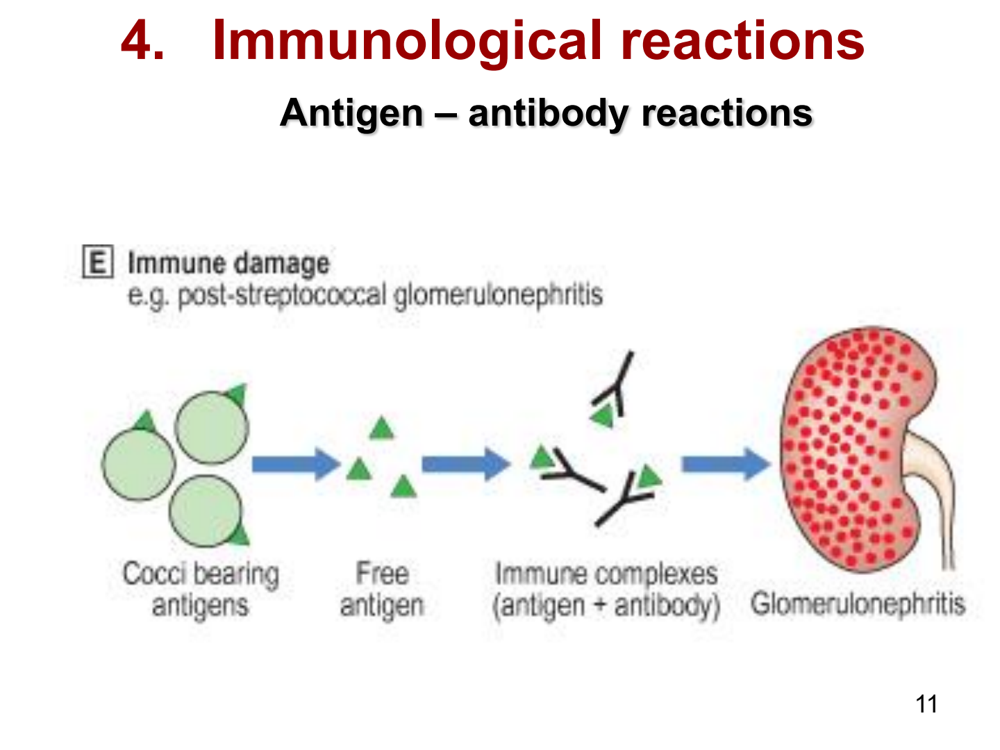

### PDF page 12 — Nutritional imbalance

> Source: ch1-part-02, PDF page 12. Printed slide: 12. Classification: teaching.

#### Preserved source text

5.    Nutritional imbalance

 Undernutrition                    Overnutrition
•Protein-calorie deficiencies        •Atherosclerosis
•Vitamins & Mineral Deficiencies     •Obesity

•Anorexia nervosa                                           12

#### Visual transcription / figure record

Full page visually inspected; extracted text and visible layout compared. Illustrative image retained in original full-page render.

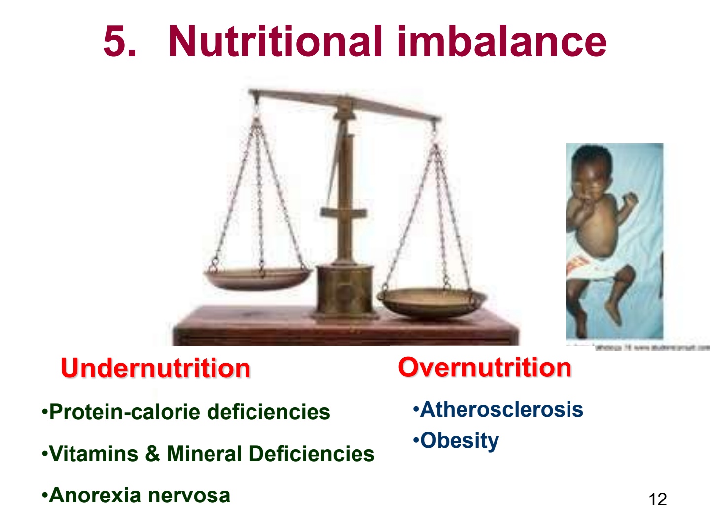

### PDF page 13 — Genetic defects

> Source: ch1-part-02, PDF page 13. Printed slide: 13. Classification: teaching.

#### Preserved source text

6.   Genetic Defects

Examples:

➢Down syndrome

➢Sickle cell anemia

➢Inborn errors of metabolism                       13

#### Visual transcription / figure record

Full page visually inspected; extracted text and visible layout compared. Illustrative image retained in original full-page render.

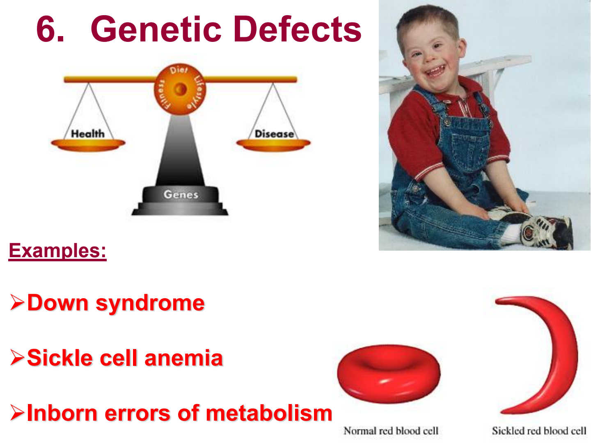

### PDF page 14 — Hypoxia versus ischemia

> Source: ch1-part-02, PDF page 14. Printed slide: 14. Classification: teaching.

#### Preserved source text

7.      Oxygen deprivation

  Hypoxia, or oxygen deficiency, interferes with aerobic
oxidative respiration

  Hypoxia     =             + O2continueglycolysis

  Ischemia, which is a loss of blood supply in a tissue due to
impeded arterial flow or reduced venous drainage.
  Ischemia➔        O2     +    nutrients

      Ischemia is the most common cause of hypoxia
      Ischemia is the most common type of cell injury              14

#### Visual transcription / figure record

Full page visually inspected; extracted text and visible layout compared. Illustrative image retained in original full-page render.

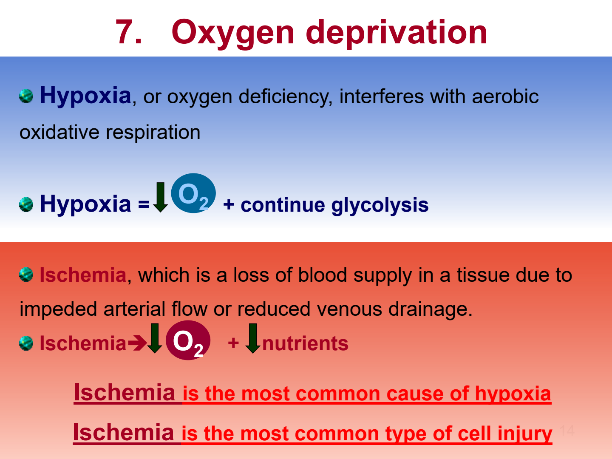

### PDF page 15 — Oxygen deprivation diagram

> Source: ch1-part-02, PDF page 15. Printed slide: 15. Classification: teaching.

#### Preserved source text

7.    Oxygen deprivation

         Ischemia
                                •Anemia
                                •high altitude
    blood supply                •respiratory failure
                                       CO

 glucose           Hypoxia:     blood oxygenation

       cell death

#### Visual transcription / figure record

Ischemia -> decreased blood supply -> decreased glucose and hypoxia -> cell death. Anemia, high altitude, respiratory failure and CO are shown causing decreased blood oxygenation/hypoxia.

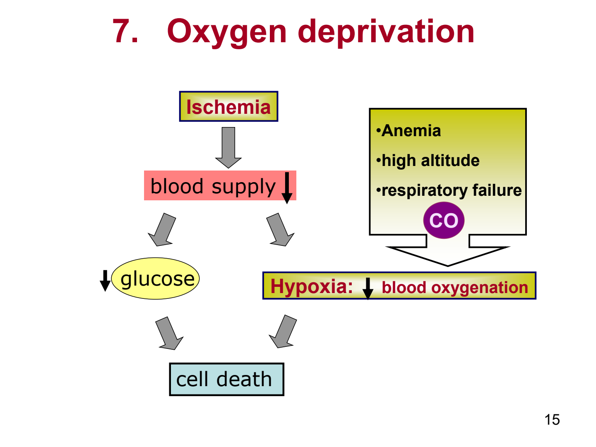

### PDF page 16 — Aging illustration

> Source: ch1-part-02, PDF page 16. Printed slide: 16. Classification: teaching.

#### Preserved source text

8.  Aging

#### Visual transcription / figure record

Full page visually inspected; extracted text and visible layout compared. Illustrative image retained in original full-page render.

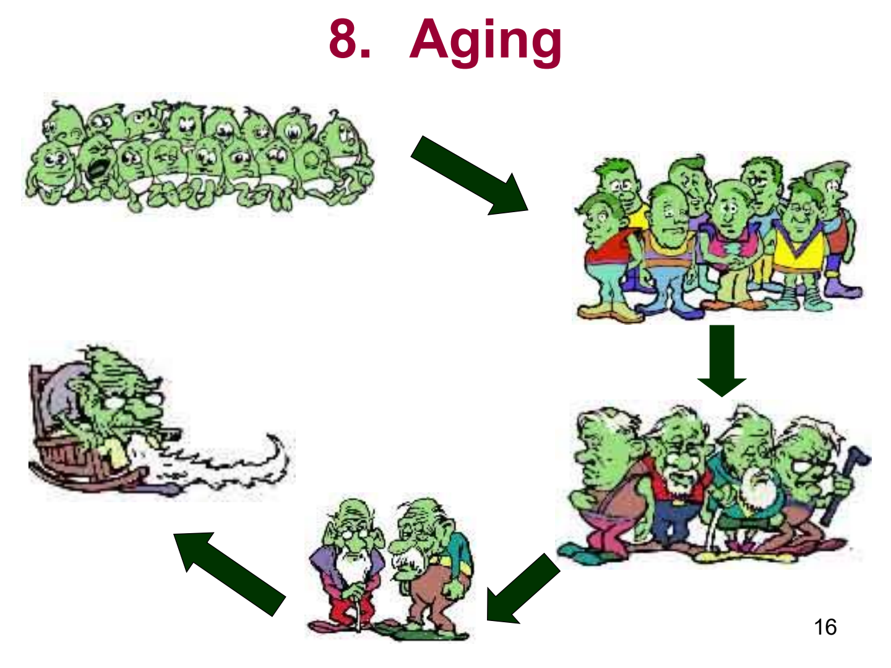

### PDF page 17 — Cellular aging mechanisms

> Source: ch1-part-02, PDF page 17. Printed slide: 17. Classification: teaching.

#### Preserved source text

Cellular aging: Mechanisms

INTRINSIC                EXTRINSIC

#### Visual transcription / figure record

Intrinsic genetic factors: DNA repair defects -> accumulated mutations; genetic abnormalities (e.g. IGF-1 pathway) -> abnormal cellular signaling. Extrinsic environmental insults -> free radical-mediated damage, and reduced proteasomal activity -> damaged cellular proteins/organelles accumulate. Replicative senescence -> reduced new-cell production. These routes converge on cellular aging.

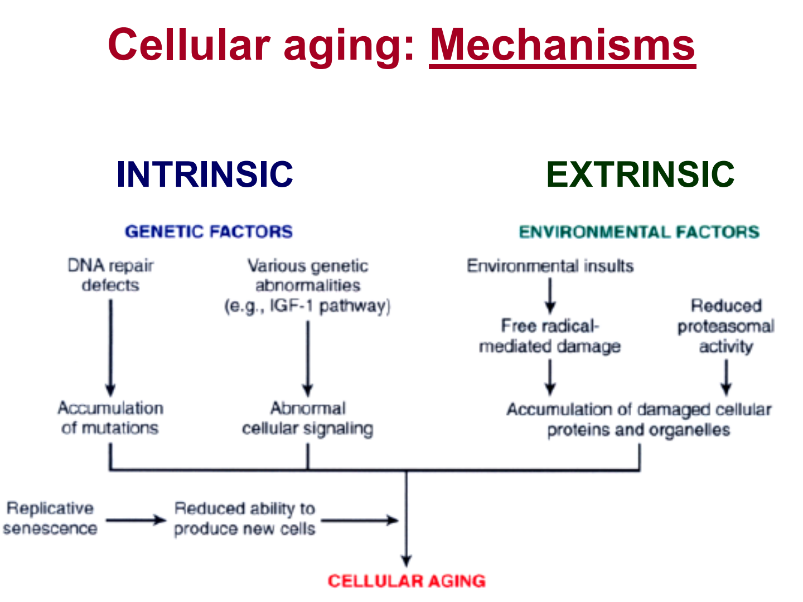

### PDF page 18 — Closing meme

> Source: ch1-part-02, PDF page 18. Printed slide: 18. Classification: administrative.

#### Preserved source text

18

#### Visual transcription / figure record

Nonteaching Arabic joke: الطب سهل جداً لعمتي؛ يعني إيه crush injury؛ جرح الحبيب.

### PDF page 19 — Targets and determinants of injury

> Source: ch1-part-02, PDF page 19. Printed slide: 19. Classification: teaching.

#### Preserved source text

Overview of Cell Injury
➢ The cellular responses to injurious stimuli depend

  on the type, duration, and severity          of injury.

➢ The main targets for the injury are:

       (1) cell membrane     integrity

       (2) ATP  generation

       (3) protein  synthesis

       (4) the integrity of the genetic   apparatus           19

#### Visual transcription / figure record

Full page visually inspected; extracted text and visible layout compared. Illustrative image retained in original full-page render.

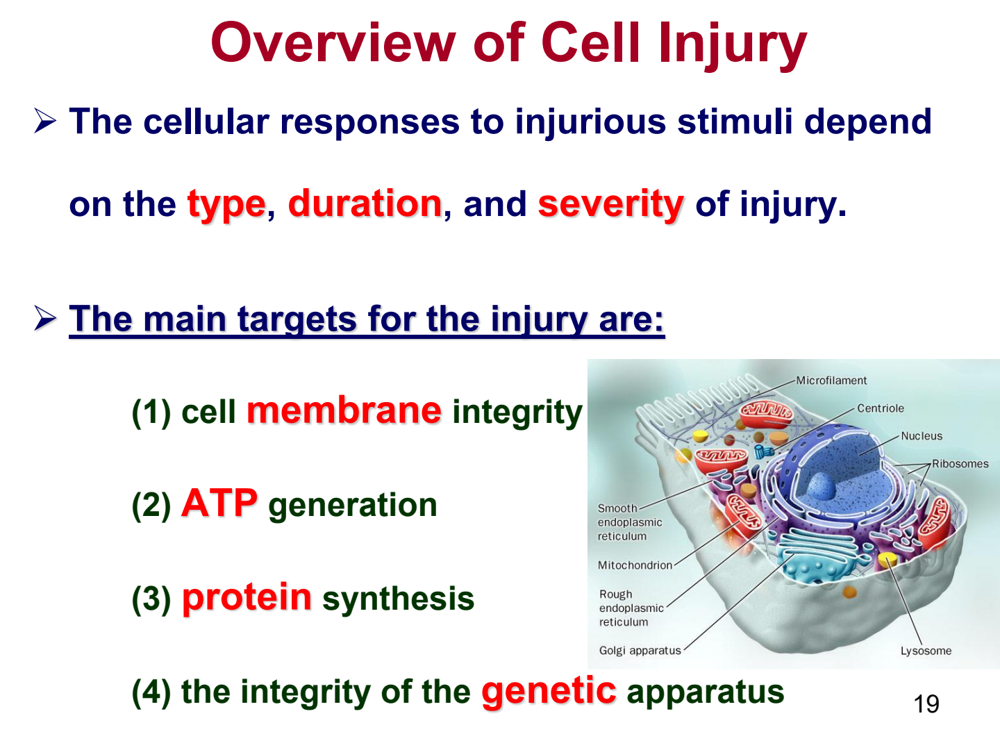

### PDF page 20 — Biochemical mechanisms

> Source: ch1-part-02, PDF page 20. Printed slide: 20. Classification: teaching.

#### Preserved source text

Cellular & biochemical mechanisms

➢  Loss of membrane     integrity

➢  ATP  depletion and mitochondrial damage

➢  Increased intracellular calcium

➢  Free radical-induced injury

➢  Protein  breakdown

➢  DNA   damage                              20

#### Visual transcription / figure record

Full page visually inspected; extracted text and visible layout compared. Illustrative image retained in original full-page render.

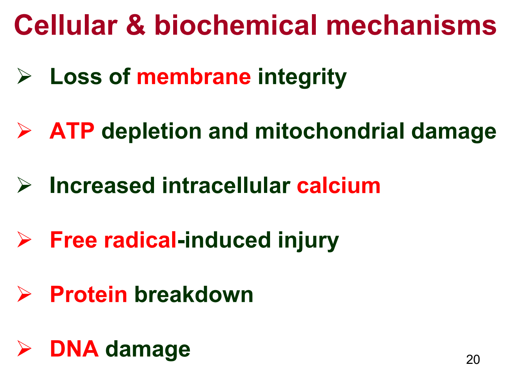

### PDF page 21 — Cell injury morphology diagram

> Source: ch1-part-02, PDF page 21. Printed slide: not visibly labelled. Classification: teaching.

#### Preserved source text

(No extractable text beyond the page label; see visual transcription and original image.)

#### Visual transcription / figure record

Healthy cell Na/K ATPase exchanges 3 Na outward and 2 K inward. Hypoxia and ATP reduction accompany reversible cell/organelle swelling, detached ribosomes, chromatin clumping, blebbing, myelin figures; intracellular Na/osmotic pressure and Ca rise, K decreases. Irreversible injury: membrane rupture, nuclear pyknosis/karyorrhexis/karyolysis, vacuolization, amorphous mitochondrial densities, lysosomal rupture -> cell lysis.

### PDF page 22 — Mechanisms overview diagram

> Source: ch1-part-02, PDF page 22. Printed slide: 22. Classification: teaching.

#### Preserved source text

Cellular & biochemical mechanisms

                                e.g. Ischemia

#### Visual transcription / figure record

Injurious stimulus e.g. ischemia -> ATP reduction -> loss of energy-dependent functions; mitochondrial membrane damage -> cell death; lysosomal damage -> enzymatic digestion; plasma membrane damage -> lost cellular contents; increased Ca and ROS -> protein breakdown and DNA damage.

### PDF page 23 — Biochemical injury pathways

> Source: ch1-part-02, PDF page 23. Printed slide: 23. Classification: teaching.

#### Preserved source text

23

#### Visual transcription / figure record

Mitochondrial damage -> ATP decrease and ROS increase (lipid/protein/DNA damage). Ca entry -> mitochondrial permeability increase and cellular enzyme activation. Plasma membrane damage -> lost components; lysosomal membrane damage -> digestion. Protein misfolding/DNA damage -> pro-apoptotic protein activation.

### PDF page 24 — Calcium homeostasis

> Source: ch1-part-02, PDF page 24. Printed slide: 24. Classification: teaching.

#### Preserved source text

Loss of calcium homeostasis
•   Cytosolic        is normally Ca2+
    maintained by ATP-
    dependent       transportersCa2+
•   Injury allows a net influx of
    extracellular       across the Ca2+
    plasma membrane,
    followed by the release of
Ca2+from the intracellular
    stores.
•   Cell injury results in
    increased intracellular
    cytosolic     Ca2+

#### Visual transcription / figure record

Ca influx from extracellular space and release from mitochondria/smooth ER increases cytosolic Ca. Phospholipase -> decreased phospholipids; protease -> disrupted membrane/cytoskeleton proteins; these cause membrane damage. Endonuclease -> nuclear damage. ATPase -> decreased ATP. Ca also increases mitochondrial permeability transition -> decreased ATP.

### PDF page 25 — ATP pathways and functions

> Source: ch1-part-02, PDF page 25. Printed slide: 25. Classification: teaching.

#### Preserved source text

Mitochondrial damage                         & ATP Depletion

ATP synthesis pathways:
1.  mitochondrial      oxidative                                InnerInner
                                                              MembraneMembrane
    phosphorylation
                                                                      OuterOuter
2.  anaerobic glycolysis                                            MembraneMembrane

                                                                           DNADNA
ATP function:
                                           CristaeCristae
➢   the maintenance of cellular
                                             MatrixMatrix
    osmolarity
                                              IntermembraneIntermembrane
➢   transport    processes                       SpaceSpace             RibosomeRibosome
                                                                GranuleGranule
➢   protein and lipid synthesis
➢   basic metabolic pathways                                              25

#### Visual transcription / figure record

Mitochondrial diagram labels outer/inner membrane, cristae, matrix, intermembrane space, DNA, ribosome and granule. Size markers 0.1–0.5 micrometers and 1–2 micrometers are reproduced as shown, without interpreting an unlabeled dimension.

### PDF page 26 — Mitochondrial dysfunction

> Source: ch1-part-02, PDF page 26. Printed slide: 26. Classification: teaching.

#### Preserved source text

Mitochondrial
dysfunction in
cell injury

#### Visual transcription / figure record

Increased cytosolic calcium, oxidative stress and lipid peroxidation -> mitochondrial injury/dysfunction. Mitochondrial permeability transition -> membrane potential loss -> inability to generate ATP -> necrosis. Cytochrome c and other pro-apoptotic protein release -> apoptosis.

### PDF page 27 — Mitochondrial cell death pathways

> Source: ch1-part-02, PDF page 27. Printed slide: 27. Classification: teaching.

#### Preserved source text

27

#### Visual transcription / figure record

Low O2, toxins, radiation -> mitochondrial dysfunction -> ATP decrease and ROS increase -> multiple abnormalities -> necrosis. Reduced survival signals or DNA/protein damage -> pro-apoptotic proteins increase and anti-apoptotic proteins decrease -> mitochondrial protein leakage -> apoptosis.

### PDF page 28 — Consequences of ATP depletion

> Source: ch1-part-02, PDF page 28. Printed slide: 28. Classification: teaching.

#### Preserved source text

Functional and

morphologic

consequences of

decreased

intracellular ATP

during cell injury

#### Visual transcription / figure record

Ischemia -> oxidative phosphorylation decrease -> ATP decrease. Na pump reduction -> influx Ca, water, Na and K efflux -> ER/cellular swelling, microvillus loss, blebs. Anaerobic glycolysis increases -> glycogen decreases and pH falls -> chromatin clumping. Ribosome detachment -> protein synthesis decrease -> lipid deposition.

### PDF page 29 — Free radical definition and species

> Source: ch1-part-02, PDF page 29. Printed slide: 29. Classification: teaching.

#### Preserved source text

Free radicals

Definition:  unstable chemical species with a

single unpaired electron      in the outer orbital.

1) Reactive nitrite species

2) Oxygen free radicals      or reactive oxygen

species (ROS) include:
➢Superoxide anion radicals (       O2-)

➢Hydrogen peroxide (H2O2)
➢Reactive hydroxyl radical (HO.)                         29

#### Visual transcription / figure record

Full page visually inspected; extracted text and visible layout compared. Illustrative image retained in original full-page render.

> **Source note:** Slide groups H2O2 under oxygen free radicals/ROS and says reactive nitrite species. Do not score whether every listed ROS is itself a free radical, or the nitrite terminology; use only clear definition/other pages.

### PDF page 30 — ROS generation

> Source: ch1-part-02, PDF page 30. Printed slide: 30. Classification: teaching.

#### Preserved source text

30

#### Visual transcription / figure record

Mitochondrial electron transport produces superoxide; + NO -> peroxynitrite (ONOO−); SOD converts superoxide to H2O2; Fenton reaction yields hydroxyl radical. Phagocyte oxidase uses NADPH/O2 to generate superoxide in phagosomes; MPO is connected to HOCl production. Caption names NO nitric oxide; SOD superoxide dismutase.

### PDF page 31 — ROS sources and targets

> Source: ch1-part-02, PDF page 31. Printed slide: not reliably labelled. Classification: teaching.

#### Preserved source text

Free radicals

Sources & generation
Inflammation
Radiation
Oxygen toxicity
Chemicals
Reperfusion injury

Targets

                                                                            31
                                                         Antioxidant activity

#### Visual transcription / figure record

Sources: ER P450/b5 oxidases; mitochondrial P450/b5 oxidases and respiratory chain oxidation; plasma membrane NADPH oxidase; cytosolic xanthine oxidase and transition metals Cu/Fe; peroxisomal oxidases; phagocyte lysosome myeloperoxidase/NO synthase. Targets: membrane lipid peroxidation, DNA fragmentation, protein cross-linking/fragmentation. Fenton, SOD, catalase, glutathione peroxidase/reductase pathways shown. Membrane antioxidants E/A/beta-carotene; cytosolic SOD, vitamin C, glutathione peroxidase, ferritin, ceruloplasmin; mitochondrial SOD/glutathione peroxidase; peroxisomal catalase.

### PDF page 32 — ROS injury and removal

> Source: ch1-part-02, PDF page 32. Printed slide: 32. Classification: teaching.

#### Preserved source text

32

#### Visual transcription / figure record

Radiation/toxins/reperfusion -> ROS: superoxide -> H2O2 -> hydroxyl radical. Lipid peroxidation -> membrane damage; protein modification -> breakdown/misfolding; DNA damage -> mutation. SOD converts superoxide to H2O2; glutathione peroxidase/catalase decompose H2O2 to water. Caption: spontaneous decay and enzymatic removal limit radicals; excessive production or inadequate removal causes accumulation/injury.

### PDF page 33 — Antioxidant activity

> Source: ch1-part-02, PDF page 33. Printed slide: not reliably labelled. Classification: teaching.

#### Preserved source text

Antioxidant activity                       Free radicals     are

                                           unstable and generally
                                           decay spontaneously

                  Endogenous or exogenous antioxidants (e.g.,
                  vitamins E, A, and C, and β-carotene) may either 33
                  block the formation of free radicals or scavenge them

#### Visual transcription / figure record

Full page visually inspected; extracted text and visible layout compared. Illustrative image retained in original full-page render.

### PDF page 34 — Direct chemical injury

> Source: ch1-part-02, PDF page 34. Printed slide: 34. Classification: teaching.

#### Preserved source text

Chemical injury I

Two mechanisms:
1. Direct combination with a critical molecule of cell
   component
➢  the greatest damage is sustained by the cells that
   use, absorb, excrete, or concentrate the compounds.
➢  Examples:
   ▪  Mercuric chloride poisoning      (HgCl2), Hg binds to the
      sulfhydryl groups of cell membrane proteins, causing
      inhibition of ATPase-dependent transport and increased
      membrane permeability.
   ▪  Antineoplastic   chemotherapeutic      agents and antibiotics34

#### Visual transcription / figure record

Full page visually inspected; extracted text and visible layout compared. Illustrative image retained in original full-page render.

### PDF page 35 — Metabolic activation of chemicals

> Source: ch1-part-02, PDF page 35. Printed slide: 35. Classification: teaching.

#### Preserved source text

Chemical injury II
2.  Activation of an inactive chemical
➢   Many chemicals are not intrinsically biologically
    active but must be first converted to reactive toxic
    metabolites by the P-450       oxidases   in the smooth
    endoplasmic reticulum of the liver and other organs.
➢   Involves the formation of reactive free radicals
➢   Examples:
      •   Carbon tetrachloride       (CCl4)
      •   Acetaminophen

#### Visual transcription / figure record

Full page visually inspected; extracted text and visible layout compared. Illustrative image retained in original full-page render.

### PDF page 36 — Carbon tetrachloride injury

> Source: ch1-part-02, PDF page 36. Printed slide: 36. Classification: teaching.

#### Preserved source text

Chemical injury II

 Example 1:

 Carbon tetrachloride      (CCl4)

 • Used in dry cleaning

 •Converted to the toxic free

 radical CCl3· in the liver
Example 2:

#### Visual transcription / figure record

CCl4 -> SER -> CCl3 radical -> microsomal polyenoic fatty acid lipid radicals + O2 -> lipid peroxidation, autocatalytic membrane spread. RER damage -> polysome detachment -> reduced apoprotein synthesis -> fatty liver. Plasma membrane damage -> Na/water/Ca influx -> swelling -> massive Ca influx -> mitochondrial/enzyme inactivation and protein denaturation.

---

## Chapter 1 — Part 3: Cover

Authority: unchanged supplied PDF only. Page headings use one-based PDF pages; printed labels are recorded only when visibly present. Original extracted text is preserved below, with separately identified visual transcription. No outside teaching content.

### PDF page 1 — Cover

> Source: ch1-part-03, PDF page 1. Printed slide: 1. Classification: cover.

#### Preserved source text

Cellular
Adaptations

 Dr. Mahmoud Kiswani
 Al-Quds University
 Faculty of Medicine
 Pathology Department                                      1

#### Visual transcription / figure record

Full page visually inspected; extracted text and visible layout compared. Illustrative image retained in original full-page render.

### PDF page 2 — Adaptation definition

> Source: ch1-part-03, PDF page 2. Printed slide: 2. Classification: teaching.

#### Preserved source text

Cellular Adaptation              to Injury

A new steady state which lies between
normal unstressed cell, and the injured
overstressed cell, in which the cell can
function and preserve viability.

#### Visual transcription / figure record

Full page visually inspected; extracted text and visible layout compared. Illustrative image retained in original full-page render.

### PDF page 3 — Adaptive size number and type changes

> Source: ch1-part-03, PDF page 3. Printed slide: not visibly labelled. Classification: teaching.

#### Preserved source text

(No extractable text beyond the page label; see visual transcription and original image.)

#### Visual transcription / figure record

Normal cells compared with more numerous cells (hyperplasia), larger cells (hypertrophy), different cells (metaplasia), fewer cells (numerical atrophy), smaller cells (cellular atrophy/hypotrophy).

### PDF page 4 — Physiological and pathological adaptation

> Source: ch1-part-03, PDF page 4. Printed slide: 4. Classification: teaching.

#### Preserved source text

Cellular Adaptation
1) Physiological adaptation
• responses of cells to normal stimulation           by
  hormones or endogenous chemical mediators
• e.g. hormones leading to enlargement of the
  breast and the uterus during pregnancy

2) Pathological adaptation
• allows the cells to modulate their environment and
  ideally escape injury
• e.g. hormones produced by tumors leading to
  endometrial hyperplasia

#### Visual transcription / figure record

Full page visually inspected; extracted text and visible layout compared. Illustrative image retained in original full-page render.

### PDF page 5 — Adaptation mechanisms

> Source: ch1-part-03, PDF page 5. Printed slide: 5. Classification: teaching.

#### Preserved source text

Mechanisms of Cellular Adaptation

   –up-  or down-regulation     of specific
    cellular receptors

   –receptor binding

   –Increase or decrease of protein
    synthesis

   –switch from producing one type of
    protein to another

#### Visual transcription / figure record

Full page visually inspected; extracted text and visible layout compared. Illustrative image retained in original full-page render.

### PDF page 6 — Types of adaptation

> Source: ch1-part-03, PDF page 6. Printed slide: 6. Classification: teaching.

#### Preserved source text

Cellular adaptation

Types of adaptive responses:

   ➢Atrophy    -decrease in cell size

   ➢Hypertrophy     -increase in cell size

   ➢Hyperplasia    - increase in cell number

   ➢Metaplasia    -change in cell type

Others:    aplasia, hypoplasia

#### Visual transcription / figure record

Full page visually inspected; extracted text and visible layout compared. Illustrative image retained in original full-page render.

### PDF page 7 — Stress response diagram

> Source: ch1-part-03, PDF page 7. Printed slide: 7. Classification: teaching.

#### Preserved source text

Cellular Adaptation to stress

                           normal bronchial epithelial cell

         adaptation                                                   cell injury

atrophy  hypertrophy    hyperplasia metaplasia   dysplasia    reversible     irreversible

                                                                            necrosis7

#### Visual transcription / figure record

Normal bronchial epithelial cell under stress branches to adaptation (atrophy, hypertrophy, hyperplasia, metaplasia, dysplasia) and injury (reversible or irreversible). Irreversible injury leads to necrosis; reversible injury has return arrow.

> **Source note:** Diagram groups dysplasia with adaptations, whereas p6 lists four main adaptations and does not define dysplasia. Do not score its categorization.

### PDF page 8 — Atrophy definition

> Source: ch1-part-03, PDF page 8. Printed slide: 8. Classification: teaching.

#### Preserved source text

Atrophy

➢ Shrinkage in the size of the cell        by loss of cell

  substances, leading to diminished function            of the

  cell and a new equilibrium is reached.

➢ Accompanied by decrease in the organ size, if

  sufficient number of cells is involved.

➢ The cells are not dead

#### Visual transcription / figure record

Full page visually inspected; extracted text and visible layout compared. Illustrative image retained in original full-page render.

### PDF page 9 — Causes of atrophy

> Source: ch1-part-03, PDF page 9. Printed slide: 9. Classification: teaching.

#### Preserved source text

Causes of Atrophy
1) Physiological:
   ➢thymic involution, aging
   ➢loss of hormonal stimuli (menopause)
2) Pathological:
   ➢decrease work load (immobilization of a limb to permit
     healing of a fracture)
   ➢loss of innervation (Denervation atrophy)
   ➢diminished blood supply (ischemic atrophy)
   ➢inadequate nutrition

#### Visual transcription / figure record

Full page visually inspected; extracted text and visible layout compared. Illustrative image retained in original full-page render.

### PDF page 10 — Brain atrophy

> Source: ch1-part-03, PDF page 10. Printed slide: 10. Classification: teaching.

#### Preserved source text

A, Atrophy of the brain in an 82-year-old male with atherosclerotic disease.
Atrophy of the brain is due to aging and reduced blood supply. The meninges
have been stripped. B, Normal brain of a 25-yr-old male. Note that loss of brain
substance narrows the gyri and widens the sulci

#### Visual transcription / figure record

Full page visually inspected; extracted text and visible layout compared. Illustrative image retained in original full-page render.

### PDF page 11 — Ischemic renal atrophy

> Source: ch1-part-03, PDF page 11. Printed slide: 11. Classification: teaching.

#### Preserved source text

Normal

These kidneys are from a patient who had
atherosclerotic stenosis of one renal artery               11

#### Visual transcription / figure record

Full page visually inspected; extracted text and visible layout compared. Illustrative image retained in original full-page render.

### PDF page 12 — Mechanisms of atrophy

> Source: ch1-part-03, PDF page 12. Printed slide: 12. Classification: teaching.

#### Preserved source text

Mechanisms of Atrophy

➢ Imbalance between protein synthesis and
  degradation    is the fundamental step, leading to
  reduction in structural components.
➢ Decreased synthesis, increased catabolism, or
  both
➢ the fundamental cellular changes are identical       in
  physiological and pathological causes.
➢ Sometimes the number of cells can be reduced by the
  process apoptosis

#### Visual transcription / figure record

Full page visually inspected; extracted text and visible layout compared. Illustrative image retained in original full-page render.

### PDF page 13 — Lysosomal proteolysis

> Source: ch1-part-03, PDF page 13. Printed slide: 13. Classification: teaching.

#### Preserved source text

Atrophy: increase catabolism

Proteolytic systems for degradation:

1) Lysosomes     contain hydrolases and other enzymes
• degrade exogenous proteins         engulfed by
  endocytosis
• degrade subcellular components          (e.g. organelles)
  leading to the formation of autophagic vacuoles

#### Visual transcription / figure record

Full page visually inspected; extracted text and visible layout compared. Illustrative image retained in original full-page render.

### PDF page 14 — Autophagy sequence

> Source: ch1-part-03, PDF page 14. Printed slide: not visibly labelled. Classification: teaching.

#### Preserved source text

(No extractable text beyond the page label; see visual transcription and original image.)

#### Visual transcription / figure record

Autophagy diagram: A envelopment; B sealing; C merging with lysosome; D resulting residual body.

### PDF page 15 — Ubiquitin proteasome pathway

> Source: ch1-part-03, PDF page 15. Printed slide: 15. Classification: teaching.

#### Preserved source text

2) The ubiquitin-proteasome pathway:

•Degradation of cytosolic and nuclear proteins
•Responsible for the accelerated proteolysis in hypercatabolic
 states (e.g. cancer)
•The protein/ubiquitin complexes are engulfed by the cytoplasmic
 proteasome

                             Ubiquitin:
 •  An abundant protein found in normal cells.
 •  It has a role in removing old or damaged
    proteins     by acting as a cofactor for proteolysis.
 •  Proteasomes: non lysosomal proteinases.

#### Visual transcription / figure record

Full page visually inspected; extracted text and visible layout compared. Illustrative image retained in original full-page render.

### PDF page 16 — Ubiquitin recycling diagram

> Source: ch1-part-03, PDF page 16. Printed slide: not visibly labelled. Classification: teaching.

#### Preserved source text

The ubiquitin-proteasome pathway:

#### Visual transcription / figure record

Ubiquitin activation by linking enzymes -> activated ubiquitin linked to damaged protein -> ubiquitinated protein recognized by proteasome -> abnormal protein destroyed to amino acids; ubiquitin recycled.

### PDF page 17 — Muscle micrograph

> Source: ch1-part-03, PDF page 17. Printed slide: not visibly labelled. Classification: teaching.

#### Preserved source text

(No extractable text beyond the page label; see visual transcription and original image.)

#### Visual transcription / figure record

Unlabelled skeletal-muscle cross-section; preserved as illustration, with no invented diagnostic identity.

### PDF page 18 — Hypertrophy definition

> Source: ch1-part-03, PDF page 18. Printed slide: 18. Classification: teaching.

#### Preserved source text

Hypertrophy

➢ Increase in the size of cells      by an increase in the
  number and density of the cellular substances,
  leading to an over all increase in the size and the
  function of the organ, and a new equilibrium is
  reached.

➢ Mainly occurs in organs composed of cells that
  can’t divide (cardiac & skeletal muscles).

➢ NO NEW CELLS, JUST BIGGER CELLS

#### Visual transcription / figure record

Full page visually inspected; extracted text and visible layout compared. Illustrative image retained in original full-page render.

### PDF page 19 — Causes of hypertrophy

> Source: ch1-part-03, PDF page 19. Printed slide: 19. Classification: teaching.

#### Preserved source text

Causes of Hypertrophy:
Physiological or pathological:
   – Increase in functional demand or work load
     e.g. body building, hypertension, aortic valve
     disease

   – Increase in hormonal stimulation. This
     involves both hypertrophy and hyperplasia and
     both result in an enlarged (hypertrophic) organ.
   e.g. the gravid uterus     occurs as a consequence
     of estrogen stimulation of both smooth muscle
     hypertrophy and smooth muscle hyperplasia             19

#### Visual transcription / figure record

Full page visually inspected; extracted text and visible layout compared. Illustrative image retained in original full-page render.

### PDF page 20 — Hypertrophy mechanism

> Source: ch1-part-03, PDF page 20. Printed slide: 20. Classification: teaching.

#### Preserved source text

Mechanisms of Hypertrophy

• an increased synthesis of structural
  proteins  and organelles leading to an overall
  increase in the workload of the organ.

#### Visual transcription / figure record

Full page visually inspected; extracted text and visible layout compared. Illustrative image retained in original full-page render.

> **Source note (fresh checker):** Source p20 links increased structural synthesis to increased workload, whereas p19 presents workload as the trigger. Preserve both; do not score causal reversal. Increased synthesis and cell size remain clear.

### PDF page 21 — Cardiac hypertrophy triggers

> Source: ch1-part-03, PDF page 21. Printed slide: 21. Classification: teaching.

#### Preserved source text

hypertrophy             after myocardial infarction

                     The mechanisms of cardiac
                         hypertrophy:
                     1.  mechanical triggers, such
                         as stretch
                     2.  trophic triggers, such as
                         activation of α-adrenergic
                         receptors                                    21

#### Visual transcription / figure record

Full page visually inspected; extracted text and visible layout compared. Illustrative image retained in original full-page render.

### PDF page 22 — Limits of adaptation

> Source: ch1-part-03, PDF page 22. Printed slide: 22. Classification: teaching.

#### Preserved source text

Hypertrophy in hypertension

Adaptive changes may not be completely benign; they can also
result in a dramatic change in the cellular phenotype:

    •Reactivation of certain genes.
    •Switch of contractile proteins to a different type.
    •Degenerative changes overtime            leading to failure of organ

#### Visual transcription / figure record

Full page visually inspected; extracted text and visible layout compared. Illustrative image retained in original full-page render.

### PDF page 23 — Skeletal muscle hypertrophy

> Source: ch1-part-03, PDF page 23. Printed slide: 23. Classification: teaching.

#### Preserved source text

Skeletal muscle
hypertrophy in body
building:

#### Visual transcription / figure record

Full page visually inspected; extracted text and visible layout compared. Illustrative image retained in original full-page render.

### PDF page 24 — Hyperplasia definition

> Source: ch1-part-03, PDF page 24. Printed slide: 24. Classification: teaching.

#### Preserved source text

Hyperplasia

➢an increase in the size of the organ         due
  to increase in the number of the cells        in
  the organ, leading to increase in the
  function.

➢SEEN IN CELLS THAT CAN DIVIDE

#### Visual transcription / figure record

Full page visually inspected; extracted text and visible layout compared. Illustrative image retained in original full-page render.

### PDF page 25 — Uterine growth

> Source: ch1-part-03, PDF page 25. Printed slide: 25. Classification: teaching.

#### Preserved source text

Hyperplasia

Gravid uterus

#### Visual transcription / figure record

Gravid uterus image beside diagram: cell number rises in hyperplasia; cell size rises in hypertrophy; both rise in combined hypertrophy and hyperplasia.

### PDF page 26 — Causes of hyperplasia

> Source: ch1-part-03, PDF page 26. Printed slide: 26. Classification: teaching.

#### Preserved source text

Causes of Hyperplasia:
•  Physiological:
   1. hormonal hyperplasia
      (e.g. female breast  at puberty and during pregnancy)
   2. compensatory hyperplasia:           occurs when a
      portion of the tissue is removed or diseased which
      is under the influence of growth factors  (e.g. liver
      resection, wound healing)
•  Pathological:
   –  Under the effect of hormones or growth factors.
      (e.g. Endometrial hyperplasia, skin wart)                 26

#### Visual transcription / figure record

Full page visually inspected; extracted text and visible layout compared. Illustrative image retained in original full-page render.

### PDF page 27 — Reversibility and cancer risk

> Source: ch1-part-03, PDF page 27. Printed slide: 27. Classification: teaching.

#### Preserved source text

Hyperplasia
•  Both hypertrophy and hyperplasia are reversible, if the
   stimulus is removed.

•  This differentiates these processes from cancer, in which
   cells continue to grow despite the absence of hormonal
   stimuli.

•  pathologic hyperplasia constitutes a fertile soil in which
   cancerous proliferation may eventually arise.

e.g. patients with hyperplasia of the endometrium            are at
   increased risk of developing endometrial cancer

e.g. papillomavirus    infections predispose to cervical cancers

#### Visual transcription / figure record

Full page visually inspected; extracted text and visible layout compared. Illustrative image retained in original full-page render.

### PDF page 28 — Hypertrophy hyperplasia summary

> Source: ch1-part-03, PDF page 28. Printed slide: 28. Classification: teaching.

#### Preserved source text

Hypertrophy & hyperplasia
         Summary

#### Visual transcription / figure record

Normal stable tissue -> increased functional/work/metabolic demand, excess endocrine stimulation or persisting tissue injury -> larger cells, more cells, or both -> hypertrophy, hyperplasia, or both. Cause removal -> reduced cell size/number -> normal tissue.

### PDF page 29 — Metaplasia definition and mechanism

> Source: ch1-part-03, PDF page 29. Printed slide: 29. Classification: teaching.

#### Preserved source text

Metaplasia
➢ Replacement of one type of adult cell, whether
  epithelial or mesenchymal, by another type            of adult
  cell
➢ aiming at replacing cells that are sensitive to
  certain stimuli by a more resistant cell type.
➢ This happens through reprogramming of stem cells or
  undifferentiated mesenchymal cells.
➢ the influences that induce metaplastic transformation,
  if persistent, may induce cancer transformation              in
  the metaplastic epithelium

#### Visual transcription / figure record

Full page visually inspected; extracted text and visible layout compared. Illustrative image retained in original full-page render.

### PDF page 30 — Metaplasia examples

> Source: ch1-part-03, PDF page 30. Printed slide: 30. Classification: teaching.

#### Preserved source text

Examples of Metaplasia

  (respiratory epithelium)                        30

#### Visual transcription / figure record

Metaplasia table (original tissue | stimulus | replacement): ciliated bronchial columnar | cigarette smoke | squamous; bladder transitional | calculus trauma | squamous; gland-duct columnar | calculus trauma | squamous; fibrocollagenous tissue | chronic trauma | bone; esophageal squamous | gastric acid | columnar; columnar glandular respiratory epithelium | vitamin A deficiency | squamous. Diagram labels basement membrane, normal columnar, reserve cells and squamous metaplasia.

### PDF page 31 — Barrett metaplasia

> Source: ch1-part-03, PDF page 31. Printed slide: 31. Classification: teaching.

#### Preserved source text

Metaplastic transformation of esophageal stratified
  squamous epithelium (left) to mature columnar
      epithelium (so-called Barrett metaplasia)

#### Visual transcription / figure record

Full page visually inspected; extracted text and visible layout compared. Illustrative image retained in original full-page render.

### PDF page 32 — Source practice question

> Source: ch1-part-03, PDF page 32. Printed slide: not visibly labelled. Classification: teaching.

#### Preserved source text

•  An investigator is studying the cell morphologies of the
   respiratory tract. He obtains a biopsy from the             mainstem
   bronchus    of a patient. On microscopic examination, the
   biopsy sample shows        uniform squamous cells in layers.
   Which of the following best describes the histologic
   finding seen in this patient?

A.  Metaplasia
B.  Normal epithelium
C.  Dysplasia
D.  Hyperplasia
E.  Hypertrophy
F.  Anaplasia

#### Visual transcription / figure record

Full page visually inspected; extracted text and visible layout compared. Illustrative image retained in original full-page render.

### PDF page 33 — Closing quotation

> Source: ch1-part-03, PDF page 33. Printed slide: not visibly labelled. Classification: administrative.

#### Preserved source text

(No extractable text beyond the page label; see visual transcription and original image.)

#### Visual transcription / figure record

Closing quotation attributed in source to Winston Churchill: Success is the ability to go from one failure to another with no loss of enthusiasm.

---

## Chapter 1 — Part 4: Cover

Authority: unchanged supplied PDF only. Page headings use one-based PDF pages; printed labels are recorded only when visibly present. Original extracted text is preserved below, with separately identified visual transcription. No outside teaching content.

### PDF page 1 — Cover

> Source: ch1-part-04, PDF page 1. Printed slide: 1. Classification: cover.

#### Preserved source text

Subcellular
Responses to
     Injury

Dr. Mahmoud Kiswani
Al-Quds University
Faculty of Medicine
Pathology Department                                         1

#### Visual transcription / figure record

Full page visually inspected; extracted text and visible layout compared. Illustrative image retained in original full-page render.

### PDF page 2 — Subcellular responses overview

> Source: ch1-part-04, PDF page 2. Printed slide: 2. Classification: teaching.

#### Preserved source text

Subcellular responses to injury
1. Lysosomal Catabolism

     ➢  Heterophagy
     ➢  Autophagy
2. Induction (Hypertrophy) of Smooth
   Endoplasmic Reticulum
3. Mitochondrial Alterations
4. Cytoskeletal Abnormalities
5. Heat Shock Proteins

#### Visual transcription / figure record

Full page visually inspected; extracted text and visible layout compared. Illustrative image retained in original full-page render.

### PDF page 3 — Primary and secondary lysosomes

> Source: ch1-part-04, PDF page 3. Printed slide: 3. Classification: teaching.

#### Preserved source text

Subcellular responses to injury:

1.  Lysosomal catabolism:
   –  Primary lysosomes: membrane bound
      intracellular organelles containing a variety of
      hydrolytic enzymes

   –  Secondary lysosomes, “phagolysosome” :
      when the primary lysosomes fuse with vacuoles
      containing material for digestion.

#### Visual transcription / figure record

Full page visually inspected; extracted text and visible layout compared. Illustrative image retained in original full-page render.

### PDF page 4 — Autophagy and heterophagy

> Source: ch1-part-04, PDF page 4. Printed slide: 4. Classification: teaching.

#### Preserved source text

1.Lysosomal catabolism:

• Two ways:

     1.autophagy

     2.heterophagy

#### Visual transcription / figure record

Heterophagy diagram: external material -> phagocytic vacuole -> primary lysosome fusion -> heterophagic phagolysosome/secondary lysosome -> residual body/exocytosis. Autophagy: intracellular organelles -> autophagic vacuole -> lysosome fusion -> residual body/lipofuscin. Electron micrograph highlights a vacuole.

### PDF page 5 — Lysosomal pathways diagram

> Source: ch1-part-04, PDF page 5. Printed slide: not visibly labelled. Classification: teaching.

#### Preserved source text

(No extractable text beyond the page label; see visual transcription and original image.)

#### Visual transcription / figure record

Fluid -> pinocytosis -> pinocytotic absorptive vacuole. Particles -> phagocytosis -> phagosome. Primary lysosomes with acid hydrolases from Golgi fuse to form secondary lysosomal compartments. Autophagosome encloses mitochondria. Residual body -> exocytosis. Enzymes shown through DNA -> RNA -> RER -> Golgi, with PTM label.

### PDF page 6 — Lysosomal processing diagram

> Source: ch1-part-04, PDF page 6. Printed slide: not visibly labelled. Classification: teaching.

#### Preserved source text

(No extractable text beyond the page label; see visual transcription and original image.)

#### Visual transcription / figure record

Bacterial phagocytosis -> heterophagosome -> secondary lysosome -> residual body. Intracellular organelle -> autophagosome -> lysosomal processing -> residual body/lipofuscin. Golgi produces primary lysosomes; RER and nucleus labelled.

### PDF page 7 — Autophagy

> Source: ch1-part-04, PDF page 7. Printed slide: 7. Classification: teaching.

#### Preserved source text

Type of phagocytosis:

• Autophagy:
   –  When intracellular organelles are sequestered from the
      cytoplasm in an autophagic vacuole. This combines with
      primary lysosome to form autophagolysosome.
   –  seen especially with atrophy and aging.

#### Visual transcription / figure record

Autophagy sequence labels effete organelle, ER-derived membrane, early autophagic body, lysosomal hydrolase, tubulovesicular body, late autophagic body, residual body.

### PDF page 8 — Heterophagy and uptake types

> Source: ch1-part-04, PDF page 8. Printed slide: 8. Classification: teaching.

#### Preserved source text

Type of phagocytosis:
• Heterophagy:
   – Inflammatory cells engulf and destroy foreign
     bodies
   – e.g. bacteria are ingested and degraded by
     neutrophils
   – e.g. macrophages engulf and catabolize necrotic
     cells.
Pinocytosis:  is engulfment of soluble small material
Phagocytosis: engulfment of large material

#### Visual transcription / figure record

Full page visually inspected; extracted text and visible layout compared. Illustrative image retained in original full-page render.

### PDF page 9 — Residual bodies and pigments

> Source: ch1-part-04, PDF page 9. Printed slide: 9. Classification: teaching.

#### Preserved source text

Type of phagocytosis:

• Lysosomes      can completely catabolize most
  proteins and carbohydrates
• Lysosomes      with undigested debris may persist
  within cells as residual bodies       or may be extruded
• Lipofuscin pigment       granules represent indigestible
  material   resulting from intracellular lipid peroxidation.
  Certain indigestible pigments, such as carbon
  particles  inhaled from the atmosphere, can persist in
  phagolysosomes of macrophages for decades.
• Lysosomal storage diseases.                                9

#### Visual transcription / figure record

Full page visually inspected; extracted text and visible layout compared. Illustrative image retained in original full-page render.

### PDF page 10 — Smooth ER induction

> Source: ch1-part-04, PDF page 10. Printed slide: 10. Classification: teaching.

#### Preserved source text

2.    Hypertrophy of the           smooth endoplasmic
                             reticulum:
• Stimulation and activation of SER and its
  enzymes     (P-450 oxidase) to increase the solubility
  and excretion of various compounds.
• Increase solubility of drugs        (e.g., steroids, alcohol,
  insecticides) and thereby facilitate their excretion.
• E.g:  patients who increase their alcohol intake while
  taking phenobarbital      for epilepsy may end up with
  subtherapeutic levels.

#### Visual transcription / figure record

Full page visually inspected; extracted text and visible layout compared. Illustrative image retained in original full-page render.

### PDF page 11 — Mitochondrial alterations

> Source: ch1-part-04, PDF page 11. Printed slide: 11. Classification: teaching.

#### Preserved source text

3.   Mitochondrial alternations:

• Increase number in hypertrophy

• Decrease number in atrophy

• Example: alcoholic liver disease

  – large and abnormal shapes (megamitochondria)

#### Visual transcription / figure record

Full page visually inspected; extracted text and visible layout compared. Illustrative image retained in original full-page render.

### PDF page 12 — Cytoskeletal abnormalities

> Source: ch1-part-04, PDF page 12. Printed slide: 12. Classification: teaching.

#### Preserved source text

4.      Cytoskeletal abnormalities

•  Increase   or decrease with hypertrophy or atrophy
•  functional modification to withstand more stress.
e.g. immobilizing cilia of the respiratory epithelium, resulting in
   chronic infections due to defective clearance of inhaled bacteria
   (Kartagener, or the immotile cilia syndrome).
•  Microtubules are essential for leukocyte migration and
   phagocytosis.
e.g. Drugs that prevent microtubule polymerization (colchicine)
   are therefore useful in treating gout, in which symptoms are due
   to movement of macrophages toward urate             crystals with
   subsequent frustrated attempts at phagocytosis.                        12

#### Visual transcription / figure record

Full page visually inspected; extracted text and visible layout compared. Illustrative image retained in original full-page render.

> **Source note (fresh checker):** Gout example specifically attributes symptoms to macrophage migration toward urate crystals. Preserve literal wording without extending it to a universal cell-specific therapeutic claim; microtubule/leukocyte mechanism remains assessable.

### PDF page 13 — Heat shock proteins

> Source: ch1-part-04, PDF page 13. Printed slide: 13. Classification: teaching.

#### Preserved source text

5.   Heat shock proteins;              HSP

• Synonymous: stress proteins, molecular
  chaperones
• Cytoplasmic     proteins that are involved in
  protein kinesis and repair, like protein
  folding, disaggregation and transport         .
• Important adaptive response found in all
  species

#### Visual transcription / figure record

Full page visually inspected; extracted text and visible layout compared. Illustrative image retained in original full-page render.

### PDF page 14 — Heat shock protein responses

> Source: ch1-part-04, PDF page 14. Printed slide: 14. Classification: teaching.

#### Preserved source text

Heat shock proteins;              HSP

•   Two families:
   1.  Produced always in normal cells; HSP 60, 90
   2.  Produced only under stress; HSP 70
•   HSP   induced after injurious stimuli leads:
   1.  Refolding denatured proteins         before   causing
       death.
   2.  If not responding, the protein is directed to bind
       with ubiquitin-proteasome pathway, leading to
       degradation.

#### Visual transcription / figure record

Full page visually inspected; extracted text and visible layout compared. Illustrative image retained in original full-page render.

> **Source note:** Slide states HSP60/90 always produced and HSP70 only under stress. Absolute expression claims are not qualified; defer those claims, retain protein-refolding/degradation pathway.

### PDF page 15 — Protein repair or degradation

> Source: ch1-part-04, PDF page 15. Printed slide: 15. Classification: teaching.

#### Preserved source text

Heat Shock Proteins;     HSP

#### Visual transcription / figure record

Stress (UV, heat, free radical injury) -> nonfunctional protein aggregates -> cell death unless repaired/removed. Chaperone route refolds protein; ubiquitin -> proteasome route generates degraded peptide fragments.

---

## Chapter 1 — Part 5: Cover

Authority: unchanged supplied PDF only. Page headings use one-based PDF pages; printed labels are recorded only when visibly present. Original extracted text is preserved below, with separately identified visual transcription. No outside teaching content.

### PDF page 1 — Cover

> Source: ch1-part-05, PDF page 1. Printed slide: not reliably labelled. Classification: cover.

#### Preserved source text

Reversible
       vs
Irreversible
 cell injury

Dr. Mahmoud Kiswani
Al-Quds University
Faculty of Medicine
                                                          1
Pathology Department

#### Visual transcription / figure record

Full page visually inspected; extracted text and visible layout compared. Illustrative image retained in original full-page render.

### PDF page 2 — Timing of injury changes

> Source: ch1-part-05, PDF page 2. Printed slide: 2. Classification: teaching.

#### Preserved source text

2

#### Visual transcription / figure record

Graph: x duration of injury; y effect. Cell function declines before cell death. Ultrastructural changes appear before light microscopic changes, which precede gross morphologic changes. Functional changes typically precede any morphologic changes.

### PDF page 3 — Cell injury progression

> Source: ch1-part-05, PDF page 3. Printed slide: 3. Classification: teaching.

#### Preserved source text

3

#### Visual transcription / figure record

Healthy cell -> reversible injury with swelling, detached ribosomes, blebs, clumped chromatin/myelin figures -> irreversible membrane rupture, lysosome rupture, nuclear degradation, mitochondrial densities -> necrosis and cell lysis.

### PDF page 4 — Membrane alterations diagram

> Source: ch1-part-05, PDF page 4. Printed slide: 4. Classification: teaching.

#### Preserved source text

4

#### Visual transcription / figure record

Membrane diagram labels microvilli, desmosome, RER, mitochondrion; A–E identify illustrated alterations without a supplied textual answer key.

### PDF page 5 — Hydropic change micrograph

> Source: ch1-part-05, PDF page 5. Printed slide: 5. Classification: teaching.

#### Preserved source text

5

#### Visual transcription / figure record

Hydropic-change micrograph has N and H labels; clear vacuolated cell cytoplasm is illustrated. No additional text identification is invented.

### PDF page 6 — Reversible injury and point of no return

> Source: ch1-part-05, PDF page 6. Printed slide: 6. Classification: teaching.

#### Preserved source text

6

#### Visual transcription / figure record

Graph illustrates reversible hypo/hyperfunction with stimulus removal returning to normal; a point of no return leads to irreversible injury/necrosis. Normal cell -> reversible swelling -> normal recovery or necrotic cell.

### PDF page 7 — Morphologic comparison

> Source: ch1-part-05, PDF page 7. Printed slide: 7. Classification: teaching.

#### Preserved source text

reversible injury

                                    necrosis

irreversible injury                                         7

#### Visual transcription / figure record

Reversible: blebs, generalized swelling, chromatin clumping, autophagy, intramembranous particle aggregation, ER swelling/ribosome dispersion, mitochondrial swelling/small densities. Irreversible: lysosomal rupture/autolysis, myelin figures, ER lysis, membrane defects, large mitochondrial densities, pyknosis/karyolysis/karyorrhexis.

### PDF page 8 — Ultrastructural reversible changes

> Source: ch1-part-05, PDF page 8. Printed slide: 8. Classification: teaching.

#### Preserved source text

MORPHOLOGY-             REVERSIBLE INJURY

•   The ultrastructural changes of reversible
    cell injury

(1) plasma membrane alterations

(2) mitochondrial changes

(3) dilation of the endoplasmic reticulum

(4) nuclear alterations

#### Visual transcription / figure record

Full page visually inspected; extracted text and visible layout compared. Illustrative image retained in original full-page render.

### PDF page 9 — Membrane and mitochondrial changes

> Source: ch1-part-05, PDF page 9. Printed slide: 9. Classification: teaching.

#### Preserved source text

Reversible cell injury (Sublethal damage)

Ultrastructural      features:
1.  plasma membrane alteration:
   –   blebs, loss of microvilli, loosing of intercellular
       attachment
2.  mitochondrial alteration

   –   earliest manifestation of sublethal    injury
   –   swelling, appearance of phospholipid        rich
       amorphous densities                                9

#### Visual transcription / figure record

Full page visually inspected; extracted text and visible layout compared. Illustrative image retained in original full-page render.

> **Source note:** Slide calls mitochondrial alteration the earliest manifestation and gives phospholipid-rich amorphous densities; irreversible p23 gives calcium-rich densities. Avoid unqualified earliest/density questions; preserve both.

### PDF page 10 — ER and nuclear changes

> Source: ch1-part-05, PDF page 10. Printed slide: 10. Classification: teaching.

#### Preserved source text

Reversible cell injury

3.  dilation of endoplasmic reticulum
   –  loss of the ribosomes

4.  nuclear alteration
   –  clumping of nuclear chromatin

#### Visual transcription / figure record

Full page visually inspected; extracted text and visible layout compared. Illustrative image retained in original full-page render.

### PDF page 11 — Light microscopic reversible changes

> Source: ch1-part-05, PDF page 11. Printed slide: 11. Classification: teaching.

#### Preserved source text

MORPHOLOGY-            REVERSIBLE INJURY

•   Two patterns of morphologic change can be
    recognized under the light microscope:

     1. Cellular swelling

     2. Fatty change

#### Visual transcription / figure record

Full page visually inspected; extracted text and visible layout compared. Illustrative image retained in original full-page render.

### PDF page 12 — Hydropic change

> Source: ch1-part-05, PDF page 12. Printed slide: 12. Classification: teaching.

#### Preserved source text

Reversible cell changes

1.  Cell swelling

   –   Called hydropic    changes    or vacuolar
       degeneration

   –   universal to all cell types

   –   loss of ionic and fluid homoeostasis

   –   cells show clear vacuoles in the cytoplasm

   –   distended and pinched-off segments of ER          12

#### Visual transcription / figure record

Full page visually inspected; extracted text and visible layout compared. Illustrative image retained in original full-page render.

### PDF page 13 — Fatty change

> Source: ch1-part-05, PDF page 13. Printed slide: 13. Classification: teaching.

#### Preserved source text

Reversible cell changes

2.  Fatty changes:
   –  Specific to cells   dealing with fat metabolism,
      liver and heart
   –  Lipid vacuoles    in the cytoplasm

#### Visual transcription / figure record

Full page visually inspected; extracted text and visible layout compared. Illustrative image retained in original full-page render.

### PDF page 14 — Gross reversible changes

> Source: ch1-part-05, PDF page 14. Printed slide: 14. Classification: teaching.

#### Preserved source text

Reversible cell changes

Macroscopic changes; gross features:

  – increase in the weight  of the organ

  – pallor of the organ

#### Visual transcription / figure record

Full page visually inspected; extracted text and visible layout compared. Illustrative image retained in original full-page render.

### PDF page 15 — Recovery versus death

> Source: ch1-part-05, PDF page 15. Printed slide: not reliably labelled. Classification: teaching.

#### Preserved source text

Types of cell injury

                                                     15
irreversible injury

#### Visual transcription / figure record

Normal -> sublethal injury: ER/mitochondrial swelling, ribosome loss, stress response. Recovery involves autophagic removal of damaged components. Death: nucleolus loss, no ribosomes, all mitochondria/ER swollen -> nuclear condensation, membrane holes/blebs, lysosome rupture -> fragmented inner membranes/nuclear breakup.

### PDF page 16 — Irreversible injury pathways

> Source: ch1-part-05, PDF page 16. Printed slide: 16. Classification: teaching.

#### Preserved source text

Irreversible cell injury
                 (lethal damage)

• General pathways:

   – excessive damage to all membranes,

     cytosolic and organelles

   – Calcium   is a potential mediator of irreversible

     cell death.  Increase intracellular Ca content from

     the extracellular compartments, with activation of
     the different enzymes                               16

#### Visual transcription / figure record

Full page visually inspected; extracted text and visible layout compared. Illustrative image retained in original full-page render.

### PDF page 17 — Calcium activated enzymes

> Source: ch1-part-05, PDF page 17. Printed slide: 17. Classification: teaching.

#### Preserved source text

17

#### Visual transcription / figure record

Increased cytosolic Ca from extracellular influx and mitochondrial/ER release -> ATPase (ATP decreases), phospholipase (phospholipids decrease), protease (membrane/cytoskeleton disrupted), endonuclease (nuclear chromatin damage).

### PDF page 18 — Autolysis versus heterolysis

> Source: ch1-part-05, PDF page 18. Printed slide: 18. Classification: teaching.

#### Preserved source text

Irreversible cell injury

• Leakage of digestive enzymes from lysosomes.
  With the low pH, hydrolases       are activated. They
  begin to digest the cell components.

   – Autolysis: if the cells are digested by their own
     enzymes

   – Heterolysis: if the cells are digested by lysosomes
     from other cells

#### Visual transcription / figure record

Full page visually inspected; extracted text and visible layout compared. Illustrative image retained in original full-page render.

### PDF page 19 — Timing clearance and calcification

> Source: ch1-part-05, PDF page 19. Printed slide: 19. Classification: teaching.

#### Preserved source text

Irreversible cell injury

•  Functional changes typically precede any morphologic
   changes of cell injury
•  These processes require hours to develop, and so there are
   no detectable changes in cells if, e.g., a myocardial infarct
   causes sudden death.
•  most necrotic cells     and their debris disappear by        a combined
   process of extracellular enzyme digestion and leukocyte
   phagocytosis.
•  If necrotic cells and cellular debris are not promptly eliminated,
   they tend to attract calcium salts and other minerals and
   undergo dystrophic calcification                                      19

#### Visual transcription / figure record

Full page visually inspected; extracted text and visible layout compared. Illustrative image retained in original full-page render.

### PDF page 20 — Point of no return

> Source: ch1-part-05, PDF page 20. Printed slide: 20. Classification: teaching.

#### Preserved source text

Mechanisms of irreversible
                      injury

Two phenomena characterize irreversibility:

1. Inability to reverse mitochondrial

   dysfunction

2. Development of severe membrane damage

This is the VITAL step at which “No Return”20

#### Visual transcription / figure record

Full page visually inspected; extracted text and visible layout compared. Illustrative image retained in original full-page render.

### PDF page 21 — Membrane damage mechanisms

> Source: ch1-part-05, PDF page 21. Printed slide: not reliably labelled. Classification: teaching.

#### Preserved source text

Irreversible cell injury: mechanism
1.  Cell   membrane damage:
   –    Progressive loss of membrane phospholipids.
       By activation of phospholipases     by Ca, and decrease
        synthesis of proteins
   –    Cytoskeletal   abnormalities.
       Loss of the filaments between the cytoplasm and the
        cell membrane. So the cell membrane becomes loose
        and susceptible to rupture.
   –    Toxic oxygen radicals.
       This leads to peroxidation   of the membranes.
   –    Lipid breakdown products.
                                                                  21
       These act as detergents on the membranes.

#### Visual transcription / figure record

Full page visually inspected; extracted text and visible layout compared. Illustrative image retained in original full-page render.

### PDF page 22 — Membrane injury diagram

> Source: ch1-part-05, PDF page 22. Printed slide: 22. Classification: teaching.

#### Preserved source text

Cellmembrane damage                                22

#### Visual transcription / figure record

Ischemia -> low O2 -> ATP decrease -> reduced phospholipid reacylation/synthesis. Ca increase -> phospholipase activation -> phospholipid degradation/lipid breakdown products; protease -> cytoskeleton damage with swelling. Leukocyte recruitment -> ROS (H2O2, hydroxyl, superoxide) -> lipid peroxidation. These routes damage membranes.

### PDF page 23 — Irreversible mitochondrial changes

> Source: ch1-part-05, PDF page 23. Printed slide: 23. Classification: teaching.

#### Preserved source text

Irreversible cell injury: mechanism

2. mitochondrial dysfunction

•  One of the earliest manifestations of irreversible cell

   injury is the vacuolization of the mitochondria,

   and the accumulation of amorphous, calcium-rich

   densities in mitochondrial matrix

•  Affect the oxidative Phosphorylation, decrease ATP

#### Visual transcription / figure record

Full page visually inspected; extracted text and visible layout compared. Illustrative image retained in original full-page render.

### PDF page 24 — Necrosis definition

> Source: ch1-part-05, PDF page 24. Printed slide: 24. Classification: teaching.

#### Preserved source text

Morphology of irreversible cell
              injury: Necrosis

• The morphological correlate of irreversible

  cell injury

• Defined as the sequence of morphological

  changes that follows cell death      in living tissue

• These morphological changes require hours to

  develop.

#### Visual transcription / figure record

Full page visually inspected; extracted text and visible layout compared. Illustrative image retained in original full-page render.

### PDF page 25 — Digestion denaturation and leakage

> Source: ch1-part-05, PDF page 25. Printed slide: 25. Classification: teaching.

#### Preserved source text

Necrosis

morphological changes are the result of:

1-  enzymatic digestion of the cell

   * by lysosomal  enzymes:

     -autolysis.                          -heterolysis.

➔  Leakage of proteins and cellular constituents e.g:

  Cardiac muscle:   creatine   kinase  & troponins.

  Liver: alkaline phosphatase.
2-  denaturation        of proteins                                     25

#### Visual transcription / figure record

Full page visually inspected; extracted text and visible layout compared. Illustrative image retained in original full-page render.

> **Source note:** Liver alkaline phosphatase is listed as a leakage example without context. Preserve it but do not use that isolated marker attribution as a scored target.

### PDF page 26 — Necrosis ultrastructure

> Source: ch1-part-05, PDF page 26. Printed slide: not reliably labelled. Classification: teaching.

#### Preserved source text

Ultrastructural morphological
             changes: Necrosis
• Defects in cell membrane

• Mitochondrial swelling
  and large densities

• Swelling of the ER   and
  detachment of ribosomes

• Appearance of myelin
  figures

                                                      26
• Rupture of lysosomes

#### Visual transcription / figure record

Full page visually inspected; extracted text and visible layout compared. Illustrative image retained in original full-page render.

### PDF page 27 — Necrotic cytoplasm

> Source: ch1-part-05, PDF page 27. Printed slide: 27. Classification: teaching.

#### Preserved source text

Necrosis: Light microscopic features

Acidophilia:   pink staining from the eosin      dye: "E" in H & E.
Basophilia:   blue staining from hematoxylin        dye: "H" in H & E

• Changes in the cytoplasm        in Necrosis:

   –  acidophilia   of the cytoplasm    (pink staining)

       • binding of eosins to denatured proteins

       • loss of basophilia  from the loss of RNA

   –  glassy cytoplasm: loss of glycogen

   –  vacuolated cytoplasm: degeneration of organelles
   –  calcification of cells                                        27

#### Visual transcription / figure record

Full page visually inspected; extracted text and visible layout compared. Illustrative image retained in original full-page render.

### PDF page 28 — Nuclear changes

> Source: ch1-part-05, PDF page 28. Printed slide: not reliably labelled. Classification: teaching.

#### Preserved source text

Light microscopic features
•   Changes in the nucleus             in
    Necrosis:
    1. Pyknosis: increased basophilia
       due to shrinkage of the nucleus
    2. Karyorrhexis: fragmentation        of
       the pyknotic nucleus by nucleases
    3. Karyolysis: loss of the
       basophilia    of the chromatin,
       secondary to DNAase activity.

    1-2 days following death, the
    nucleus disappears completely                                    28
                                                     Karyolysis

#### Visual transcription / figure record

Full page visually inspected; extracted text and visible layout compared. Illustrative image retained in original full-page render.

### PDF page 29 — Nuclear morphology diagram

> Source: ch1-part-05, PDF page 29. Printed slide: 29. Classification: teaching.

#### Preserved source text

29

#### Visual transcription / figure record

Normal nucleus contrasted separately with A pyknosis (small dense), B karyorrhexis (fragments), C karyolysis (faded). Arrows branch from normal rather than imposing a mandatory order.

> **Source note (fresh checker):** Diagram branches from normal nucleus to three changes. Do not infer a universal pyknosis-karyorrhexis-karyolysis ordering; individual meanings remain assessable.

### PDF page 30 — Injury summary

> Source: ch1-part-05, PDF page 30. Printed slide: 30. Classification: teaching.

#### Preserved source text

Types of cell injury: summary

#### Visual transcription / figure record

Summary: ischemia -> mitochondrial oxidative phosphorylation decrease -> ATP decrease -> Na pump decrease, ionic/water influx and K efflux -> swelling, lost microvilli, blebs, ER swelling, myelin figures. Glycolysis increase -> glycogen/pH decrease -> chromatin clumping. Detached ribosomes -> reduced protein synthesis -> lipid deposition. Membrane injury causes enzyme leakage and Ca influx; lysosomal enzymes cause protein digestion/nuclear changes/lost basophilia.

---

## Chapter 1 — Part 6: Cover

Authority: unchanged supplied PDF only. Page headings use one-based PDF pages; printed labels are recorded only when visibly present. Original extracted text is preserved below, with separately identified visual transcription. No outside teaching content.

### PDF page 1 — Cover

> Source: ch1-part-06, PDF page 1. Printed slide: 1. Classification: cover.

#### Preserved source text

Types of
necrosis

Dr. Mahmoud Kiswani
Al-Quds University
Faculty of Medicine
Pathology Department                                         1

#### Visual transcription / figure record

Full page visually inspected; extracted text and visible layout compared. Illustrative image retained in original full-page render.

### PDF page 2 — Necrosis classification

> Source: ch1-part-06, PDF page 2. Printed slide: 2. Classification: teaching.

#### Preserved source text

Types of Necrosis
I.   Coagulative    necrosis

II.  Liquefactive    necrosis

III. Caseous    necrosis

IV.  Fatty necrosis

V.   Gangrenous necrosis

VI.  Fibrinoid   necrosis

#### Visual transcription / figure record

Full page visually inspected; extracted text and visible layout compared. Illustrative image retained in original full-page render.

### PDF page 3 — Coagulative necrosis

> Source: ch1-part-06, PDF page 3. Printed slide: 3. Classification: teaching.

#### Preserved source text

I. Coagulative necrosis
➢ The most common type of necrosis
➢ Defined as   death   of cells with preservation of the
  basic structural outlines    of the cells  for days, with
  preservation of the general tissue architecture
➢ Protein denaturation     overcomes enzymatic
  digestion
➢ Seen in most organs after hypoxia/ischemia           except
  brain

#### Visual transcription / figure record

Full page visually inspected; extracted text and visible layout compared. Illustrative image retained in original full-page render.

### PDF page 4 — Ischemic organ examples

> Source: ch1-part-06, PDF page 4. Printed slide: 4. Classification: teaching.

#### Preserved source text

I. Coagulative necrosis

                   Ischemia

myocardium                kidney

#### Visual transcription / figure record

Full page visually inspected; extracted text and visible layout compared. Illustrative image retained in original full-page render.

### PDF page 5 — Renal infarct

> Source: ch1-part-06, PDF page 5. Printed slide: not visibly labelled. Classification: teaching.

#### Preserved source text

(No extractable text beyond the page label; see visual transcription and original image.)

#### Visual transcription / figure record

Unlabelled kidney with pale wedge-shaped focus, preserved as an illustration adjacent to the labelled kidney-infarct slide.

### PDF page 6 — Coagulative renal morphology

> Source: ch1-part-06, PDF page 6. Printed slide: 6. Classification: teaching.

#### Preserved source text

Kidney infarct exhibiting coagulative necrosis, with loss of nuclei and
clumping of the cytoplasm but with preservation of basic outlines of
glomerular and tubular architecture

#### Visual transcription / figure record

Full page visually inspected; extracted text and visible layout compared. Illustrative image retained in original full-page render.

### PDF page 7 — Normal kidney labels

> Source: ch1-part-06, PDF page 7. Printed slide: not visibly labelled. Classification: teaching.

#### Preserved source text

(No extractable text beyond the page label; see visual transcription and original image.)

#### Visual transcription / figure record

Normal kidney micrograph labels renal distal tubule, renal proximal tubules, renal corpuscle, Bowman capsule and Bowman space.

### PDF page 8 — Myocardial infarction

> Source: ch1-part-06, PDF page 8. Printed slide: not reliably labelled. Classification: teaching.

#### Preserved source text

Myocardial Infarction (Coagulative Necrosis)

myocardial infarct

#### Visual transcription / figure record

Full page visually inspected; extracted text and visible layout compared. Illustrative image retained in original full-page render.

### PDF page 9 — Red and pale infarct illustrations

> Source: ch1-part-06, PDF page 9. Printed slide: not visibly labelled. Classification: teaching.

#### Preserved source text

(No extractable text beyond the page label; see visual transcription and original image.)

#### Visual transcription / figure record

Side-by-side unlabelled red and pale infarct gross images; comparison captions supplied on following page.

### PDF page 10 — Red and pale infarct comparison

> Source: ch1-part-06, PDF page 10. Printed slide: not visibly labelled. Classification: teaching.

#### Preserved source text

(No extractable text beyond the page label; see visual transcription and original image.)

#### Visual transcription / figure record

Table: red infarct occurs in venous occlusion, tissues with multiple supplies (liver, lung, intestine, testes), and reperfusion e.g. angioplasty; reperfusion injury due to free radicals. Pale infarct in solid organs with single end-arterial supply e.g. heart, kidney.

### PDF page 11 — Liquefactive necrosis

> Source: ch1-part-06, PDF page 11. Printed slide: 11. Classification: teaching.

#### Preserved source text

II. Liquefactive necrosis
➢   Defined as    necrosis with complete digestion of
    the cells and destruction of the normal
    architecture
➢   Enzymatic digestion overcomes the
    denaturation
➢   Two situations:
   1.  hypoxic/ischemic    injury of the brain
   2.  bacterial/fungal infection, with accumulation of
       WBCs and release of enzymes                           11

#### Visual transcription / figure record

Full page visually inspected; extracted text and visible layout compared. Illustrative image retained in original full-page render.

### PDF page 12 — Brain liquefaction

> Source: ch1-part-06, PDF page 12. Printed slide: 12. Classification: teaching.

#### Preserved source text

II. Liquefactive necrosis

brain injury due to         cyst formation at the site
  hemorrhage                   of previous necrosis      12

#### Visual transcription / figure record

Full page visually inspected; extracted text and visible layout compared. Illustrative image retained in original full-page render.

### PDF page 13 — Fungal renal abscess

> Source: ch1-part-06, PDF page 13. Printed slide: 13. Classification: teaching.

#### Preserved source text

A focus of liquefactive necrosis        in the kidney caused by fungal
seeding. The focus is filled with white cells and cellular debris,
creating a renal abscess that obliterates the normal architecture

#### Visual transcription / figure record

Full page visually inspected; extracted text and visible layout compared. Illustrative image retained in original full-page render.

### PDF page 14 — Caseous necrosis

> Source: ch1-part-06, PDF page 14. Printed slide: 14. Classification: teaching.

#### Preserved source text

III. Caseous necrosis

• Special type of necrosis, seen with tuberculus           infection
• the tissue architecture is completely obliterated
• Grossly:
  cheesy white appearance         to the necrotic focus
• Microscopically:
  the necrotic focus is composed of structure-less
  amorphous granular debris

#### Visual transcription / figure record

Full page visually inspected; extracted text and visible layout compared. Illustrative image retained in original full-page render.

### PDF page 15 — Tuberculosis examples

> Source: ch1-part-06, PDF page 15. Printed slide: 15. Classification: teaching.

#### Preserved source text

III. caseous necrosis

                       miliary TB             primary TB

cavitary TB

 tuberculosis of
     the lung                                    granuloma15

#### Visual transcription / figure record

Full page visually inspected; extracted text and visible layout compared. Illustrative image retained in original full-page render.

### PDF page 16 — Caseous lung morphology

> Source: ch1-part-06, PDF page 16. Printed slide: not visibly labelled. Classification: teaching.

#### Preserved source text

Tuberculosis of the lung, with a large area                   Microscopic
of caseous necrosis containing yellow-
white (cheesy) debris.

#### Visual transcription / figure record

Microscopic labels: caseous necrosis, Langhans giant cells, epithelioid macrophages, lymphocytes.

### PDF page 17 — Fat necrosis

> Source: ch1-part-06, PDF page 17. Printed slide: 17. Classification: teaching.

#### Preserved source text

IV. Fatty necrosis

• Special type of necrosis with focal areas of fat
  destruction
• Seen with acute pancreatitis, due to release of
  enzymes from the injured pancreas
• Grossly:
  fat saponification: visible white chalky areas
• Microscopically:
  shadows of cells with calcification                         17

#### Visual transcription / figure record

Full page visually inspected; extracted text and visible layout compared. Illustrative image retained in original full-page render.

### PDF page 18 — Pancreatitis fat destruction

> Source: ch1-part-06, PDF page 18. Printed slide: 18. Classification: teaching.

#### Preserved source text

IV. fat necrosis

acute pancreatitis

#### Visual transcription / figure record

Full page visually inspected; extracted text and visible layout compared. Illustrative image retained in original full-page render.

### PDF page 19 — Dry and wet gangrene

> Source: ch1-part-06, PDF page 19. Printed slide: 19. Classification: teaching.

#### Preserved source text

V. Gangrenous necrosis

➢ It is not a distinctive pattern of cell death the
  term is still commonly used in surgical practice.
➢ It refers to ischemic coagulative necrosis         (Dry
  gangrene: frequently of a limb)
➢ When there is superimposed infection with a
  liquefactive component, the lesion is called "wet
  gangrene"

#### Visual transcription / figure record

Full page visually inspected; extracted text and visible layout compared. Illustrative image retained in original full-page render.

### PDF page 20 — Gangrene illustrations

> Source: ch1-part-06, PDF page 20. Printed slide: 20. Classification: teaching.

#### Preserved source text

V. Gangrenous necrosis

                            fresh

                              old

bowel infarct:                  dry gangrene in
wet gangrene                         diabetes     20

#### Visual transcription / figure record

Full page visually inspected; extracted text and visible layout compared. Illustrative image retained in original full-page render.

### PDF page 21 — Fibrinoid necrosis

> Source: ch1-part-06, PDF page 21. Printed slide: not visibly labelled. Classification: teaching.

#### Preserved source text

(No extractable text beyond the page label; see visual transcription and original image.)

#### Visual transcription / figure record

Fibrinoid necrosis: small blood-vessel injury with fibrin/plasma-protein accumulation. Immune-complex deposition e.g. type III hypersensitivity -> collagen/elastic-fiber fragmentation -> fibrin/plasma-protein leakage. Thick damaged walls contain cellular debris, serum, fibrin; intense red stain. Examples: rheumatoid arthritis, peptic ulcer disease, immune vasculitis/polyarteritis nodosa, vascular reactions (preeclampsia, hypertensive emergency).

### PDF page 22 — Vascular micrograph

> Source: ch1-part-06, PDF page 22. Printed slide: not visibly labelled. Classification: teaching.

#### Preserved source text

(No extractable text beyond the page label; see visual transcription and original image.)

#### Visual transcription / figure record

Unlabelled vascular micrograph with intensely pink vessel-wall material; no additional diagnosis inferred beyond adjacent fibrinoid slide.

### PDF page 23 — Closing illustration

> Source: ch1-part-06, PDF page 23. Printed slide: not visibly labelled. Classification: administrative.

#### Preserved source text

(No extractable text beyond the page label; see visual transcription and original image.)

#### Visual transcription / figure record

Nonteaching closing paragliding illustration.

---

## Chapter 1 — Part 7: Cover

Authority: unchanged supplied PDF only. Page headings use one-based PDF pages; printed labels are recorded only when visibly present. Original extracted text is preserved below, with separately identified visual transcription. No outside teaching content.

### PDF page 1 — Cover

> Source: ch1-part-07, PDF page 1. Printed slide: 1. Classification: cover.

#### Preserved source text

Apoptosis

Al-Quds University
Faculty of Medicine
Pathology Department

#### Visual transcription / figure record

Full page visually inspected; extracted text and visible layout compared. Illustrative image retained in original full-page render.

### PDF page 2 — Apoptosis and physiological examples

> Source: ch1-part-07, PDF page 2. Printed slide: 2. Classification: teaching.

#### Preserved source text

APOPTOSIS: PROGRAMMED CELL DEATH

➢  important type of cell death: cell commits suicide

➢  Physiological or pathological:

➢  Examples:

1. Programmed destruction of cells      during embryogenesis

2. Hormone-dependent involution:

e.g. physiological, as in endometrium     during menstrual cycle

e.g. pathologic, as in the prostate atrophy after castration

3.Cell deletion in proliferating tissuese.g. cell death in tumors         2

#### Visual transcription / figure record

Etymology inset: ancient Greek apopiptein = falling off.

### PDF page 3 — Additional apoptosis examples

> Source: ch1-part-07, PDF page 3. Printed slide: 3. Classification: teaching.

#### Preserved source text

APOPTOSIS: PROGRAMMED CELL DEATH

➢ Examples:

4.Immune cell death:

e.g. deletion of autoreactive T-lymphocytes in thymus

e.g. cell death induced by cytotoxic T cells

5. Mild injurious stimuli:

e.g. mild heat, radiation, cytotoxic treatment.

6. Death of neurons in disease processes

e.g. Alzheimer disease                                                3

#### Visual transcription / figure record

Full page visually inspected; extracted text and visible layout compared. Illustrative image retained in original full-page render.

### PDF page 4 — Interdigital apoptosis

> Source: ch1-part-07, PDF page 4. Printed slide: not visibly labelled. Classification: teaching.

#### Preserved source text

(No extractable text beyond the page label; see visual transcription and original image.)

#### Visual transcription / figure record

Fetal hand diagram labels apoptosis of interdigital tissue; syndactyly shown alongside.

### PDF page 5 — Apoptosis molecular players

> Source: ch1-part-07, PDF page 5. Printed slide: 5. Classification: teaching.

#### Preserved source text

Mechanisms of apoptosis

The main players are:

➢Cytosolic proteins called Caspases

➢Mitochondrial proteins called       BCL-2  family

#### Visual transcription / figure record

Full page visually inspected; extracted text and visible layout compared. Illustrative image retained in original full-page render.

### PDF page 6 — Caspase definition

> Source: ch1-part-07, PDF page 6. Printed slide: 6. Classification: teaching.

#### Preserved source text

Mechanisms of apoptosis:             Caspases

• Enzymes which are present in the cytoplasm and

  are key players in apoptosis

• Found in an inactive     form   in the cytoplasm.

• They are called Caspases       from  C; from   Cysteine

  active site, “asp”; from cleavage after aspartic

  acid residue.

#### Visual transcription / figure record

Full page visually inspected; extracted text and visible layout compared. Illustrative image retained in original full-page render.

### PDF page 7 — Initiator and effector caspases

> Source: ch1-part-07, PDF page 7. Printed slide: 7. Classification: teaching.

#### Preserved source text

Mechanisms of apoptosis: Caspases

There are two types:

1.   Initiators: signaling of these caspases results in
     commitment of cells to apoptotic cell death. These are
     found in certain cell types.

2.   Effectors:  these are proteases     which bring about the
     structural degradation of the cellsto give the classical
     morphology. They are present in all cell types.

#### Visual transcription / figure record

Full page visually inspected; extracted text and visible layout compared. Illustrative image retained in original full-page render.

> **Source note (fresh checker):** Source assigns initiators to certain cell types and effectors to all cell types. Defer these absolute distribution claims; the functional initiator/executioner distinction remains clear.

### PDF page 8 — BCL2 family

> Source: ch1-part-07, PDF page 8. Printed slide: 8. Classification: teaching.

#### Preserved source text

Mechanisms of apoptosis:                  BCL-2 family

• BCL-2 family    are group of proteins that either:

   –  suppress apoptosis, like BCL-2  / BCL-XL

   –  enhance apoptosis   like Bax / Bad

•  BCL-2   protects from apoptosis by stabilizing the
  mitochondrial membrane, thus preventing increase
  permeability, by binding and sequestering cytochrome-C,
  and stabilizing proteins like the Apaf, thus preventing its
  activation.

#### Visual transcription / figure record

Full page visually inspected; extracted text and visible layout compared. Illustrative image retained in original full-page render.

> **Source note:** Detailed BCL2 wording includes binding/sequestering cytochrome c and stabilizing Apaf; later diagrams describe regulation of permeability. Preserve wording, defer that detailed molecular binding claim.

### PDF page 9 — Mitochondrial permeability regulation

> Source: ch1-part-07, PDF page 9. Printed slide: 9. Classification: teaching.

#### Preserved source text

Mechanisms of apoptosis:                    BCL-2 family

•  Factors that influence mitochondrial membrane
   permeability are important players in regulating
   apoptosis in the cells.

                                              (Apoptosis Inducing Factor)

#### Visual transcription / figure record

Mitochondrial diagram: PTPC megachannel inhibited by Bcl2/BclXL, promoted by Bax/Bad; cytochrome C and AIF (apoptosis inducing factor) connected to caspase activation.

> **Source note:** AIF is depicted converging on caspase activation; this specific simplified route is unqualified. Do not score the AIF-caspase link.

### PDF page 10 — Cytochrome c pathway

> Source: ch1-part-07, PDF page 10. Printed slide: 10. Classification: teaching.

#### Preserved source text

Mechanisms of apoptosis: mitochondrial damage

• Stimuli  like toxins, or signalling   will open  permeability

  transition pore complex (PTPC), or       mega channels, which

  will release   material mainly cytochrome-C        from the

  mitochondria to cytosol.

• Cytochrome-C will bind to Apaf        “pro-apoptotic protease-

  activating factor”  and activate effector caspases.

#### Visual transcription / figure record

Full page visually inspected; extracted text and visible layout compared. Illustrative image retained in original full-page render.

> **Source note:** Slide says cytochrome c/Apaf activates effector caspases directly, while p15 includes initiator then executioner stages. Assess overall mitochondrial/caspase route, not direct activation distinction.

### PDF page 11 — Mitochondrial apoptosis diagram

> Source: ch1-part-07, PDF page 11. Printed slide: 11. Classification: teaching.

#### Preserved source text

Mechanisms of apoptosis: mitochondrial damage

              signalling

#### Visual transcription / figure record

Signalling -> ATP reduction/ROS increase and membrane potential collapse; open PTPC megachannels/high-amplitude swelling -> cytochrome c -> apoptosome -> caspase activation -> apoptosis. A strip obscures part of diagram; it is not reconstructed.

### PDF page 12 — Apoptosis stages

> Source: ch1-part-07, PDF page 12. Printed slide: 12. Classification: teaching.

#### Preserved source text

Mechanisms of apoptosis

1. Signaling:  intrinsic or extrinsic triggers   to induce apoptosis

2. Control and integration:      by the BCL-2   family that can either inhibit
   or promote cell death.

3. Execution: by caspases      that activate   cytoplasmic endonuclease
   and proteases     that degrade cytoskeletal & nuclear proteins which
   results in breakdown of cytoskeletonand fragmentation of
   nuclear chromatin.

4. Removal of dead cells:      the formation of apoptotic bodies
   containing various intracellular organelles; they express new
   ligands that mediate phagocytic cell binding and uptake.                   12

#### Visual transcription / figure record

Full page visually inspected; extracted text and visible layout compared. Illustrative image retained in original full-page render.

### PDF page 13 — Intrinsic and extrinsic pathways

> Source: ch1-part-07, PDF page 13. Printed slide: not visibly labelled. Classification: teaching.

#### Preserved source text

(No extractable text beyond the page label; see visual transcription and original image.)

#### Visual transcription / figure record

Extrinsic ligand/death receptor (FAS-L/TNF-alpha, FAS-R/TNFR) and NK/cytotoxic T-cell perforin/granzyme B routes. Intrinsic survival-signal loss, DNA damage/radiation/ROS/toxins, misfolded proteins or hypoxia -> p53; Bak/Bax/Bad increase and Bcl2 decrease -> cytochrome c/APAF1 apoptosome. Initiator caspases labelled 2,8,9,10; executioners 3,6,7 -> cytoskeletal/nuclear fragmentation, blebbing, apoptotic bodies -> macrophage uptake.

### PDF page 14 — Apoptosis integrated diagram

> Source: ch1-part-07, PDF page 14. Printed slide: 14. Classification: teaching.

#### Preserved source text

Mechanisms of apoptosis

#### Visual transcription / figure record

Withdrawal of growth factors/hormones, injury/radiation/toxins/free radicals, embryogenic signals, death receptor FAS/FASL or TNF/TNFR, cytotoxic T/granzyme B converge on initiator/execution caspases. BCL2/BCLXL inhibit; BAX/BAD promote. p53 and endonuclease activation -> DNA fragmentation; cytoskeleton catabolism -> buds/apoptotic bodies with phagocyte ligands -> macrophage or epithelial-cell uptake.

### PDF page 15 — Mitochondrial and death receptor pathways

> Source: ch1-part-07, PDF page 15. Printed slide: not visibly labelled. Classification: teaching.

#### Preserved source text

(No extractable text beyond the page label; see visual transcription and original image.)

#### Visual transcription / figure record

Intrinsic mitochondrial route: growth-factor withdrawal, DNA damage, protein misfolding/ER stress -> Bcl2 sensors/effectors Bax/Bak (inhibited by Bcl2/BclXL) -> cytochrome c/pro-apoptotic proteins. Extrinsic death receptor Fas/TNF -> adaptor proteins -> initiator caspases. Both -> executioners -> endonuclease/nuclear fragmentation and cytoskeleton breakdown -> bodies/phagocytosis.

### PDF page 16 — Survival signals versus apoptosis

> Source: ch1-part-07, PDF page 16. Printed slide: not visibly labelled. Classification: teaching.

#### Preserved source text

(No extractable text beyond the page label; see visual transcription and original image.)

#### Visual transcription / figure record

Survival signal -> Bcl2/BclXL -> no cytochrome c leakage -> survival. Lack of survival signal, irradiation/DNA damage or misfolded proteins -> sensors -> Bcl2 antagonism and Bax/Bak channel activation -> cytochrome c leakage -> caspases -> apoptosis.

### PDF page 17 — Apoptotic morphology

> Source: ch1-part-07, PDF page 17. Printed slide: 17. Classification: teaching.

#### Preserved source text

Apoptosis: Morphology

• Single cells or groups of cells
• Cells show intensely eosinophilic cytoplasm              and
  condensed pyknotic nucleus
• Cells are not surrounded by inflammatory cells
• Rapidly removed by fragmentation and
  engulfment by cells

Pyknosis: increased basophilia due to shrinkage of the nucleus

#### Visual transcription / figure record

Full page visually inspected; extracted text and visible layout compared. Illustrative image retained in original full-page render.

### PDF page 18 — Apoptotic bodies and removal

> Source: ch1-part-07, PDF page 18. Printed slide: 18. Classification: teaching.

#### Preserved source text

Apoptosis: Morphology

Normal                       Apoptotic body

           removed                           18

#### Visual transcription / figure record

Normal epithelium -> loss of microvilli/junctions and nuclear changes -> apoptotic body -> neighboring-cell phagocytosis/removal.

### PDF page 19 — Necrosis apoptosis ultrastructure

> Source: ch1-part-07, PDF page 19. Printed slide: 19. Classification: teaching.

#### Preserved source text

Ultrastructural changes in necrosis & apoptosis

chromatin                                                  chromatin
clumping                                                   condensation

organellar                                                 chromatin
swelling                                                   fragmentation

membrane                                                   cytoplasmic
damage                                                     budding

                 necrosis                       apoptosis              19

#### Visual transcription / figure record

Full page visually inspected; extracted text and visible layout compared. Illustrative image retained in original full-page render.

### PDF page 20 — Necrosis apoptosis distribution

> Source: ch1-part-07, PDF page 20. Printed slide: not visibly labelled. Classification: teaching.

#### Preserved source text

(No extractable text beyond the page label; see visual transcription and original image.)

#### Visual transcription / figure record

Necrosis (group of cells/exogenous injury): swollen mitochondria/RER, chromatin clumping -> membrane rupture -> nuclear fragments. Apoptosis (single cell/suicide-gene activation): nuclear changes/cytoplasmic fragmentation -> apoptotic bodies -> macrophage uptake.

### PDF page 21 — Necrosis apoptosis comparison

> Source: ch1-part-07, PDF page 21. Printed slide: 21. Classification: teaching.

#### Preserved source text

Feature                     Necrosis                     Apoptosis
Cell size                   Enlarged    (swelling)       Reduced     (shrinkage)
Nucelus                     Pyknosis                     Fragmentation     into
                            karyorrhexis                 nucleosome      size
                            karyolysis                   fragments
Plasma membrane             Disrupted                    Intact; altered
                                                         structure, especially
                                                         orientation of lipids
Cellular contents           Enzymatic digestion;         Intact; may be
                            may leak out of cell         released in apoptotic
                                                         bodies
Adjacent inflammation       Frequent                     No
Physiologic or              Invariably pathologic        Often  physiologic    ,
pathologic role             (irreversible cell           means of eliminating
                            injury)                      unwanted cells; may
                                                         be pathologic after
                                                         some forms of cell
                                                         injury, especially DNA
                                                         damage                 21

#### Visual transcription / figure record

Full page visually inspected; extracted text and visible layout compared. Illustrative image retained in original full-page render.

### PDF page 22 — Comparison summary

> Source: ch1-part-07, PDF page 22. Printed slide: not visibly labelled. Classification: teaching.

#### Preserved source text

(No extractable text beyond the page label; see visual transcription and original image.)

#### Visual transcription / figure record

Table: apoptosis non-inflammatory, shrinkage, blebs, intact membrane, single cell, DNA laddering, may be physiologic. Necrosis inflammatory, swelling, blebs, membrane damage, many cells, no laddering, always pathologic.

> **Source note (fresh checker):** Table says apoptosis affects one cell, but p17 allows single cells or groups. Do not score a prohibition against apoptotic groups.

### PDF page 23 — Closing quotation

> Source: ch1-part-07, PDF page 23. Printed slide: not visibly labelled. Classification: administrative.

#### Preserved source text

(No extractable text beyond the page label; see visual transcription and original image.)

#### Visual transcription / figure record

Closing Arabic quotation: الأدب يستر قليل العلم، والعلم لا يستر قليل الأدب، وفقدهما عراء وجمعهما ثراء.

---

## Chapter 1 — Part 8: Cover

Authority: unchanged supplied PDF only. Page headings use one-based PDF pages; printed labels are recorded only when visibly present. Original extracted text is preserved below, with separately identified visual transcription. No outside teaching content.

### PDF page 1 — Cover

> Source: ch1-part-08, PDF page 1. Printed slide: 1. Classification: cover.

#### Preserved source text

Intracellular
accumulation
        &
  Pathologic
Calcification

Al-Quds University
Faculty of Medicine
Pathology Department                                         1

#### Visual transcription / figure record

Full page visually inspected; extracted text and visible layout compared. Illustrative image retained in original full-page render.

### PDF page 2 — Intracellular accumulation definition

> Source: ch1-part-08, PDF page 2. Printed slide: 2. Classification: teaching.

#### Preserved source text

Intracellular accumulation

• Accumulation of abnormal amounts             of various

  substances either in the cytoplasm, within

  organelles    (typically lysosomes), or in the nucleus.

• May be harmless or may cause varied degrees of

  injury.

• The substance may be synthesized by the affected

  cells or may be produced elsewhere.

#### Visual transcription / figure record

Full page visually inspected; extracted text and visible layout compared. Illustrative image retained in original full-page render.

### PDF page 3 — Examples of intracellular accumulations

> Source: ch1-part-08, PDF page 3. Printed slide: 3. Classification: teaching.

#### Preserved source text

3

#### Visual transcription / figure record

Illustrated accumulation categories: protein, triglyceride, cholesterol, carbon, hemosiderin (iron), glycogen, lipofuscin, infectious organisms.

### PDF page 4 — Accumulation pathways

> Source: ch1-part-08, PDF page 4. Printed slide: 4. Classification: teaching.

#### Preserved source text

General pathways for intracellular
                      accumulation
1.  Abnormal metabolism of substances
    e.g. fatty liver

2.  Defective folding and transport of proteins
    e.g. alpha-1 antitrypsin deficiency.

3.  Genetic or acquired lack of enzyme
    e.g. storage diseases.

4.  Accumulation of exogenous indigestible material
    e.g. carbon                                              4

#### Visual transcription / figure record

Full page visually inspected; extracted text and visible layout compared. Illustrative image retained in original full-page render.

### PDF page 5 — Metabolism versus protein folding defects

> Source: ch1-part-08, PDF page 5. Printed slide: 5. Classification: teaching.

#### Preserved source text

Causes            :

1)  Abnormal
    metabolism      of
    substances
    e.g. fatty liver

2)  Defective
    folding &
    transport of
    proteins
e.g. alpha-1
    antitrypsin
    deficiency   .                                                          5

#### Visual transcription / figure record

Full page visually inspected; extracted text and visible layout compared. Illustrative image retained in original full-page render.

### PDF page 6 — Enzyme deficiency versus exogenous material

> Source: ch1-part-08, PDF page 6. Printed slide: 6. Classification: teaching.

#### Preserved source text

3) Genetic or acquired
    lack of enzyme
    e.g. storage
    diseases.

4) Accumulation  of
    exogenous
    indigestible material
e.g. carbon

#### Visual transcription / figure record

Full page visually inspected; extracted text and visible layout compared. Illustrative image retained in original full-page render.

### PDF page 7 — Steatosis definition

> Source: ch1-part-08, PDF page 7. Printed slide: 7. Classification: teaching.

#### Preserved source text

Fatty changes: Steatosis

• Defined as abnormal accumulation of

  triglycerides   within parenchymal cells.

• Liver  is the most common organ affected,

  but heart, skeletal muscles and kidney may

  be affected.

• Fatty changes are reversible.

#### Visual transcription / figure record

Full page visually inspected; extracted text and visible layout compared. Illustrative image retained in original full-page render.

### PDF page 8 — Causes of steatosis

> Source: ch1-part-08, PDF page 8. Printed slide: 8. Classification: teaching.

#### Preserved source text

Causes of Fatty changes

• Toxins:   alcohol  is the most common cause.

• Protein malnutrition    : due to decrease in the

  synthesis of  apolipoproteins   .

• Diabetes mellitus

• Obesity

• Anoxia and starvation                             8

#### Visual transcription / figure record

Full page visually inspected; extracted text and visible layout compared. Illustrative image retained in original full-page render.

### PDF page 9 — Alcohol metabolism diagram

> Source: ch1-part-08, PDF page 9. Printed slide: 9. Classification: teaching.

#### Preserved source text

9

#### Visual transcription / figure record

Alcohol --alcohol dehydrogenase/NAD+ to NADH--> acetaldehyde --acetaldehyde dehydrogenase/NAD+ to NADH--> acetate --acetyl-CoA synthetase--> acetyl CoA. DHAP --glycerol-phosphate dehydrogenase/NADH to NAD+--> G3-P + 3 fatty acids -> TG. Some source text above/below diagrams is visibly clipped and not guessed.

> **Source note:** Some diagram-adjacent text is clipped in original, not merely missing from extraction. Preserve legible pathways and flag clipped text; do not guess it.

### PDF page 10 — Hepatic lipid handling

> Source: ch1-part-08, PDF page 10. Printed slide: 10. Classification: teaching.

#### Preserved source text

10

#### Visual transcription / figure record

Hepatic free-fatty-acid influx and acetate contribute fatty acids. Fatty acids -> oxidation to ketone bodies/CO2, phospholipids, cholesterol esters, or + alpha-glycerophosphate -> triglycerides. Triglycerides + apoprotein -> lipoproteins -> export. Steps labelled 1–6.

### PDF page 11 — Fatty liver mechanisms

> Source: ch1-part-08, PDF page 11. Printed slide: 11. Classification: teaching.

#### Preserved source text

Causes
of Fatty
changes

#### Visual transcription / figure record

Diabetes/starvation -> increased FFA supply. Ethanol links to increased FFA supply, increased esterification and decreased oxidation. Hypoxia/toxins -> decreased FFA oxidation; toxins/malnutrition -> reduced apoprotein availability -> impaired triglyceride export via lipoproteins. These converge on triglyceride accumulation.

### PDF page 12 — Steatosis morphology

> Source: ch1-part-08, PDF page 12. Printed slide: 12. Classification: teaching.

#### Preserved source text

MORPHOLOGY:
Early fatty change is seen
by light microscopy as
small fat vacuoles in the
cytoplasm around the
nucleus.

With accumulation, the
organ enlarges      and
becomes progressively
yellow, greasy     & soft.                                  12

#### Visual transcription / figure record

Full page visually inspected; extracted text and visible layout compared. Illustrative image retained in original full-page render.

### PDF page 13 — Fat vacuoles micrograph

> Source: ch1-part-08, PDF page 13. Printed slide: 13. Classification: teaching.

#### Preserved source text

13

#### Visual transcription / figure record

Unlabelled hepatic micrograph with prominent clear cytoplasmic vacuoles; no stain/diagnosis beyond context is added.

### PDF page 14 — Vacuolated hepatocytes micrograph

> Source: ch1-part-08, PDF page 14. Printed slide: 14. Classification: teaching.

#### Preserved source text

14

#### Visual transcription / figure record

Unlabelled vacuolated hepatocyte micrograph. No additional diagnostic inference.

### PDF page 15 — Cholesterol and foam cells

> Source: ch1-part-08, PDF page 15. Printed slide: 15. Classification: teaching.

#### Preserved source text

Cholesterol & cholesterol esters
• Mainly accumulates in
  macrophages, leading
  to the formation of foam
  cells.

 •  Example 1:
    In atherosclerosis, smooth muscle cells and
    macrophages are filled with lipid vacuoles
    composed of cholesterol and cholesterol esters;
    these give atherosclerotic plaques their yellow color.15

#### Visual transcription / figure record

Full page visually inspected; extracted text and visible layout compared. Illustrative image retained in original full-page render.

### PDF page 16 — Xanthomas

> Source: ch1-part-08, PDF page 16. Printed slide: not reliably labelled. Classification: teaching.

#### Preserved source text

Cholesterol & cholesterol esters

Example 2:

  In hereditary  and acquired
  hyperlipidemic  syndromes,
  macrophages accumulate
  intracellular  cholesterol;  when                       xanthomas

  present in the subepithelial
  connective  tissue of skin or in
  tendons,  clusters of these
  foamy  macrophages form
  masses called     xanthomas.                                      16
                                            XANTHELASMA

#### Visual transcription / figure record

Full page visually inspected; extracted text and visible layout compared. Illustrative image retained in original full-page render.

### PDF page 17 — Protein droplets and Russell bodies

> Source: ch1-part-08, PDF page 17. Printed slide: 17. Classification: teaching.

#### Preserved source text

Proteins

1.In nephrotic    syndrome, there is an increased
  pinocytic  reabsorption    of the protein. Fusion of
  these pinocytic     vesicles with lysosomes     results in
  the histologic  appearance of pink, hyaline
  cytoplasmic     droplets
2.Russell bodies; accumulation of newly
  synthesized immunoglobulins          within the RER in
  plasma cells.

#### Visual transcription / figure record

Full page visually inspected; extracted text and visible layout compared. Illustrative image retained in original full-page render.

### PDF page 18 — Mallory bodies and tangles

> Source: ch1-part-08, PDF page 18. Printed slide: 18. Classification: teaching.

#### Preserved source text

Proteins

3.  Mallory bodies      or “alcoholic hyaline”;
    accumulation of eosinophilic intracytoplasmic
    inclusions    (prekeratin filaments)      in liver cells in
    alcoholic liver disease.

4.  Neurofibrillary tangle      found in the brain    in
    Alzheimer     disease; aggregated protein        inclusion
    contains microtubule-associated proteins and
    neurofilaments.                                         18

#### Visual transcription / figure record

Full page visually inspected; extracted text and visible layout compared. Illustrative image retained in original full-page render.

### PDF page 19 — Protein accumulation morphology

> Source: ch1-part-08, PDF page 19. Printed slide: 19. Classification: teaching.

#### Preserved source text

A, Protein reabsorption
  droplets in the renal
  tubular epithelium; the
  droplets are contained
  within pinocytic
  vacuoles and within
  lysosomes.
                                        Fig. 1-15A
B, Mallory bodies
  (arrow). Also note the
  intracellular fat
  accumulation
  (asterisks), associated
  with acute alcohol
  intake.                                                        19

#### Visual transcription / figure record

Full page visually inspected; extracted text and visible layout compared. Illustrative image retained in original full-page render.

### PDF page 20 — Russell bodies micrograph

> Source: ch1-part-08, PDF page 20. Printed slide: 20. Classification: teaching.

#### Preserved source text

Russell bodies

#### Visual transcription / figure record

Full page visually inspected; extracted text and visible layout compared. Illustrative image retained in original full-page render.

### PDF page 21 — Glycogen accumulation

> Source: ch1-part-08, PDF page 21. Printed slide: 21. Classification: teaching.

#### Preserved source text

Glycogen

• Associated with abnormalities in the metabolism of
  either glucose or glycogen.

• Examples:

1) In diabetes mellitus; glycogen accumulates in
  renal tubular epithelium, cardiac myocytes, and
  beta cells of the islets in the pancreas.

2) Glycogen storage diseases           due to enzymatic
  defects

#### Visual transcription / figure record

Full page visually inspected; extracted text and visible layout compared. Illustrative image retained in original full-page render.

### PDF page 22 — Exogenous and endogenous pigments

> Source: ch1-part-08, PDF page 22. Printed slide: 22. Classification: teaching.

#### Preserved source text

Pigments
• Colored substances      that are either exogenous or
  endogenous.
• Carbon   is the most common exogenous pigment.
  In the lung  and the hilar lymph nodes      carbon
  aggregates are called anthracosis.

• Endogenous pigments include:
  lipofuscin, melanin, and hemosiderin

#### Visual transcription / figure record

Full page visually inspected; extracted text and visible layout compared. Illustrative image retained in original full-page render.

### PDF page 23 — Anthracosis

> Source: ch1-part-08, PDF page 23. Printed slide: 23. Classification: teaching.

#### Preserved source text

Anthracosis

#### Visual transcription / figure record

Anthracosis micrograph shows black particulate pigment; no outside cell identification added.

### PDF page 24 — Carbon pigment micrograph

> Source: ch1-part-08, PDF page 24. Printed slide: 24. Classification: teaching.

#### Preserved source text

24

#### Visual transcription / figure record

Unlabelled micrograph contains abundant black pigment; preserved alongside anthracosis page without assigning an unlabelled diagnosis.

### PDF page 25 — Lipofuscin

> Source: ch1-part-08, PDF page 25. Printed slide: 25. Classification: teaching.

#### Preserved source text

Pigments:          Lipofuscin

• an insoluble, brownish-yellow granular
  intracellular material     that accumulates as a function
  of age or atrophy.
• also called “Wear and tear pigment”.
• represents complexes of lipid and protein            that
  derive from the free radical-catalyzed           peroxidation
  of polyunsaturated lipids of subcellular membranes.
• not injurious to the cell      but is important marker of
  past free radical injury.                                  25

#### Visual transcription / figure record

Full page visually inspected; extracted text and visible layout compared. Illustrative image retained in original full-page render.

### PDF page 26 — Brown atrophy

> Source: ch1-part-08, PDF page 26. Printed slide: 26. Classification: teaching.

#### Preserved source text

Pigments:          Lipofuscin

 •  the pigment appears as perinuclear electron        -dense
    granules
 •  called “brown atrophy” if apparent grossly

Lipofuscin
granules  in
cardiac
myocyte                                                      26

#### Visual transcription / figure record

Full page visually inspected; extracted text and visible layout compared. Illustrative image retained in original full-page render.

### PDF page 27 — Melanin

> Source: ch1-part-08, PDF page 27. Printed slide: 27. Classification: teaching.

#### Preserved source text

Pigments:            Melanin

 •  an endogenous,      brown-
    black pigment    formed by
    melanocytes    .

 •  adjacent  basal
    keratinocytes    in the skin
    can also accumulate the
    pigment   (e.g., in freckles),
    or it may be accumulated  in
    dermal  macrophages.

#### Visual transcription / figure record

Full page visually inspected; extracted text and visible layout compared. Illustrative image retained in original full-page render.

### PDF page 28 — Melanin micrograph

> Source: ch1-part-08, PDF page 28. Printed slide: 28. Classification: teaching.

#### Preserved source text

28

#### Visual transcription / figure record

Unlabelled skin section with brown basal pigment; no additional diagnosis inferred.

### PDF page 29 — Hemosiderin

> Source: ch1-part-08, PDF page 29. Printed slide: 29. Classification: teaching.

#### Preserved source text

Pigments:           Hemosiderin

• Hemoglobin derived golden-yellow to brown pigment.
• accumulates in tissues when there is a local or
  systemic excess of iron
• Hemosiderin pigment represents large aggregates
  of ferritin
• Detected by special stain called “Prussian blue”.

Hemosiderin  in liver cells         Prussian blue reaction   29

#### Visual transcription / figure record

Full page visually inspected; extracted text and visible layout compared. Illustrative image retained in original full-page render.

### PDF page 30 — Prussian blue micrograph

> Source: ch1-part-08, PDF page 30. Printed slide: 30. Classification: teaching.

#### Preserved source text

30

#### Visual transcription / figure record

Unlabelled blue-stained tissue micrograph adjacent to Prussian-blue discussion; no external interpretation added.

### PDF page 31 — Pathological calcification

> Source: ch1-part-08, PDF page 31. Printed slide: 31. Classification: teaching.

#### Preserved source text

Pathological calcification

• Definition:   abnormal deposition of calcium salts,

  together with smaller amounts of iron,

  magnesium and other minerals.

• Types of pathological calcification:

   – Dystrophic calcification.

   – Metastatic calcification.

#### Visual transcription / figure record

Full page visually inspected; extracted text and visible layout compared. Illustrative image retained in original full-page render.

### PDF page 32 — Dystrophic calcification

> Source: ch1-part-08, PDF page 32. Printed slide: 32. Classification: teaching.

#### Preserved source text

Dystrophic calcification

• Deposition of calcium on dead or dying
  cells.
• Normal levels of serum calcium.
• Associated with clinical organ dysfunction.
• Grossly    appears as fine white granules.
• Microscopically: intracellular or extracellular
  basophilic deposits.

#### Visual transcription / figure record

Full page visually inspected; extracted text and visible layout compared. Illustrative image retained in original full-page render.

### PDF page 33 — Calcified aortic valve

> Source: ch1-part-08, PDF page 33. Printed slide: 33. Classification: teaching.

#### Preserved source text

Dystrophic calcification       in aortic valve is an important
          cause of aortic stenosis        in the elderly

#### Visual transcription / figure record

Full page visually inspected; extracted text and visible layout compared. Illustrative image retained in original full-page render.

### PDF page 34 — Metastatic calcification

> Source: ch1-part-08, PDF page 34. Printed slide: 34. Classification: teaching.

#### Preserved source text

Metastatic calcification

•   Deposition of calcium in normal tissue in the
    presence of hypercalcemia.

•   Causes of hypercalcemia:

      1.  Increased secretion of parathyroid hormone.

      2.  Destruction of bone by tumors.

      3.  Vitamin-D related disorders.

      4.  Renal failure.

#### Visual transcription / figure record

Full page visually inspected; extracted text and visible layout compared. Illustrative image retained in original full-page render.

> **Source note (fresh checker):** Renal failure appears in an unqualified hypercalcemia-cause list. Preserve the source but do not infer that all renal failure causes hypercalcemia.

### PDF page 35 — Metastatic calcification sites and severity

> Source: ch1-part-08, PDF page 35. Printed slide: 35. Classification: teaching.

#### Preserved source text

Metastatic
calcification

•  Affects mainly the interstitium of blood vessels,
   kidneys, lungs, and gastric mucosa.
•  Does not generally cause clinical dysfunction, unless
   the process is severe
  e.g. nephrocalcinosis                                      35

#### Visual transcription / figure record

Full page visually inspected; extracted text and visible layout compared. Illustrative image retained in original full-page render.

### PDF page 36 — Closing quotation

> Source: ch1-part-08, PDF page 36. Printed slide: not visibly labelled. Classification: administrative.

#### Preserved source text

(No extractable text beyond the page label; see visual transcription and original image.)

#### Visual transcription / figure record

Closing quotation: TWO THINGS DEFINE YOU: 1. YOUR PATIENCE WHEN YOU HAVE NOTHING. 2. YOUR ATTITUDE WHEN YOU HAVE EVERYTHING.

---

## Chapter 2 — Inflammation, Part 1

Authority: unchanged supplied lecture PDF only. One-based PDF page is separate from visible printed slide. Full text retained below; diagram additions were transcribed during visual review of every page. No outside facts.

### PDF page 1 — Cover

Printed slide: 1. Classification: cover.

Pathology of
         INFLAMMATION
                CH 2: Lecture I

Al-Quds University
Faculty of Medicine
Pathology Department

[Original page image](../sources/pages/ch2-part-01/page-001.webp)

### PDF page 2 — Definition and purpose of inflammation

Printed slide: 2. Classification: teaching.

Introduction:

• Inflammation is “dynamic response of

  vascularised tissue to injury.”

• It is physiologic, protective response.

• Serves to bring defense & healing

  mechanisms to the site of injury.

[Original page image](../sources/pages/ch2-part-01/page-002.webp)

### PDF page 3 — Repair and harmful potential

Printed slide: 3. Classification: teaching.

Inflammation:

• Inflammation occurs in the vascularized connective
  tissue.
• Inflammation is followed by repair process:
   - damaged tissue is replaced by the regeneration of
     parenchymal cells,
   - and/or by filling of any residual defect with fibrous
     scar tissue.
• Inflammation has considerable potential to cause
  harm.
e.g. life-threatening anaphylactic reactions to insect
  bites or drugs.

[Original page image](../sources/pages/ch2-part-01/page-003.webp)

### PDF page 4 — Causes of inflammation

Printed slide: 4. Classification: teaching.

Inflammation Causes: ..Injury

• Physical agents – Trauma, radiation

• Infection – microbial agents

• Chemical agents – acid, alkali, toxins

• Ischemia

• Immune reaction

[Original page image](../sources/pages/ch2-part-01/page-004.webp)

### PDF page 5 — Acute and chronic patterns

Printed slide: 5. Classification: teaching.

Patterns of inflammation:

• Acute inflammation: immediate and early
  response to injury, characterized by fluid and
  plasma protein exudation and a predominant
  neutrophilic accumulation. It lasts only for few
  minutes to few days.

• Chronic inflammation: delayed response,
  characterized by influx of macrophages and
  lymphocytes with associated vascular proliferation
  and scarring.

[Original page image](../sources/pages/ch2-part-01/page-005.webp)

### PDF page 6 — Components of inflammation

Printed slide: 6. Classification: teaching.

Components for inflammation:

1.   The vascular wall cells include the endothelial cells in
     direct contact with the blood, and the underlying smooth
     muscle cells that control the vessels tone.
2.   The circulating cells include bone marrow-derived
     polymorphonuclear leukocytes (neutrophils), eosinophils, &
     basophils; lymphocytes & monocytes; and platelets
3.   The circulating proteins include clotting factors,
     kininogens, & complement
4.   The connective tissue cells include mast cells &
     macrophages, in addition to the fibroblasts that synthesize
     the extracellular matrix and can proliferate to fill in a wound.
5.   The connective tissue (extracellular matrix) consists of
     fibrous structural proteins (e.g., collagen and elastin), gel-
     forming proteoglycans, and adhesive glycoproteins (e.g.,
     fibronectin) that are the cell-ECM and ECM-ECM connectors6

[Original page image](../sources/pages/ch2-part-01/page-006.webp)

### PDF page 7 — Components illustrated

Printed slide: 7. Classification: teaching.

Components for inflammation

#### Figure / image transcription

Diagram labels: mast cell, fibroblast and macrophage outside the vessel; smooth muscle, endothelium and basement membrane in vessel wall. Blood contains polymorphonuclear leukocyte, lymphocyte, platelets, monocyte, eosinophil and basophil, plus clotting factors, kininogens and complement. Extracellular matrix labels: elastic fibers, collagen fibers, proteoglycans.

[Original page image](../sources/pages/ch2-part-01/page-007.webp)

### PDF page 8 — Acute inflammation and cardinal signs

Printed slide: 8. Classification: teaching.

Acute inflammation:

• Acute – up to days.
   – Vascular changes : Hyperemia & exudation.
   – Neutrophils, pus/suppuration.
• Immediate and early response to injury
  aiming at delivery of leukocytes to the site of
  injury.
• Clinically has 5 local signs: heat, redness,
  swelling, pain and loss of function.

[Original page image](../sources/pages/ch2-part-01/page-008.webp)

### PDF page 9 — Cardinal signs and mechanisms

Printed slide: 9. Classification: teaching.

Cardinal Signs of Inflammation

• Calor     : Warm, heat – Hyperaemia.

• Rubor     : Redness – Hyperaemia.

• Dolor     : Pain – Nerve, Chemical mediators

• Tumor     : Swelling – Exudation

• Functio laesa: Loss of function

[Original page image](../sources/pages/ch2-part-01/page-009.webp)

### PDF page 10 — Inflammation nomenclature and causes

Printed slide: 10. Classification: teaching.

Nomenclature and etiology of common types of inflammation
Tissue                        Acute inflammation                  Typical causes
Meninges                     Meningitis                    Bacterial and viral infections
Brain                           Encephalitis                 Viral infections
Lung                           Pneumonia                   Bacterial infections
Pleura                         Pleurisy                        Bacterial and viral infections
Pericardium                 Pericarditis                    Bacterial and viral infections, MI
Oesophagus                Oesophagitis                  Gastric acid reflux, fungal infections
Stomach                      Gastritis                        Alcohol abuse, Helicobacter pylori infection
Colon                          Colitis                            Bacterial infections, ulcerative colitis
Rectum                       Proctitis                         Ulcerative colitis
Appendix                     Appendicitis                   Faecal obstruction
Liver                           Hepatitis                       Alcohol abuse, viral infections
Gallbladder                  Cholecystitis                   Bacterial infections, chemical irritation
Pancreas                     Pancreatitis                    Pancreatic enzyme release
Urinary bladder            Cystitis                          Bacterial infections
Bone                           Osteomyelitis                 Bacterial infections
Subcutaneous tissues    Cellulitis                        Bacterial infections
Skin                            Sunburn                        UV radiation
Joints                          Arthritis                         Bacterial & viral infections, immune complex deposition
Arteries                       Arteritis                         Immune complex deposition

[Original page image](../sources/pages/ch2-part-01/page-010.webp)

### PDF page 11 — Examples of inflammation

Printed slide: 11. Classification: teaching.

Inflammation - Examples

     Dermatitis                          Appendicitis

     Tonsillitis
                      Meningitis

[Original page image](../sources/pages/ch2-part-01/page-011.webp)

### PDF page 12 — Vascular and cellular components

Printed slide: 12. Classification: teaching.

Acute inflammation:

Two major components:

• Vascular: with alteration of the vessels caliber
  (vasodilation), and increased vascular permeability
  to allow delivery of plasma proteins into the focus
  of inflammation.

• Cellular: emigration of the WBCs from the
  microcirculation into the focus of inflammation.

[Original page image](../sources/pages/ch2-part-01/page-012.webp)

### PDF page 13 — Overview of acute inflammation

Printed slide: 13. Classification: teaching.

Mechanism

1.Vasodilatation

2.Exudation - Edema

3.Emigration of cells

4.Mediator release

5.Phagocytosis

#### Figure / image transcription

Normal and inflamed microcirculation compared: arteriolar and venular dilation, expansion of capillary bed and increased blood flow; edema expands extracellular matrix; deposition of fibrin and plasma proteins; neutrophil emigration.

[Original page image](../sources/pages/ch2-part-01/page-013.webp)

### PDF page 14 — Normal and inflamed circulation

Printed slide: 14. Classification: teaching.

14

#### Figure / image transcription

Normal precapillary sphincters closed; acute inflammation shows open precapillary sphincters, arteriolar and venular dilatation. Inset labels nerve cell, impulse, smooth muscle cell; arterial blood red and venous blood blue.

[Original page image](../sources/pages/ch2-part-01/page-014.webp)

### PDF page 15 — Local manifestations

Printed slide: 15. Classification: teaching.

Acute inflammation: signs             5 cardinal

• The major local manifestations:
 (1) vascular dilation (causing erythema and warmth),
  heat (calor), redness (rubor),
 (2) extravasation of plasma fluid and proteins
  (edema) swelling (tumor).
 (3) leukocyte emigration and accumulation in the site
  of injury.
 (4) local release of chemical mediators, causing pain
  (dolor) and loss of function (functio laesa)

[Original page image](../sources/pages/ch2-part-01/page-015.webp)

### PDF page 16 — Vascular changes overview

Printed slide: 16. Classification: teaching.

Acute inflammation:

 Vascular changes:

 1.  Changes in vascular flow

 2.  Increased vascular permeability

[Original page image](../sources/pages/ch2-part-01/page-016.webp)

### PDF page 17 — Changes in vascular flow

Printed slide: 17. Classification: teaching.

Vascular changes:
               1. Changes in vascular flow

• Transient vascular constriction

• Arteriolar vasodilation causing “redness, erythema, rubor”;
  leading to increase in the local blood flow “heat, warmth,
  calor”

• Increased vascular permeability, leading to extravasation of
  inflammatory cells and proteins into the interstitial tissue
  “swelling, edema, tumor”

• Slowing of the circulation due to increased viscosity and
  stasis.

[Original page image](../sources/pages/ch2-part-01/page-017.webp)

### PDF page 18 — Fluid and protein movement in edema

Printed slide: 18. Classification: teaching.

Vascular changes: 2. Increased vascular
                             permeability
- Increased vascular permeability leading to the escape
of a protein-rich fluid (exudate) into the extravascular
tissue.
- The loss of protein from the plasma reduces the
intravascular osmotic pressure and increases the osmotic
pressure of the interstitial fluid.
- Together with the increased hydrostatic pressure owing
to increased blood flow through the dilated vessels, this
leads to a marked outflow of fluid and its accumulation in
the interstitial tissue.
                                                                 18
- The net increase of extravascular fluid results in edema

[Original page image](../sources/pages/ch2-part-01/page-018.webp)

### PDF page 19 — Normal and inflammatory fluid balance

Printed slide: 19. Classification: teaching.

•  Vascular changes:
   2. Increased
   vascular
   permeability

#### Figure / image transcription

Normal diagram: net outward flow at arteriolar end and net inward flow at venular end. Acute inflammation: outward flow throughout. Red arrows denote hydrostatic pressure; green arrows denote colloid osmotic pressure.

[Original page image](../sources/pages/ch2-part-01/page-019.webp)

### PDF page 20 — Transudation versus exudation

Printed slide: 20. Classification: teaching.

Vascular changes:
        2. Increased vascular permeability
Two types of fluids can be seen:
1)  Transudation: Ultrafiltration of blood plasma which
    contains little protein under the effect of increased
    hydrostatic pressure due to arteriolar vasodilation
    and increased blood flow.
2)  Exudation: the move of protein rich fluid from the
    blood into the extravascular tissue due to increased
    vascular permeability.
This fluid accumulation is called edema.

[Original page image](../sources/pages/ch2-part-01/page-020.webp)

### PDF page 21 — Permeability mechanisms

Printed slide: 21. Classification: teaching.

Vascular changes:
     2. Increased vascular permeability

What are the mechanisms:

1. Endothelial cell contraction
2. Direct endothelial injury
3. Leukocyte dependent endothelial injury
4. Increased transcytosis
5. Leakage from new blood vessels

[Original page image](../sources/pages/ch2-part-01/page-021.webp)

### PDF page 22 — Endothelial contraction versus retraction

Printed slide: 22. Classification: teaching.

Increased vascular permeability:
                                Mechanism
 1. Endothelial cell contraction:
 •  the most common cause of increased vascular permeability
 •  leading to intercellular gaps
 •  resulting in  “the immediate transient response”
 •  mediated by histamine, bradykinins, leukotrienes           .
 •  seen only at the    venules

This to be differentiated from endothelial
cell retraction, in which the cytoskeleton
proteins are rearranged, and thus the
response is delayed. Retraction is mediated
by other inflammatory mediators like
TNF/IL-1.
                                                                          22
Both processes are completely reversible.

[Original page image](../sources/pages/ch2-part-01/page-022.webp)

### PDF page 23 — Contraction and retraction illustration

Printed slide: 23. Classification: teaching.

23

#### Figure / image transcription

Handwritten diagram: histamine, bradykinin, LT -> endothelial contraction (shrunken completely), immediate transient response due to short half-life. IL-1/TNF -> retraction (extensions taken back), delayed prolonged response.

[Original page image](../sources/pages/ch2-part-01/page-023.webp)

### PDF page 24 — Direct endothelial injury

Printed slide: 24. Classification: teaching.

Increased vascular permeability:
                          Mechanism
2. Direct endothelial injury
• “immediate sustained response” if the injury is
  severe, involves venules, capillaries & arterioles
• “delayed prolonged response” if the injury is
  mild, involves venules & capillaries only.

#### Figure / image transcription

Figure adds toxins, burns and chemicals as direct injury stimuli; fast and potentially long-lived response (hours to days).

[Original page image](../sources/pages/ch2-part-01/page-024.webp)

### PDF page 25 — Leukocyte-dependent injury

Printed slide: 25. Classification: teaching.

Increased vascular permeability:
                        Mechanism

3. Leukocyte dependent endothelial injury:
   This occurs in the systemic venules and in the
  pulmonary capillaries.

#### Figure / image transcription

Figure states mostly venules and pulmonary capillaries, late response, long-lived (hours).

[Original page image](../sources/pages/ch2-part-01/page-025.webp)

### PDF page 26 — Transcytosis

Printed slide: 26. Classification: teaching.

Increased vascular permeability:
                         Mechanism
4. Increased transcytosis:
• occurs through vesicles in the cytoplasm of the
  endothelial cells in venules and is induced by
  VEGF

                   (VEGF)

[Original page image](../sources/pages/ch2-part-01/page-026.webp)

### PDF page 27 — New vessel leakage

Printed slide: 27. Classification: teaching.

Increased vascular permeability:
                    Mechanism

5. Leakage from new blood vessels

#### Figure / image transcription

Figure labels new blood vessel formation at sites of angiogenesis; leakage persists until intercellular junctions form.

[Original page image](../sources/pages/ch2-part-01/page-027.webp)

### PDF page 28 — Neutrophils and pus

Printed slide: 28. Classification: teaching.

Cellular reaction:
Acute Inflammatory Cells: Neutrophils
  • Accumulation of neutrophils in extracellular
    space
  • In severe cases, accumulation of neutrophils,
    cellular debris, bacteria and edema fluid forms
    pus
  • Neutrophils:
        • Produced in bone marrow
        • Commonest white cell in blood ~ 65%
        • Increase in acute inflammation
        • Motile, can move into tissues
        • Directional chemotaxis
        • Short lifespan (hours in tissues)

[Original page image](../sources/pages/ch2-part-01/page-028.webp)

### PDF page 29 — Neutrophil activation

Printed slide: 29. Classification: teaching.

Cellular reaction:
Acute Inflammatory Cells: Neutrophils

 • Neutrophil activation

 – expression of adhesion molecules causes
   neutrophils to adhere to endothelium

 – increased motility allows emigration from
   vessels into surrounding tissues

 – increase capacity for bacterial killing.

[Original page image](../sources/pages/ch2-part-01/page-029.webp)

### PDF page 30 — Leukocyte response sequence

Printed slide: 30. Classification: teaching.

Cellular events

Cellular response of leukocytes:
1.  Margination
2.  Rolling
3.  Adhesion
4.  Transmigration by diapedesis.
5.  Chemotaxis
6.  Activation
7.  Phagocytosis and degranulation

These events are facilitated by certain chemical mediators 30
    and adhesion molecules that are induced on the cells.

[Original page image](../sources/pages/ch2-part-01/page-030.webp)

### PDF page 31 — Margination illustration

Printed slide: 31. Classification: teaching.

Endothelial cells
                                                                     Blood vessel

                                   Virus

extracellular matrix

#### Figure / image transcription

Illustration labels margination, endothelial cells, blood vessel, virus and extracellular matrix.

[Original page image](../sources/pages/ch2-part-01/page-031.webp)

### PDF page 32 — Leukocyte recruitment illustration

Printed slide: 32. Classification: teaching.

Cellular events:

#### Figure / image transcription

Sequence figure: margination -> rolling -> adhesion -> transmigration; selectins at rolling, integrins at adhesion; chemotaxis follows entry into tissue toward bacteria; endothelial and leukocyte activation are shown.

[Original page image](../sources/pages/ch2-part-01/page-032.webp)

### PDF page 33 — Adhesion molecule families

Printed slide: 33. Classification: teaching.

Adhesion molecules:
- Selectins
- Integrins
- Immunoglobulin family (e.g. ICAM-1, ICAM-2, VCAMs)

#### Figure / image transcription

Figure: TNF and IL-1 from macrophage with microbes induce endothelial P/E-selectins and integrin ligand ICAM-1. Rolling involves sialyl-Lewis X-modified glycoprotein and low-affinity integrin; chemokines activate integrins into high affinity state; migration uses PECAM-1 (CD31). Fibrin/fibronectin labeled in extracellular matrix.

[Original page image](../sources/pages/ch2-part-01/page-033.webp)

### PDF page 34 — Recruitment molecules overview

Printed slide: 34. Classification: teaching.

34

#### Figure / image transcription

Diagram lists rolling: sialyl-Lewis X, E-selectin, P-selectin. Adhesion: beta2 integrin, ICAM. Diapedesis: type IV collagenase, PECAM-1. Migration: LTB4, PAF, chemokines (IL-8), kallikrein, C5a, bacterial products. Macrophage and bacteria labeled.

[Original page image](../sources/pages/ch2-part-01/page-034.webp)

### PDF page 35 — Margination rolling and selectins

Printed slide: 35. Classification: teaching.

Cellular events: Margination & rolling

1)    Margination     : the process by which leukocytes accumulate at the
      periphery of vessel. This is augmented by increased vascular permeability
      and stasis.
2)    Rolling  : tumbling of the leukocytes and transient sticking on the
      endothelial surfaces.
•     Margination and rolling     : Mediated through molecules called selectins
      which are receptors expressed on endothelial cells, platelets, and
      leukocytes.
•     Types of selectins:
1.    E-selectins    : confined to  Endothelial cells     , induced after stimulation of
      the endothelial cells by inflammatory mediators, like IL          -1 &TNF.
2.    P-selectins    : endothelial cells and Platelets. In endothelial cells they are
      found within the Weibel-Palade bodies and under the influence of
      histamine and thrombin, they are redistributed to the cell surface.
                                                                                          35
3.    L-selectins:    always expressed on the surface of          Leukocytes     .

[Original page image](../sources/pages/ch2-part-01/page-035.webp)

### PDF page 36 — Rolling illustration

Printed slide: 36. Classification: teaching.

1       Margination & Rolling

Margination

                                       2

#### Figure / image transcription

Rolling diagram labels L-selectin, endothelial E/P-selectin, L-selectin ligand, sialyl-Lewis X-modified glycoprotein and nonactivated/activated integrins.

[Original page image](../sources/pages/ch2-part-01/page-036.webp)

### PDF page 37 — Firm adhesion and integrins

Printed slide: 37. Classification: teaching.

Cellular events: Adhesion
3)  Adhesion: firm sticking of the leukocytes to the endothelial
   cells
•  Mediated through Integrins: Transmembrane glycoproteins
   that are normally expressed on the leukocyte plasma
   membrane.
•  Integrins affinity is increased after stimulation by chemical
   mediators like chemokines, complement C5a and PAF.
•  Once activated, they undergo conformational changes that
   allow them to interact with their ligands, which are
   immunoglobulins that are normally expressed on the
   endothelial plasma membrane (ICAM-1, VCAM-1), and which
   are induced by TNF and IL-1
•  Types of integrins:
1. LFA-1 (CD11a/CD18) and Mac-1 (CD11b/CD18), both bind to
   ICAM-1 on endothelial cells.
2. VLA-4: this binds to VCAM-1.

[Original page image](../sources/pages/ch2-part-01/page-037.webp)

### PDF page 38 — Adhesion illustration

Printed slide: 38. Classification: teaching.

2     Rolling & Adhesion

                            3

#### Figure / image transcription

Adhesion diagram distinguishes activated integrins binding ICAM-1 from selectin rolling; PECAM-1 (CD31) labeled for following stage.

[Original page image](../sources/pages/ch2-part-01/page-038.webp)

### PDF page 39 — Transmigration and PECAM-1

Printed slide: 39. Classification: teaching.

Cellular events: Transmigration

4) Transmigration: crawling of the leukocytes
  between the endothelial cells and through the
  basement membrane into the extravascular
  space, by diapedesis.
• Occurs mainly in the venules of the systemic
  circulation.
• Mediated through PECAM-1 (CD-31), present
  on both the endothelial  cells and leukocytes.
• Collagenases elaborated from leukocytes

                                                     39
  degrade the basement membrane.

[Original page image](../sources/pages/ch2-part-01/page-039.webp)

### PDF page 40 — Transmigration illustration

Printed slide: 40. Classification: teaching.

3

                                           4

Adhesion & Transmigration

#### Figure / image transcription

Adhesion to transmigration diagram highlights PECAM-1 and movement between endothelial cells.

[Original page image](../sources/pages/ch2-part-01/page-040.webp)

### PDF page 41 — Chemotaxis and cell recruitment

Printed slide: 41. Classification: teaching.

Cellular events: Chemotaxis

5) Chemotaxis: migration of the leukocytes toward the site of injury along a chemical
    gradient.
•   Chemotactic substances to leukocytes:
1.  Soluble  bacterial products
2.  Complement, e.g. C5a complement factor
3.  Arachidonic acid, e.g. Leukotriene B4 (LTB 4)
4.  Chemokines, especially IL-8 for neutrophils, eotaxin for eosinophils, monocyte
    chemoattractant protein-1 (MCP-1), macrophage inflammatory protein 1α (MIP-1α)
    for monocytes and the RANTES for lymphocytes & monocytes

•   The type of inflammatory cells depends on the nature of stimulus:
     –   Neutrophils predominate in acute inflammation in the 1st 24 hours, and then
         are replaced by macrophages and lymphocytes.
     –   For allergic reactions and parasitic infestations eosinophils predominate.
     –   For viruses lymphocytes are the main cells.

[Original page image](../sources/pages/ch2-part-01/page-041.webp)

### PDF page 42 — Leukocyte activation

Printed slide: 42. Classification: teaching.

Cellular events: Activation,

6) Activation involves:
1.  binding of the chemoattractant molecule with a G-protein-
    coupled receptor on the surface of the inflammatory cell.

2.  Activation of phopholipase A2, with generation of AA
    metabolites.

3.  Modulation of adhesion molecules by increasing Calcium
    levels.

4.  Degradation and secretion of lysosomal enzymes.

5.  Generation of oxidative burst.

> **Source note:** Text says degradation and secretion of lysosomal enzymes whereas figure p43 labels secretion/degranulation; preserve wording and avoid scoring the degradation/degranulation substitution.

[Original page image](../sources/pages/ch2-part-01/page-042.webp)

### PDF page 43 — Activation signaling illustration

Printed slide: 43. Classification: teaching.

Leukocyte Activation

#### Figure / image transcription

Ligand (e.g. chemokine) binds receptor -> G protein activation -> phospholipase C -> PIP2 cleavage to IP3 and DAG. IP3 releases calcium from ER; DAG activates protein kinase C. Calcium promotes intracellular actin/myosin assembly, pseudopod motility and chemotaxis, adhesion molecule number/affinity, secretion/degranulation, oxidative burst; phospholipase A2 releases arachidonic acid.

[Original page image](../sources/pages/ch2-part-01/page-043.webp)

### PDF page 44 — Leukocyte emigration micrograph

Printed slide: 44. Classification: teaching.

44

#### Figure / image transcription

Micrograph arrows identify leukocytes along and outside a blood vessel; no additional cell identity caption is supplied.

[Original page image](../sources/pages/ch2-part-01/page-044.webp)

### PDF page 45 — Phagocytosis stages

Printed slide: 45. Classification: teaching.

Cellular events: Phagocytosis &
                               degranulation

7) Phagocytosis:

1. Opsonization: A Recognition and attachment of leukocytes to the micro-
                             organism

2. Engulfment: a pesudopod is extended around the object to form a
                          phagocytic vacuole

3. Fusion of the phagocytic vacuole with lysosomes to form a phagolysosome
      leading to  degranulation    :

[Original page image](../sources/pages/ch2-part-01/page-045.webp)

### PDF page 46 — Phagocytosis illustration

Printed slide: 46. Classification: teaching.

Phagocytosis:

#### Figure / image transcription

Diagram labels opsonins on bacterium, opsonin receptors, attachment -> engulfment -> phagolysosome formation and degranulation.

[Original page image](../sources/pages/ch2-part-01/page-046.webp)

### PDF page 47 — Opsonins illustration

Printed slide: 47. Classification: teaching.

47

#### Figure / image transcription

Three illustrated recognition routes: C-reactive protein-coated bacteria; antibody with macrophage Fc receptor; C3b-coated bacteria with C3b receptor.

[Original page image](../sources/pages/ch2-part-01/page-047.webp)

### PDF page 48 — Microbial killing and degradation

Printed slide: 48. Classification: teaching.

4. Microbial killing: the final step in the process, involve
     A) Oxidative burst: the generation of  reactive oxygen species through
     activation of the NADPH oxidase.
     B) Myeloperoxidase          (MPO), present within the        lysosomes     (azurophilic
     granules) in   neutrophils   . MPO in the presence of       Cl, will convert H2O2 into
     HOCl (hypochlorous radical), powerful free radical , that will degrade the
     microorganism.
5. Degradation:
   through acid hydrolases.

#### Figure / image transcription

Figure shows NADPH oxidase generation of superoxide, conversion to H2O2, MPO plus chloride producing OCl; iron-associated hydroxyl radical also drawn.

> **Source note:** HOCl is called hypochlorous radical/powerful free radical, while p49 uses HOCl/hypochlorite; preserve source terminology, do not assess chemical classification.

[Original page image](../sources/pages/ch2-part-01/page-048.webp)

### PDF page 49 — Oxidative killing pathway

Printed slide: 49. Classification: teaching.

49

#### Figure / image transcription

Diagram: NADPH oxidase -> superoxide; superoxide dismutase -> H2O2; myeloperoxidase plus chloride -> HOCl; catalase/glutathione peroxidase decompose H2O2. Glutathione reductase restores GSH from GSSG using NADPH from HMP shunt/G6PD. NADPH oxidase deficiency labeled chronic granulomatous disease. Bacterial catalase decomposes H2O2. GSH/GSSG are reduced/oxidized glutathione.

[Original page image](../sources/pages/ch2-part-01/page-049.webp)

### PDF page 50 — Adhesion and trafficking defects

Printed slide: 50. Classification: teaching.

Defects of leukocyte function

• Defects of adhesion:
   –  Integrins LFA-1 and Mac-1 subunit defects lead to impaired
      adhesion, leukocytes adhesion deficiency (LAD-1)
   –  Absence of sialyl-Lewis X, that binds to E- and P-selectin
      (LAD-2)
• Defects of chemotaxis/phagocytosis:
   –  Microtubule assembly defect leads to impaired locomotion
      and lysosomal degranulation (Chediak-Higashi Syndrome)
   –  Autosomal recessive, characterized by repeated infection

[Original page image](../sources/pages/ch2-part-01/page-050.webp)

### PDF page 51 — Microbicidal defect

Printed slide: 51. Classification: teaching.

Defects of leukocyte function

• Defects of microbicidal activity:
   – Deficiency of NADPH oxidase that generates
     superoxide, therefore no oxygen-dependent
     killing mechanism (chronic granulomatous
     disease) – X-Linked disorder

[Original page image](../sources/pages/ch2-part-01/page-051.webp)

---

## Chapter 2 — Inflammation, Part 2

Authority: unchanged supplied lecture PDF only. One-based PDF page is separate from visible printed slide. Full text retained below; diagram additions were transcribed during visual review of every page. No outside facts.

### PDF page 1 — Cover

Printed slide: 1. Classification: cover.

Pathology of
         INFLAMMATION

                CH 2: Lecture II

Al-Quds University
Faculty of Medicine
Pathology Department

[Original page image](../sources/pages/ch2-part-02/page-001.webp)

### PDF page 2 — Mediator action and origin

Printed slide: 2. Classification: teaching.

Chemical Mediators of
                   Inflammation:
• Direct vascular &    cellular  events in inflammation

• Locally   produced &   Plasma-derived mediators
  (systemic).

• Most mediators      induce their effects by binding to
  specific receptors     on target cells.

• Some have     direct enzymatic and/or toxic
  activities  (e.g., lysosomal proteases or reactive
  oxygen species).

[Original page image](../sources/pages/ch2-part-02/page-002.webp)

### PDF page 3 — Microbial recognition and inflammasome

Printed slide: 3. Classification: teaching.

3

#### Figure / image transcription

Recognition diagram: extracellular bacterial cell-wall lipid via TLR and fungal polysaccharide via lectin; cytosolic bacterial lipid and viral RNA; endosomal microbial DNA/RNA via TLR lead to cytokines (TNF) and increased adhesion molecules, producing acute inflammation. NLRP3 inflammasome responds to pathogenic bacteria/extracellular ATP, K+ efflux/ROS, endogenous crystals (MSU, CPP, cholesterol), exogenous crystals (alum, asbestos). Inactive caspase-1 becomes active, converting pro-IL1beta to secreted IL1beta.

[Original page image](../sources/pages/ch2-part-02/page-003.webp)

### PDF page 4 — Mediator sources illustrated

Printed slide: 4. Classification: teaching.

Chemical Mediators of Inflammation

#### Figure / image transcription

Cell-derived preformed mediators: histamine from mast cells/basophils/platelets; serotonin from platelets. Newly synthesized: prostaglandins and leukotrienes from all leukocytes/mast cells; PAF from all leukocytes/endothelial cells; ROS from all leukocytes; NO from macrophages/endothelial cells; cytokines from macrophages/lymphocytes/endothelial cells/mast cells; neuropeptides from leukocytes/nerve fibers. Liver is major source of plasma protein mediators. Complement: C3a/C5a anaphylatoxins, C3b, C5b-9 MAC. Factor XII activation links kinin (bradykinin) and coagulation/fibrinolysis.

[Original page image](../sources/pages/ch2-part-02/page-004.webp)

### PDF page 5 — Local versus plasma mediators

Printed slide: 5. Classification: teaching.

Chemical Mediators of Inflammation
• Locally produced:        • Plasma derived:
• Histamine                • Kinins
• Serotonin / 5HT          • Complements
• Platelet activating      • Coagulation
  factor (PAF)               system
• Prostaglandins           • Plasminolysis
• Leukotrienes               system

• Nitric oxide

[Original page image](../sources/pages/ch2-part-02/page-005.webp)

### PDF page 6 — Mediator classes

Printed slide: 6. Classification: teaching.

Chemical Mediators of Inflammation
• Vasoactive amines         -  Histamine,  Serotonin
• Complement system            – C1 to 9 cytolysis,  opsonins.
• Kinin System       – Kallikreins →  Bradykinin
• Clotting system       – FXII, FX, Fibrin, Plasmin
• Arachidonic acid metabolites:
   – Prostaglandins   - (cyclooxygenase)
   – Leukotrienes   – (Lipoxygenase)
   – Lipoxins
• Others:
   – Nitric Oxide,  Lysozymes,  oxygen  free radicals

[Original page image](../sources/pages/ch2-part-02/page-006.webp)

### PDF page 7 — Mediator control and cytokines

Printed slide: 7. Classification: teaching.

Chemical Mediators of Inflammation
•  Once activated and released from the cell, most
   mediators quickly decay, are inactivated          by
   enzymes, are eliminated, or are inhibited

•  Most mediators have the potential to cause harmful
   effects.

•  Cytokines:    are polypeptide products of many cell
   types (but principally activated lymphocytes and
   macrophages) that modulate the function of other

                                                             7
   cell types, e.g. TNF and IL-1

[Original page image](../sources/pages/ch2-part-02/page-007.webp)

### PDF page 8 — Cytokine systemic responses

Printed slide: 8. Classification: teaching.

More specific mediators: Cytokines
•  Cytokines:        Protein  cell products that act as a message  to
   other cells, telling  them how to behave  & modulate  their
   function// (pleiotropic  effect)
•  Products of many  cell types (principally  activated  lymphocytes
   & macrophages)
•  Produced  during immune  and inflammatory  responses
•  IL-1, TNF-    and   -, IFN-  are especially  important  in
   inflammation.
•  Induce   the  systemic acute      -phase responses        ,  these include
   fever, lethargy    , hepatic synthesis of various proteins            ,
   metabolic  wasting (cachexia),  neutrophil  release  into the
   circulation,  and release  of adrenocorticotropic hormone
                                                                             8
   (inducing corticosteroid  synthesis  and release)

[Original page image](../sources/pages/ch2-part-02/page-008.webp)

### PDF page 9 — Cytokine sources and functions

Printed slide: 9. Classification: teaching.

9

#### Figure / image transcription

Table: IL-1 from macrophages (main), endothelial cells and some epithelial cells; TNF from macrophages/T cells. IL-1 stimulates hypothalamic CRH -> pituitary ACTH -> adrenal cortisol; PGE2 synthesis in anterior hypothalamus causes fever; hepatic APR synthesis, endothelial adhesion molecules, Th17 differentiation. TNF: apoptosis, endothelial/neutrophil activation, cachexia. IL-6 from macrophages/endothelial/T cells: primary increased hepatic APR synthesis (e.g. C-reactive protein), Th17 differentiation and B-cell proliferation. IL-8 from macrophages/epithelial/endothelial/airway smooth muscle: neutrophil chemotaxis/respiratory burst and granule release. IL-10 from T cells inhibits activated macrophages/dendritic cells, IL-12 production, costimulators and class II MHC expression.

[Original page image](../sources/pages/ch2-part-02/page-009.webp)

### PDF page 10 — Interleukin mnemonic

Printed slide: 10. Classification: teaching.

10

#### Figure / image transcription

Source mnemonic: Hot T-bone stEAK: IL-1 fever; IL-2 stimulates T cells; IL-3 stimulates bone marrow; IL-4 stimulates IgE; IL-5 stimulates IgA; IL-6 stimulates acute-phase proteins.

[Original page image](../sources/pages/ch2-part-02/page-010.webp)

### PDF page 11 — Histamine and serotonin

Printed slide: 11. Classification: teaching.

Cell-derived mediators (locally produced):
• Histamine:
-synthesized and stored in mast cells, platelets and
  basophils
-diffuses rapidly through the blood stream
-promotes vasodilation, and increased vascular
  permeability
-recognized by specific receptors (H1, H2 and H3)
• Serotonin:
-stored in platelets, mast cells and enterochromaffin
  cells  of the GI tract

                                                             11
-has vasoactive     properties

> **Source note:** Serotonin storage includes mast cells while p4 source table lists platelets; avoid exclusivity claims.

[Original page image](../sources/pages/ch2-part-02/page-011.webp)

### PDF page 12 — Platelet activating factor

Printed slide: 12. Classification: teaching.

Cell-derived mediators (locally produced):
• Platelet activating factor      (PAF):
- it is generated from the membrane phospholipids of
  neutrophils, monocytes, basophils, endothelium, and
  platelets (and other cells) by the action of
  phospholipase A2.
- platelet stimulation, vasoconstriction          and
  vasodilation, increased vascular permeability              and
  bronchoconstriction, enhances leukocyte adhesion,
  chemotaxis, leukocyte degranulation, and the
                                                             12
  oxidative burst

[Original page image](../sources/pages/ch2-part-02/page-012.webp)

### PDF page 13 — Prostaglandins

Printed slide: 13. Classification: teaching.

Cell-derived mediators:                     Prostaglandins:

•  oxidized derivatives of arachidonic acid            produced via
   cyclooxygenase pathway

•  Products of this pathway  include  prostaglandin  (PGE2), PGD2,
   PGF2a, PGI2 (prostacyclin),  and thromboxane  A           2 (TXA2)

•  major  sources in the acute inflammatory  response  include
   monocytes,  macrophages,  endothelial  cells and platelets

•  augmented  by a number  of stimuli including: bacterial
   endotoxin,  immune  complex  formation,  C       3a, bradykinin  & IL  -1

•  promote   pain, fever, vasodilation       and  increased vascular
   permeability

[Original page image](../sources/pages/ch2-part-02/page-013.webp)

### PDF page 14 — Arachidonic acid pathways and inhibitors

Printed slide: 14. Classification: teaching.

14

#### Figure / image transcription

Pathway: membrane phospholipids -> phospholipase A2 -> arachidonic acid; glucocorticoids inhibit upstream. 5-lipoxygenase (inhibited by zileuton) -> leukotrienes; montelukast/zafirlukast antagonize leukotriene receptors. LTC4/LTD4/LTE4 increase bronchial tone; LTB4 increases neutrophil chemotaxis. Cyclooxygenase: celecoxib COX2; aspirin irreversible and other NSAIDs reversible inhibit COX1/2. PGI2 decreases platelet aggregation and vascular tone; PGE1 decreases vascular tone; PGE2/PGF2alpha increase uterine tone; TXA2 increases platelet aggregation and vascular tone. Named analogues: epoprostenol, alprostadil, dinoprostone, carboprost.

[Original page image](../sources/pages/ch2-part-02/page-014.webp)

### PDF page 15 — Arachidonic acid pathway illustration

Printed slide: 15. Classification: teaching.

15

#### Figure / image transcription

Diagram: phospholipase A2 (corticosteroids inhibit; calcium enhances) releases arachidonic acid from phospholipids; linoleic acid -> arachidonic acid. 5-lipoxygenase -> LTB4/LTC4/LTD4/LTE4 (group labeled bronchoconstrictors), and LXA4/LXB4. Zileuton inhibits 5-lipoxygenase; montelukast inhibits LTC/D/E4 receptors. Cyclooxygenase -> PGG2 -> PGH2 -> TXA2 via platelet thromboxane synthase (aggregation, vasoconstriction); PGI2 via endothelial prostacyclin synthase (inhibits aggregation, vasodilator; dipyridamole enhances). PGD2/PGE2/PGF2 also shown. Aspirin label: irreversible, 3–5 days to reverse platelet effect (must synthesize enzyme); NSAIDs reversible, <24 hours.

> **Source note:** LTB4 is grouped under bronchoconstrictors, unlike p14 and p17 which separate LTB4 chemotaxis from LTC4/D4/E4 bronchospasm. Aspirin platelet-effect reversal 3–5 days/must synthesize enzyme is also unclear. Preserve and block these claims.

[Original page image](../sources/pages/ch2-part-02/page-015.webp)

### PDF page 16 — Leukotrienes

Printed slide: 16. Classification: teaching.

Cell-derived mediators: Leukotrienes:

• oxidized derivatives of arachidonic acid produced
  via lipoxygenase pathway
• synthesized and released from neutrophils, basophils
  and mast cells
• LTA4 can be taken up by platelets, RBCs and
  endothelial cells and converted to LTB4 and LTC4
• lead to vasoconstriction, increased vascular
  permeability, increased endothelial adhesiveness,
  bronchoconstriction, neutrophil activation and
  chemotaxis (LTB4)

[Original page image](../sources/pages/ch2-part-02/page-016.webp)

### PDF page 17 — Eicosanoid effects illustrated

Printed slide: 17. Classification: teaching.

17

#### Figure / image transcription

Diagram: COX1/2 inhibitors aspirin and indomethacin inhibit cyclooxygenase. Arachidonic acid -> PGG2 -> PGH2 -> PGI2 vasodilation/inhibits platelet aggregation; TXA2 vasoconstriction/promotes aggregation; PGD2/PGE2 vasodilation/increased permeability. 5-lipoxygenase -> 5-HPETE -> 5-HETE (chemotaxis); LTA4 -> LTB4 (chemotaxis) or LTC4 -> LTD4 -> LTE4 (bronchospasm/increased permeability). 12-lipoxygenase participates in LXA4/LXB4 production, inhibiting neutrophil adhesion and chemotaxis. Other lipoxygenases -> HPETEs -> HETEs. Steroids inhibit phospholipases.

[Original page image](../sources/pages/ch2-part-02/page-017.webp)

### PDF page 18 — Nitric oxide

Printed slide: 18. Classification: teaching.

Cell-derived mediators: Nitric oxide:

• short-acting soluble free-radical gas       with many
  functions

• may be released from endothelial cells          upon
  stimulation by acetylcholine and bradykinin where it
  acts as a potent vasodilator      and inhibitor of
  platelet aggregation

• may also be released from macrophagesupon
  stimulation with IFN-alpha and TNF-alpha

> **Source note:** Original rendered slide reads IFN-alpha/TNF-alpha for macrophage NO stimulation; text extraction gives IFN-g. Preserve the printed alpha subtype and defer this disputed stimulus.

[Original page image](../sources/pages/ch2-part-02/page-018.webp)

### PDF page 19 — Nitric oxide synthesis illustration

Printed slide: 19. Classification: teaching.

19

#### Figure / image transcription

Chemical diagram: arginine plus O2, eNOS and BH4 -> citrulline plus NO, with BH2 product. Vessel inset labels endothelial cells, blood, smooth muscle cells, elastin-rich intima and tissue.

[Original page image](../sources/pages/ch2-part-02/page-019.webp)

### PDF page 20 — Mediator sources repeated

Printed slide: 20. Classification: teaching.

Chemical Mediators of Inflammation

#### Figure / image transcription

Repeated mediator/source figure as PDF p4.

[Original page image](../sources/pages/ch2-part-02/page-020.webp)

### PDF page 21 — Plasma mediator cascades

Printed slide: 21. Classification: teaching.

Interrelationships  between the four plasma mediator systems
      triggered by activation of factor XII (Hageman factor).

                                                           Thrombin: enhancing
                                                           leukocyte adhesion,
                                                           vascular permeability
             1                                             and chemotactic
                                        2

                     3

Bradykinin causes           4
increased vascular
permeability,                                                                    21
vasodilation & pain                           C3a: increase vascular permeability

#### Figure / image transcription

Four plasma cascades linked by factor XII/Hageman activation on collagen, basement membrane, activated platelets, with HMWK cofactor. XIIa converts prekallikrein to kallikrein, which feeds back to XII and cleaves HMWK to bradykinin. Clotting cascade XIIa -> XIa -> Xa -> thrombin from prothrombin; thrombin forms fibrin from fibrinogen and fibrinopeptides, activates protease-activated receptors to inflammation. Kallikrein forms plasmin from plasminogen; plasmin causes fibrin split products and complement cleavage C3 -> C3a. Bradykinin: permeability, vasodilation, pain; thrombin: adhesion, permeability, chemotaxis; C3a: permeability.

[Original page image](../sources/pages/ch2-part-02/page-021.webp)

### PDF page 22 — Kinin pathway and bradykinin

Printed slide: 22. Classification: teaching.

Plasma-derived mediators: Kinins:

•  group of serine proteases,  whose        ultimate product is
   bradykinin
•  Initiated by   a number of by-products  of tissue damage
   including: collagen,  cartilage,  basement  membranes,
   endotoxin  and plasmin
•  activated  factor XII (Hageman  factor) cleaves  prekallikrein  to
   kallikrein  which in turn cleaves  the proenzyme  kininogen  to
   bradykinin
•  activated  factor XII also   generates plasmin       from plasminogen
•  induces bronchial     smooth muscle constriction,
   vasodilation, increased vascular permeability, and pain22

> **Source note:** Heading describes kinins as serine proteases; distinguish cascade enzymes from bradykinin product without scoring this category wording.

[Original page image](../sources/pages/ch2-part-02/page-022.webp)

### PDF page 23 — Intrinsic clotting and kinin pathways

Printed slide: 23. Classification: teaching.

23

#### Figure / image transcription

Intrinsic clotting diagram: collagen/basement membrane/activated platelets activate XII -> XIIa -> XIa -> IXa -> Xa (with Va); prothrombin II -> thrombin IIa -> fibrinogen I -> fibrin Ia. Kallikrein feedback enhances XII activation; prekallikrein -> kallikrein; HMWK -> bradykinin, causing increased pain sensitivity, permeability, vasodilation.

[Original page image](../sources/pages/ch2-part-02/page-023.webp)

### PDF page 24 — Fibrinolysis and complement

Printed slide: 24. Classification: teaching.

Plasma-derived mediators

Fibrinolytic (Plasminolysis) system:

• activation of factor XII ultimately results in the
  cleavage of fibrinogen to fibrin        and smaller
  fibrinopeptides which serve as inflammatory
  mediators

• activated factor XII also activates the fibrinolytic
  system via plasmin formation

• plasmin activates the complement pathway

[Original page image](../sources/pages/ch2-part-02/page-024.webp)

### PDF page 25 — Complement actions

Printed slide: 25. Classification: teaching.

Plasma     -derived mediators:
                  Complement system                 :
• Components C1-C9 present in inactive form
   – Activated via      classic (C1) or alternative (C3)
     pathways      to generate MAC (C5 –          C9) that punch
     holes in microbe membranes
   – In acute inflammation:

       • Vasodilation,  vascular  permeability,  mast cell
         degranulation  (C3a, C5a)
       • Leukocyte  chemotaxin,  increases integrin  avidity  (C 5a)
       • As an opsonin,  increases  phagocytosis  (C   3b, C 3bi)

[Original page image](../sources/pages/ch2-part-02/page-025.webp)

### PDF page 26 — Complement activation overview

Printed slide: 26. Classification: teaching.

Plasma-derived mediators:      Complement system:

#### Figure / image transcription

Classical antibody-dependent, alternative microbial and lectin/mannose-binding lectin pathways deposit C3b on microbes; C3a/C5a recruit/activate leukocytes; C3b recognition by C3b receptor promotes phagocytosis; MAC lyses microbes.

[Original page image](../sources/pages/ch2-part-02/page-026.webp)

### PDF page 27 — Complement convertases

Printed slide: 27. Classification: teaching.

27

#### Figure / image transcription

Diagram labels alternative spontaneous/microbial-surface C3 activation -> C3b, factor B -> Bb via D; C3bBb C3 convertase; C3bBb3b C5 convertase. Lectin microbial mannose -> C1-like complex; classical antigen-antibody -> C1; C4 -> C4b and C2 -> C2b form C4b2b C3 convertase; C4b2b3b C5 convertase. C3 cleavage releases C3a and C3b; C5 cleavage releases C5a and C5b; C5b plus C6–C9 -> MAC -> lysis/cytotoxicity. Footnote: larger C2 fragment historically C2a, now C2b.

[Original page image](../sources/pages/ch2-part-02/page-027.webp)

### PDF page 28 — Mediator effect comparisons

Printed slide: 28. Classification: teaching.

Action of Mediators in Inflammation

• Vasodilatation:   Histamine, PGI2,    NO

• Blood vessel permeability:      histamine, C3a, C5a,

  kinins, PAF, and leukotrienes C, D, and E.

• Leukocyte adhesion:      IL8, LB4, C5a, TNFα

• Chemotaxis:    C5a, LTB4, and the chemokines

• Pain:  Prostaglandins & Bradykinin.

[Original page image](../sources/pages/ch2-part-02/page-028.webp)

### PDF page 29 — Local systemic and harmful cytokine effects

Printed slide: 29. Classification: teaching.

29

#### Figure / image transcription

Local: TNF/IL1 endothelial adhesion molecule expression, TNF permeability; TNF/IL1 leukocyte activation; IL1/IL6/chemokines produced. Systemic protective: TNF/IL1/IL6 fever and marrow leukocyte production; IL1/IL6 hepatic acute-phase proteins. Systemic pathological: TNF cardiac low output, endothelial thrombus and permeability; TNF/IL1 tissue insulin resistance.

[Original page image](../sources/pages/ch2-part-02/page-029.webp)

### PDF page 30 — Acute inflammation outcomes

Printed slide: 30. Classification: teaching.

Outcomes of Acute Inflammation
•  The process of acute inflammation is designed to
   neutralize injurious agents and to restore the tissue to
   useful function.
•  There are four main outcomes of acute inflammation
   if the patient survives:
      1. resolution
      2. abscess formation
      3. healing by fibrosis
      4. progression to chronic inflammation

[Original page image](../sources/pages/ch2-part-02/page-030.webp)

### PDF page 31 — Outcome determinants

Printed slide: 31. Classification: teaching.

Outcomes of Acute Inflammation

• Three factors determine which of these
  outcomes occurs:
1)the  severity   of tissue damage
2)the capacity of specialized cells within the
  damaged tissue to divide and replace
  themselves, a process termed        regeneration
3)the  type of agent    which has caused the
  tissue damage.

[Original page image](../sources/pages/ch2-part-02/page-031.webp)

### PDF page 32 — Outcome table

Printed slide: 32. Classification: teaching.

32

#### Figure / image transcription

Outcome table: persistent acute inflammation remains active without resolution or chronic progression (IL8). Resolution with regeneration: macrophages remove debris/pathogen, lymphatics resorb edema, stem cells proliferate (IL10,TGFbeta). Resolution with scarring: debris/pathogen/edema cleared but insufficient stem cells; fibrotic replacement (PDGF,FGF2,TGFbeta). Abscess: pus/tissue necrosis, fibrous separation from healthy tissue; septic infectious or sterile noninfectious after persistent injected substances (glucocorticoids,synthol,oils) or formerly septic abscess after pathogen cleared (IL1beta,TNFalpha). Chronic: persistent cause, macrophage/APC presentation to helper T cells, CD4+ infiltration (IL1,TNFalpha,IL12,IL6).

[Original page image](../sources/pages/ch2-part-02/page-032.webp)

### PDF page 33 — Outcome pathways

Printed slide: 33. Classification: teaching.

1

               2

4              3

#### Figure / image transcription

Flowchart: injury (infarction,bacteria,toxins,trauma) -> acute inflammation (vascular changes,neutrophils,mediators); resolution clears stimuli/mediators/cells,replaces injured cells, restores function. Abscess heals by scar; acute can heal by scar or progress chronic. Chronic stimuli include viruses,chronic infections,persistent injury,autoimmune disease. Chronic has angiogenesis, mononuclear cells,fibrosis; can heal by scar (dense fibrosis,loss of function) or regeneration (clearance,remodeling,normal function).

[Original page image](../sources/pages/ch2-part-02/page-033.webp)

### PDF page 34 — Resolution and abscess

Printed slide: 34. Classification: teaching.

Outcomes of Acute Inflammation

1)  Resolution:     When the injury is limited or short-lived,
    when there has been no or        minimal tissue damage,
    and when the tissue is capable of replacing any
    irreversibly  injured cells.
2)  Abscess formation:        takes place when the acute
    inflammatory reaction fails to destroy/remove the
    cause of tissue damage and continues with a
    component of chronic inflammation. This is most
    common in the case of infection by pyogenic bacteria.
    As the acute inflammation progresses, there is
    liquefaction of the tissue to form pus. Abscess
    formation may occur where the only outcome is
    scarring.

[Original page image](../sources/pages/ch2-part-02/page-034.webp)

### PDF page 35 — Fibrosis and chronic progression

Printed slide: 35. Classification: teaching.

Outcomes of Acute Inflammation
3)   Healing by fibrosis (scar formation):          results after
     substantial tissue destruction or when inflammation
     occurs in tissues  that do not regenerate. In
     addition, extensive fibrinous exudates may not be
     completely absorbed with resultant fibrosis.
4)   Progression to chronic inflammation            may follow
     acute inflammation depending on the extent of the
     initial and ongoing tissue injury, and the capacity of the
     affected tissues to regrow, chronic inflammation may
     be followed by regeneration of normal structure and
     function or may lead to scarring.

[Original page image](../sources/pages/ch2-part-02/page-035.webp)

### PDF page 36 — Outcome flowchart

Printed slide: 36. Classification: teaching.

Cell injury

                          Acute inflammation

                                              suppuration
Cells can regrow               Cells cannot                    Damaging agent
                                  regrow                            persists

1  Healing by                 2 Healing by                     3   Chronic
 regeneration                      repair                       inflammation
Resolution                Scarring or fibrosis

[Original page image](../sources/pages/ch2-part-02/page-036.webp)

### PDF page 37 — Acute morphologic patterns

Printed slide: 37. Classification: teaching.

Morphologic patterns of acute
             inflammation:

•Serous inflammation

•Fibrinous inflammation

•Suppurative   “purulent” inflammation

•Ulceration

[Original page image](../sources/pages/ch2-part-02/page-037.webp)

### PDF page 38 — Serous inflammation

Printed slide: 38. Classification: teaching.

1. Serous inflammation:

• describes a pattern of acute inflammation where the
  main tissue response is an accumulation of fluid
  with a low plasma protein         and cell content. This
  is often called a transudate.
• most commonly seen in the skin, e.g. burn, or in
  skin blisters   resulting from viral infection.
• inflammation in body cavities, e.g. pleural
  effusion, peritoneal effusion “ascites”.

• Resolution is the outcome.

> **Source note:** Serous fluid called transudate; preserve source-specific wording, avoid universal equivalence.

[Original page image](../sources/pages/ch2-part-02/page-038.webp)

### PDF page 39 — Serous fluid image

Printed slide: 39. Classification: teaching.

39

#### Figure / image transcription

Gross image shows straw-colored fluid within a body cavity; no additional source caption.

[Original page image](../sources/pages/ch2-part-02/page-039.webp)

### PDF page 40 — Fibrinous inflammation

Printed slide: 40. Classification: teaching.

2. Fibrinous inflammation:

• a pattern of acute inflammation where the acute
  inflammatory exudate has a high plasma protein
  content.

• Exudation of fibrinogen, due to vascular
  permeability

• Fibrinogen     derived from plasma is converted to
  fibrin, which is deposited in tissues.

• Caused by bacterial infection

> **Source note:** Bacterial infection is listed as a cause of fibrinous inflammation; no exclusive causation claim is justified.

[Original page image](../sources/pages/ch2-part-02/page-040.webp)

### PDF page 41 — Fibrinous sites and outcomes

Printed slide: 41. Classification: teaching.

2. Fibrinous inflammation:

• This pattern is particularly associated with
  membrane-lined cavities        such as the pleura,
  pericardium     and peritoneum      where the fibrin
  strands form a mat-like sheet causing adhesion
  between adjacent surfaces

• Outcome:     either complete resolution       if the fibrin is
  degraded by fibrinolysis, or organization        with growth
  of blood vessels and fibroblasts may occur.

[Original page image](../sources/pages/ch2-part-02/page-041.webp)

### PDF page 42 — Fibrinous pericarditis

Printed slide: 42. Classification: teaching.

Fibrinous inflammation:

 Fibrinous pericarditis:
 A) Adhesion between
 visceral  and parietal
 pericardium.
 B) A pink meshwork of
 fibrin exudate (F) overlies
 the pericardial surface (P)

adhesions

                                                                  42
A                               B

[Original page image](../sources/pages/ch2-part-02/page-042.webp)

### PDF page 43 — Fibrinous pericarditis repeated

Printed slide: 43. Classification: teaching.

43

#### Figure / image transcription

Caption: fibrinous pericarditis; deposits of fibrin on pericardium; pink fibrin meshwork F overlies pericardial surface P.

[Original page image](../sources/pages/ch2-part-02/page-043.webp)

### PDF page 44 — Fibrinous surface image

Printed slide: 44. Classification: teaching.

44

#### Figure / image transcription

Uncaptioned gross photograph shows a rough white fibrinous surface; no additional diagnosis is supplied.

[Original page image](../sources/pages/ch2-part-02/page-044.webp)

### PDF page 45 — Suppurative inflammation and pus

Printed slide: 45. Classification: teaching.

3. Suppurative (purulent)
• refers to acute inflammation in which the acute inflammation

  inflammatory exudate is particularly rich in
  neutrophil    leukocytes.
• most commonly seen as a result of infection by
  bacteria.
• Pus:   a semi-liquid material formed from a mixture
  of neutrophils    (viable and dead), necrotic tissue,
  and edema     fluid in the acute inflammatory exudate.
• Within cavities, is termed an abscess.

> **Source note:** Pus within cavities called abscess without circumscription qualification; use circumscribed definition on p46.

[Original page image](../sources/pages/ch2-part-02/page-045.webp)

### PDF page 46 — Abscess morphology and pyogenic organisms

Printed slide: 46. Classification: teaching.

3. Suppurative (purulent)
• Abscess:     a circumscribed collectioninflammationof semi-

  liquid pus with central area of necrosis
  surrounded by a zone of viable neutrophils& then
  a zone of dilated vessels & fibroblastic reaction
• Pyogenic     bacteria:    Bacteria which produce
  purulent inflammation, include Staphylococci, some
  Streptococci (S. pyogenes, S. pneumoniae),
  Escherichia coli and the Neisseriae (meningococci
  and gonococci).

                                                          46
• Outcome: healing is always by scarring & fibrosis

> **Source note:** Abscess healing always by scarring/fibrosis is absolute; preserve but avoid unqualified universal scoring.

[Original page image](../sources/pages/ch2-part-02/page-046.webp)

### PDF page 47 — Abscess formation illustration

Printed slide: 47. Classification: teaching.

47

#### Figure / image transcription

Stages illustrated: bacteria enter via hair follicle,sweat duct or epidermal injury; multiply causing tissue injury/inflammation with dilation,fluid exudation and neutrophils; continued multiplication and neutrophil emigration produce liquefactive necrosis/suppuration; pus/necrosis walled by fibrosis forms abscess, may discharge through follicle/epidermis.

[Original page image](../sources/pages/ch2-part-02/page-047.webp)

### PDF page 48 — Skin abscess images

Printed slide: 48. Classification: teaching.

48

#### Figure / image transcription

Clinical skin photographs show erythematous raised lesions with central purulent material; no additional source diagnosis.

[Original page image](../sources/pages/ch2-part-02/page-048.webp)

### PDF page 49 — Abscess constituents

Printed slide: 49. Classification: teaching.

Suppurative (purulent) inflammation

A) Subcutaneous bacterial abscess with collections of
   pus.

A) The abscess contains neutrophils, edema fluid, and
   cellular debris.

[Original page image](../sources/pages/ch2-part-02/page-049.webp)

### PDF page 50 — Pulmonary abscess images

Printed slide: 50. Classification: teaching.

50

#### Figure / image transcription

Caption: multiple bacterial abscesses in lung in bronchopneumonia; neutrophils and cellular debris surrounded by congested vessels.

[Original page image](../sources/pages/ch2-part-02/page-050.webp)

### PDF page 51 — Ulceration

Printed slide: 51. Classification: teaching.

4. Ulceration:

   – A site of inflammation where the epithelial

     surface is necrotic and eroded.

   – Caused     by toxic or traumatic injury      to the
     epithelium or due to vascular       compromise.

   – Has 3 layers:    neutrophilic    exudates, vascular

     proliferation, & fibroblastic    proliferating layer

   – Outcome:     Resolution or fibrosis.

[Original page image](../sources/pages/ch2-part-02/page-051.webp)

### PDF page 52 — Duodenal ulcer

Printed slide: 52. Classification: teaching.

Ulceration:                    The morphology of ulcer
                               A) A chronic duodenal ulcer.
                               B) Low-power cross-section
                                  of a duodenal ulcer crater
                                  with an acute
                                  inflammatory exudate in
A
                                  the base.

[Original page image](../sources/pages/ch2-part-02/page-052.webp)

### PDF page 53 — Morphologic examples

Printed slide: 53. Classification: teaching.

53

#### Figure / image transcription

Uncaptioned panel of clinical/gross morphologic examples; no organism or specific diagnosis can be inferred from unlabeled photographs.

[Original page image](../sources/pages/ch2-part-02/page-053.webp)

---

## Chapter 2 — Inflammation, Part 3

Authority: unchanged supplied lecture PDF only. One-based PDF page is separate from visible printed slide. Full text retained below; diagram additions were transcribed during visual review of every page. No outside facts.

### PDF page 1 — Cover

Printed slide: 1. Classification: cover.

Pathology of
         INFLAMMATION

                CH 2: Lecture III

Al-Quds University
Faculty of Medicine
Pathology Department

[Original page image](../sources/pages/ch2-part-03/page-001.webp)

### PDF page 2 — Chronic inflammation definition

Printed slide: 2. Classification: teaching.

Chronic Inflammation

• Chronic    - weeks to months or years

  – Fibrosis  – Scarring.
  – Lymphocytes    and macrophages

• Definition:    Inflammation of prolonged
  duration in which active inflammation, tissue
  injury and healing proceed simultaneously

[Original page image](../sources/pages/ch2-part-03/page-002.webp)

### PDF page 3 — Chronic inflammation features

Printed slide: 3. Classification: teaching.

Characteristics of chronic inflammation

     Persistence  or recurrence      of injurious  agent

     Prolonged inflammation

     Tissue destruction     by the inflammatory  cells

     Healing/repair:   involving  new vessel  formation
     (angiogenesis)  and    fibrosis.

     Infiltration by mononuclear  cells (macrophages,
     lymphocytes,  and plasma  cells)

[Original page image](../sources/pages/ch2-part-03/page-003.webp)

### PDF page 4 — Unresolved and repeated acute inflammation

Printed slide: 4. Classification: teaching.

Chronic inflammation arises in
     the following settings:

1.   unresolved acute inflammation
     example: chronic abscess

2.   repeated acute inflammation

     example: chronic pancreatitis

[Original page image](../sources/pages/ch2-part-03/page-004.webp)

### PDF page 5 — Delayed hypersensitivity settings

Printed slide: 5. Classification: teaching.

Chronic inflammation             arises in
      the following settings:

3.   delayed hypersensitivity reaction

     intracellular infectious agents
       example:    brucellosis, viral infections

     Fungi, parasite

     repeated contact sensitivity
       example:    contact dermatitis

[Original page image](../sources/pages/ch2-part-03/page-005.webp)

### PDF page 6 — Type IV hypersensitivity illustration

Printed slide: 6. Classification: teaching.

6

#### Figure / image transcription

Type IV hypersensitivity diagram: antigen-presenting cell displays antigen to sensitized Th1 cell; cytokines activate macrophage, producing delayed-type hypersensitivity.

[Original page image](../sources/pages/ch2-part-03/page-006.webp)

### PDF page 7 — Foreign body settings

Printed slide: 7. Classification: teaching.

Chronic inflammation arises in
       the following settings:

4.   foreign body reaction

     endogenous material
       example: fat, uric acid crystals in gout

     exogenous material
       example: suture material, asbestos, silica

[Original page image](../sources/pages/ch2-part-03/page-007.webp)

### PDF page 8 — Autoimmune and unknown settings

Printed slide: 8. Classification: teaching.

Chronic inflammation arises in
      the following settings:

5.  ❑ auto-immune disease

    example: Hashimoto's disease

6.  ❑ unknown

    example: inflammatory bowel disease
                sarcoidosis

[Original page image](../sources/pages/ch2-part-03/page-008.webp)

### PDF page 9 — White blood cells

Printed slide: 9. Classification: teaching.

White Blood Cells

  Band                                                 Eosinophil
Neutrophil

                                           segmented
                                           neutrophil

               Lymphocyte
                                                          Basophil

Monocyte

[Original page image](../sources/pages/ch2-part-03/page-009.webp)

### PDF page 10 — Monocyte macrophage lineage

Printed slide: 10. Classification: teaching.

Chronic inflammatory cells:      Macrophages

#### Figure / image transcription

Stem cell -> monoblast in bone marrow -> monocyte in blood -> macrophage in tissue -> activated macrophage. Tissue forms labeled microglia (CNS), Kupffer cells (liver), alveolar macrophages (lung), osteoclasts (bone).

[Original page image](../sources/pages/ch2-part-03/page-010.webp)

### PDF page 11 — Tissue macrophage names

Printed slide: 11. Classification: teaching.

Chronic inflammatory cells:              Macrophages

• The main cells in chronic inflammation.

• Called:

   – Kupffer cells   in the liver

   – sinus histiocytes    in the lymph nodes & spleen

   – alveolar macrophages       in the lungs

   – microglial cells   in the CNS
   – Osteoclasts    in the bone

[Original page image](../sources/pages/ch2-part-03/page-011.webp)

### PDF page 12 — Macrophage origin and activation

Printed slide: 12. Classification: teaching.

Chronic inflammatory cells: Macrophages

• Derived from blood monocytes, where they begin to

  emigrate    within the first 24-48 hrs after the onset on acute

  inflammation.

• They are transformed        into big cells which are capable of

  phagocytosis (macrophages).

• Macrophages may also become activated, resulting in

  increased cell size and lysosomal enzymes, more active

  metabolism, & greater ability to kill ingested organisms.12

[Original page image](../sources/pages/ch2-part-03/page-012.webp)

### PDF page 13 — Macrophage effects overview

Printed slide: 13. Classification: teaching.

The effect of macrophages in
                    inflammation

  phagocytosis                            chemotaxis

lysis of ECM                              multinucleated
increase tissue                              giant cells
  injury

endothelial cells                         fibroblasts
increase angiogenesis                 increase fibrosis13

[Original page image](../sources/pages/ch2-part-03/page-013.webp)

### PDF page 14 — Classical and alternative activation

Printed slide: 14. Classification: teaching.

14

#### Figure / image transcription

M1 classical activation induced by microbes/IFNgamma, inhibited by IL4/IL13. M1 ROS,NO,lysosomal enzymes -> microbicidal phagocytosis/killing; IL1,IL12,IL23,chemokines -> inflammation. M2 alternative activation induced IL4/IL13, inhibited microbes/IFNgamma. M2 growth factors/TGFbeta -> repair/fibrosis; IL10/TGFbeta -> anti-inflammatory effects.

[Original page image](../sources/pages/ch2-part-03/page-014.webp)

### PDF page 15 — Macrophage tissue injury products

Printed slide: 15. Classification: teaching.

The effect of macrophages in
                      inflammation
• After activation, macrophages secrete a wide variety
  of biologically active products, that can result in the
  tissue injury and fibrosis. These products include:
1) Tissue injury:
   – Proteases    & plasminogen activator.
   – Complement      component and coagulation factors.
   – Reactive oxygen species        and  NO
   – Arachidonic acid metabolites
   – Cytokines

[Original page image](../sources/pages/ch2-part-03/page-015.webp)

### PDF page 16 — Macrophage fibrosis products

Printed slide: 16. Classification: teaching.

The effect of macrophages in
                  inflammation

2) Fibrosis:

• growth factors:    influence the proliferation of
  smooth muscle cells and fibroblasts and the
  production of extracellular matrix

• cytokines

• angiogenesis factors

• collagenase

[Original page image](../sources/pages/ch2-part-03/page-016.webp)

### PDF page 17 — Macrophage activation pathways

Printed slide: 17. Classification: teaching.

Macrophages
  in chronic
inflammation
                                                IMMUNE
                                                ACTIVATION

#### Figure / image transcription

Blood monocyte adheres/emigrates -> tissue macrophage. Immune activation by T-cell IFNgamma; nonimmune activation by endotoxin,fibronectin,chemical mediators. Activated macrophage tissue injury products: toxic oxygen metabolites,proteases,neutrophil chemotactic factors,coagulation factors,AA metabolites,NO. Fibrosis: PDGF,FGF,TGFbeta growth factors; fibrogenic cytokines; angiogenesis factors FGF; remodeling collagenases.

[Original page image](../sources/pages/ch2-part-03/page-017.webp)

### PDF page 18 — Macrophages in resolution

Printed slide: 18. Classification: teaching.

Macrophages
     in acute
inflammtion:
Macrophages  can
 engulf  excess
 fluid, apoptotic
 neutrophils   and
 debris  resulting
 from acute
 inflammation,  thus
 participating  in
 resolution   of acute
 inflammation

[Original page image](../sources/pages/ch2-part-03/page-018.webp)

### PDF page 19 — Epithelioid and giant cells

Printed slide: 19. Classification: teaching.

Chronic inflammatory cells: Macrophages

• under the influence of INF-γ, endotoxins, ECM like

  fibronectin and other products,  they are activated;

  they increase in size, with eosinophilic cytoplasm,

  assume an epithelial-like appearance so they are

  called  “epithelioid macrophages”.

• under the influence of IL-4 or INF-γ, several cells may

  fuse to give “multinucleated giant cells”.

[Original page image](../sources/pages/ch2-part-03/page-019.webp)

### PDF page 20 — Multinucleated giant cell example

Printed slide: 20. Classification: teaching.

20
multinucleated giant cells, chronic glomerulonephritis

#### Figure / image transcription

Micrograph labeled multinucleated giant cells, chronic glomerulonephritis; arrow identifies giant cell; large inset shows multiple nuclei. Label preserved without independent disease verification.

> **Source note:** Image labeled chronic glomerulonephritis; diagnosis cannot be independently established from this image; not a scored identification.

[Original page image](../sources/pages/ch2-part-03/page-020.webp)

### PDF page 21 — T and B lymphocytes

Printed slide: 21. Classification: teaching.

Chronic inflammatory cells: Lymphocytes

•  They are mobilized in any specific stimulus
   (infection), or in non-immune stimulus like in
   infarction or tissue trauma.
•  T-lymphocytes:      have a reciprocal relation with the
   number of macrophages involved in the chronic
   inflammation.
•  B-lymphocytes:      responsible for the production of
   antibodies    through the differentiation into plasma
   cells.

[Original page image](../sources/pages/ch2-part-03/page-021.webp)

### PDF page 22 — Lymphocyte functions

Printed slide: 22. Classification: teaching.

Chronic inflammatory cells: Lymphocytes

 T-lymphocytes:
  cellular immunity
  macrophage interaction
                                        lymphocyte

 B-lymphocytes:
 antibody-mediated immunity
 transform to plasma cells                        22
                                          plasma cells

[Original page image](../sources/pages/ch2-part-03/page-022.webp)

### PDF page 23 — Macrophage lymphocyte interaction

Printed slide: 23. Classification: teaching.

T -Lymphocytes                –macrophages interaction

•  Lymphocytes  are initially  activated  by interaction  with
   macrophages presenting  antigen  fragments  on their cell surface
•  The activated  lymphocytes  then produce  a variety  of mediators,
   including IFN-γ to activate  macrophages.

•  Activated  macrophages  in turn release  cytokines,  including IL-1
   & TNF, that further activate  lymphocytes  and other cell types

•  The end result is an inflammatory  focus where            macrophages
   and T cells can persistently stimulate one another until the
   triggering antigen is removed          , or some modulating  process
   occurs.

[Original page image](../sources/pages/ch2-part-03/page-023.webp)

### PDF page 24 — Macrophage lymphocyte loop

Printed slide: 24. Classification: teaching.

24

#### Figure / image transcription

Macrophage presents antigen and IL12,IL6,IL23 to T lymphocyte -> activated Th1/Th17. IFNgamma classically activates macrophage. Activated T cells release IL17,TNF for leukocyte recruitment/inflammation. Activated macrophage TNF,IL1 recruit leukocytes and sustain inflammation.

[Original page image](../sources/pages/ch2-part-03/page-024.webp)

### PDF page 25 — Interaction loop repeated

Printed slide: 25. Classification: teaching.

T-Lymphocytes     – macrophages interaction:

#### Figure / image transcription

Macrophage presents antigen and releases IL1/TNF to T lymphocyte; activated lymphocyte IFNgamma activates macrophage. Both release other inflammatory mediators.

[Original page image](../sources/pages/ch2-part-03/page-025.webp)

### PDF page 26 — Eosinophils

Printed slide: 26. Classification: teaching.

Chronic inflammatory cells: Eosinophils

•  found in inflammation  induced  by
   parasitic infections     or in allergic
   reactions   involving  IgE, Type I
   hypersensitivity reactions.
•  Eotaxin  is a specific chemokine  for
   eaosinophils.
•  major  basic protein  (MBP) is a
   protein  found in the granules  of
   eosinophils.
•  It is toxic to parasites    and causes
   tissue damage.

[Original page image](../sources/pages/ch2-part-03/page-026.webp)

### PDF page 27 — Mast cells

Printed slide: 27. Classification: teaching.

Chronic inflammatory cells: Mast cells

• widely distributed in tissues, especially around blood
  vessels.

• Has IgE   receptors, and so it is important in
  allergic reactions and in anaphylactic shock.

• They are the primary source of histamine,
  mediating acute inflammation, and cytokines like
  TNF, so participating in chronic inflammation.

[Original page image](../sources/pages/ch2-part-03/page-027.webp)

### PDF page 28 — Chronic morphologic types

Printed slide: 28. Classification: teaching.

Chronic inflammation: morphological
                       types

1.   non specific:
     general features of inflammation
       example:    chronic cholecystitis, chronic
       pyelonephritis

2.   Granulomatous:
     histological pattern (   granulomas     )
       example:   leprosy, sarcoidosis, syphilis

[Original page image](../sources/pages/ch2-part-03/page-028.webp)

### PDF page 29 — Granulation tissue

Printed slide: 29. Classification: teaching.

Chronic inflammation

1.   non specific:

  ❑ Characterized by granulation tissue
      formation of new blood vessels
      inflammatory cells
      fibroblasts
      collagen

  ❑ aim: repair by replacement of injured
    tissue by fibrous tissue

[Original page image](../sources/pages/ch2-part-03/page-029.webp)

### PDF page 30 — Increased vascularity micrograph

Printed slide: 30. Classification: teaching.

Chronic inflammation
  1. non specific type -    morphology

increased                                   30
vascularity

#### Figure / image transcription

Micrograph highlights increased vascularity in nonspecific chronic inflammation.

[Original page image](../sources/pages/ch2-part-03/page-030.webp)

### PDF page 31 — Lymphocytes and plasma cells micrograph

Printed slide: 31. Classification: teaching.

Chronic inflammation
    1. non specific type - morphology

increased numbers of
                                                 31
lymphocytes and plasma cells

#### Figure / image transcription

Same micrograph highlights increased lymphocytes and plasma cells.

[Original page image](../sources/pages/ch2-part-03/page-031.webp)

### PDF page 32 — Acute inflammatory exudate micrographs

Printed slide: 32. Classification: teaching.

(a)                (b)

•  Formation of the acute
   inflammatory exudate:
(a) Early vascular changes
(b) Migration of neutrophils            (c)
(c) Early formation of exudate         Acute inflammation32

[Original page image](../sources/pages/ch2-part-03/page-032.webp)

### PDF page 33 — Granulomatous inflammation

Printed slide: 33. Classification: teaching.

Chronic inflammation
               2.  Granulomatous                  type

•  Defined as    aggregates of activated macrophages             that
   assume an epithelial or squamoid-like  appearance
   (epithelioid macrophages).

•  Seen in few pathological  conditions,  so once identified,  the
   differential  diagnosis  is limited.

•  Important  defense mechanism          aiming  at either eradication
   of the causative  microorganism,  or “walling  off” of the
   particles  that are resistant to killing and degradation,  thus
   preventing  their spread.

[Original page image](../sources/pages/ch2-part-03/page-033.webp)

### PDF page 34 — Immune granuloma formation

Printed slide: 34. Classification: teaching.

34

#### Figure / image transcription

APC MHCII/antigen binds CD4 T-cell TCR with IL12 -> Th1. IFNgamma activates monocyte to M1 macrophage; IL12 sustains loop; TNF self-activation shown. M1 gives giant cells/epithelioid cells within granuloma; labels lymphocyte,macrophage,fibroblast.

[Original page image](../sources/pages/ch2-part-03/page-034.webp)

### PDF page 35 — Granuloma cytokine sequence

Printed slide: 35. Classification: teaching.

35

#### Figure / image transcription

APC/antigen -> IL12 -> Th1 -> IFNgamma -> macrophage -> TNF -> granuloma. Granuloma labels lymphocyte,fibroblast,epithelioid cell,giant cell.

[Original page image](../sources/pages/ch2-part-03/page-035.webp)

### PDF page 36 — Granulomatous etiologies table

Printed slide: 36. Classification: teaching.

Infectious

infectiousNon-

#### Figure / image transcription

Table of granulomatous examples. Infectious bacterial: tuberculosis (Mycobacterium tuberculosis),leprosy (M.leprae),syphilitic gumma (Treponema pallidum),cat-scratch disease (Bartonella henselae). Parasitic: schistosomiasis (Schistosoma mansoni,S.haematobium,S.japonicum). Fungal: Histoplasma capsulatum,blastomycosis,Cryptococcus neoformans,Coccidioides immitis. Noninfectious: inorganic dusts/metals—silicosis,berylliosis; foreign bodies—suture,breast prosthesis,vascular graft; unknown—sarcoidosis.

[Original page image](../sources/pages/ch2-part-03/page-036.webp)

### PDF page 37 — Expanded granulomatous etiologies

Printed slide: 37. Classification: teaching.

37

#### Figure / image transcription

Table infectious etiologies: mycobacteria (tuberculosis,leprosy),Bartonella henselae (cat-scratch,stellate necrotizing granulomas),Listeria monocytogenes (granulomatosis infantiseptica),Treponema pallidum (tertiary syphilis); endemic mycoses e.g.histoplasmosis; schistosomiasis; catalase-positive organisms in chronic granulomatous disease. Noninfectious: immune-mediated sarcoidosis,Crohn disease,primary biliary cholangitis,subacute de Quervain/granulomatous thyroiditis; vasculitis—granulomatosis with polyangiitis,eosinophilic granulomatosis with polyangiitis,giant-cell temporal arteritis,Takayasu arteritis; foreign bodies—berylliosis,talcosis,hypersensitivity pneumonitis.

[Original page image](../sources/pages/ch2-part-03/page-037.webp)

### PDF page 38 — Caseous and noncaseating granulomas

Printed slide: 38. Classification: teaching.

Chronic inflammation
               2. Granulomatous        type

                                                       38
Infectious                                    Non-infectious

#### Figure / image transcription

Early granuloma labels lymphocytes and macrophages. Caseous epithelioid granuloma labels fibroblasts producing collagen,lymphocytes/plasma cells,Langhans giant cell,epithelioid macrophages and caseous necrosis. Noncaseating epithelioid granuloma shown separately. Figure equates caseous with infectious and noncaseating with noninfectious; this is retained as a source overgeneralization and not scored as universal.

> **Source note:** Diagram equates infectious granulomas with caseation and noninfectious with noncaseation; etiologic tables p36/37 are broader. Do not score as universal diagnostic rule.

[Original page image](../sources/pages/ch2-part-03/page-038.webp)

### PDF page 39 — Granuloma architecture

Printed slide: 39. Classification: teaching.

Granulomatous inflammation

#### Figure / image transcription

Granuloma diagram: central caseous necrosis, surrounding activated macrophages and giant cells, peripheral lymphocytes and fibroblasts.

[Original page image](../sources/pages/ch2-part-03/page-039.webp)

### PDF page 40 — Pulmonary tuberculosis

Printed slide: 40. Classification: teaching.

Granulomatous

disease:

Here are numerous

granulomas     in upper

lung fields in a case of

active pulmonary

tuberculosis

[Original page image](../sources/pages/ch2-part-03/page-040.webp)

### PDF page 41 — Miliary tuberculosis morphology

Printed slide: 41. Classification: teaching.

Chronic inflammation
granulomatous type       -morphology

                             ❑ Langhans
                               giant cell

                             ❑ caseous
                               necrosis

                             ❑ epitheloid
                             macrophages

                                         41
 miliary tuberculosis

[Original page image](../sources/pages/ch2-part-03/page-041.webp)

### PDF page 42 — Epithelioid cell morphology

Printed slide: 42. Classification: teaching.

These are epithelioid cells        around the center of a
granuloma. They get their name from the fact that they
have lots of pink cytoplasm similar to squamous
epithelial cells. Their nuclei tend to be long

[Original page image](../sources/pages/ch2-part-03/page-042.webp)

### PDF page 43 — Foreign body giant cell

Printed slide: 43. Classification: teaching.

Here is a foreign body giant type cell            at the
upper left of center adjacent to a segment of
  vegetable material aspirated into the lung.

[Original page image](../sources/pages/ch2-part-03/page-043.webp)

### PDF page 44 — Giant cell nuclear patterns

Printed slide: 44. Classification: teaching.

44

#### Figure / image transcription

Paired labeled images: foreign body giant cell has centrally clustered nuclei; Langhans giant cell has nuclei arranged near periphery in horseshoe-like arc. These visible patterns are descriptions, not exclusive disease diagnoses.

[Original page image](../sources/pages/ch2-part-03/page-044.webp)

### PDF page 45 — Lymphatic defense

Printed slide: 45. Classification: teaching.

Inflammation:           The other defense lines

• The lymphatics, lymph nodes & mononuclear

  phagocyte system      form the secondary defense

  lines.

• During inflammation, lymphatics help in draining

  edema fluid together with leukocytes, debris and

  micro-organisms      into the lymph nodes, resulting

  in lymphangitis    and lymphadenitis.

[Original page image](../sources/pages/ch2-part-03/page-045.webp)

### PDF page 46 — Bacteremia and dissemination

Printed slide: 46. Classification: teaching.

Inflammation: The other defense lines

•  Bacteremia     develops  if the micro-organisms failed  to be

   contained  within the lymph nodes  and gain access into the

   blood  stream.

•  Failure  of containment  of the micro-organism  leads to

   seeding  of distant sites. Heart valves  “endocarditis”,

   meninges  “meningitis”, kidney  “renal abscesses”,  and joints

   “septic arthritis” are the favored  sites.     The phagocytic

   cells in the liver, spleen and bone marrow constitute the

   next defense line.

[Original page image](../sources/pages/ch2-part-03/page-046.webp)

### PDF page 47 — Acute phase manifestations

Printed slide: 47. Classification: teaching.

Systemic Effects of Inflammation
• Called the acute phase response        that is
  characterized by:
   – Fever
   – Malaise: a feeling of general discomfort
   – Anorexia: loss of appetite
   – Somnolence: tendency       to sleep
   – Wasting: accelerated degeneration of skeletal
     muscles
   – Hypotension
   – Alteration in the circulating leukocytes
   – hepatic synthesis of plasma proteins

[Original page image](../sources/pages/ch2-part-03/page-047.webp)

### PDF page 48 — Fever mechanism

Printed slide: 48. Classification: teaching.

48

#### Figure / image transcription

Bacteria stimulate leukocyte/macrophage TNF and IL1; hypothalamic thermoregulatory center produces prostaglandins; thermostat raised above 37C baseline -> fever.

[Original page image](../sources/pages/ch2-part-03/page-048.webp)

### PDF page 49 — Systemic inflammatory responses illustrated

Printed slide: 49. Classification: teaching.

49

#### Figure / image transcription

Systemic illustration labels headache,confusion,anorexia; hypothalamic temperature set-point change,fever,sweating,neuroendocrine/autonomic stress; flushing; increased respiratory and heart rate,flow murmur; low blood pressure; hepatic acute-phase proteins; adrenal glucocorticoids/catecholamines; pancreatic insulin; marrow neutrophil production/mobilization; enlarged draining lymph nodes; ascending lymphangitis; local cellulitis,pain,redness,swelling. Inset local bacteria/tissue damage -> mediators/cytokines -> dilation,permeability,phagocytosis,leukocyte influx.

[Original page image](../sources/pages/ch2-part-03/page-049.webp)

### PDF page 50 — Acute phase cytokine sequence

Printed slide: 50. Classification: teaching.

Systemic Effects of Inflammation

• Cytokines IL-1, IL-6, and TNF        are the most
  important mediators of the acute phase reaction
• These cytokines are produced by leukocytes and
  other cells in response to infection, immune and
  toxic injury
• TNF induces the production of IL-1, which in turn
  stimulates the production of IL-6
• TNF and IL-1     act on the thermoregulatory center to
  cause fever by the production of prostaglandins50

[Original page image](../sources/pages/ch2-part-03/page-050.webp)

### PDF page 51 — Acute phase proteins and leukocytes

Printed slide: 51. Classification: teaching.

Systemic Effects of Inflammation

• IL-6 stimulates hepatic synthesis of plasma
  proteins, mainly fibrinogen
• IL-1 and TNF    cause increased production of
  leukocytes    by the bone marrow
• Some infections cause a selective increase in the
  leukocyte count:
   – Bacteria:  PMNs
   – Parasites with allergy:    eosinophils
   – Viruses:  lymphocytes

[Original page image](../sources/pages/ch2-part-03/page-051.webp)

### PDF page 52 — Chronic outcomes

Printed slide: 52. Classification: teaching.

1

                               2

                    4          3

Chronic inflammation- outcome

#### Figure / image transcription

Outcome figure repeats Part II p33, highlighting chronic inflammation with angiogenesis,mononuclear infiltrate,fibrosis. Ongoing injury from viruses,chronic infection,persistent injury or autoimmune disease; healing leads to dense scar/loss of function or regeneration with clearance/remodeling/normal function.

[Original page image](../sources/pages/ch2-part-03/page-052.webp)

### PDF page 53 — Liver cirrhosis example

Printed slide: 53. Classification: teaching.

Chronic Inflammation
outcome   -prolonged exposure to toxic agents

                                     Liver
                                    cirrhosis

#### Figure / image transcription

Gross liver cirrhosis shown under prolonged toxic exposure.

[Original page image](../sources/pages/ch2-part-03/page-053.webp)

### PDF page 54 — Asbestos and fibrosis example

Printed slide: 54. Classification: teaching.

Chronic Inflammation
outcome - prolonged exposure to toxic agents

      normal lung

                               interstitial fibrosis
                 asbestos                          54
                    body

#### Figure / image transcription

Normal lung compared with interstitial fibrosis and an asbestos body under prolonged toxic exposure.

[Original page image](../sources/pages/ch2-part-03/page-054.webp)

### PDF page 55 — Persistent gastric ulcer

Printed slide: 55. Classification: teaching.

Chronic Inflammation
outcome   - persistent infection

                        ❑ chronic
                          ulcer  of the
                          stomach
                          with
                          perforation

#### Figure / image transcription

Chronic gastric ulcer with perforation shown under persistent infection.

[Original page image](../sources/pages/ch2-part-03/page-055.webp)

### PDF page 56 — Acute chronic comparison I

Printed slide: 56. Classification: teaching.

Acute versus Chronic Inflammation:
                  Acute                       Chronic
Duration          Short (days)                Long (weeks to
                                              months)
Onset             Acute                       Insidious
                                              Lymphocytes,
Inflammatory      Neutrophils,                plasma cells,
cells             macrophages                 macrophages,
                                              fibroblasts
Vascular          Active vasodilatation,      New vessel
changes           increased permeability      formation
                                              (granulation tissue)
Fluid
exudation &                    +                          –
edema
                                                                  56
Cardinal signs                 +                          –

> **Source note:** Summary table uses minus signs for chronic edema/cardinal signs; interpret as typical contrast, never absolute absence.

[Original page image](../sources/pages/ch2-part-03/page-056.webp)

### PDF page 57 — Acute chronic comparison II

Printed slide: 57. Classification: teaching.

Acute versus Chronic Inflammation:

                   Acute                       Chronic
Tissue             –  (Usually)                +  (ongoing)
necrosis
Fibrosis           –  (Usually)                +
Systemic           Fever, often high           Low  –grade fever,
manifestations                                 weight loss,
                                               anemia
Changes in         Neutrophil                  Frequently none;
peripheral         leukocytosis   ;            variable leukocyte
blood              lymphocytosis     (in       changes,    increased
                   viral infections)           plasma IG

> **Source note:** Summary usually absent acute necrosis/fibrosis is qualified; retain usually and avoid absolute contrasts.

[Original page image](../sources/pages/ch2-part-03/page-057.webp)

### PDF page 58 — Closing image

Printed slide: 58. Classification: administrative.

58

#### Figure / image transcription

Closing meme: Enough is enough. No teaching content.

[Original page image](../sources/pages/ch2-part-03/page-058.webp)

