# Chapter 1 — Part 1: Cover

Authority: unchanged supplied PDF only. Page headings use one-based PDF pages; printed labels are recorded only when visibly present. Original extracted text is preserved below, with separately identified visual transcription. No outside teaching content.

## PDF page 1 — Cover

> Source: ch1-part-01, PDF page 1. Printed slide: 1. Classification: cover.

### Preserved source text

Introduction
                      to
              Pathology

Dr. Mahmoud Kiswani
Al-Quds University
Faculty of Medicine
Pathology Department                            1

### Visual transcription / figure record

Full page visually inspected; extracted text and visible layout compared. Illustrative image retained in original full-page render.

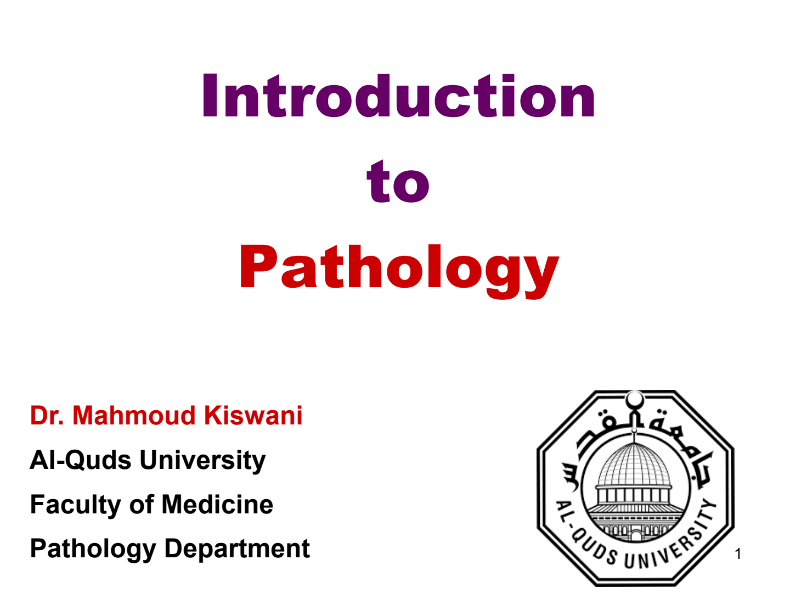

## PDF page 2 — Pathology: definition

> Source: ch1-part-01, PDF page 2. Printed slide: not reliably labelled. Classification: teaching.

### Preserved source text

Definition of Pathology
• Path   + ology    : The study (logos) of suffering
  (pathos)
• The scientific study of disease          including the
  patterns, causes, mechanisms and effects of
  disease
• That branch of medicine treating the essential
  nature of disease, especially of the changes
  in the body tissue and organs, which cause or
  are caused by disease
                                                          2
                        (24th edition of Dorland’s medical dictionary)

### Visual transcription / figure record

Full page visually inspected; extracted text and visible layout compared. Illustrative image retained in original full-page render.

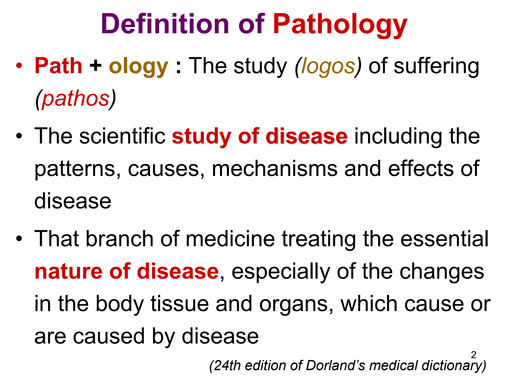

## PDF page 3 — Pathology bridges basic and clinical science

> Source: ch1-part-01, PDF page 3. Printed slide: 3. Classification: teaching.

### Preserved source text

Definition of Pathology

It is  a  bridging   discipline  involving   both   basic
science   and  clinical practice   and  isdevoted   to the
study  of the  structural   and  functional   changes    in
cells, tissues,   and   organs    that underlie  disease.
By    the    use    of    molecular,     microbiologic,
immunologic,       and     morphologic       techniques,
pathology    attempts    to   explain   the   whys    and
wherefores   of the signs   and  symptoms     manifested
by  patients  while  providing  a  sound   foundation   for
rational clinicalcare  and  therapy.                    3

### Visual transcription / figure record

Full page visually inspected; extracted text and visible layout compared. Illustrative image retained in original full-page render.

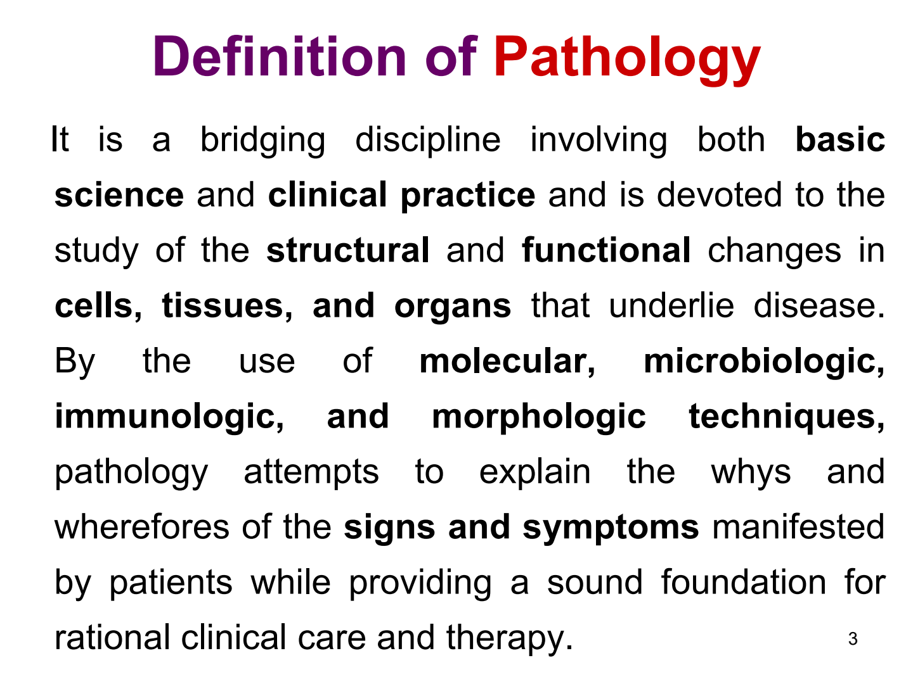

## PDF page 4 — Disease: definition

> Source: ch1-part-01, PDF page 4. Printed slide: 4. Classification: teaching.

### Preserved source text

Definition of Disease

•An abnormality of the body         that
 causes loss of normal health

•Expression of discomfort due to
 structural   or functional    abnormality

### Visual transcription / figure record

Full page visually inspected; extracted text and visible layout compared. Illustrative image retained in original full-page render.

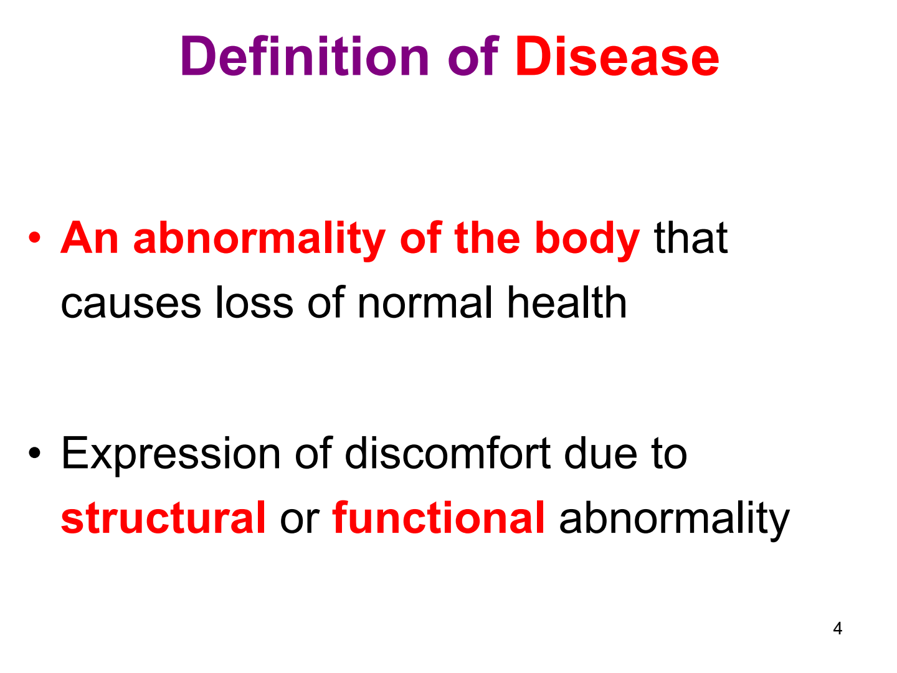

## PDF page 5 — Disease classifications

> Source: ch1-part-01, PDF page 5. Printed slide: 5. Classification: teaching.

### Preserved source text

Classification of Diseases
• Physical / Mental
• Acute / Chronic
  – Acute   – short, days to weeks.
  – Chronic   – long, months to years.
• Congenital / Acquired
• Genetic / Environmental
• Mild / Moderate / Severe
• Inflammatory / Neoplastic / Degenerative         5

### Visual transcription / figure record

Full page visually inspected; extracted text and visible layout compared. Illustrative image retained in original full-page render.

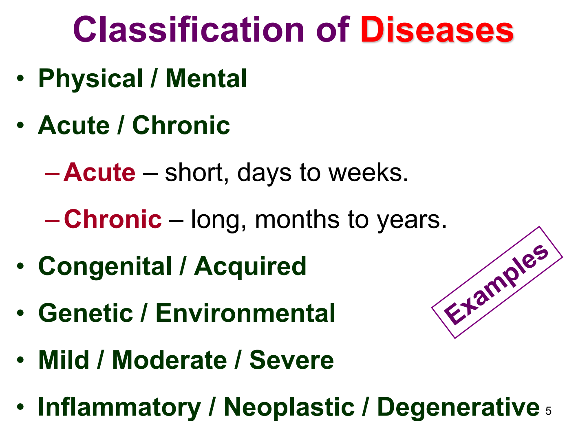

## PDF page 6 — Aspects of disease

> Source: ch1-part-01, PDF page 6. Printed slide: not reliably labelled. Classification: teaching.

### Preserved source text

Aspects of Disease             Process
• Epidemiology
• Etiology
• Pathogenesis
• Morphologic changes
• Clinical significance
• Diagnosis
• Management
• Complications
• Prognosis
                                                    6
• Prevention

### Visual transcription / figure record

Full page visually inspected; extracted text and visible layout compared. Illustrative image retained in original full-page render.

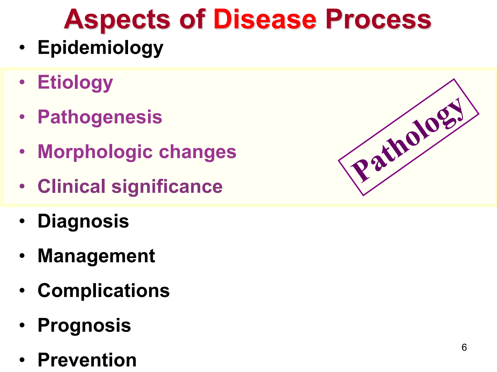

## PDF page 7 — Etiology overview

> Source: ch1-part-01, PDF page 7. Printed slide: 7. Classification: teaching.

### Preserved source text

Aspects of Disease           Process

• Etiology

• Pathogenesis
• Morphologic changes
• Clinical significance

### Visual transcription / figure record

Full page visually inspected; extracted text and visible layout compared. Illustrative image retained in original full-page render.

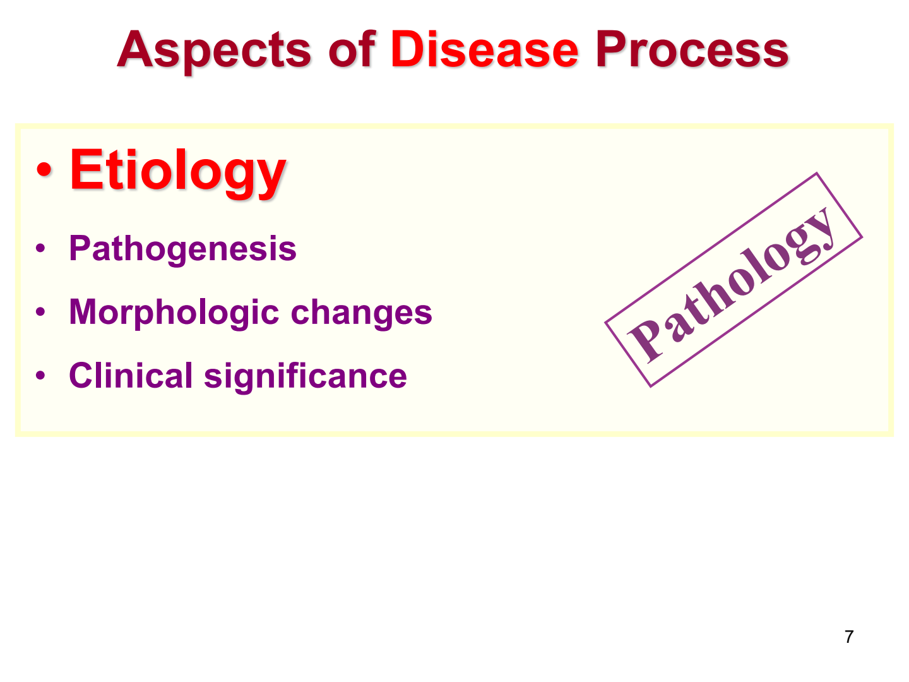

## PDF page 8 — Etiology categories

> Source: ch1-part-01, PDF page 8. Printed slide: 8. Classification: teaching.

### Preserved source text

Etiology: What is the cause?
• Environmental or Acquired Factors:
       • Physical
       • Chemical
       • Nutritional
       • Infections
       • Immunological
       • Psychological
• Genetic or Intrinsic Factors:
• Multi-factorial:
       • Diabetes
       • Hypertension
       • Cancer

### Visual transcription / figure record

Full page visually inspected; extracted text and visible layout compared. Illustrative image retained in original full-page render.

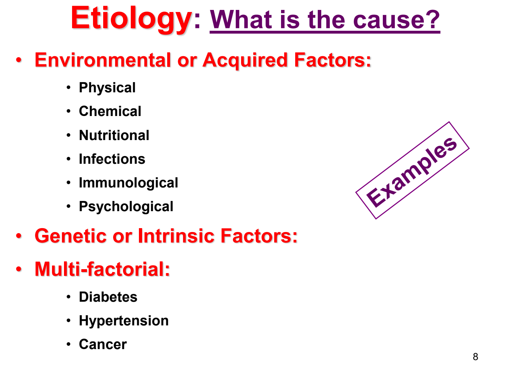

## PDF page 9 — Pathogenesis overview

> Source: ch1-part-01, PDF page 9. Printed slide: 9. Classification: teaching.

### Preserved source text

Aspects of Disease          Process

•Etiology
•Pathogenesis

•Morphologic changes
•Clinical significance

### Visual transcription / figure record

Full page visually inspected; extracted text and visible layout compared. Illustrative image retained in original full-page render.

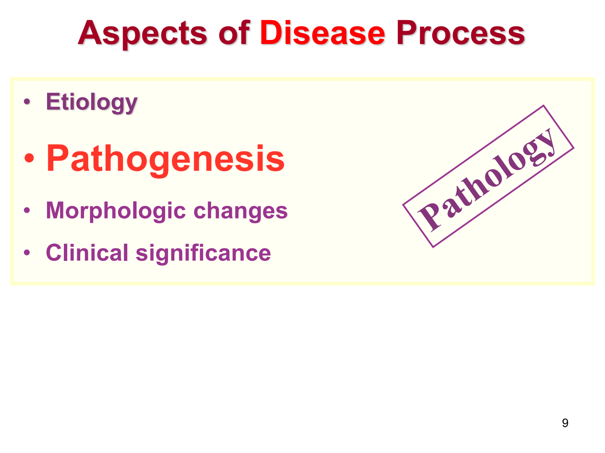

## PDF page 10 — Pathogenesis definition

> Source: ch1-part-01, PDF page 10. Printed slide: 10. Classification: teaching.

### Preserved source text

Pathogenesis:           Definition
•  How  does  disease  develop?
•  The  mechanisms     of disease   development
•  Sequence   of events  in the response   ofcells &
   tissues to a stimulus/pathogen    starting  from
   the   initial   stimulus    to    the   ultimate
   expression   of disease.

### Visual transcription / figure record

Full page visually inspected; extracted text and visible layout compared. Illustrative image retained in original full-page render.

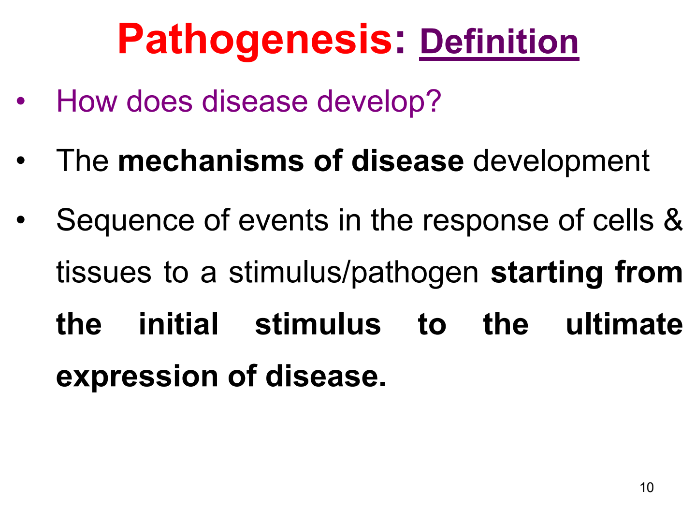

## PDF page 11 — Morphologic changes overview

> Source: ch1-part-01, PDF page 11. Printed slide: 11. Classification: teaching.

### Preserved source text

Aspects of Disease         Process

•Etiology
•Pathogenesis
•Morphologic changes

•Clinical significance

### Visual transcription / figure record

Full page visually inspected; extracted text and visible layout compared. Illustrative image retained in original full-page render.

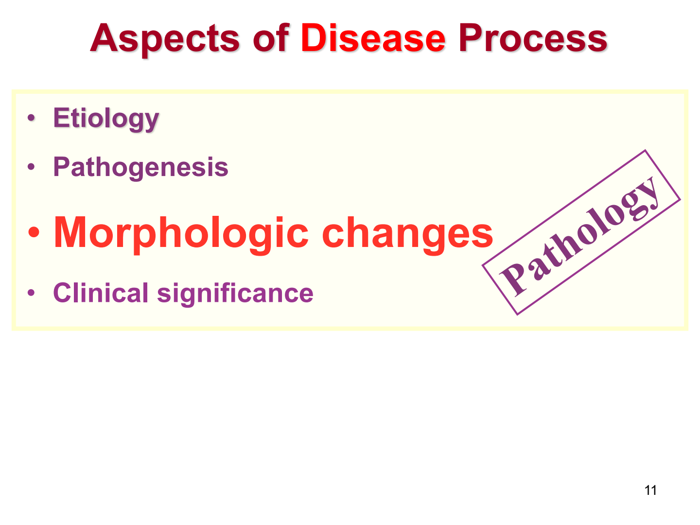

## PDF page 12 — Morphologic changes

> Source: ch1-part-01, PDF page 12. Printed slide: 12. Classification: teaching.

### Preserved source text

Morphologic changes
- Morphologic       changes      are   the   structural
  alterations induced  by  the disease in the cells and
  organs  ofthe body
- They   include:
   gross  changes           microscopic   changes

                   Alcoholic Cirrhosis.              12

### Visual transcription / figure record

Full page visually inspected; extracted text and visible layout compared. Illustrative image retained in original full-page render.

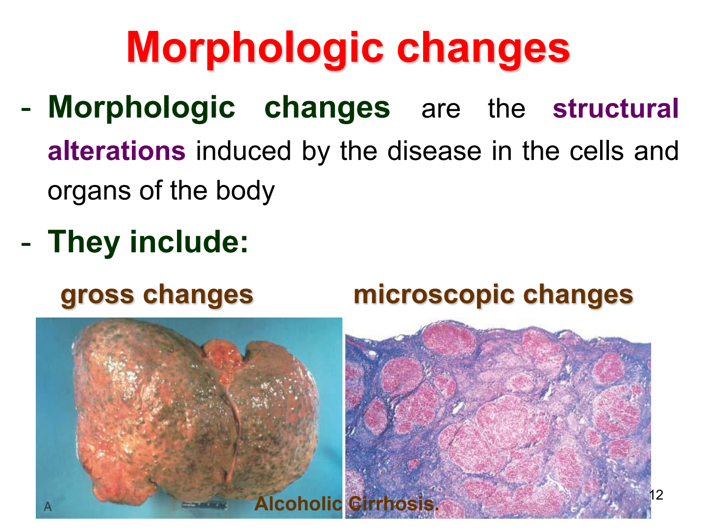

## PDF page 13 — Unlabelled morphology illustrations

> Source: ch1-part-01, PDF page 13. Printed slide: 13. Classification: teaching.

### Preserved source text

13

### Visual transcription / figure record

Unlabelled histologic image beside an unlabelled gross surgical specimen; no diagnosis is supplied. Preserve the images without inventing an identification.

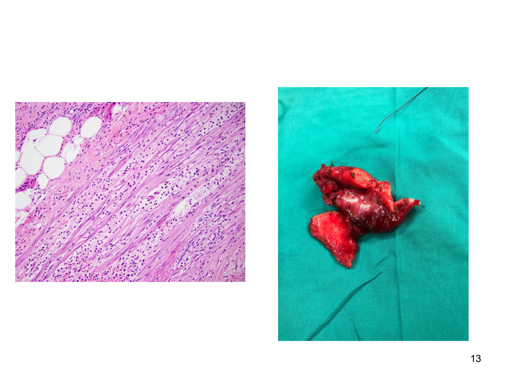

## PDF page 14 — Clinical significance overview

> Source: ch1-part-01, PDF page 14. Printed slide: 14. Classification: teaching.

### Preserved source text

Aspects of Disease         Process

•Etiology
•Pathogenesis
•Morphologic changes
•Clinical significance

### Visual transcription / figure record

Full page visually inspected; extracted text and visible layout compared. Illustrative image retained in original full-page render.

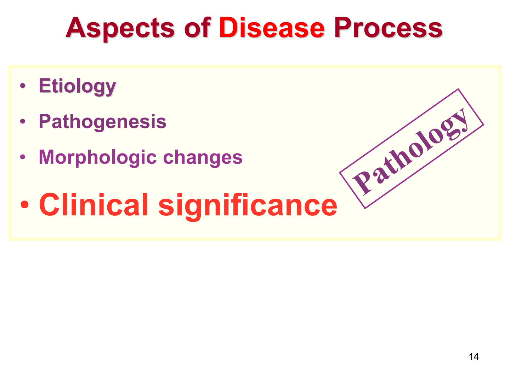

## PDF page 15 — Clinical features

> Source: ch1-part-01, PDF page 15. Printed slide: 15. Classification: teaching.

### Preserved source text

Clinical significance

- ClinicalManifestations   =Clinical features
- The functional  consequences    ofthe morphologic changes

- Clinicalfeatures  include:
     Symptoms                              Signs

                      Examples

### Visual transcription / figure record

Full page visually inspected; extracted text and visible layout compared. Illustrative image retained in original full-page render.

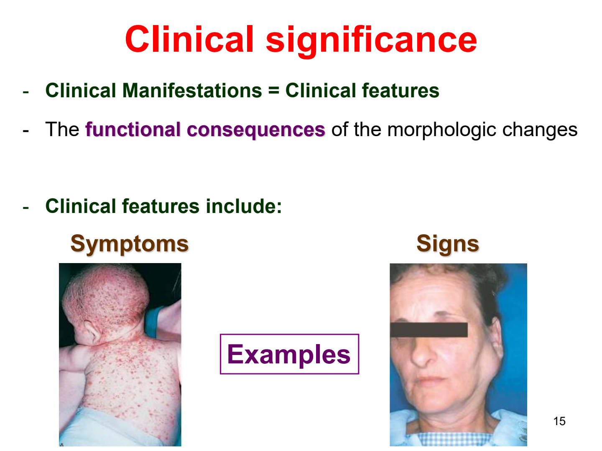

## PDF page 16 — Diagnosis

> Source: ch1-part-01, PDF page 16. Printed slide: 16. Classification: teaching.

### Preserved source text

Diagnosis

•  Based on the symptoms & Signs and the
   results of Pathology tests

•  Needs knowledge of different diseases, their
   characteristics

•  Important for patient management &
   prognosis

### Visual transcription / figure record

Full page visually inspected; extracted text and visible layout compared. Illustrative image retained in original full-page render.

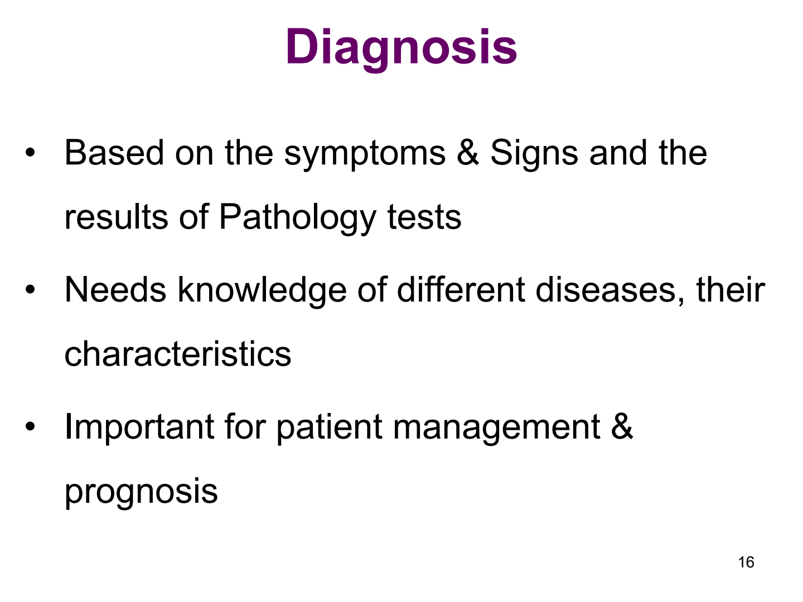

## PDF page 17 — Diagnostic levels

> Source: ch1-part-01, PDF page 17. Printed slide: 17. Classification: teaching.

### Preserved source text

Diagnosis:         Levels of study

• Gross pathology
  – Patient or autopsy
• Macroscopic
  – Surgical specimen
• Tissues
  – Microscopic sections
• Special investigations
  – Immunohistochemistry, tumor markers
• Genome                                          17

### Visual transcription / figure record

Full page visually inspected; extracted text and visible layout compared. Illustrative image retained in original full-page render.

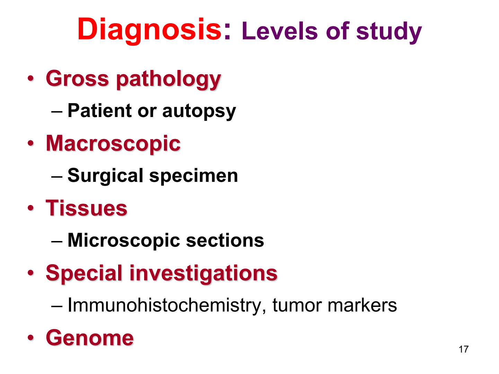

## PDF page 18 — Pathology divisions

> Source: ch1-part-01, PDF page 18. Printed slide: 18. Classification: teaching.

### Preserved source text

Divisions of Pathology

1)General   pathology

2)Systemic    pathology

### Visual transcription / figure record

Full page visually inspected; extracted text and visible layout compared. Illustrative image retained in original full-page render.

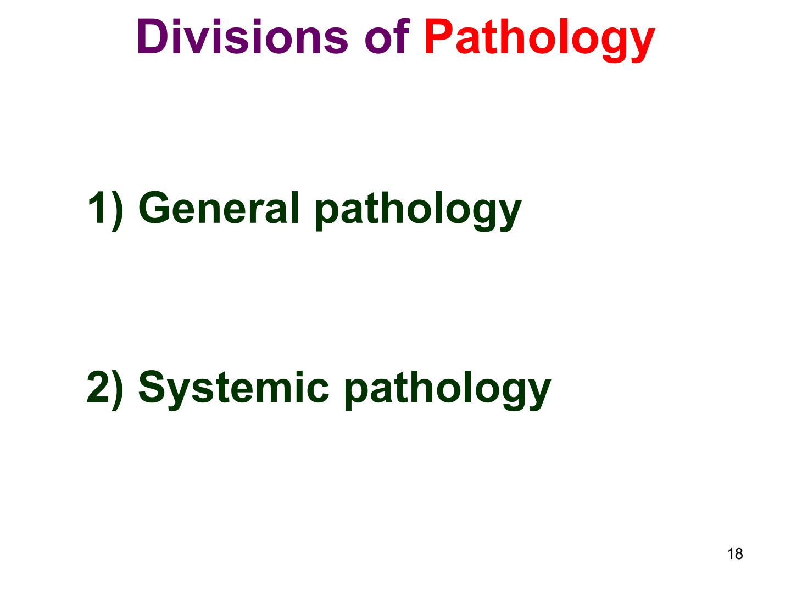

## PDF page 19 — General pathology

> Source: ch1-part-01, PDF page 19. Printed slide: 19. Classification: teaching.

### Preserved source text

Divisions of Pathology
1) General   pathology:

• The   basic  reactions    of cells  and   tissues   to
  abnormal     stimuli  that underlie  all diseases

• Involved   the  mechanisms      and  characteristics
  of the  principle types  of disease   processes

• Examples:      cell injury, adaptation,  inflammation,
  repair, hemostasis,  neoplasia

### Visual transcription / figure record

Full page visually inspected; extracted text and visible layout compared. Illustrative image retained in original full-page render.

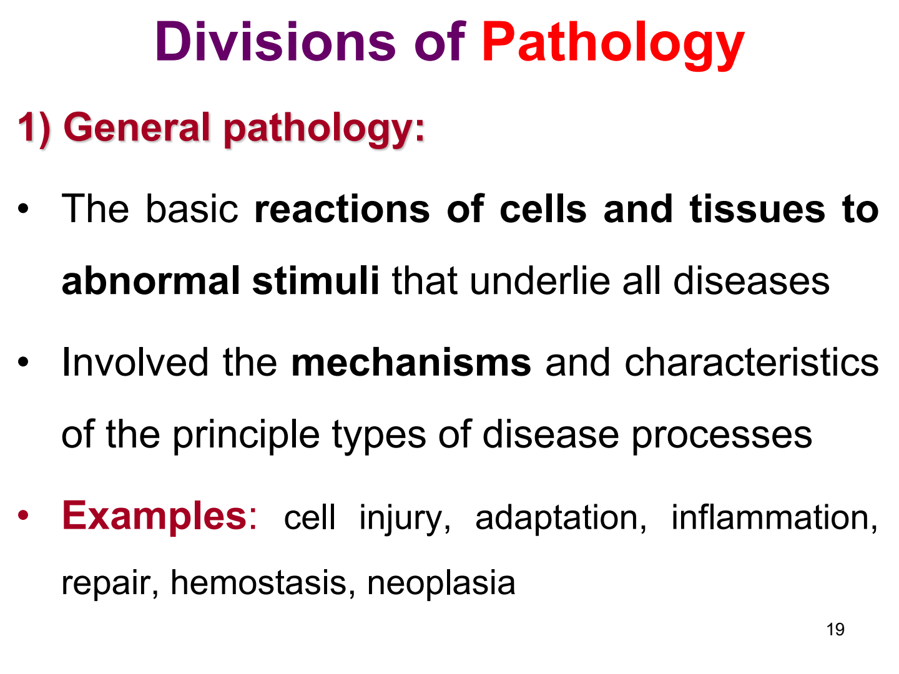

## PDF page 20 — Systemic pathology

> Source: ch1-part-01, PDF page 20. Printed slide: 20. Classification: teaching.

### Preserved source text

Divisions of Pathology

2) Systemic    pathology:

• descriptions   of specific diseases   as  they affect
  individual  organs   or organ   systems

• Examples:     cardiovascular pathology, renal
  pathology, dermatopathology, endocrine
  pathology,  gastrointestinal pathology

### Visual transcription / figure record

Full page visually inspected; extracted text and visible layout compared. Illustrative image retained in original full-page render.

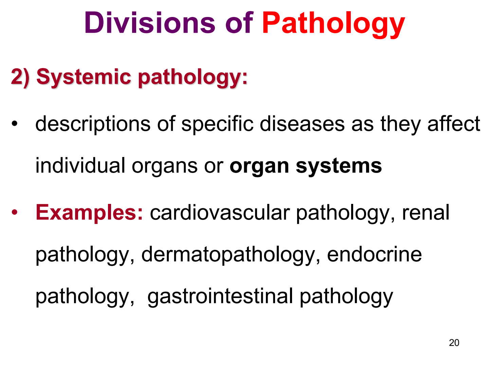

## PDF page 21 — Pathology subdivisions

> Source: ch1-part-01, PDF page 21. Printed slide: 21. Classification: teaching.

### Preserved source text

Subdivisions of Pathology

1. Histopathology

2. Cytopathology

3. Hematology

4. Forensic pathology

5. Chemical pathology

6. Microbiology

7. Immunology                            21

### Visual transcription / figure record

Full page visually inspected; extracted text and visible layout compared. Illustrative image retained in original full-page render.

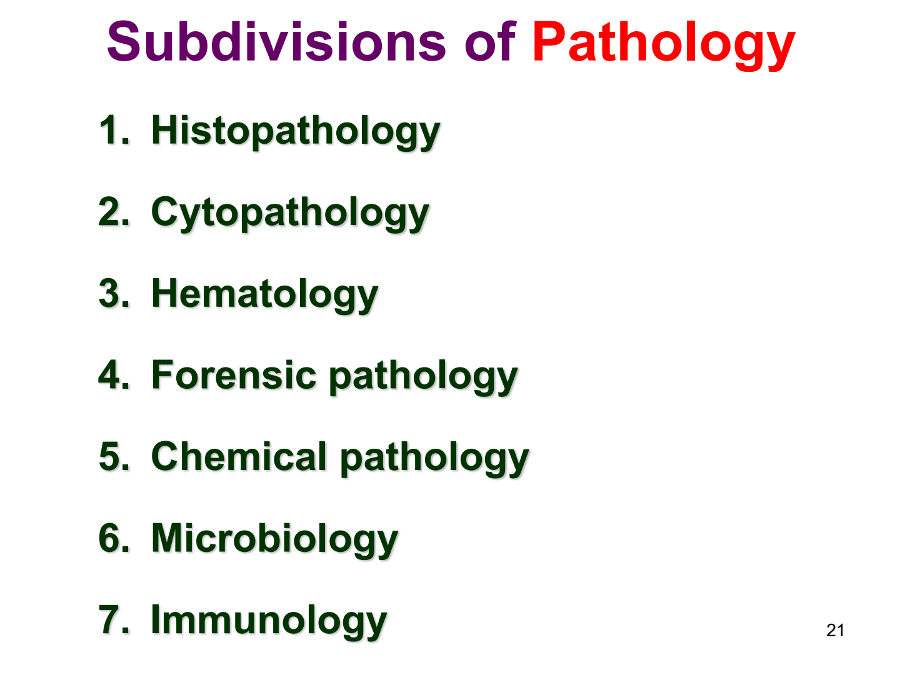

## PDF page 22 — Histopathology

> Source: ch1-part-01, PDF page 22. Printed slide: 22. Classification: teaching.

### Preserved source text

Subdivisions of Pathology (1)
• Histopathology:

  Investigation and diagnosis of disease from the
  examination of tissues.
(e.g., Surgical specimen, Microscopic sections)

### Visual transcription / figure record

Full page visually inspected; extracted text and visible layout compared. Illustrative image retained in original full-page render.

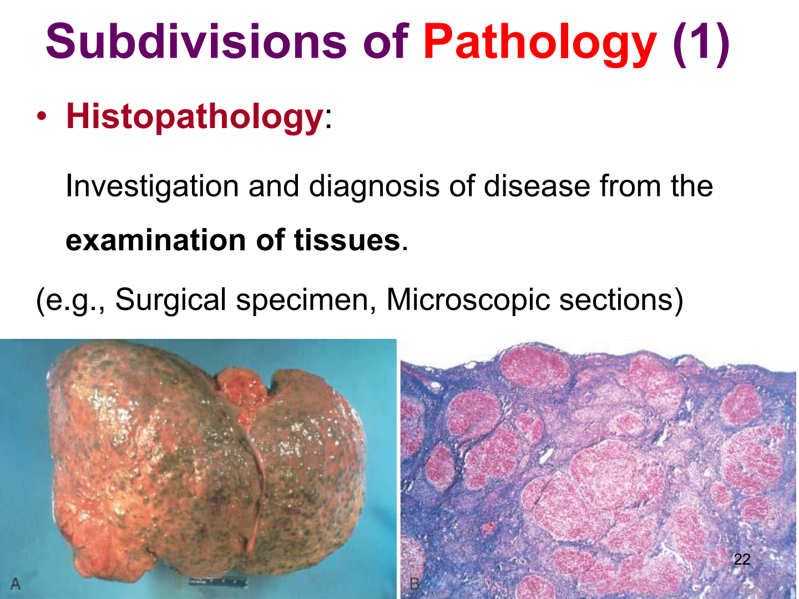

## PDF page 23 — Cytopathology

> Source: ch1-part-01, PDF page 23. Printed slide: 23. Classification: teaching.

### Preserved source text

Subdivisions of Pathology (2)

• Cytopathology:

  Investigation and diagnosis of disease from the
  examination of isolated cells.

(e.g., Pap smears, FNA -Fine Needle Aspiration).

### Visual transcription / figure record

Full page visually inspected; extracted text and visible layout compared. Illustrative image retained in original full-page render.

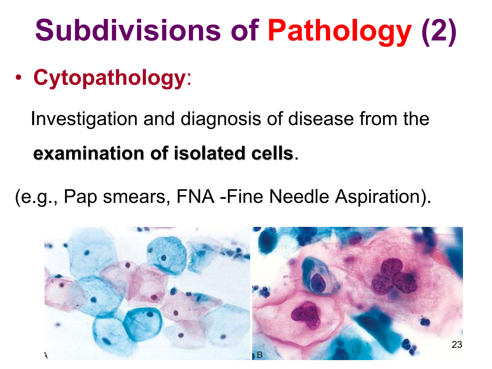

## PDF page 24 — Tissue and cell illustrations

> Source: ch1-part-01, PDF page 24. Printed slide: 24. Classification: teaching.

### Preserved source text

24

### Visual transcription / figure record

Comparison shows a skin tissue section above isolated squamous cells. No additional diagnostic label is supplied.

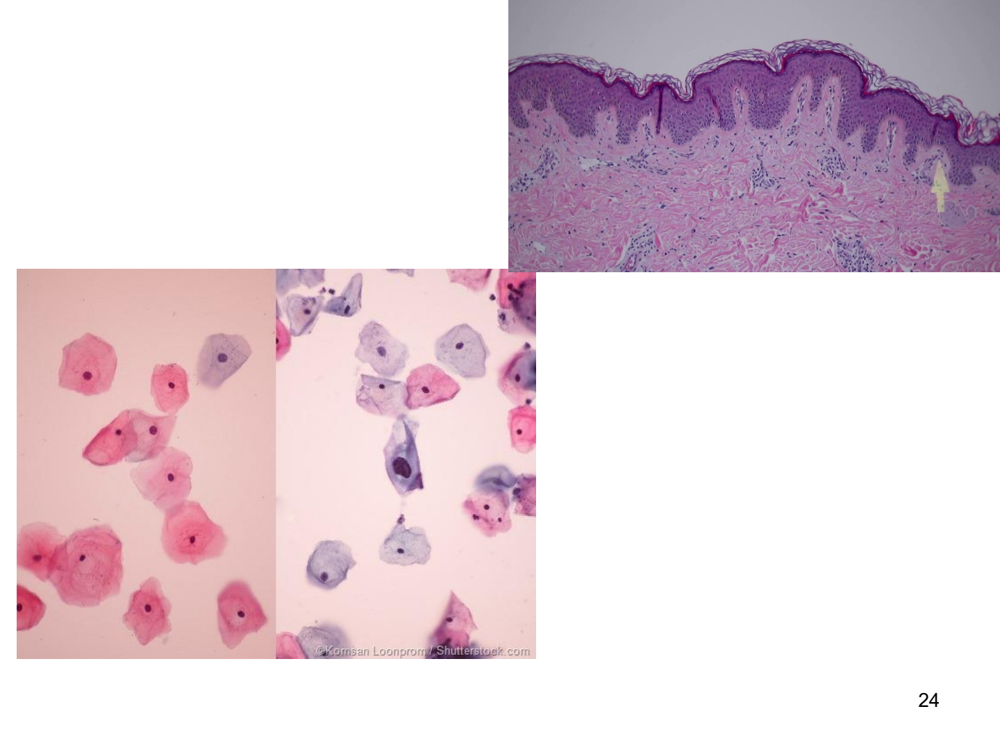

## PDF page 25 — Hematology

> Source: ch1-part-01, PDF page 25. Printed slide: 25. Classification: teaching.

### Preserved source text

Subdivisions of Pathology (3)

• Hematology:
  Study   of   disorders   of  the   cellular   and
  coagulable   components    ofthe  blood.
  (e.g. Peripheral  blood   smear,  bone   marrow,
  coagulation  disorders)

### Visual transcription / figure record

Full page visually inspected; extracted text and visible layout compared. Illustrative image retained in original full-page render.

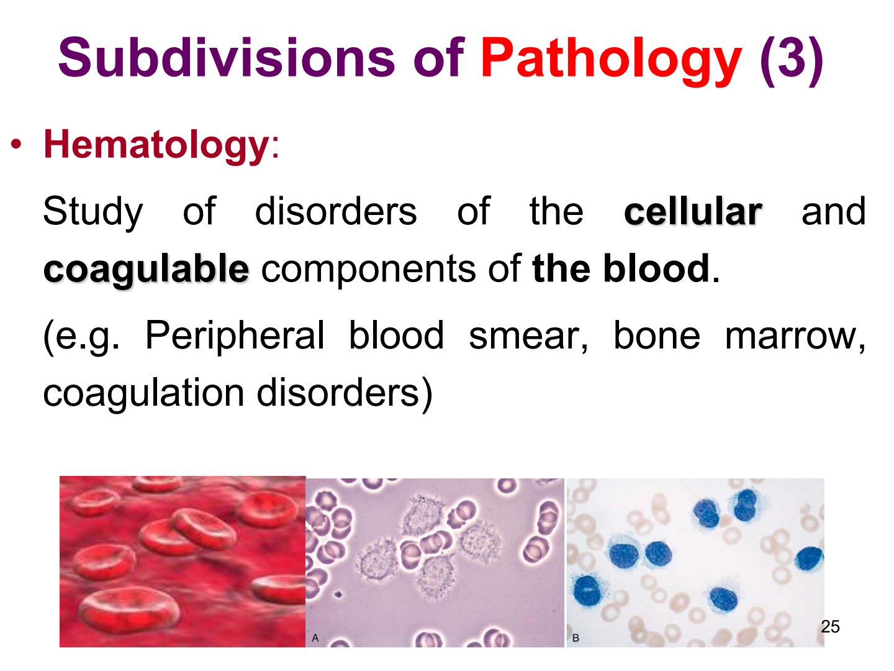

## PDF page 26 — Forensic pathology

> Source: ch1-part-01, PDF page 26. Printed slide: 26. Classification: teaching.

### Preserved source text

•Subdivisions of Forensic pathology:Pathology (4)

  Application of pathology to legal purposes
  e.g. investigation of death in suspicious
  circumstances (e.g. autopsy)

### Visual transcription / figure record

Full page visually inspected; extracted text and visible layout compared. Illustrative image retained in original full-page render.

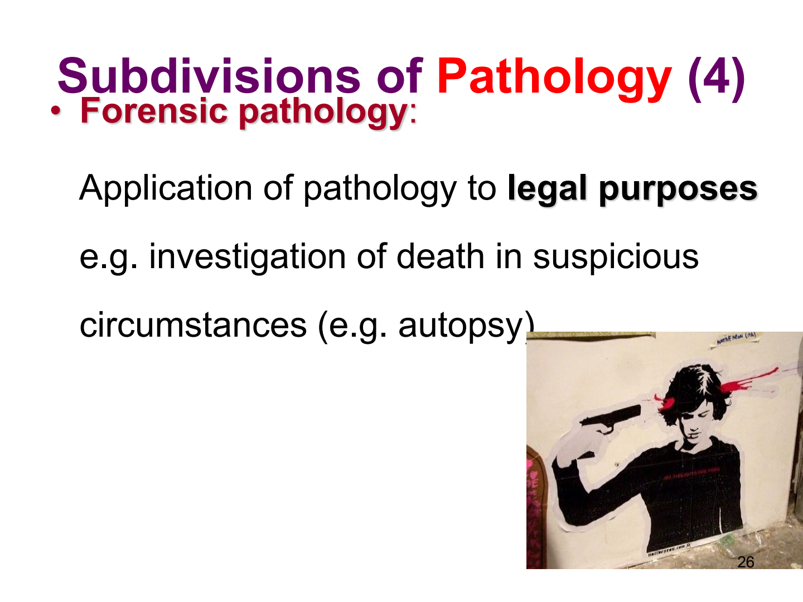

## PDF page 27 — Chemical pathology

> Source: ch1-part-01, PDF page 27. Printed slide: 27. Classification: teaching.

### Preserved source text

Subdivisions of Pathology (5)

• Chemical pathology:

  Investigation of biochemical disorders(e.g. blood,

  urine, cerebrospinal fluid, effusions)

### Visual transcription / figure record

Embedded image labels cytosolic hepatocellular enzymes: serum aspartate aminotransferase (AST), alanine aminotransferase (ALT), lactate dehydrogenase (LDH).

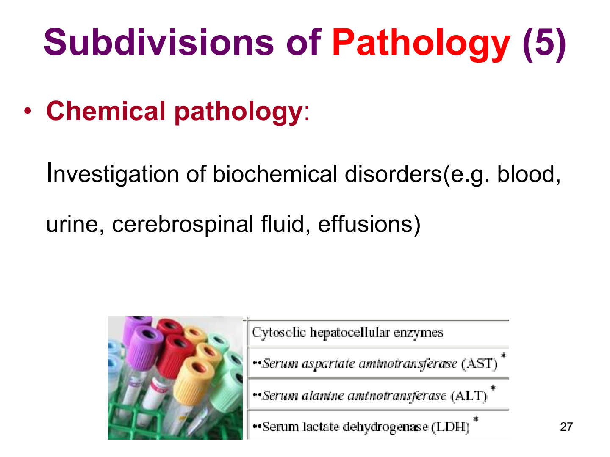

## PDF page 28 — Immunology

> Source: ch1-part-01, PDF page 28. Printed slide: 28. Classification: teaching.

### Preserved source text

Subdivisions of Pathology (6)
• Immunology:
  Study of specific defence mechanisms         of the
  body and the diseases that arise from them
  (e.g, AIDS, allergic disorders)

### Visual transcription / figure record

Illustrations include pollen exposure, an immune-response schematic (bacterium, macrophage, antigen, MHC marker, antigen-MHC complex, virgin B cell, membrane-bound antibody, receptor, helper T cell, activated B cell, memory B cell, plasma cell secreting antibodies) and inhaler use.

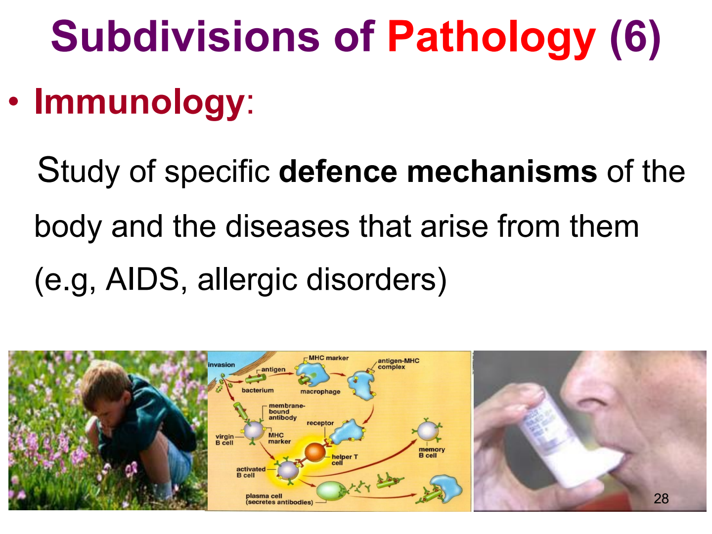

## PDF page 29 — Microbiology

> Source: ch1-part-01, PDF page 29. Printed slide: 29. Classification: teaching.

### Preserved source text

Subdivisions of Pathology (7)

• Microbiology:
Study of infectious diseases
(e.g, Malaria, influenza)

### Visual transcription / figure record

Full page visually inspected; extracted text and visible layout compared. Illustrative image retained in original full-page render.

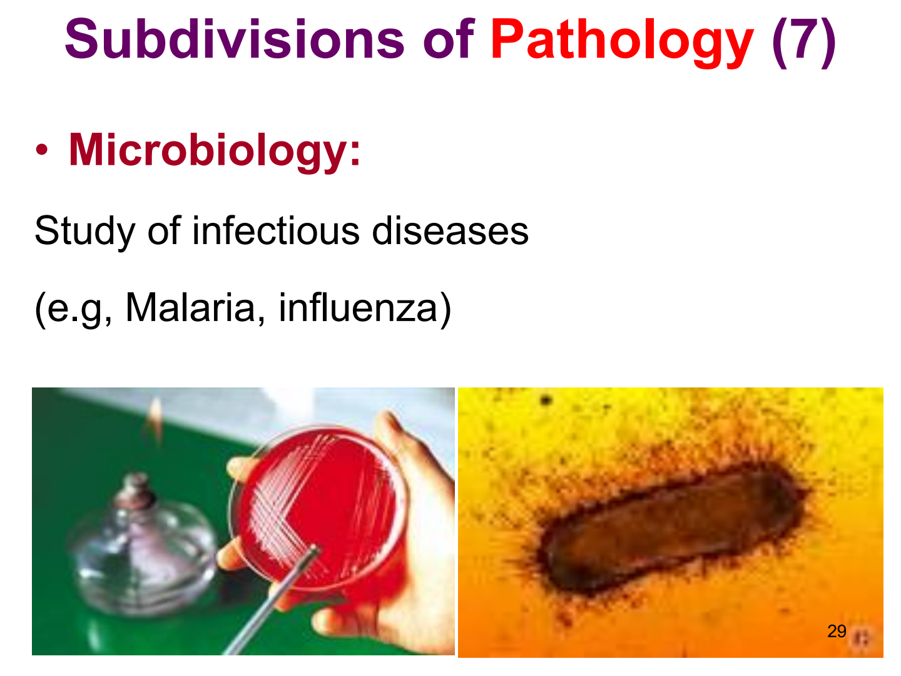

## PDF page 30 — Prefixes

> Source: ch1-part-01, PDF page 30. Printed slide: 30. Classification: teaching.

### Preserved source text

Nomenclature (1)

Prefix   Meaning                          Example

Ana-     Absence                          Anaphylaxis

Dys-     Disordered                       Dysplasia

Hyper-   Excess over normal               Hyperthyroidism

Hypo-    Deficiency below normal          Hypothyroidism

Meta-    Change from one state to         Metaplasia
         another

### Visual transcription / figure record

Full page visually inspected; extracted text and visible layout compared. Illustrative image retained in original full-page render.

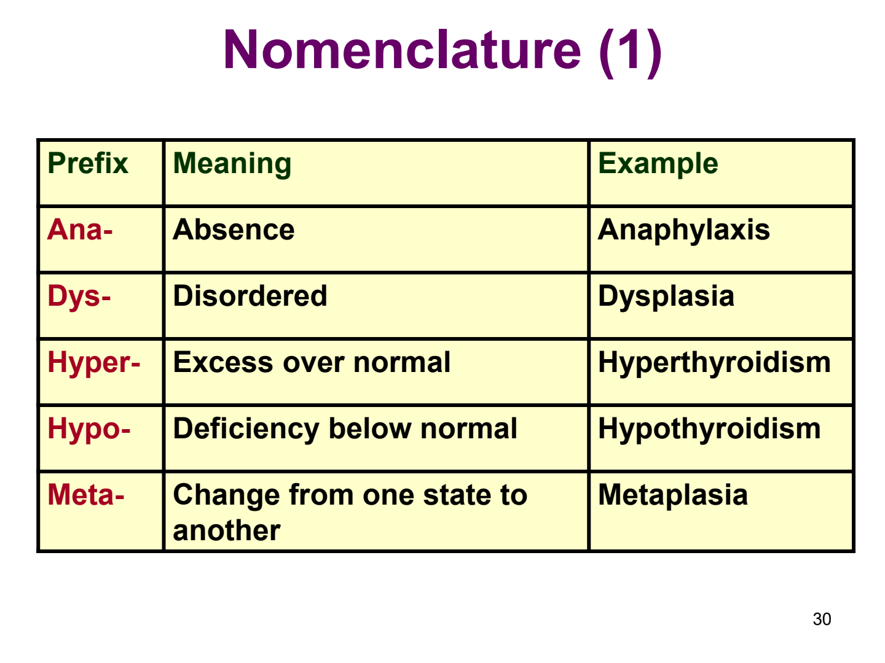

> **Source note:** Prefix table gives Ana- as absence with Anaphylaxis example. Example/meaning pairing is doubtful; preserve without correction, exclude this table from scoring.

## PDF page 31 — Suffixes

> Source: ch1-part-01, PDF page 31. Printed slide: 31. Classification: teaching.

### Preserved source text

Nomenclature (2)

Suffix     Meaning                         Example
-itis      Inflammatory process            Appendicitis
-emia      Vascular                        Ischemia
-oma       Tumour                          Carcinoma
-osis      State or condition              Osteoarthrosis
-oid       Bearing a resemblance to        Rheumatoid disease
-penia     Lack of                         Thrombocytopenia
-cytosis   Increased number of cells       Leukocytosis
-ectasis   Dilation                        Bronchiectasis
-plasia    Disorder of growth              Hyperplasia

### Visual transcription / figure record

Full page visually inspected; extracted text and visible layout compared. Illustrative image retained in original full-page render.

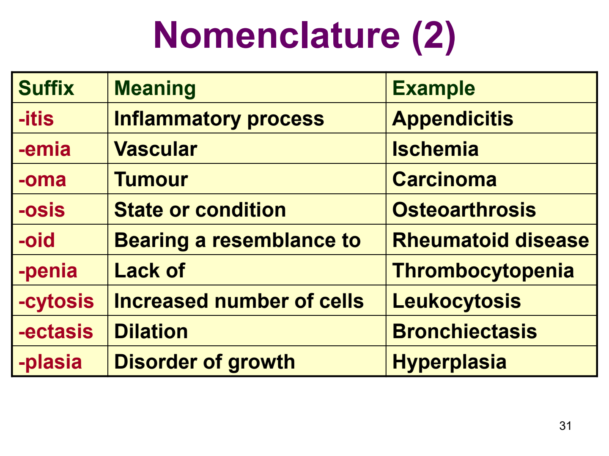

> **Source note:** Suffix table gives -emia as vascular with ischemia example, and -plasia as disorder of growth. Terminology is insufficiently precise for scored distinctions; preserved, table excluded from scoring.

## PDF page 32 — Closing quotation

> Source: ch1-part-01, PDF page 32. Printed slide: 32. Classification: administrative.

### Preserved source text

32

### Visual transcription / figure record

Closing quotation: YOUR LIFE RIGHT NOW IS A RESULT OF WHAT YOU DID A YEAR AGO. YOUR LIFE A YEAR FROM NOW WILL BE A RESULT OF WHAT YOU DO RIGHT NOW. ACT ACCORDINGLY!

