# Chapter 1 — Part 2: Cover

Authority: unchanged supplied PDF only. Page headings use one-based PDF pages; printed labels are recorded only when visibly present. Original extracted text is preserved below, with separately identified visual transcription. No outside teaching content.

## PDF page 1 — Cover

> Source: ch1-part-02, PDF page 1. Printed slide: 1. Classification: cover.

### Preserved source text

Causes &
Targets of
Cell   Injury

Dr. Mahmoud Kiswani
Al-Quds University
Faculty of Medicine
Pathology Department                                    1

### Visual transcription / figure record

Full page visually inspected; extracted text and visible layout compared. Illustrative image retained in original full-page render.

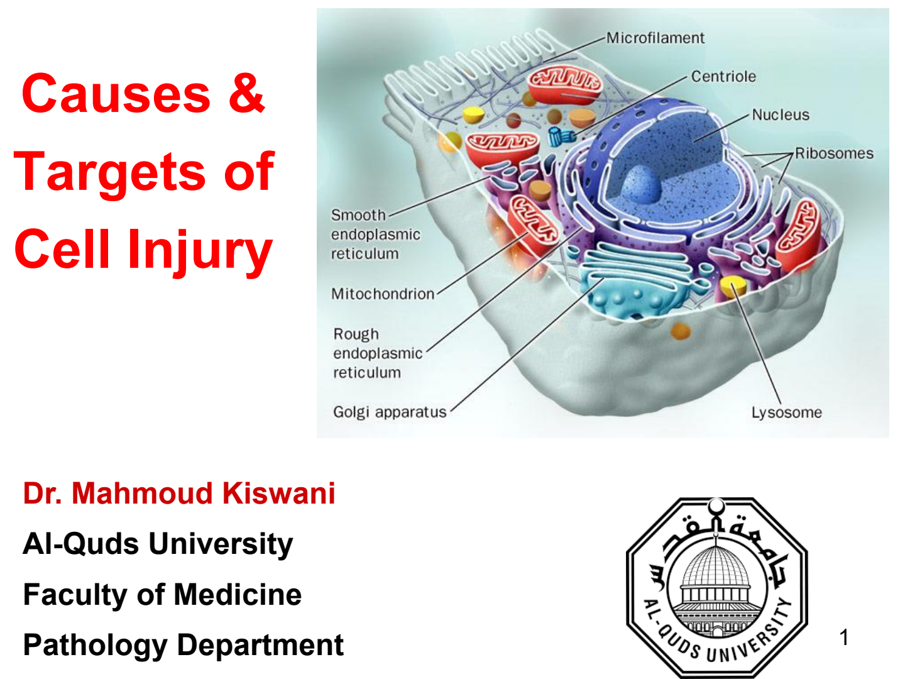

## PDF page 2 — Stress responses

> Source: ch1-part-02, PDF page 2. Printed slide: not reliably labelled. Classification: teaching.

### Preserved source text

(Homeostasis)

                                               stress
If the stress is
removed

                           Injury                                                                Adaptation

                       Reversible                        Irreversible
                                                         (cell death)

                                                         *If the stress
                                                         was severe or
                                                         progressive

### Visual transcription / figure record

Homeostatic cell under stress may adapt or undergo injury. Injury is reversible or irreversible (cell death); severe or progressive stress leads to irreversible injury. Removal of stress allows return from reversible injury.

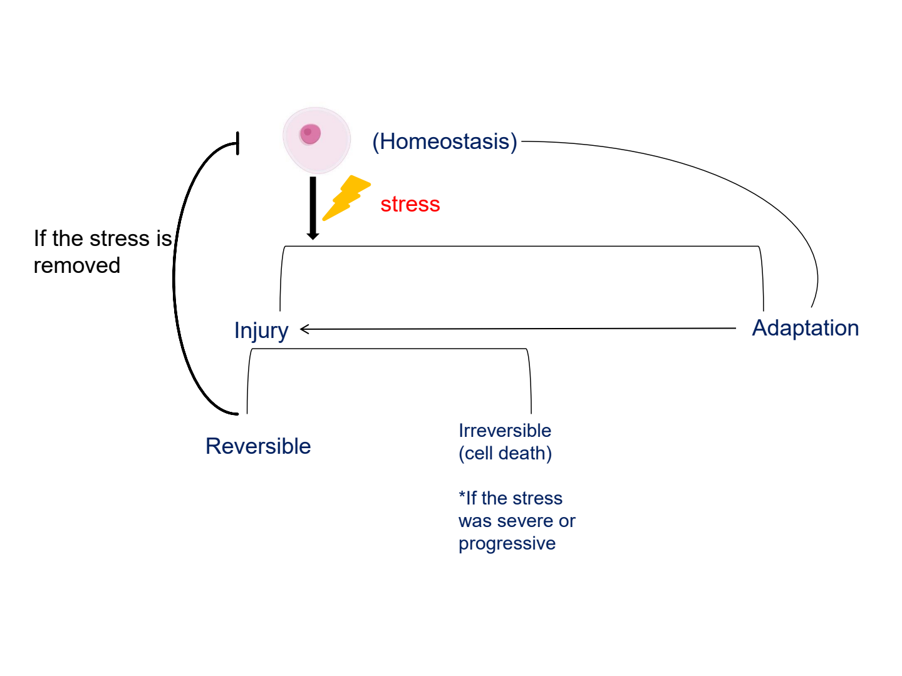

## PDF page 3 — Stages of cell injury

> Source: ch1-part-02, PDF page 3. Printed slide: 3. Classification: teaching.

### Preserved source text

3

### Visual transcription / figure record

Normal cell/homeostasis -> stress -> adaptation. Inability to adapt -> injury. Mild transient injury -> reversible injury -> normal cell. Severe progressive injury -> irreversible injury -> necrosis or apoptosis (cell death).

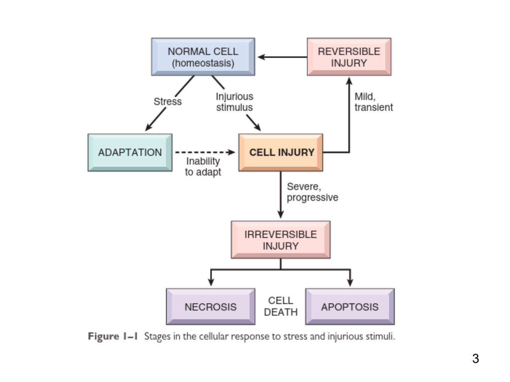

## PDF page 4 — Adaptive responses diagram

> Source: ch1-part-02, PDF page 4. Printed slide: 4. Classification: teaching.

### Preserved source text

4

### Visual transcription / figure record

Normal cells: reversible changes in size/number -> hyperplasia, hypertrophy, atrophy; reversible changes in structure/type -> dysplasia or metaplasia. Severe stress/inability to adapt -> irreversible injury, necrosis or apoptosis. Persistent chronic irritant is connected to neoplasia, labelled generally irreversible.

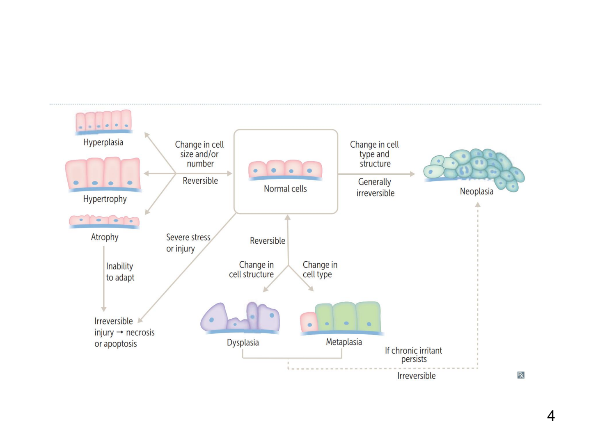

## PDF page 5 — Reversible and irreversible morphology

> Source: ch1-part-02, PDF page 5. Printed slide: 5. Classification: teaching.

### Preserved source text

5

### Visual transcription / figure record

Reversible injury: cellular/mitochondrial swelling, ribosomal detachment, membrane blebbing, nuclear chromatin clumping. Irreversible injury: plasma membrane damage, lysosome rupture/autolysis, nuclear degradation, increased mitochondrial permeability -> necrosis.

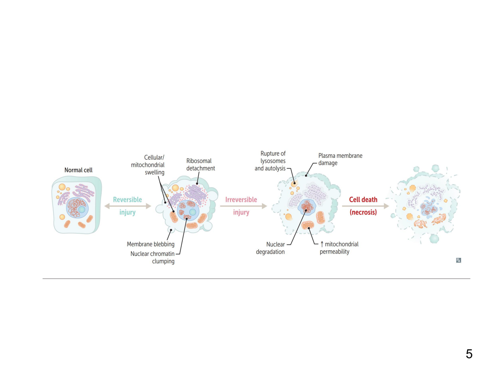

## PDF page 6 — Causes of cell injury

> Source: ch1-part-02, PDF page 6. Printed slide: 6. Classification: teaching.

### Preserved source text

Cell injury: What are the causes?

  1.Physical
  2.Chemical
  3.Infectious
  4.Immunological
  5.Nutritional
  6.Genetic
  7.Oxygen Deprivation
  8.Aging                                     6

### Visual transcription / figure record

Full page visually inspected; extracted text and visible layout compared. Illustrative image retained in original full-page render.

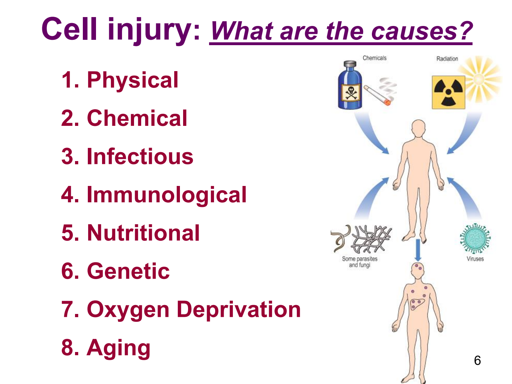

## PDF page 7 — Physical agents

> Source: ch1-part-02, PDF page 7. Printed slide: 7. Classification: teaching.

### Preserved source text

1.   Physical agents

Mechanical trauma                   Thermal: heat or cold

 Electrical shock                       Radiation       7

### Visual transcription / figure record

Full page visually inspected; extracted text and visible layout compared. Illustrative image retained in original full-page render.

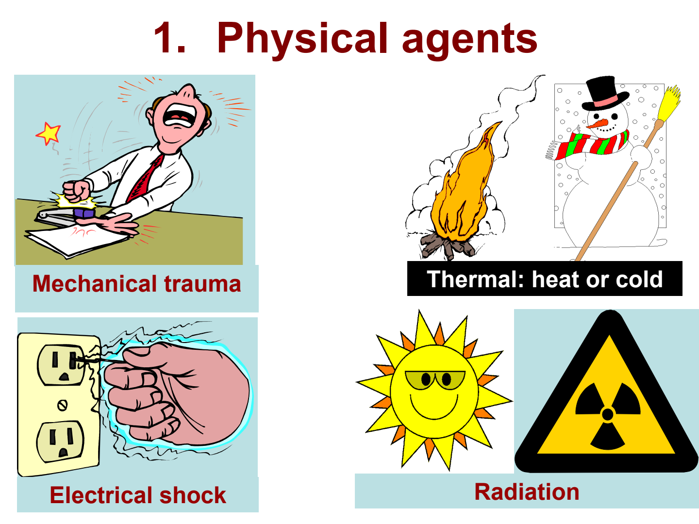

## PDF page 8 — Chemical agents

> Source: ch1-part-02, PDF page 8. Printed slide: 8. Classification: teaching.

### Preserved source text

2.  Chemical agents

      Drugs & Poisons

### Visual transcription / figure record

Full page visually inspected; extracted text and visible layout compared. Illustrative image retained in original full-page render.

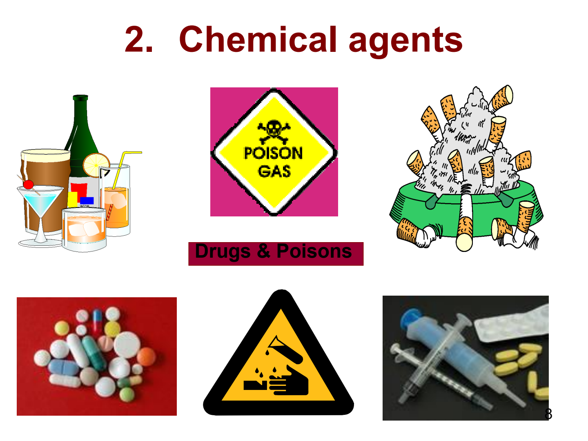

## PDF page 9 — Infectious agents

> Source: ch1-part-02, PDF page 9. Printed slide: 9. Classification: teaching.

### Preserved source text

3.    Infectious       agents

Viruses, bacteria, fungi, parasites, tapeworms

### Visual transcription / figure record

Full page visually inspected; extracted text and visible layout compared. Illustrative image retained in original full-page render.

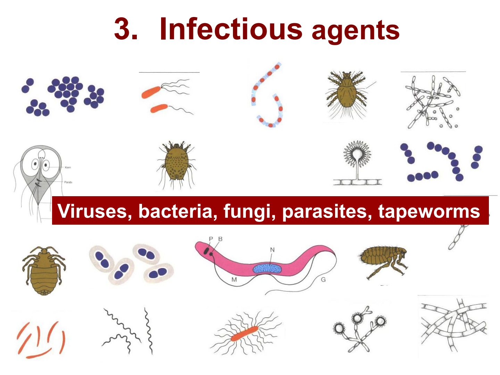

## PDF page 10 — Immune reactions

> Source: ch1-part-02, PDF page 10. Printed slide: 10. Classification: teaching.

### Preserved source text

4.    Immunological reactions
           Antigen –     antibody reactions

              ➢  Major role in defence against
                 infectious pathogens

               If overridden or improperly operating it
                  will result in diseases:
               1. Anaphylactic reaction:
               •   reaction to a foreign protein or a drug
               2.  Autoimmune diseases:
               •   reactions to endogenous self-antigens10

### Visual transcription / figure record

Full page visually inspected; extracted text and visible layout compared. Illustrative image retained in original full-page render.

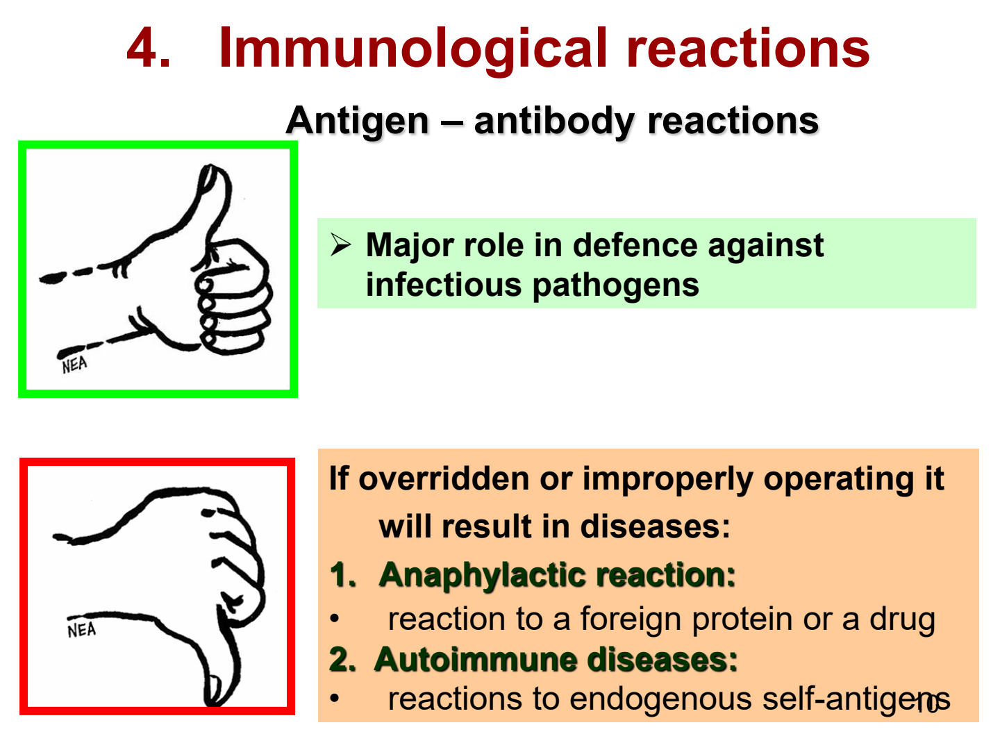

## PDF page 11 — Immune complex injury

> Source: ch1-part-02, PDF page 11. Printed slide: 11. Classification: teaching.

### Preserved source text

4.  Immunological reactions
        Antigen – antibody reactions

### Visual transcription / figure record

Immune-damage sequence labelled post-streptococcal glomerulonephritis: cocci bearing antigens -> free antigen -> antigen-antibody immune complexes -> glomerulonephritis.

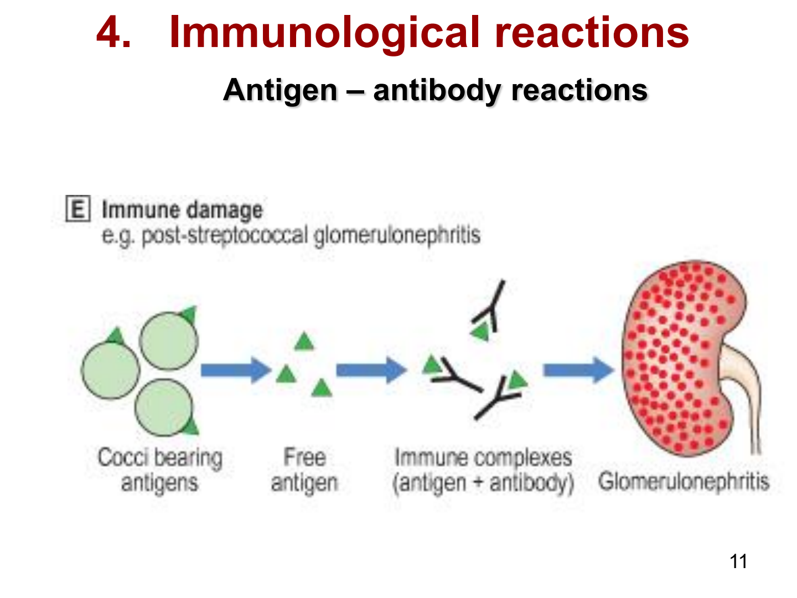

## PDF page 12 — Nutritional imbalance

> Source: ch1-part-02, PDF page 12. Printed slide: 12. Classification: teaching.

### Preserved source text

5.    Nutritional imbalance

 Undernutrition                    Overnutrition
•Protein-calorie deficiencies        •Atherosclerosis
•Vitamins & Mineral Deficiencies     •Obesity

•Anorexia nervosa                                           12

### Visual transcription / figure record

Full page visually inspected; extracted text and visible layout compared. Illustrative image retained in original full-page render.

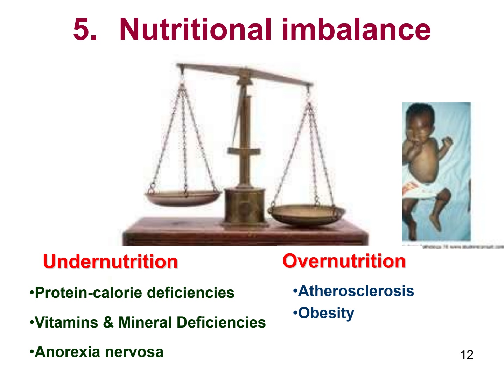

## PDF page 13 — Genetic defects

> Source: ch1-part-02, PDF page 13. Printed slide: 13. Classification: teaching.

### Preserved source text

6.   Genetic Defects

Examples:

➢Down syndrome

➢Sickle cell anemia

➢Inborn errors of metabolism                       13

### Visual transcription / figure record

Full page visually inspected; extracted text and visible layout compared. Illustrative image retained in original full-page render.

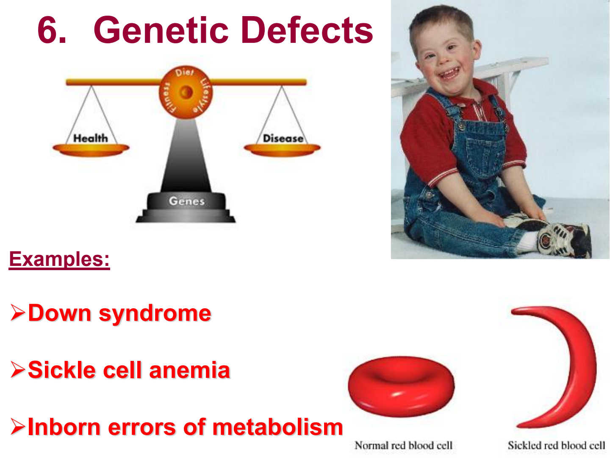

## PDF page 14 — Hypoxia versus ischemia

> Source: ch1-part-02, PDF page 14. Printed slide: 14. Classification: teaching.

### Preserved source text

7.      Oxygen deprivation

  Hypoxia, or oxygen deficiency, interferes with aerobic
oxidative respiration

  Hypoxia     =             + O2continueglycolysis

  Ischemia, which is a loss of blood supply in a tissue due to
impeded arterial flow or reduced venous drainage.
  Ischemia➔        O2     +    nutrients

      Ischemia is the most common cause of hypoxia
      Ischemia is the most common type of cell injury              14

### Visual transcription / figure record

Full page visually inspected; extracted text and visible layout compared. Illustrative image retained in original full-page render.

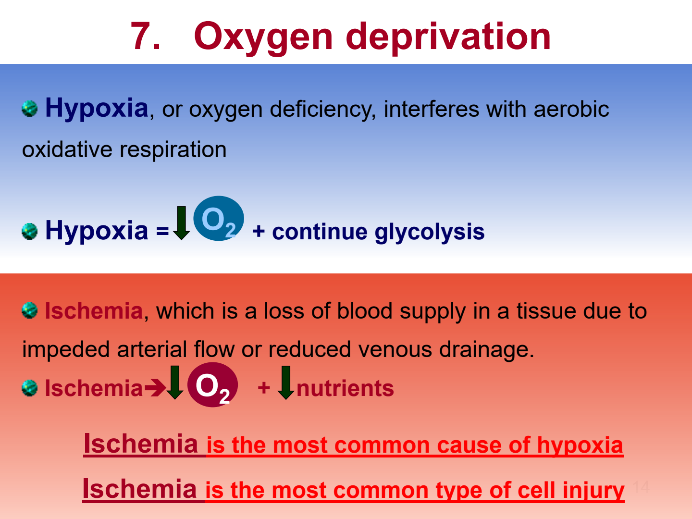

## PDF page 15 — Oxygen deprivation diagram

> Source: ch1-part-02, PDF page 15. Printed slide: 15. Classification: teaching.

### Preserved source text

7.    Oxygen deprivation

         Ischemia
                                •Anemia
                                •high altitude
    blood supply                •respiratory failure
                                       CO

 glucose           Hypoxia:     blood oxygenation

       cell death

### Visual transcription / figure record

Ischemia -> decreased blood supply -> decreased glucose and hypoxia -> cell death. Anemia, high altitude, respiratory failure and CO are shown causing decreased blood oxygenation/hypoxia.

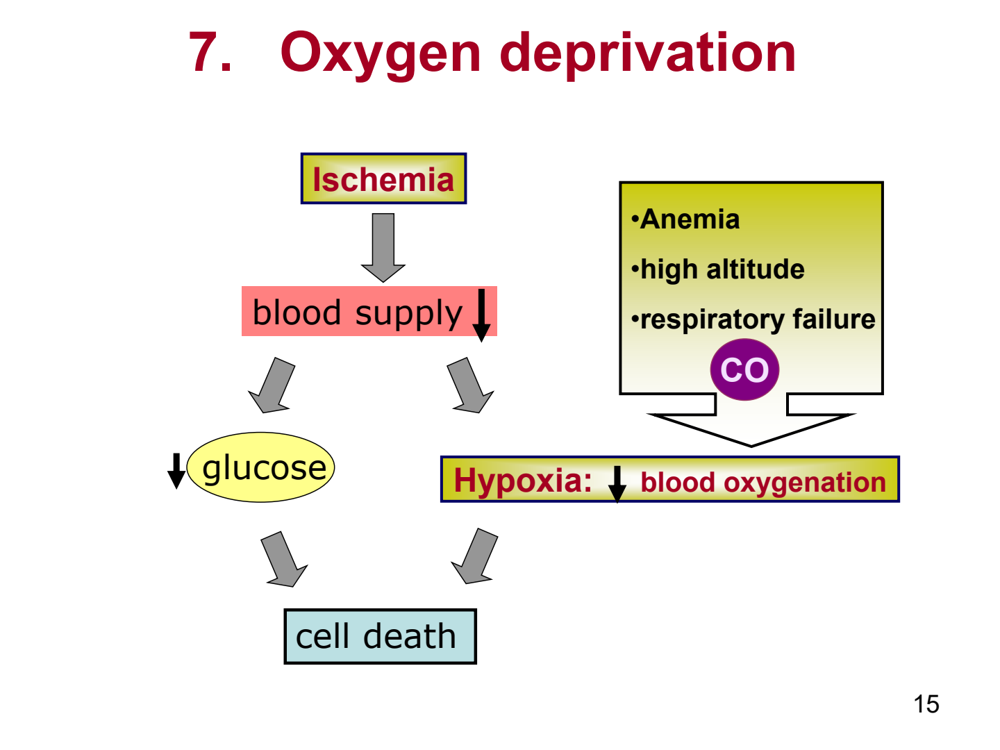

## PDF page 16 — Aging illustration

> Source: ch1-part-02, PDF page 16. Printed slide: 16. Classification: teaching.

### Preserved source text

8.  Aging

### Visual transcription / figure record

Full page visually inspected; extracted text and visible layout compared. Illustrative image retained in original full-page render.

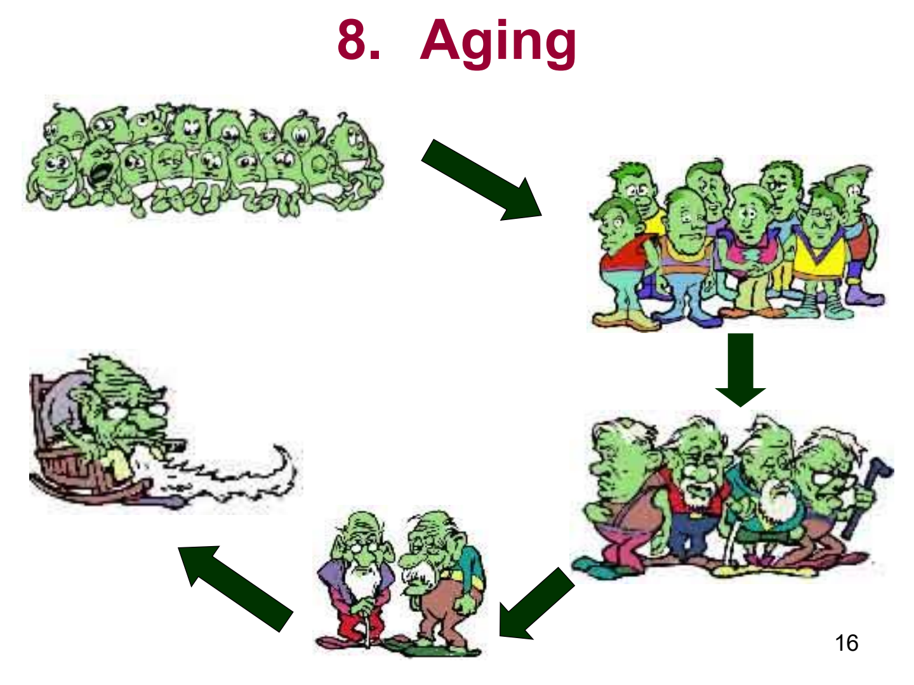

## PDF page 17 — Cellular aging mechanisms

> Source: ch1-part-02, PDF page 17. Printed slide: 17. Classification: teaching.

### Preserved source text

Cellular aging: Mechanisms

INTRINSIC                EXTRINSIC

### Visual transcription / figure record

Intrinsic genetic factors: DNA repair defects -> accumulated mutations; genetic abnormalities (e.g. IGF-1 pathway) -> abnormal cellular signaling. Extrinsic environmental insults -> free radical-mediated damage, and reduced proteasomal activity -> damaged cellular proteins/organelles accumulate. Replicative senescence -> reduced new-cell production. These routes converge on cellular aging.

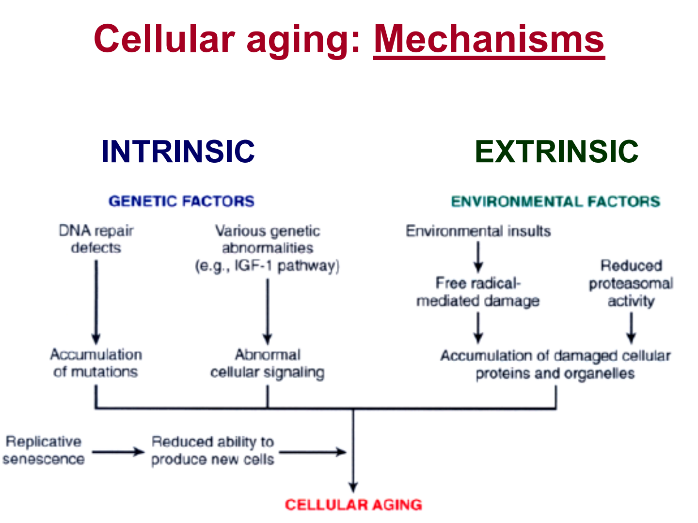

## PDF page 18 — Closing meme

> Source: ch1-part-02, PDF page 18. Printed slide: 18. Classification: administrative.

### Preserved source text

18

### Visual transcription / figure record

Nonteaching Arabic joke: الطب سهل جداً لعمتي؛ يعني إيه crush injury؛ جرح الحبيب.

## PDF page 19 — Targets and determinants of injury

> Source: ch1-part-02, PDF page 19. Printed slide: 19. Classification: teaching.

### Preserved source text

Overview of Cell Injury
➢ The cellular responses to injurious stimuli depend

  on the type, duration, and severity          of injury.

➢ The main targets for the injury are:

       (1) cell membrane     integrity

       (2) ATP  generation

       (3) protein  synthesis

       (4) the integrity of the genetic   apparatus           19

### Visual transcription / figure record

Full page visually inspected; extracted text and visible layout compared. Illustrative image retained in original full-page render.

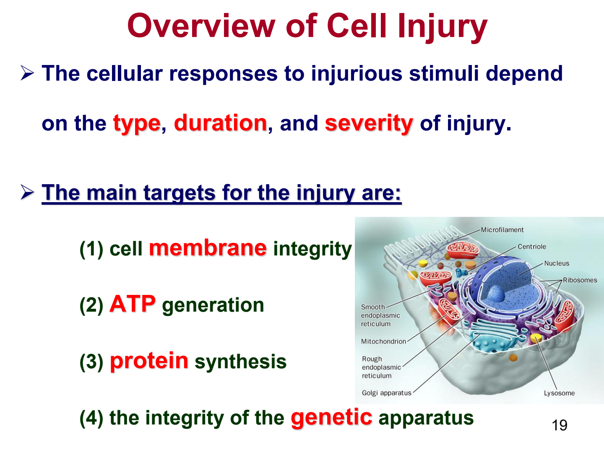

## PDF page 20 — Biochemical mechanisms

> Source: ch1-part-02, PDF page 20. Printed slide: 20. Classification: teaching.

### Preserved source text

Cellular & biochemical mechanisms

➢  Loss of membrane     integrity

➢  ATP  depletion and mitochondrial damage

➢  Increased intracellular calcium

➢  Free radical-induced injury

➢  Protein  breakdown

➢  DNA   damage                              20

### Visual transcription / figure record

Full page visually inspected; extracted text and visible layout compared. Illustrative image retained in original full-page render.

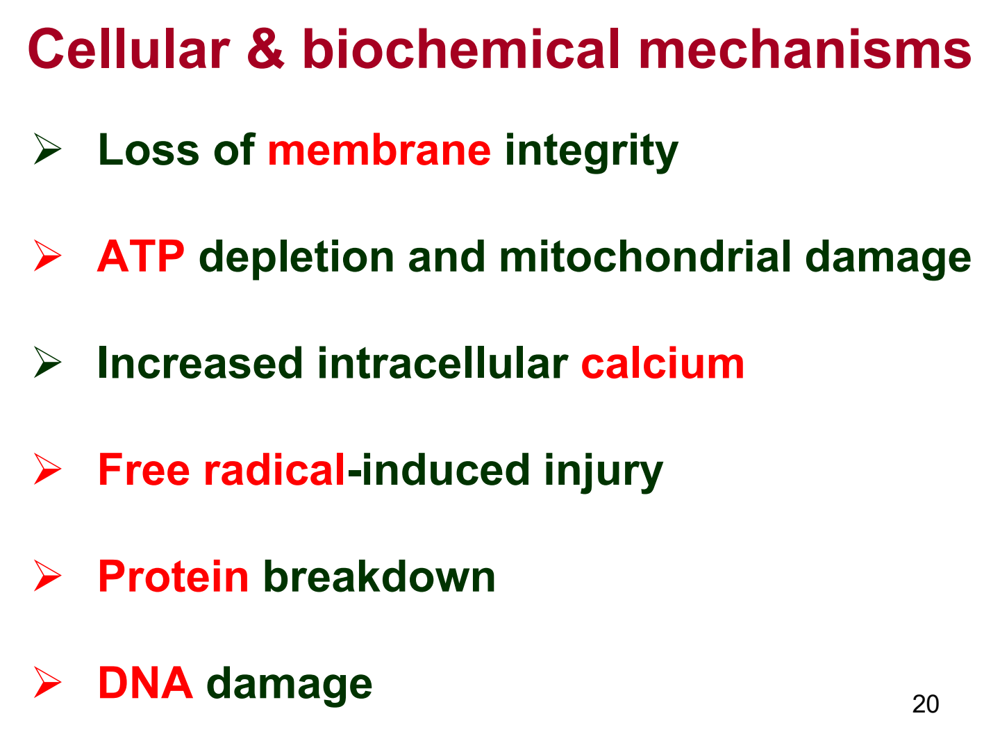

## PDF page 21 — Cell injury morphology diagram

> Source: ch1-part-02, PDF page 21. Printed slide: not visibly labelled. Classification: teaching.

### Preserved source text

(No extractable text beyond the page label; see visual transcription and original image.)

### Visual transcription / figure record

Healthy cell Na/K ATPase exchanges 3 Na outward and 2 K inward. Hypoxia and ATP reduction accompany reversible cell/organelle swelling, detached ribosomes, chromatin clumping, blebbing, myelin figures; intracellular Na/osmotic pressure and Ca rise, K decreases. Irreversible injury: membrane rupture, nuclear pyknosis/karyorrhexis/karyolysis, vacuolization, amorphous mitochondrial densities, lysosomal rupture -> cell lysis.

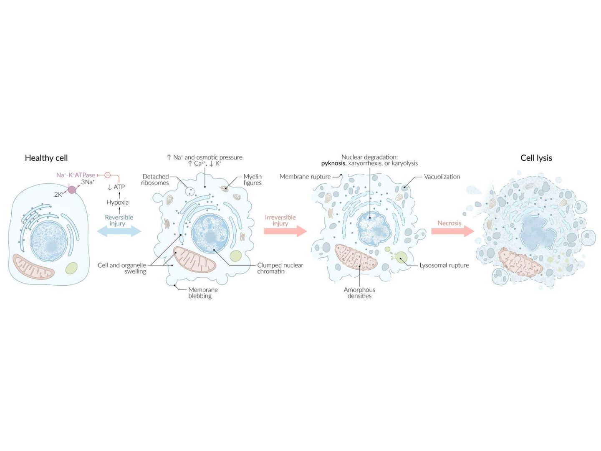

## PDF page 22 — Mechanisms overview diagram

> Source: ch1-part-02, PDF page 22. Printed slide: 22. Classification: teaching.

### Preserved source text

Cellular & biochemical mechanisms

                                e.g. Ischemia

### Visual transcription / figure record

Injurious stimulus e.g. ischemia -> ATP reduction -> loss of energy-dependent functions; mitochondrial membrane damage -> cell death; lysosomal damage -> enzymatic digestion; plasma membrane damage -> lost cellular contents; increased Ca and ROS -> protein breakdown and DNA damage.

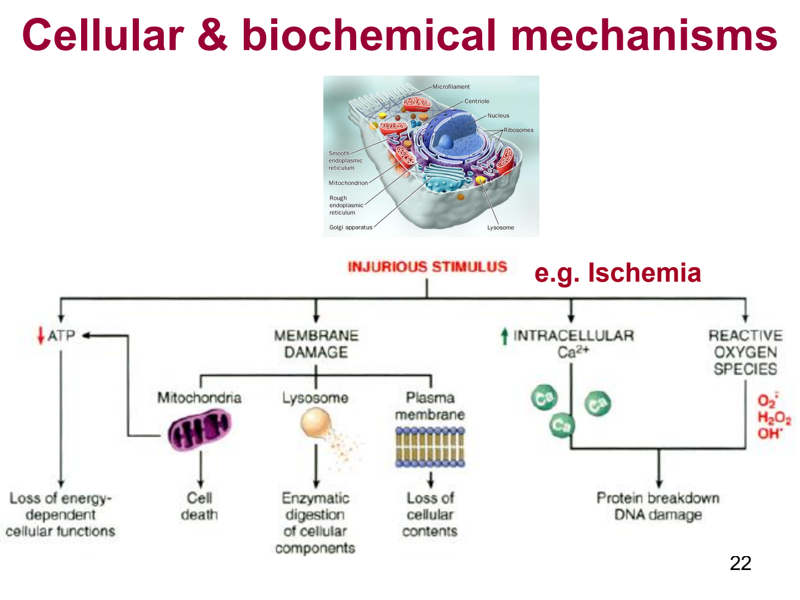

## PDF page 23 — Biochemical injury pathways

> Source: ch1-part-02, PDF page 23. Printed slide: 23. Classification: teaching.

### Preserved source text

23

### Visual transcription / figure record

Mitochondrial damage -> ATP decrease and ROS increase (lipid/protein/DNA damage). Ca entry -> mitochondrial permeability increase and cellular enzyme activation. Plasma membrane damage -> lost components; lysosomal membrane damage -> digestion. Protein misfolding/DNA damage -> pro-apoptotic protein activation.

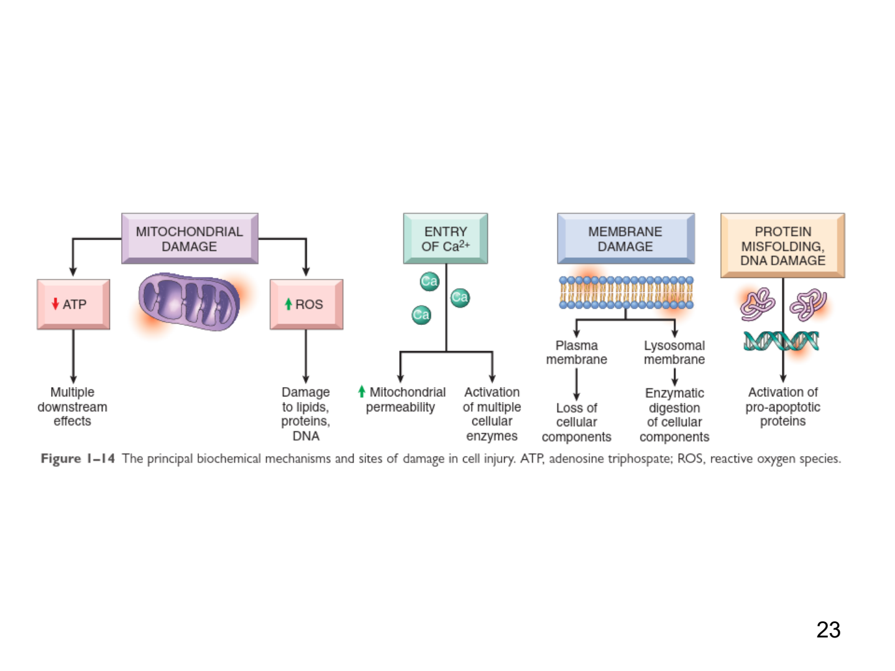

## PDF page 24 — Calcium homeostasis

> Source: ch1-part-02, PDF page 24. Printed slide: 24. Classification: teaching.

### Preserved source text

Loss of calcium homeostasis
•   Cytosolic        is normally Ca2+
    maintained by ATP-
    dependent       transportersCa2+
•   Injury allows a net influx of
    extracellular       across the Ca2+
    plasma membrane,
    followed by the release of
Ca2+from the intracellular
    stores.
•   Cell injury results in
    increased intracellular
    cytosolic     Ca2+

### Visual transcription / figure record

Ca influx from extracellular space and release from mitochondria/smooth ER increases cytosolic Ca. Phospholipase -> decreased phospholipids; protease -> disrupted membrane/cytoskeleton proteins; these cause membrane damage. Endonuclease -> nuclear damage. ATPase -> decreased ATP. Ca also increases mitochondrial permeability transition -> decreased ATP.

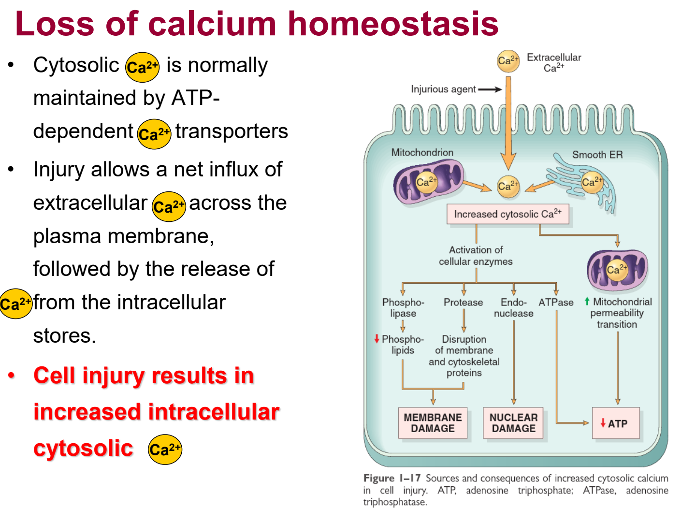

## PDF page 25 — ATP pathways and functions

> Source: ch1-part-02, PDF page 25. Printed slide: 25. Classification: teaching.

### Preserved source text

Mitochondrial damage                         & ATP Depletion

ATP synthesis pathways:
1.  mitochondrial      oxidative                                InnerInner
                                                              MembraneMembrane
    phosphorylation
                                                                      OuterOuter
2.  anaerobic glycolysis                                            MembraneMembrane

                                                                           DNADNA
ATP function:
                                           CristaeCristae
➢   the maintenance of cellular
                                             MatrixMatrix
    osmolarity
                                              IntermembraneIntermembrane
➢   transport    processes                       SpaceSpace             RibosomeRibosome
                                                                GranuleGranule
➢   protein and lipid synthesis
➢   basic metabolic pathways                                              25

### Visual transcription / figure record

Mitochondrial diagram labels outer/inner membrane, cristae, matrix, intermembrane space, DNA, ribosome and granule. Size markers 0.1–0.5 micrometers and 1–2 micrometers are reproduced as shown, without interpreting an unlabeled dimension.

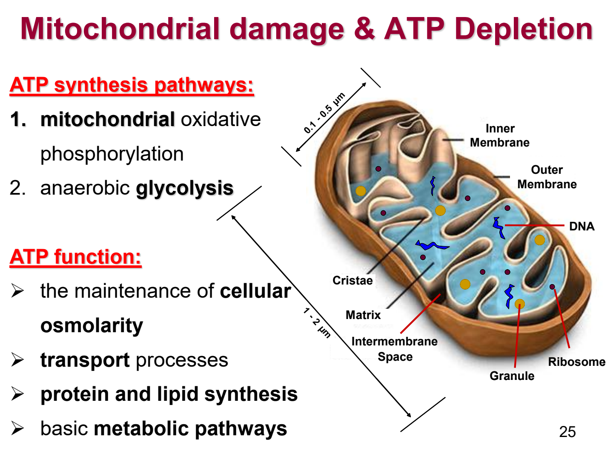

## PDF page 26 — Mitochondrial dysfunction

> Source: ch1-part-02, PDF page 26. Printed slide: 26. Classification: teaching.

### Preserved source text

Mitochondrial
dysfunction in
cell injury

### Visual transcription / figure record

Increased cytosolic calcium, oxidative stress and lipid peroxidation -> mitochondrial injury/dysfunction. Mitochondrial permeability transition -> membrane potential loss -> inability to generate ATP -> necrosis. Cytochrome c and other pro-apoptotic protein release -> apoptosis.

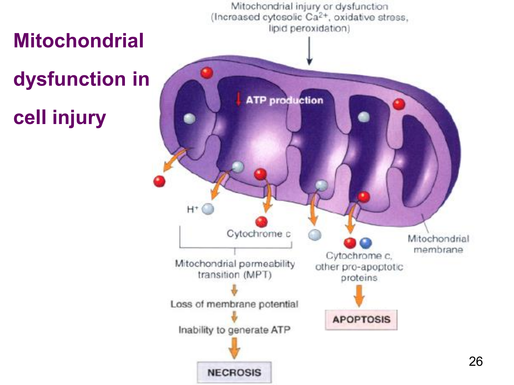

## PDF page 27 — Mitochondrial cell death pathways

> Source: ch1-part-02, PDF page 27. Printed slide: 27. Classification: teaching.

### Preserved source text

27

### Visual transcription / figure record

Low O2, toxins, radiation -> mitochondrial dysfunction -> ATP decrease and ROS increase -> multiple abnormalities -> necrosis. Reduced survival signals or DNA/protein damage -> pro-apoptotic proteins increase and anti-apoptotic proteins decrease -> mitochondrial protein leakage -> apoptosis.

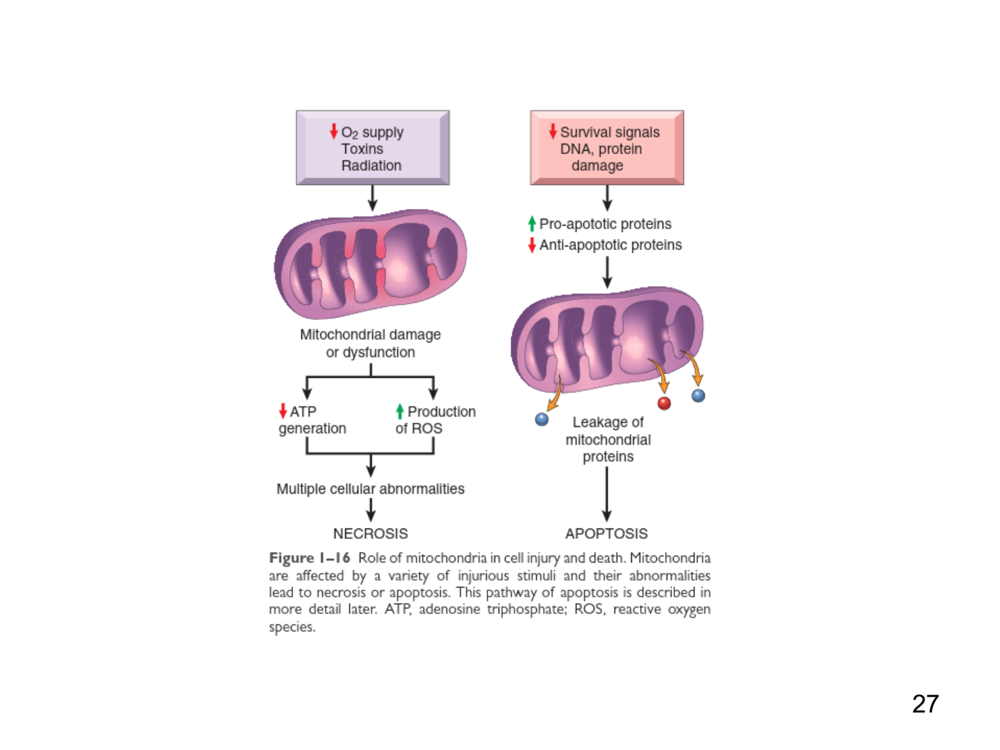

## PDF page 28 — Consequences of ATP depletion

> Source: ch1-part-02, PDF page 28. Printed slide: 28. Classification: teaching.

### Preserved source text

Functional and

morphologic

consequences of

decreased

intracellular ATP

during cell injury

### Visual transcription / figure record

Ischemia -> oxidative phosphorylation decrease -> ATP decrease. Na pump reduction -> influx Ca, water, Na and K efflux -> ER/cellular swelling, microvillus loss, blebs. Anaerobic glycolysis increases -> glycogen decreases and pH falls -> chromatin clumping. Ribosome detachment -> protein synthesis decrease -> lipid deposition.

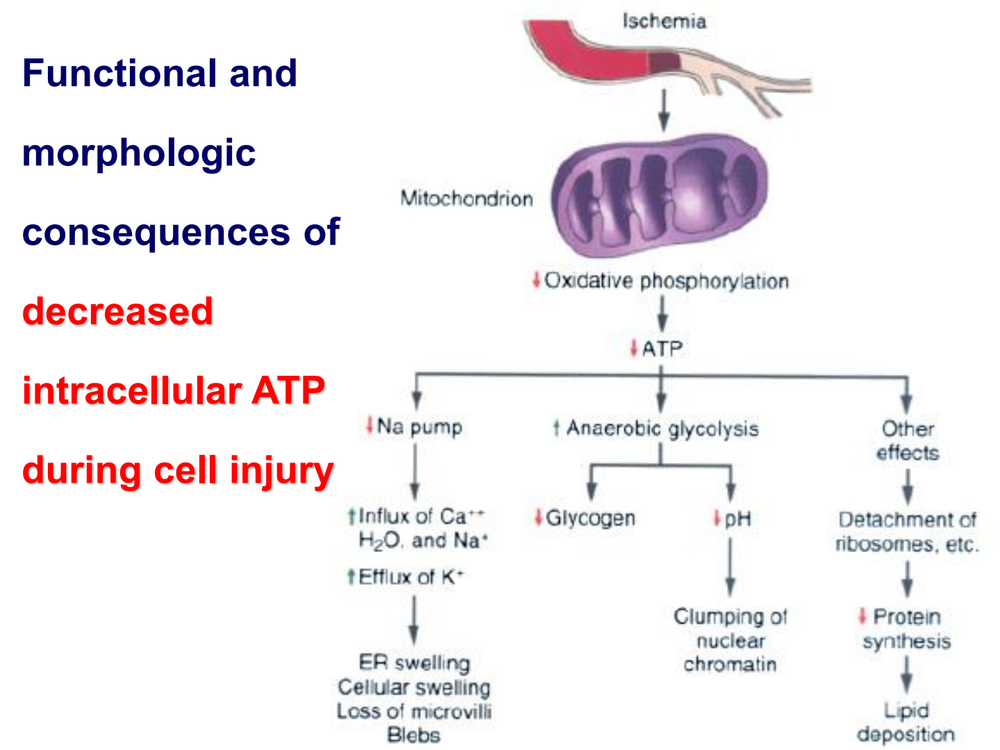

## PDF page 29 — Free radical definition and species

> Source: ch1-part-02, PDF page 29. Printed slide: 29. Classification: teaching.

### Preserved source text

Free radicals

Definition:  unstable chemical species with a

single unpaired electron      in the outer orbital.

1) Reactive nitrite species

2) Oxygen free radicals      or reactive oxygen

species (ROS) include:
➢Superoxide anion radicals (       O2-)

➢Hydrogen peroxide (H2O2)
➢Reactive hydroxyl radical (HO.)                         29

### Visual transcription / figure record

Full page visually inspected; extracted text and visible layout compared. Illustrative image retained in original full-page render.

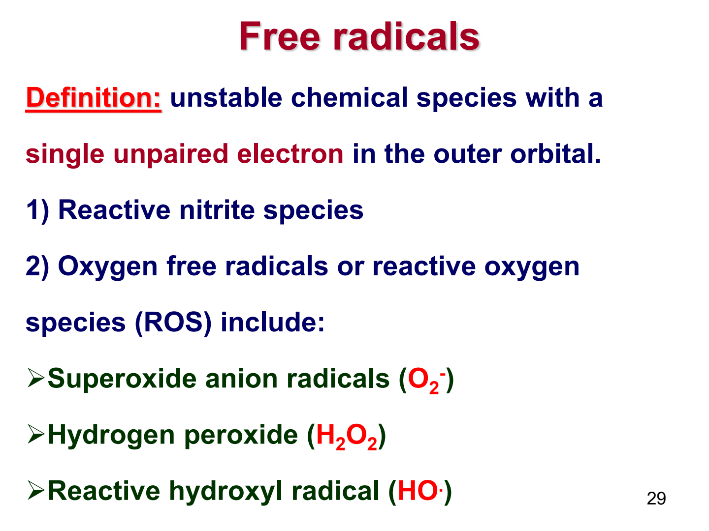

> **Source note:** Slide groups H2O2 under oxygen free radicals/ROS and says reactive nitrite species. Do not score whether every listed ROS is itself a free radical, or the nitrite terminology; use only clear definition/other pages.

## PDF page 30 — ROS generation

> Source: ch1-part-02, PDF page 30. Printed slide: 30. Classification: teaching.

### Preserved source text

30

### Visual transcription / figure record

Mitochondrial electron transport produces superoxide; + NO -> peroxynitrite (ONOO−); SOD converts superoxide to H2O2; Fenton reaction yields hydroxyl radical. Phagocyte oxidase uses NADPH/O2 to generate superoxide in phagosomes; MPO is connected to HOCl production. Caption names NO nitric oxide; SOD superoxide dismutase.

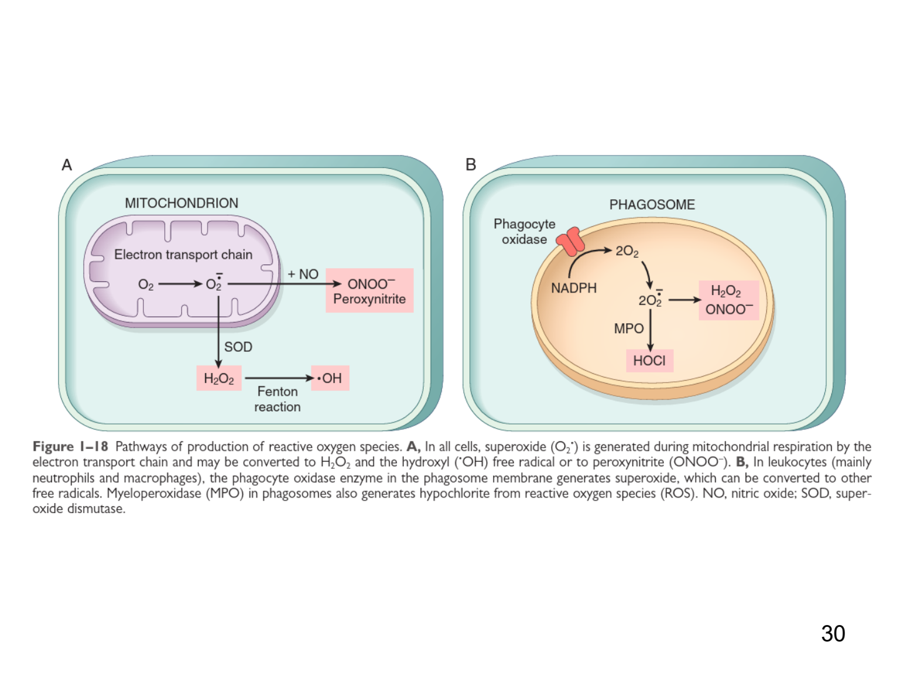

## PDF page 31 — ROS sources and targets

> Source: ch1-part-02, PDF page 31. Printed slide: not reliably labelled. Classification: teaching.

### Preserved source text

Free radicals

Sources & generation
Inflammation
Radiation
Oxygen toxicity
Chemicals
Reperfusion injury

Targets

                                                                            31
                                                         Antioxidant activity

### Visual transcription / figure record

Sources: ER P450/b5 oxidases; mitochondrial P450/b5 oxidases and respiratory chain oxidation; plasma membrane NADPH oxidase; cytosolic xanthine oxidase and transition metals Cu/Fe; peroxisomal oxidases; phagocyte lysosome myeloperoxidase/NO synthase. Targets: membrane lipid peroxidation, DNA fragmentation, protein cross-linking/fragmentation. Fenton, SOD, catalase, glutathione peroxidase/reductase pathways shown. Membrane antioxidants E/A/beta-carotene; cytosolic SOD, vitamin C, glutathione peroxidase, ferritin, ceruloplasmin; mitochondrial SOD/glutathione peroxidase; peroxisomal catalase.

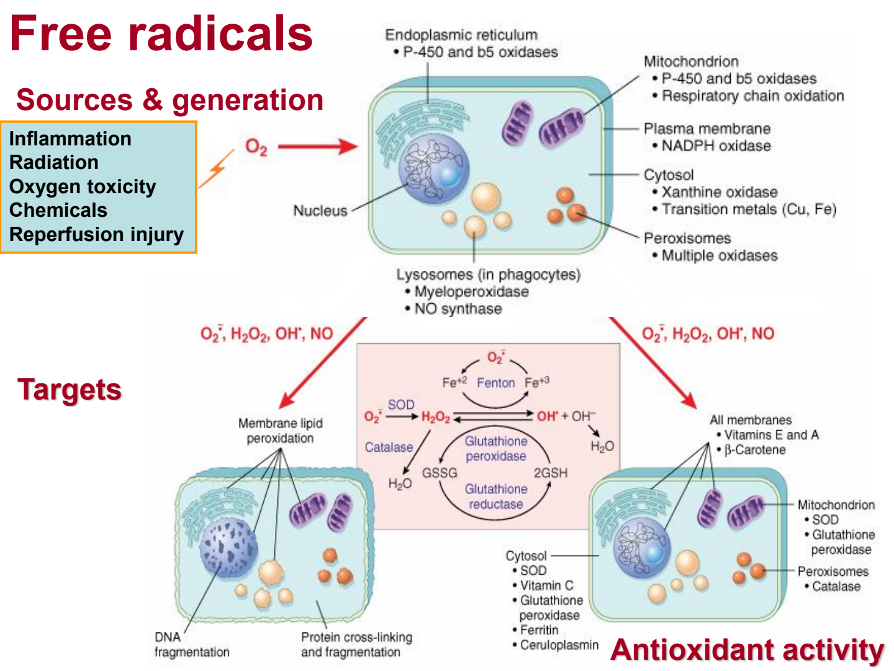

## PDF page 32 — ROS injury and removal

> Source: ch1-part-02, PDF page 32. Printed slide: 32. Classification: teaching.

### Preserved source text

32

### Visual transcription / figure record

Radiation/toxins/reperfusion -> ROS: superoxide -> H2O2 -> hydroxyl radical. Lipid peroxidation -> membrane damage; protein modification -> breakdown/misfolding; DNA damage -> mutation. SOD converts superoxide to H2O2; glutathione peroxidase/catalase decompose H2O2 to water. Caption: spontaneous decay and enzymatic removal limit radicals; excessive production or inadequate removal causes accumulation/injury.

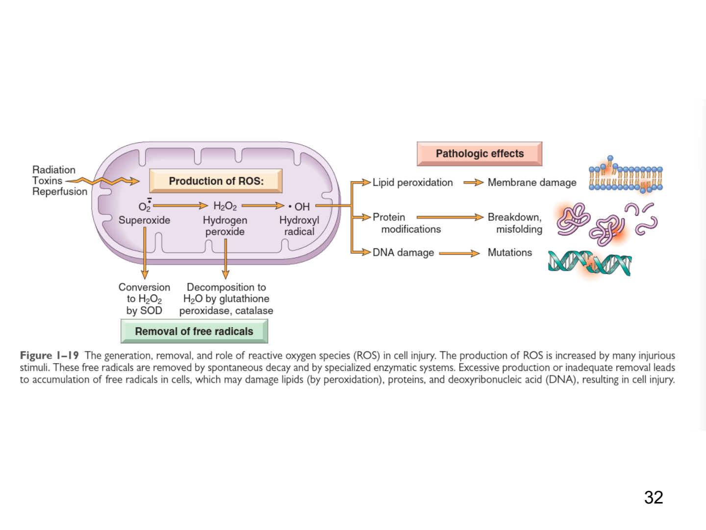

## PDF page 33 — Antioxidant activity

> Source: ch1-part-02, PDF page 33. Printed slide: not reliably labelled. Classification: teaching.

### Preserved source text

Antioxidant activity                       Free radicals     are

                                           unstable and generally
                                           decay spontaneously

                  Endogenous or exogenous antioxidants (e.g.,
                  vitamins E, A, and C, and β-carotene) may either 33
                  block the formation of free radicals or scavenge them

### Visual transcription / figure record

Full page visually inspected; extracted text and visible layout compared. Illustrative image retained in original full-page render.

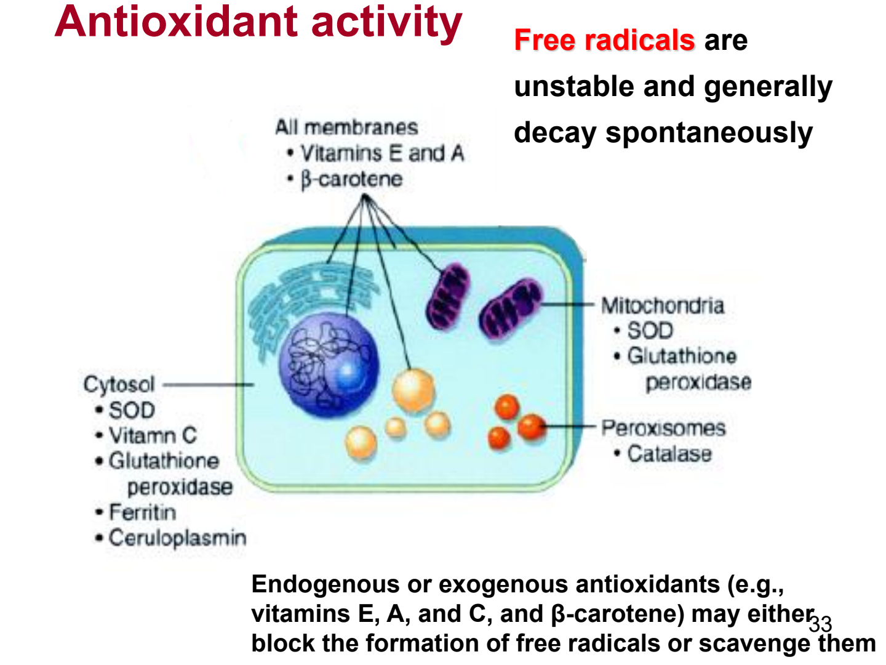

## PDF page 34 — Direct chemical injury

> Source: ch1-part-02, PDF page 34. Printed slide: 34. Classification: teaching.

### Preserved source text

Chemical injury I

Two mechanisms:
1. Direct combination with a critical molecule of cell
   component
➢  the greatest damage is sustained by the cells that
   use, absorb, excrete, or concentrate the compounds.
➢  Examples:
   ▪  Mercuric chloride poisoning      (HgCl2), Hg binds to the
      sulfhydryl groups of cell membrane proteins, causing
      inhibition of ATPase-dependent transport and increased
      membrane permeability.
   ▪  Antineoplastic   chemotherapeutic      agents and antibiotics34

### Visual transcription / figure record

Full page visually inspected; extracted text and visible layout compared. Illustrative image retained in original full-page render.

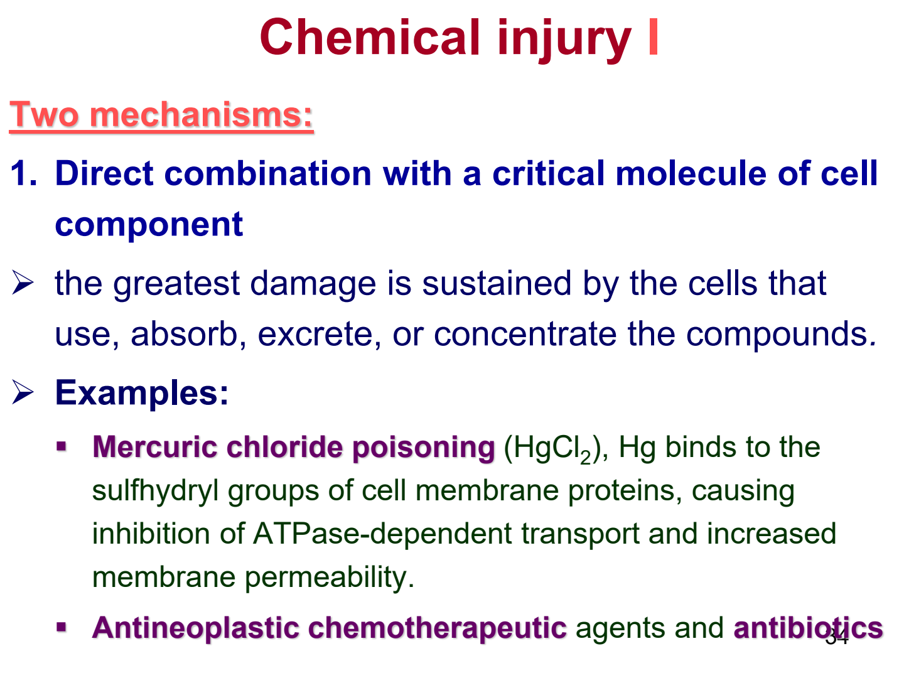

## PDF page 35 — Metabolic activation of chemicals

> Source: ch1-part-02, PDF page 35. Printed slide: 35. Classification: teaching.

### Preserved source text

Chemical injury II
2.  Activation of an inactive chemical
➢   Many chemicals are not intrinsically biologically
    active but must be first converted to reactive toxic
    metabolites by the P-450       oxidases   in the smooth
    endoplasmic reticulum of the liver and other organs.
➢   Involves the formation of reactive free radicals
➢   Examples:
      •   Carbon tetrachloride       (CCl4)
      •   Acetaminophen

### Visual transcription / figure record

Full page visually inspected; extracted text and visible layout compared. Illustrative image retained in original full-page render.

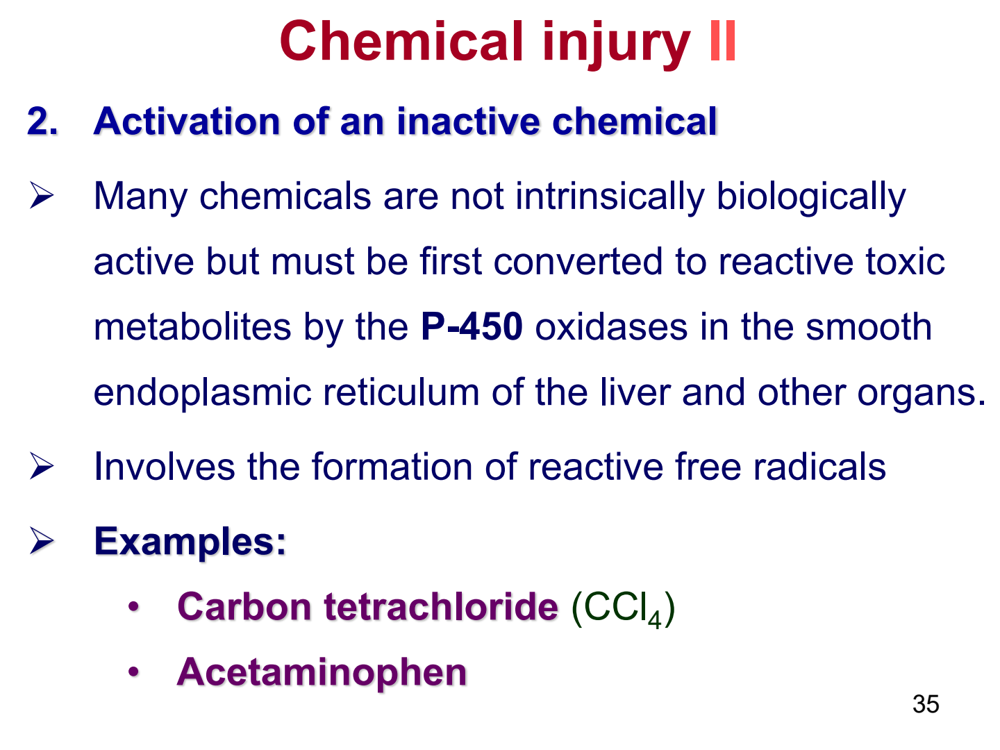

## PDF page 36 — Carbon tetrachloride injury

> Source: ch1-part-02, PDF page 36. Printed slide: 36. Classification: teaching.

### Preserved source text

Chemical injury II

 Example 1:

 Carbon tetrachloride      (CCl4)

 • Used in dry cleaning

 •Converted to the toxic free

 radical CCl3· in the liver
Example 2:

### Visual transcription / figure record

CCl4 -> SER -> CCl3 radical -> microsomal polyenoic fatty acid lipid radicals + O2 -> lipid peroxidation, autocatalytic membrane spread. RER damage -> polysome detachment -> reduced apoprotein synthesis -> fatty liver. Plasma membrane damage -> Na/water/Ca influx -> swelling -> massive Ca influx -> mitochondrial/enzyme inactivation and protein denaturation.

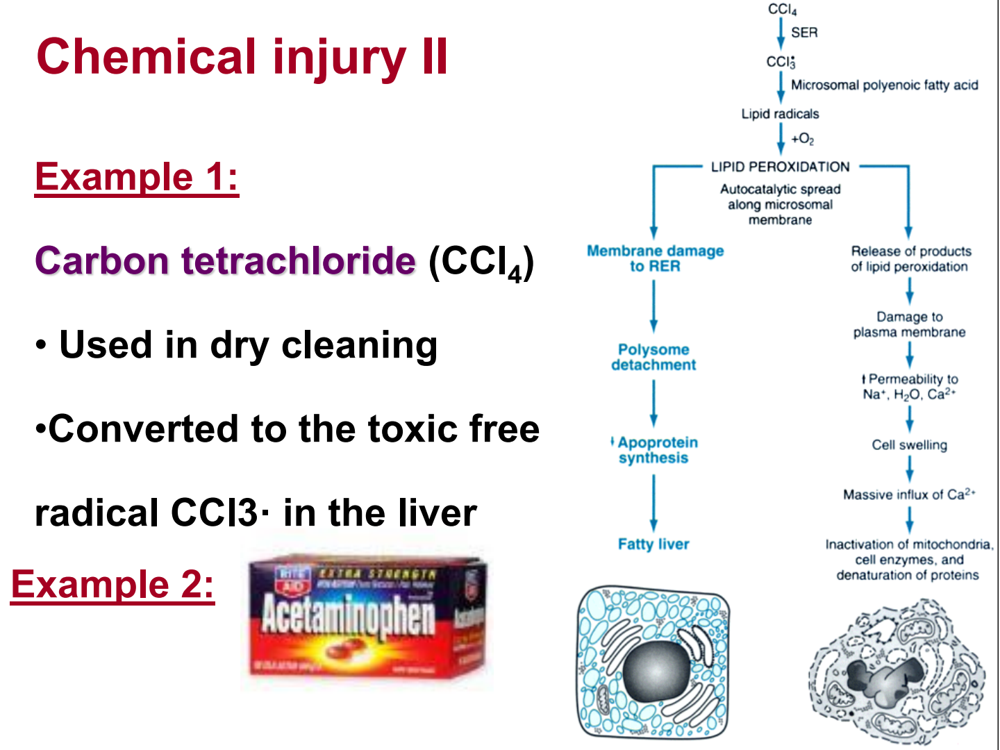

