# Chapter 1 — Part 3: Cover

Authority: unchanged supplied PDF only. Page headings use one-based PDF pages; printed labels are recorded only when visibly present. Original extracted text is preserved below, with separately identified visual transcription. No outside teaching content.

## PDF page 1 — Cover

> Source: ch1-part-03, PDF page 1. Printed slide: 1. Classification: cover.

### Preserved source text

Cellular
Adaptations

 Dr. Mahmoud Kiswani
 Al-Quds University
 Faculty of Medicine
 Pathology Department                                      1

### Visual transcription / figure record

Full page visually inspected; extracted text and visible layout compared. Illustrative image retained in original full-page render.

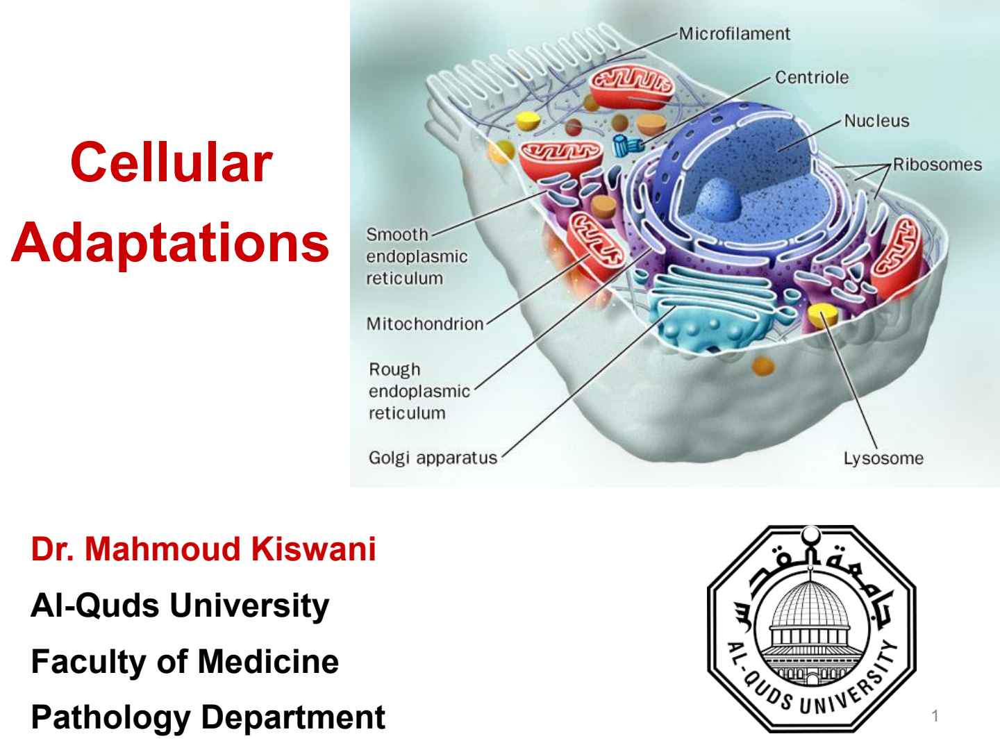

## PDF page 2 — Adaptation definition

> Source: ch1-part-03, PDF page 2. Printed slide: 2. Classification: teaching.

### Preserved source text

Cellular Adaptation              to Injury

A new steady state which lies between
normal unstressed cell, and the injured
overstressed cell, in which the cell can
function and preserve viability.

### Visual transcription / figure record

Full page visually inspected; extracted text and visible layout compared. Illustrative image retained in original full-page render.

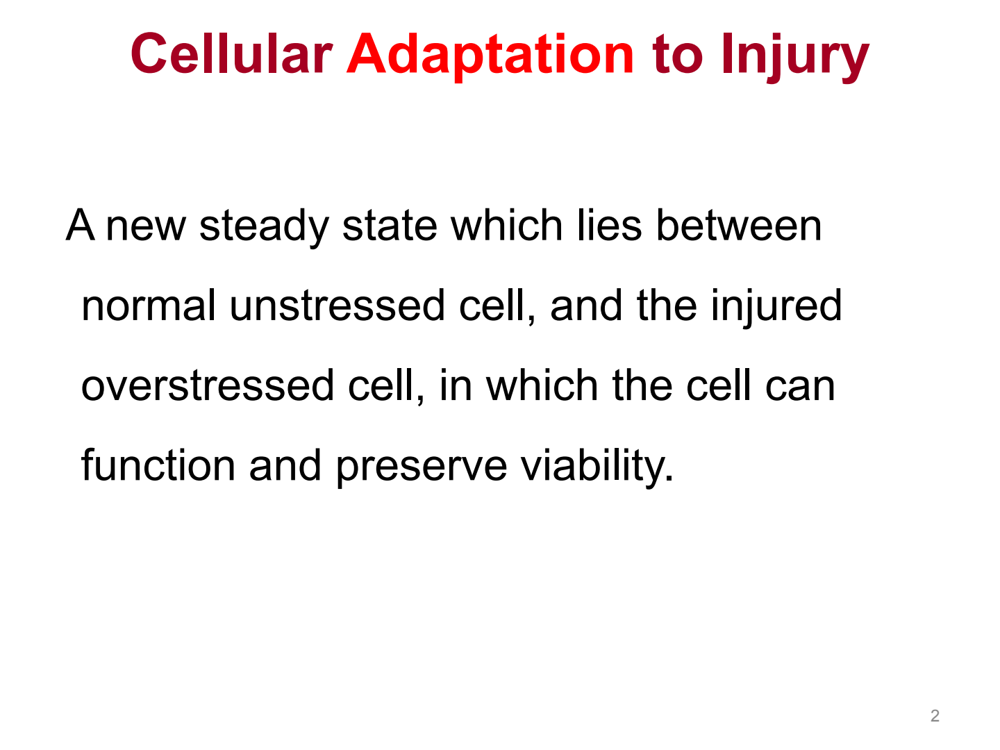

## PDF page 3 — Adaptive size number and type changes

> Source: ch1-part-03, PDF page 3. Printed slide: not visibly labelled. Classification: teaching.

### Preserved source text

(No extractable text beyond the page label; see visual transcription and original image.)

### Visual transcription / figure record

Normal cells compared with more numerous cells (hyperplasia), larger cells (hypertrophy), different cells (metaplasia), fewer cells (numerical atrophy), smaller cells (cellular atrophy/hypotrophy).

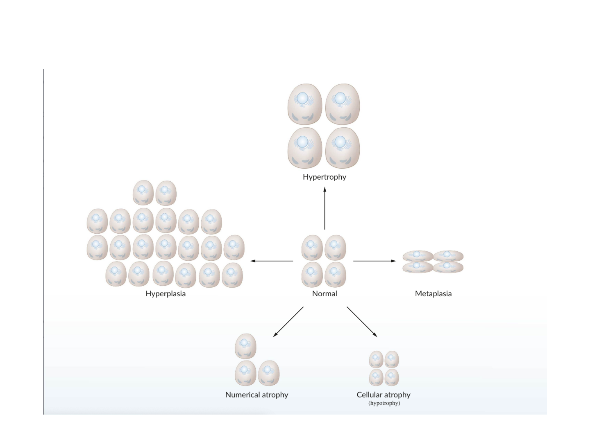

## PDF page 4 — Physiological and pathological adaptation

> Source: ch1-part-03, PDF page 4. Printed slide: 4. Classification: teaching.

### Preserved source text

Cellular Adaptation
1) Physiological adaptation
• responses of cells to normal stimulation           by
  hormones or endogenous chemical mediators
• e.g. hormones leading to enlargement of the
  breast and the uterus during pregnancy

2) Pathological adaptation
• allows the cells to modulate their environment and
  ideally escape injury
• e.g. hormones produced by tumors leading to
  endometrial hyperplasia

### Visual transcription / figure record

Full page visually inspected; extracted text and visible layout compared. Illustrative image retained in original full-page render.

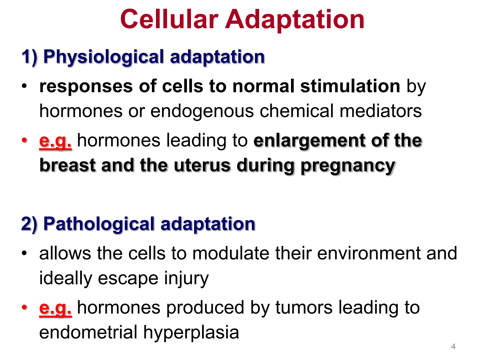

## PDF page 5 — Adaptation mechanisms

> Source: ch1-part-03, PDF page 5. Printed slide: 5. Classification: teaching.

### Preserved source text

Mechanisms of Cellular Adaptation

   –up-  or down-regulation     of specific
    cellular receptors

   –receptor binding

   –Increase or decrease of protein
    synthesis

   –switch from producing one type of
    protein to another

### Visual transcription / figure record

Full page visually inspected; extracted text and visible layout compared. Illustrative image retained in original full-page render.

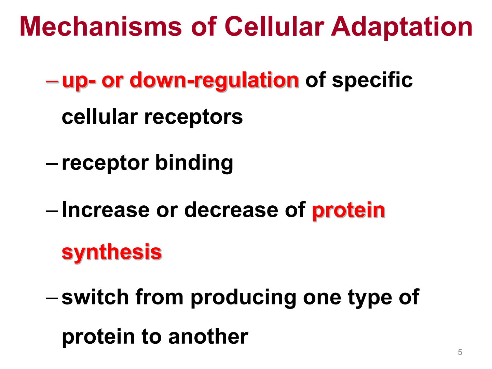

## PDF page 6 — Types of adaptation

> Source: ch1-part-03, PDF page 6. Printed slide: 6. Classification: teaching.

### Preserved source text

Cellular adaptation

Types of adaptive responses:

   ➢Atrophy    -decrease in cell size

   ➢Hypertrophy     -increase in cell size

   ➢Hyperplasia    - increase in cell number

   ➢Metaplasia    -change in cell type

Others:    aplasia, hypoplasia

### Visual transcription / figure record

Full page visually inspected; extracted text and visible layout compared. Illustrative image retained in original full-page render.

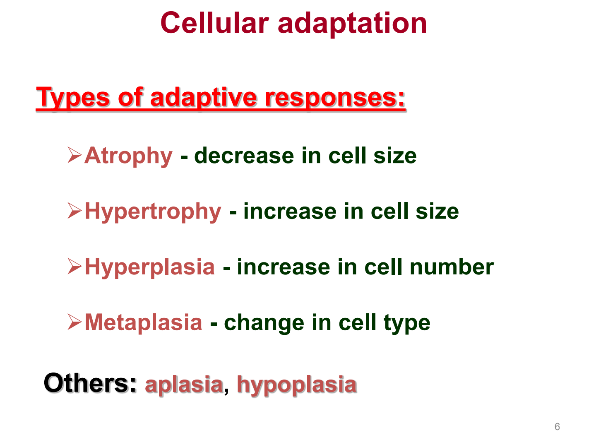

## PDF page 7 — Stress response diagram

> Source: ch1-part-03, PDF page 7. Printed slide: 7. Classification: teaching.

### Preserved source text

Cellular Adaptation to stress

                           normal bronchial epithelial cell

         adaptation                                                   cell injury

atrophy  hypertrophy    hyperplasia metaplasia   dysplasia    reversible     irreversible

                                                                            necrosis7

### Visual transcription / figure record

Normal bronchial epithelial cell under stress branches to adaptation (atrophy, hypertrophy, hyperplasia, metaplasia, dysplasia) and injury (reversible or irreversible). Irreversible injury leads to necrosis; reversible injury has return arrow.

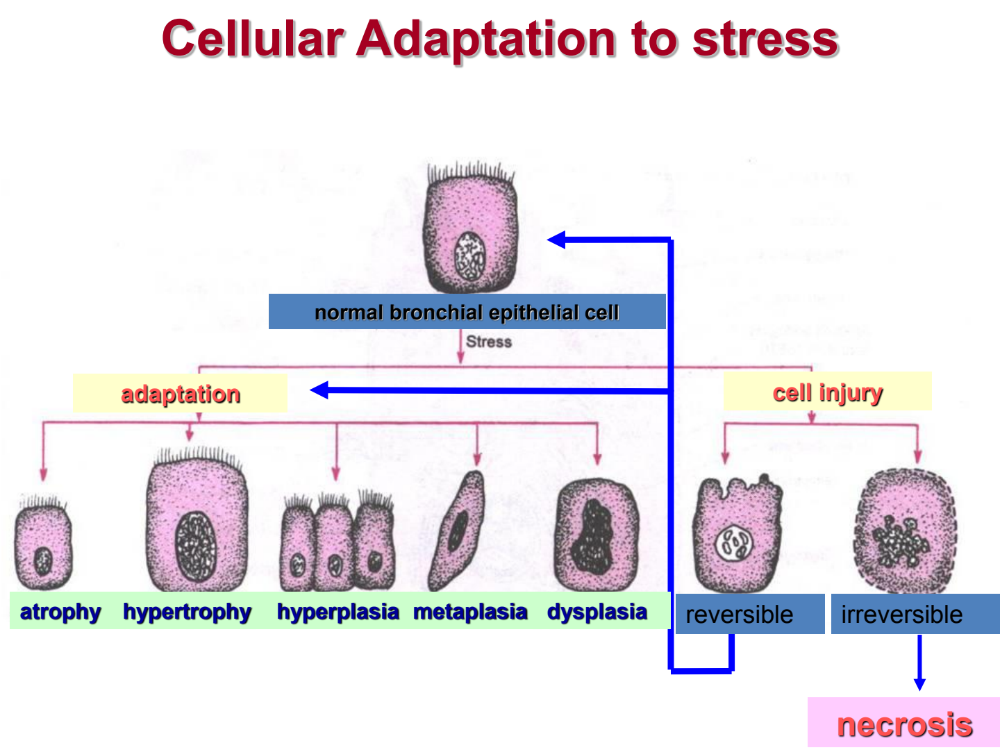

> **Source note:** Diagram groups dysplasia with adaptations, whereas p6 lists four main adaptations and does not define dysplasia. Do not score its categorization.

## PDF page 8 — Atrophy definition

> Source: ch1-part-03, PDF page 8. Printed slide: 8. Classification: teaching.

### Preserved source text

Atrophy

➢ Shrinkage in the size of the cell        by loss of cell

  substances, leading to diminished function            of the

  cell and a new equilibrium is reached.

➢ Accompanied by decrease in the organ size, if

  sufficient number of cells is involved.

➢ The cells are not dead

### Visual transcription / figure record

Full page visually inspected; extracted text and visible layout compared. Illustrative image retained in original full-page render.

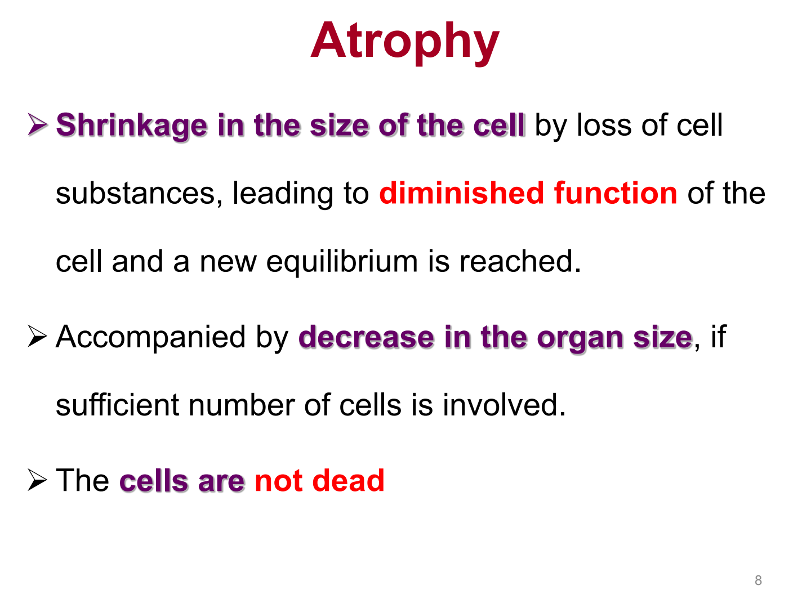

## PDF page 9 — Causes of atrophy

> Source: ch1-part-03, PDF page 9. Printed slide: 9. Classification: teaching.

### Preserved source text

Causes of Atrophy
1) Physiological:
   ➢thymic involution, aging
   ➢loss of hormonal stimuli (menopause)
2) Pathological:
   ➢decrease work load (immobilization of a limb to permit
     healing of a fracture)
   ➢loss of innervation (Denervation atrophy)
   ➢diminished blood supply (ischemic atrophy)
   ➢inadequate nutrition

### Visual transcription / figure record

Full page visually inspected; extracted text and visible layout compared. Illustrative image retained in original full-page render.

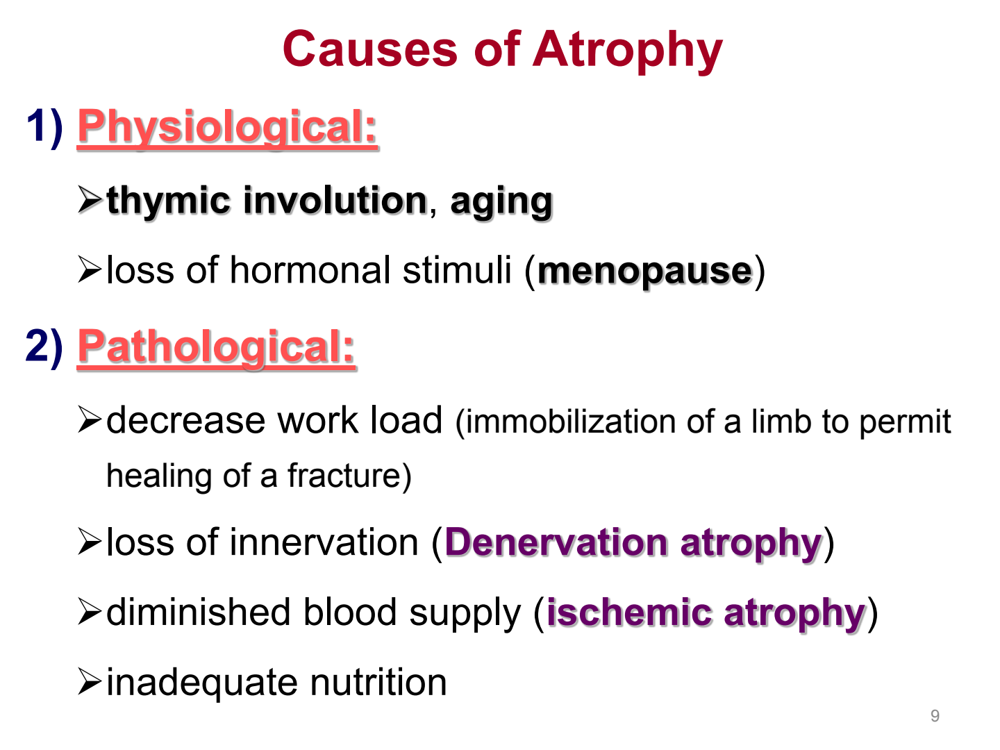

## PDF page 10 — Brain atrophy

> Source: ch1-part-03, PDF page 10. Printed slide: 10. Classification: teaching.

### Preserved source text

A, Atrophy of the brain in an 82-year-old male with atherosclerotic disease.
Atrophy of the brain is due to aging and reduced blood supply. The meninges
have been stripped. B, Normal brain of a 25-yr-old male. Note that loss of brain
substance narrows the gyri and widens the sulci

### Visual transcription / figure record

Full page visually inspected; extracted text and visible layout compared. Illustrative image retained in original full-page render.

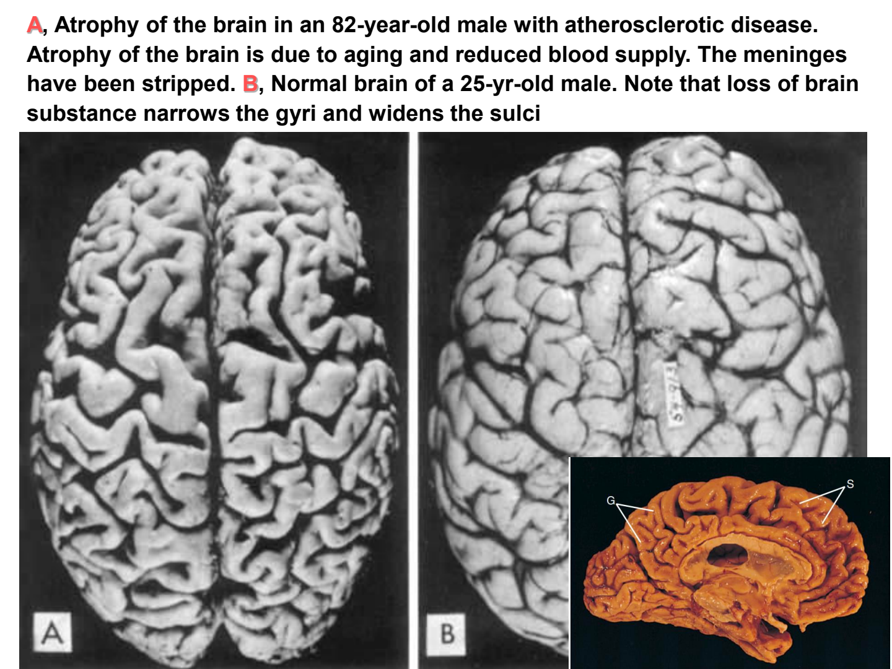

## PDF page 11 — Ischemic renal atrophy

> Source: ch1-part-03, PDF page 11. Printed slide: 11. Classification: teaching.

### Preserved source text

Normal

These kidneys are from a patient who had
atherosclerotic stenosis of one renal artery               11

### Visual transcription / figure record

Full page visually inspected; extracted text and visible layout compared. Illustrative image retained in original full-page render.

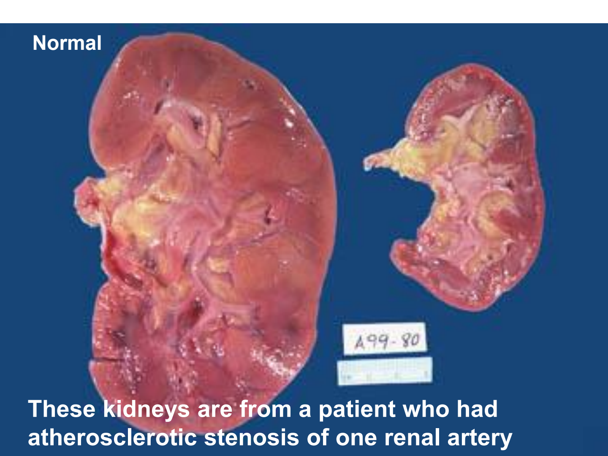

## PDF page 12 — Mechanisms of atrophy

> Source: ch1-part-03, PDF page 12. Printed slide: 12. Classification: teaching.

### Preserved source text

Mechanisms of Atrophy

➢ Imbalance between protein synthesis and
  degradation    is the fundamental step, leading to
  reduction in structural components.
➢ Decreased synthesis, increased catabolism, or
  both
➢ the fundamental cellular changes are identical       in
  physiological and pathological causes.
➢ Sometimes the number of cells can be reduced by the
  process apoptosis

### Visual transcription / figure record

Full page visually inspected; extracted text and visible layout compared. Illustrative image retained in original full-page render.

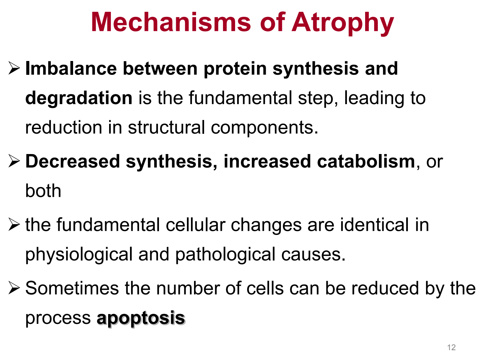

## PDF page 13 — Lysosomal proteolysis

> Source: ch1-part-03, PDF page 13. Printed slide: 13. Classification: teaching.

### Preserved source text

Atrophy: increase catabolism

Proteolytic systems for degradation:

1) Lysosomes     contain hydrolases and other enzymes
• degrade exogenous proteins         engulfed by
  endocytosis
• degrade subcellular components          (e.g. organelles)
  leading to the formation of autophagic vacuoles

### Visual transcription / figure record

Full page visually inspected; extracted text and visible layout compared. Illustrative image retained in original full-page render.

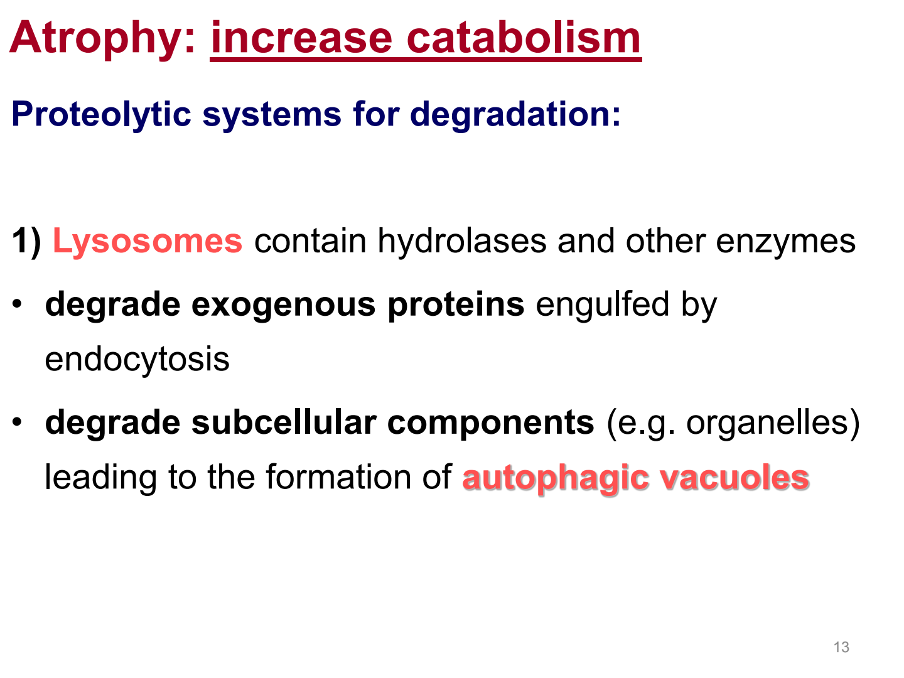

## PDF page 14 — Autophagy sequence

> Source: ch1-part-03, PDF page 14. Printed slide: not visibly labelled. Classification: teaching.

### Preserved source text

(No extractable text beyond the page label; see visual transcription and original image.)

### Visual transcription / figure record

Autophagy diagram: A envelopment; B sealing; C merging with lysosome; D resulting residual body.

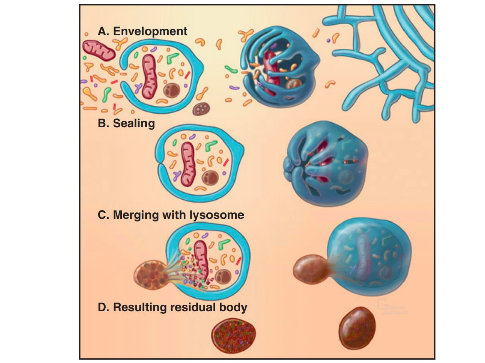

## PDF page 15 — Ubiquitin proteasome pathway

> Source: ch1-part-03, PDF page 15. Printed slide: 15. Classification: teaching.

### Preserved source text

2) The ubiquitin-proteasome pathway:

•Degradation of cytosolic and nuclear proteins
•Responsible for the accelerated proteolysis in hypercatabolic
 states (e.g. cancer)
•The protein/ubiquitin complexes are engulfed by the cytoplasmic
 proteasome

                             Ubiquitin:
 •  An abundant protein found in normal cells.
 •  It has a role in removing old or damaged
    proteins     by acting as a cofactor for proteolysis.
 •  Proteasomes: non lysosomal proteinases.

### Visual transcription / figure record

Full page visually inspected; extracted text and visible layout compared. Illustrative image retained in original full-page render.

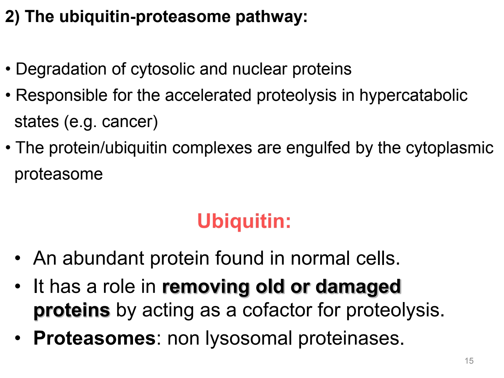

## PDF page 16 — Ubiquitin recycling diagram

> Source: ch1-part-03, PDF page 16. Printed slide: not visibly labelled. Classification: teaching.

### Preserved source text

The ubiquitin-proteasome pathway:

### Visual transcription / figure record

Ubiquitin activation by linking enzymes -> activated ubiquitin linked to damaged protein -> ubiquitinated protein recognized by proteasome -> abnormal protein destroyed to amino acids; ubiquitin recycled.

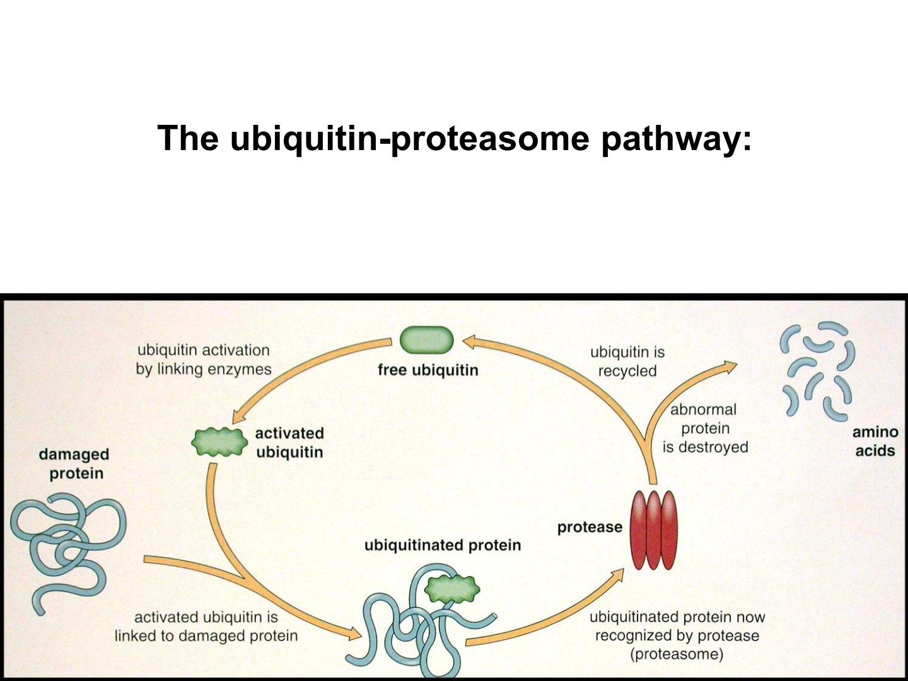

## PDF page 17 — Muscle micrograph

> Source: ch1-part-03, PDF page 17. Printed slide: not visibly labelled. Classification: teaching.

### Preserved source text

(No extractable text beyond the page label; see visual transcription and original image.)

### Visual transcription / figure record

Unlabelled skeletal-muscle cross-section; preserved as illustration, with no invented diagnostic identity.

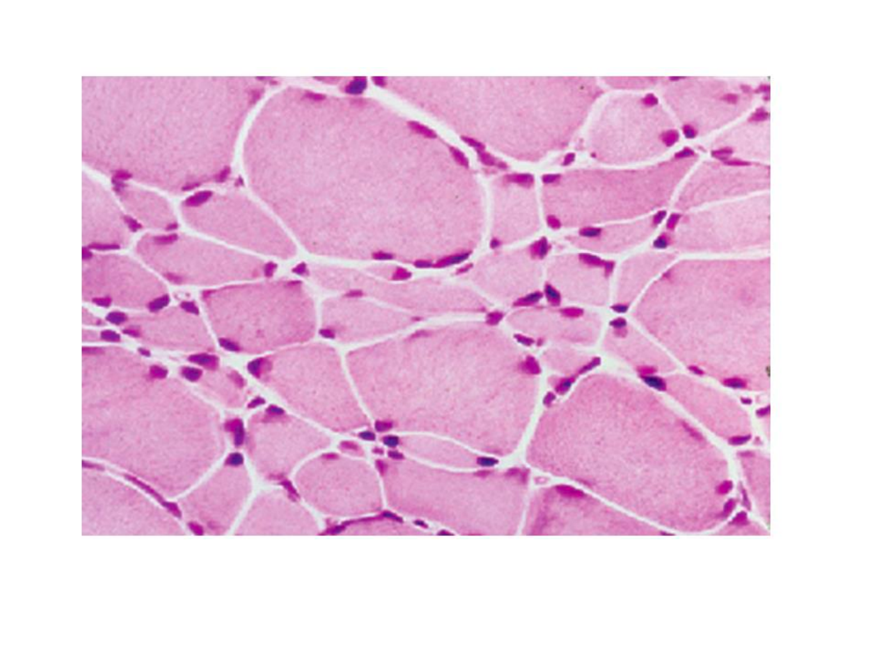

## PDF page 18 — Hypertrophy definition

> Source: ch1-part-03, PDF page 18. Printed slide: 18. Classification: teaching.

### Preserved source text

Hypertrophy

➢ Increase in the size of cells      by an increase in the
  number and density of the cellular substances,
  leading to an over all increase in the size and the
  function of the organ, and a new equilibrium is
  reached.

➢ Mainly occurs in organs composed of cells that
  can’t divide (cardiac & skeletal muscles).

➢ NO NEW CELLS, JUST BIGGER CELLS

### Visual transcription / figure record

Full page visually inspected; extracted text and visible layout compared. Illustrative image retained in original full-page render.

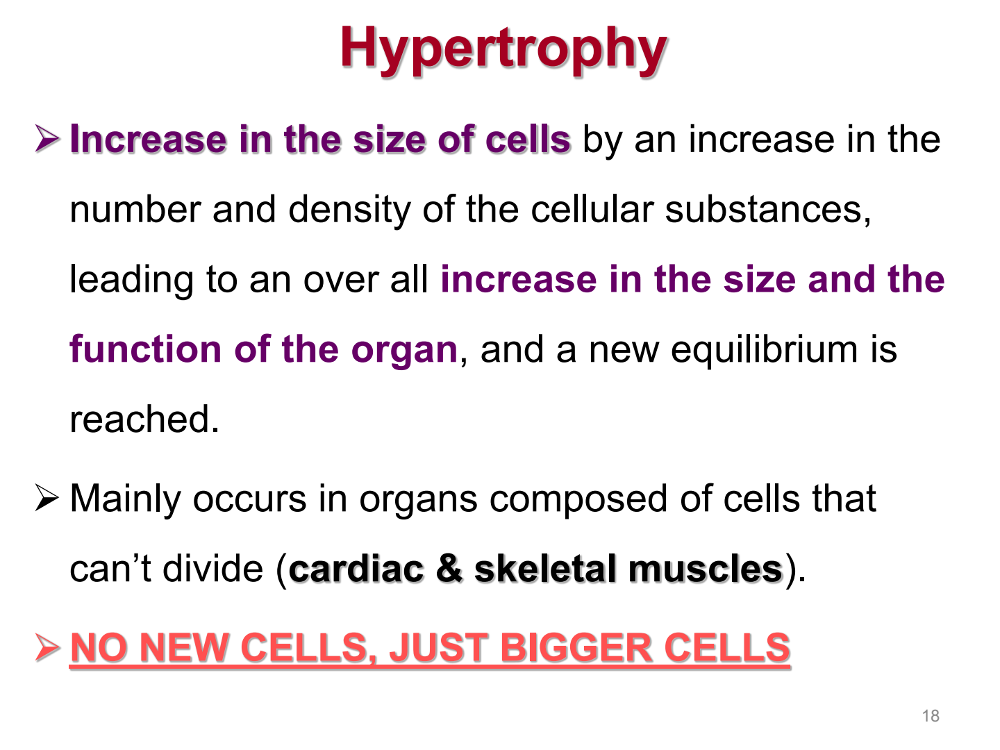

## PDF page 19 — Causes of hypertrophy

> Source: ch1-part-03, PDF page 19. Printed slide: 19. Classification: teaching.

### Preserved source text

Causes of Hypertrophy:
Physiological or pathological:
   – Increase in functional demand or work load
     e.g. body building, hypertension, aortic valve
     disease

   – Increase in hormonal stimulation. This
     involves both hypertrophy and hyperplasia and
     both result in an enlarged (hypertrophic) organ.
   e.g. the gravid uterus     occurs as a consequence
     of estrogen stimulation of both smooth muscle
     hypertrophy and smooth muscle hyperplasia             19

### Visual transcription / figure record

Full page visually inspected; extracted text and visible layout compared. Illustrative image retained in original full-page render.

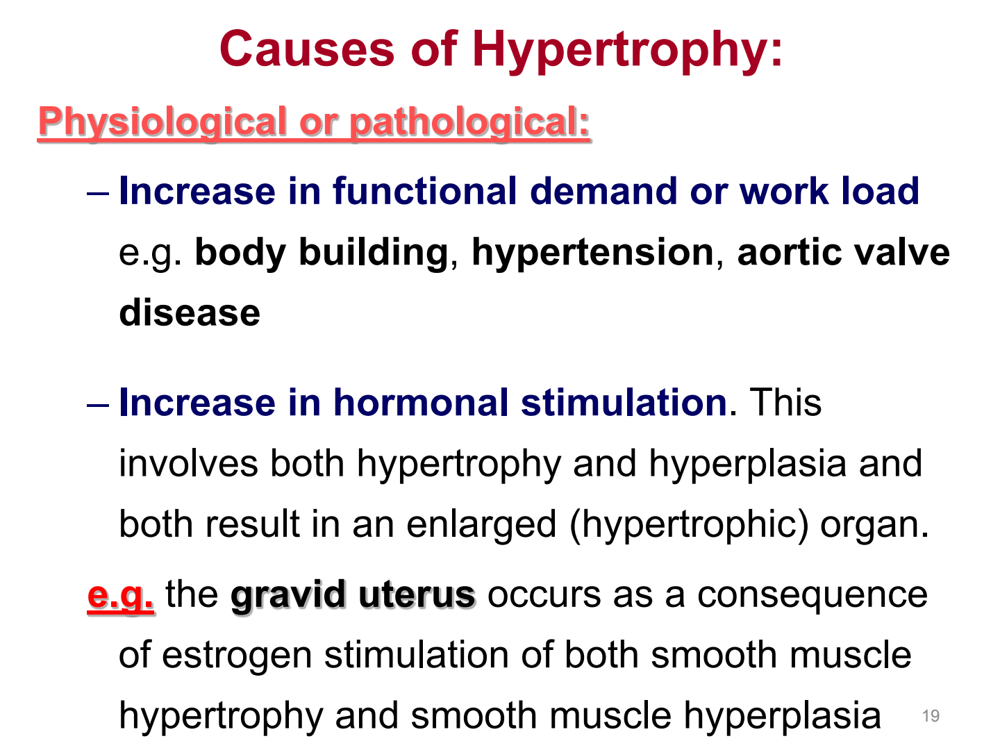

## PDF page 20 — Hypertrophy mechanism

> Source: ch1-part-03, PDF page 20. Printed slide: 20. Classification: teaching.

### Preserved source text

Mechanisms of Hypertrophy

• an increased synthesis of structural
  proteins  and organelles leading to an overall
  increase in the workload of the organ.

### Visual transcription / figure record

Full page visually inspected; extracted text and visible layout compared. Illustrative image retained in original full-page render.

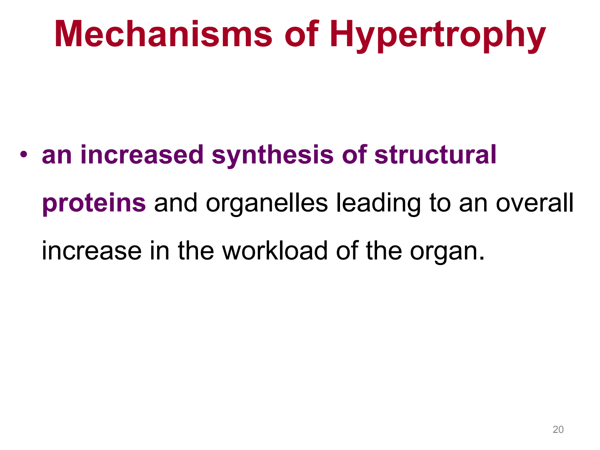

> **Source note (fresh checker):** Source p20 links increased structural synthesis to increased workload, whereas p19 presents workload as the trigger. Preserve both; do not score causal reversal. Increased synthesis and cell size remain clear.

## PDF page 21 — Cardiac hypertrophy triggers

> Source: ch1-part-03, PDF page 21. Printed slide: 21. Classification: teaching.

### Preserved source text

hypertrophy             after myocardial infarction

                     The mechanisms of cardiac
                         hypertrophy:
                     1.  mechanical triggers, such
                         as stretch
                     2.  trophic triggers, such as
                         activation of α-adrenergic
                         receptors                                    21

### Visual transcription / figure record

Full page visually inspected; extracted text and visible layout compared. Illustrative image retained in original full-page render.

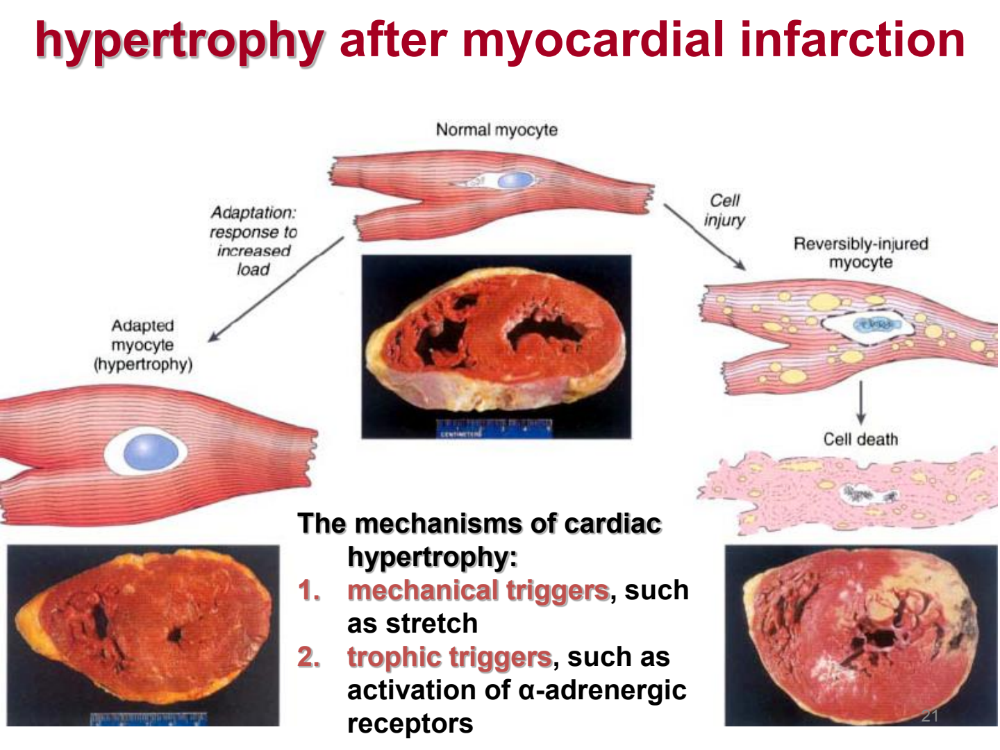

## PDF page 22 — Limits of adaptation

> Source: ch1-part-03, PDF page 22. Printed slide: 22. Classification: teaching.

### Preserved source text

Hypertrophy in hypertension

Adaptive changes may not be completely benign; they can also
result in a dramatic change in the cellular phenotype:

    •Reactivation of certain genes.
    •Switch of contractile proteins to a different type.
    •Degenerative changes overtime            leading to failure of organ

### Visual transcription / figure record

Full page visually inspected; extracted text and visible layout compared. Illustrative image retained in original full-page render.

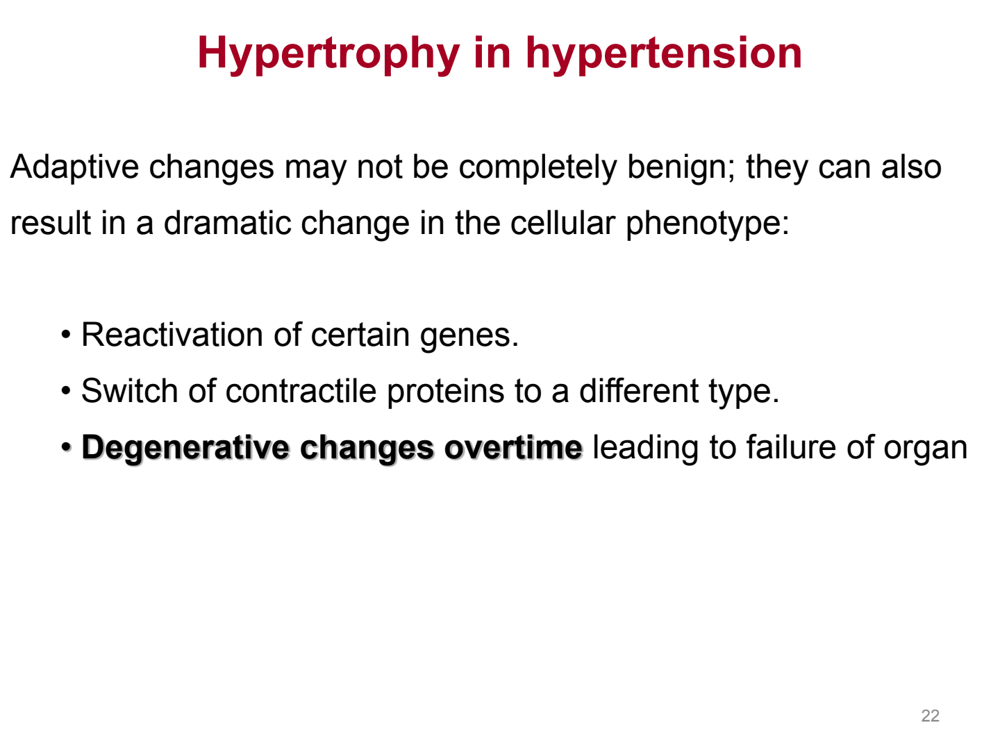

## PDF page 23 — Skeletal muscle hypertrophy

> Source: ch1-part-03, PDF page 23. Printed slide: 23. Classification: teaching.

### Preserved source text

Skeletal muscle
hypertrophy in body
building:

### Visual transcription / figure record

Full page visually inspected; extracted text and visible layout compared. Illustrative image retained in original full-page render.

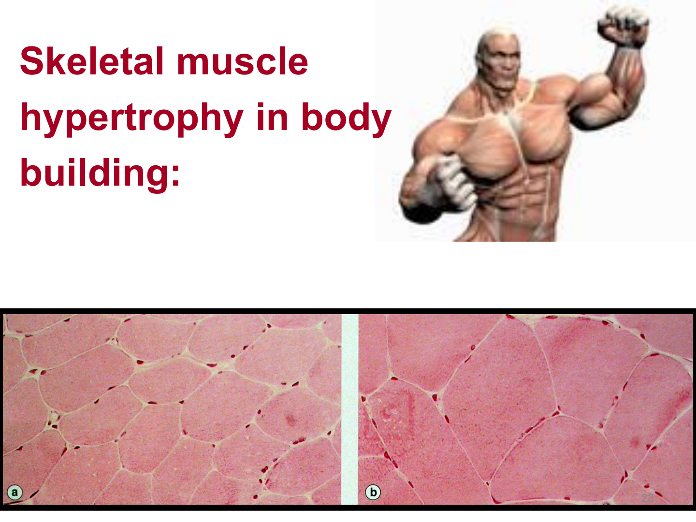

## PDF page 24 — Hyperplasia definition

> Source: ch1-part-03, PDF page 24. Printed slide: 24. Classification: teaching.

### Preserved source text

Hyperplasia

➢an increase in the size of the organ         due
  to increase in the number of the cells        in
  the organ, leading to increase in the
  function.

➢SEEN IN CELLS THAT CAN DIVIDE

### Visual transcription / figure record

Full page visually inspected; extracted text and visible layout compared. Illustrative image retained in original full-page render.

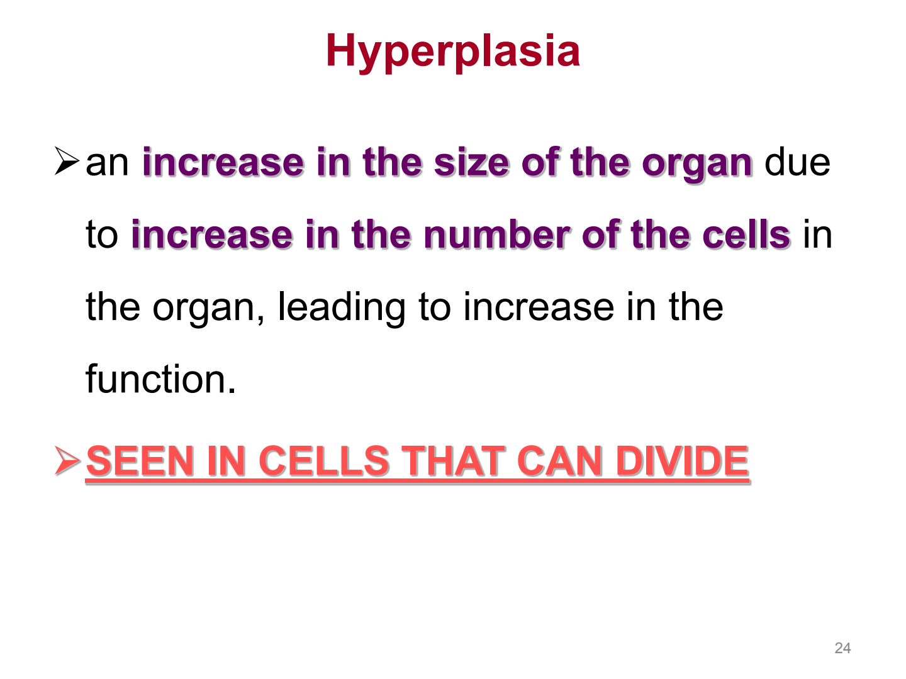

## PDF page 25 — Uterine growth

> Source: ch1-part-03, PDF page 25. Printed slide: 25. Classification: teaching.

### Preserved source text

Hyperplasia

Gravid uterus

### Visual transcription / figure record

Gravid uterus image beside diagram: cell number rises in hyperplasia; cell size rises in hypertrophy; both rise in combined hypertrophy and hyperplasia.

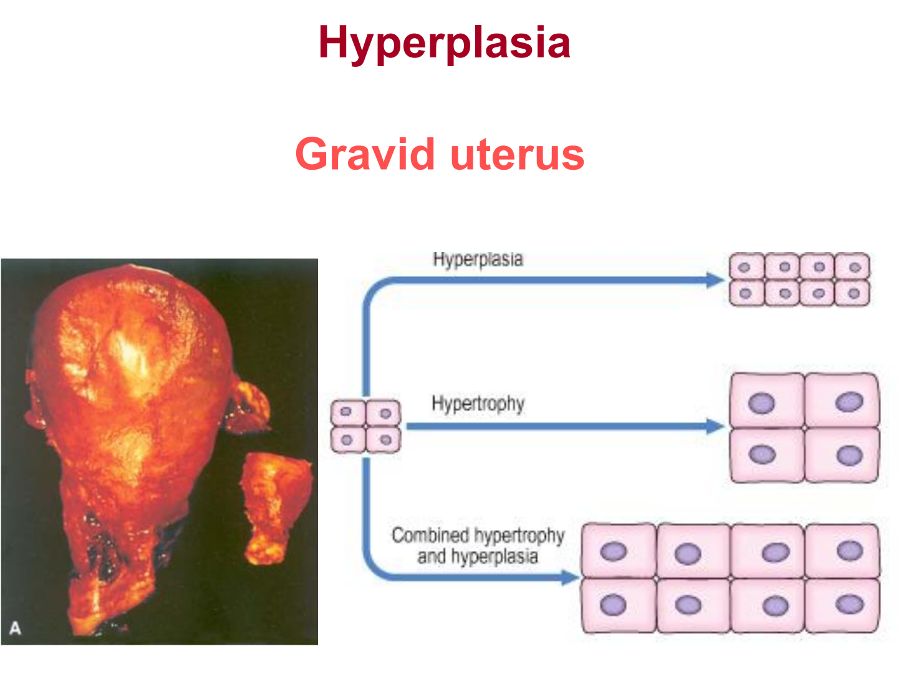

## PDF page 26 — Causes of hyperplasia

> Source: ch1-part-03, PDF page 26. Printed slide: 26. Classification: teaching.

### Preserved source text

Causes of Hyperplasia:
•  Physiological:
   1. hormonal hyperplasia
      (e.g. female breast  at puberty and during pregnancy)
   2. compensatory hyperplasia:           occurs when a
      portion of the tissue is removed or diseased which
      is under the influence of growth factors  (e.g. liver
      resection, wound healing)
•  Pathological:
   –  Under the effect of hormones or growth factors.
      (e.g. Endometrial hyperplasia, skin wart)                 26

### Visual transcription / figure record

Full page visually inspected; extracted text and visible layout compared. Illustrative image retained in original full-page render.

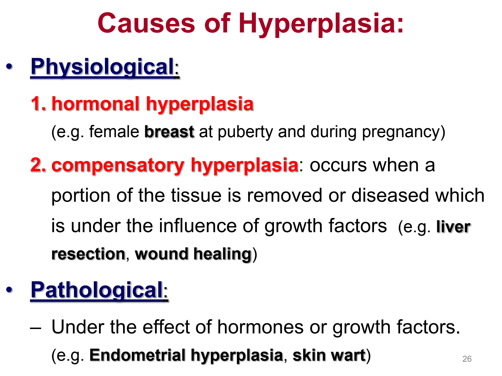

## PDF page 27 — Reversibility and cancer risk

> Source: ch1-part-03, PDF page 27. Printed slide: 27. Classification: teaching.

### Preserved source text

Hyperplasia
•  Both hypertrophy and hyperplasia are reversible, if the
   stimulus is removed.

•  This differentiates these processes from cancer, in which
   cells continue to grow despite the absence of hormonal
   stimuli.

•  pathologic hyperplasia constitutes a fertile soil in which
   cancerous proliferation may eventually arise.

e.g. patients with hyperplasia of the endometrium            are at
   increased risk of developing endometrial cancer

e.g. papillomavirus    infections predispose to cervical cancers

### Visual transcription / figure record

Full page visually inspected; extracted text and visible layout compared. Illustrative image retained in original full-page render.

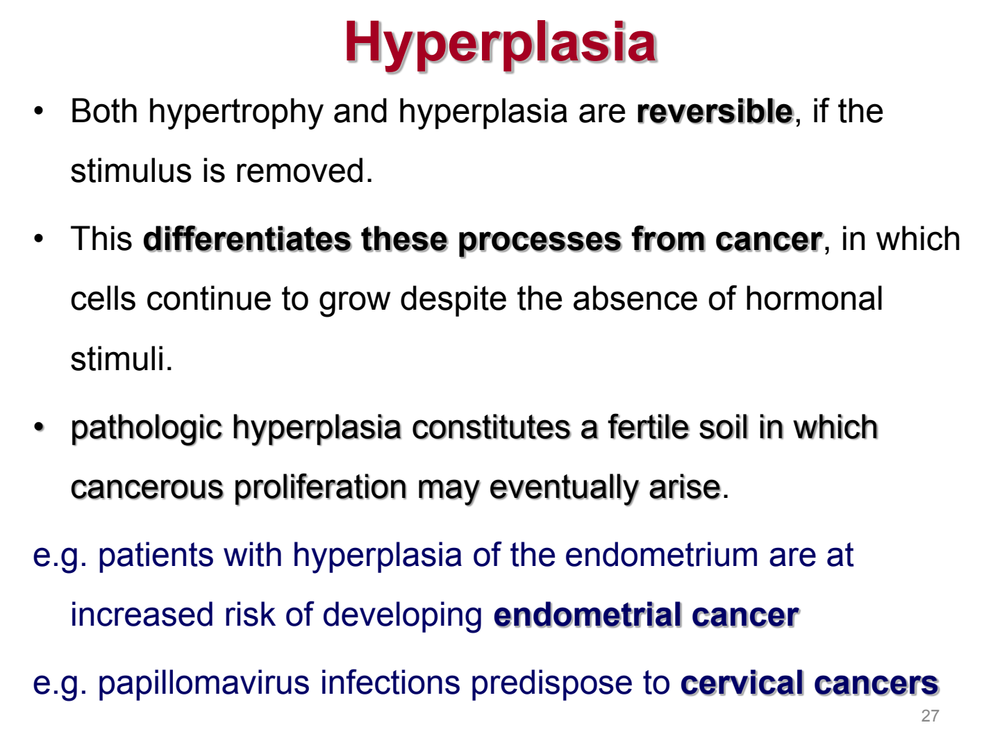

## PDF page 28 — Hypertrophy hyperplasia summary

> Source: ch1-part-03, PDF page 28. Printed slide: 28. Classification: teaching.

### Preserved source text

Hypertrophy & hyperplasia
         Summary

### Visual transcription / figure record

Normal stable tissue -> increased functional/work/metabolic demand, excess endocrine stimulation or persisting tissue injury -> larger cells, more cells, or both -> hypertrophy, hyperplasia, or both. Cause removal -> reduced cell size/number -> normal tissue.

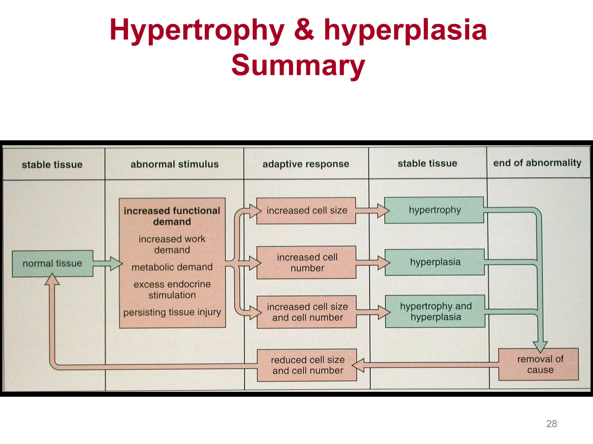

## PDF page 29 — Metaplasia definition and mechanism

> Source: ch1-part-03, PDF page 29. Printed slide: 29. Classification: teaching.

### Preserved source text

Metaplasia
➢ Replacement of one type of adult cell, whether
  epithelial or mesenchymal, by another type            of adult
  cell
➢ aiming at replacing cells that are sensitive to
  certain stimuli by a more resistant cell type.
➢ This happens through reprogramming of stem cells or
  undifferentiated mesenchymal cells.
➢ the influences that induce metaplastic transformation,
  if persistent, may induce cancer transformation              in
  the metaplastic epithelium

### Visual transcription / figure record

Full page visually inspected; extracted text and visible layout compared. Illustrative image retained in original full-page render.

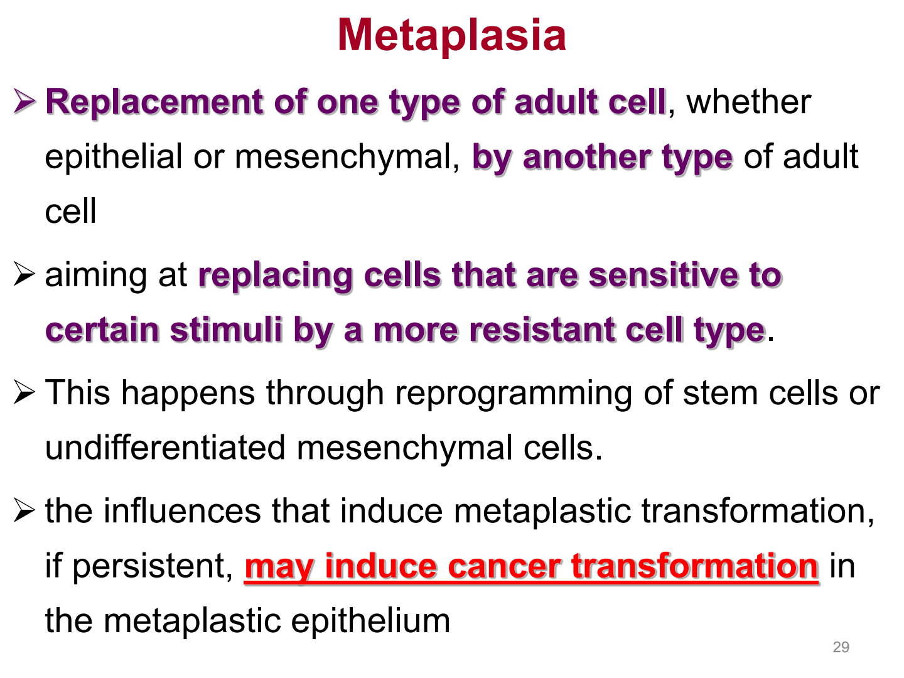

## PDF page 30 — Metaplasia examples

> Source: ch1-part-03, PDF page 30. Printed slide: 30. Classification: teaching.

### Preserved source text

Examples of Metaplasia

  (respiratory epithelium)                        30

### Visual transcription / figure record

Metaplasia table (original tissue | stimulus | replacement): ciliated bronchial columnar | cigarette smoke | squamous; bladder transitional | calculus trauma | squamous; gland-duct columnar | calculus trauma | squamous; fibrocollagenous tissue | chronic trauma | bone; esophageal squamous | gastric acid | columnar; columnar glandular respiratory epithelium | vitamin A deficiency | squamous. Diagram labels basement membrane, normal columnar, reserve cells and squamous metaplasia.

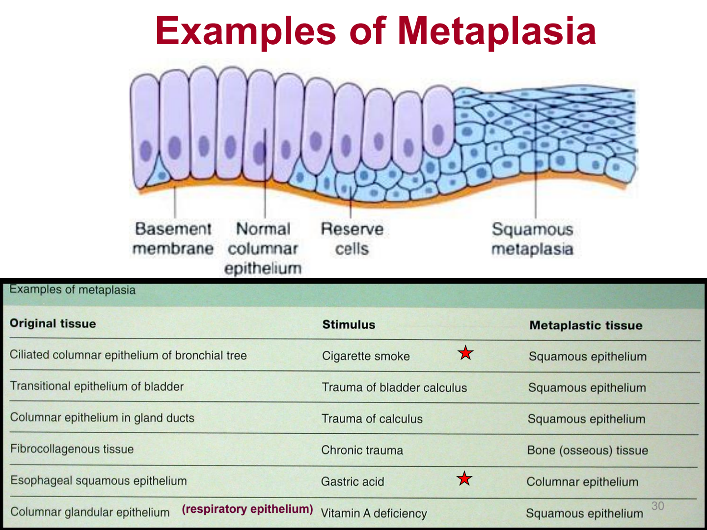

## PDF page 31 — Barrett metaplasia

> Source: ch1-part-03, PDF page 31. Printed slide: 31. Classification: teaching.

### Preserved source text

Metaplastic transformation of esophageal stratified
  squamous epithelium (left) to mature columnar
      epithelium (so-called Barrett metaplasia)

### Visual transcription / figure record

Full page visually inspected; extracted text and visible layout compared. Illustrative image retained in original full-page render.

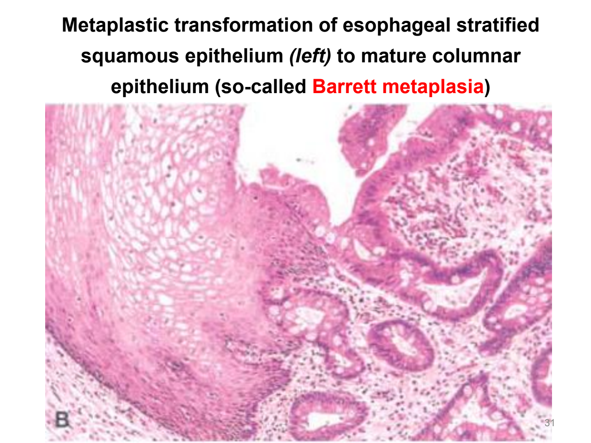

## PDF page 32 — Source practice question

> Source: ch1-part-03, PDF page 32. Printed slide: not visibly labelled. Classification: teaching.

### Preserved source text

•  An investigator is studying the cell morphologies of the
   respiratory tract. He obtains a biopsy from the             mainstem
   bronchus    of a patient. On microscopic examination, the
   biopsy sample shows        uniform squamous cells in layers.
   Which of the following best describes the histologic
   finding seen in this patient?

A.  Metaplasia
B.  Normal epithelium
C.  Dysplasia
D.  Hyperplasia
E.  Hypertrophy
F.  Anaplasia

### Visual transcription / figure record

Full page visually inspected; extracted text and visible layout compared. Illustrative image retained in original full-page render.

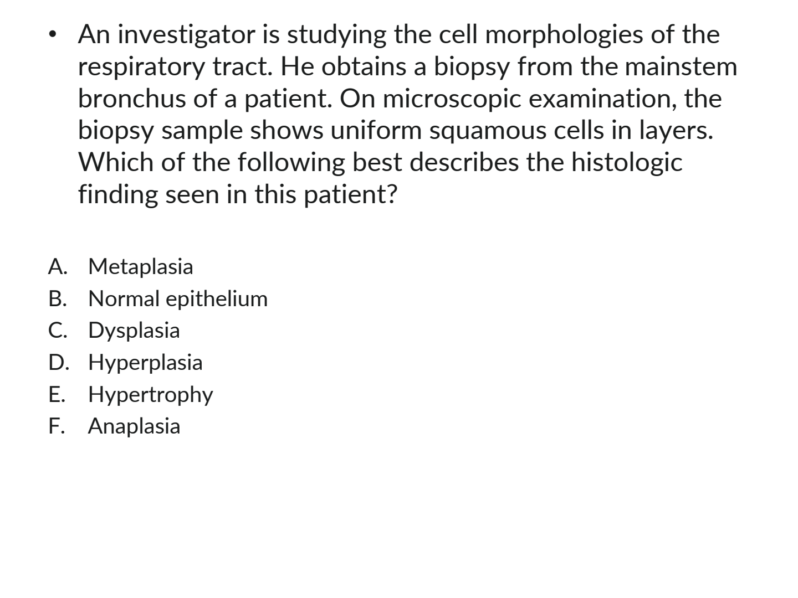

## PDF page 33 — Closing quotation

> Source: ch1-part-03, PDF page 33. Printed slide: not visibly labelled. Classification: administrative.

### Preserved source text

(No extractable text beyond the page label; see visual transcription and original image.)

### Visual transcription / figure record

Closing quotation attributed in source to Winston Churchill: Success is the ability to go from one failure to another with no loss of enthusiasm.

