# Chapter 1 — Part 4: Cover

Authority: unchanged supplied PDF only. Page headings use one-based PDF pages; printed labels are recorded only when visibly present. Original extracted text is preserved below, with separately identified visual transcription. No outside teaching content.

## PDF page 1 — Cover

> Source: ch1-part-04, PDF page 1. Printed slide: 1. Classification: cover.

### Preserved source text

Subcellular
Responses to
     Injury

Dr. Mahmoud Kiswani
Al-Quds University
Faculty of Medicine
Pathology Department                                         1

### Visual transcription / figure record

Full page visually inspected; extracted text and visible layout compared. Illustrative image retained in original full-page render.

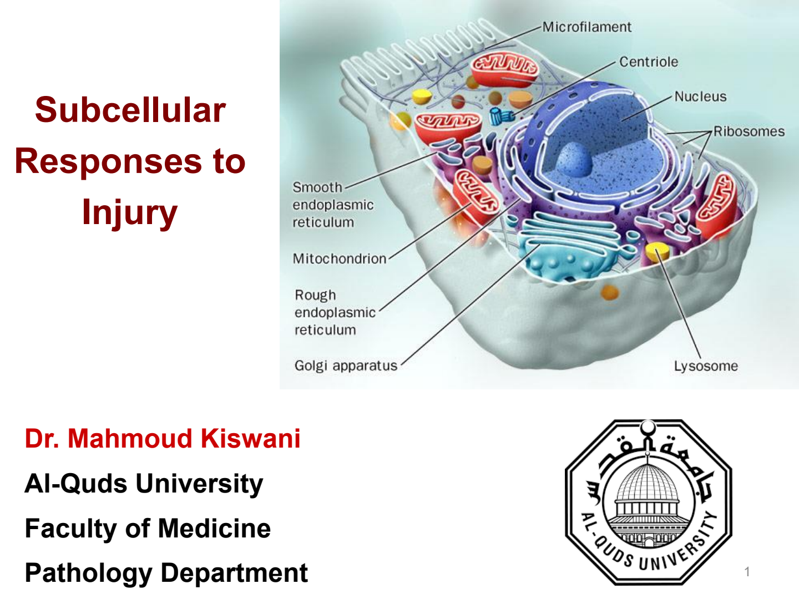

## PDF page 2 — Subcellular responses overview

> Source: ch1-part-04, PDF page 2. Printed slide: 2. Classification: teaching.

### Preserved source text

Subcellular responses to injury
1. Lysosomal Catabolism

     ➢  Heterophagy
     ➢  Autophagy
2. Induction (Hypertrophy) of Smooth
   Endoplasmic Reticulum
3. Mitochondrial Alterations
4. Cytoskeletal Abnormalities
5. Heat Shock Proteins

### Visual transcription / figure record

Full page visually inspected; extracted text and visible layout compared. Illustrative image retained in original full-page render.

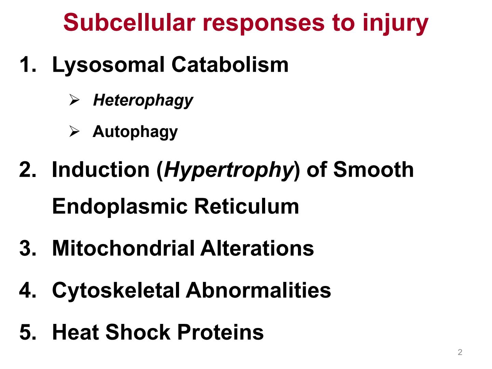

## PDF page 3 — Primary and secondary lysosomes

> Source: ch1-part-04, PDF page 3. Printed slide: 3. Classification: teaching.

### Preserved source text

Subcellular responses to injury:

1.  Lysosomal catabolism:
   –  Primary lysosomes: membrane bound
      intracellular organelles containing a variety of
      hydrolytic enzymes

   –  Secondary lysosomes, “phagolysosome” :
      when the primary lysosomes fuse with vacuoles
      containing material for digestion.

### Visual transcription / figure record

Full page visually inspected; extracted text and visible layout compared. Illustrative image retained in original full-page render.

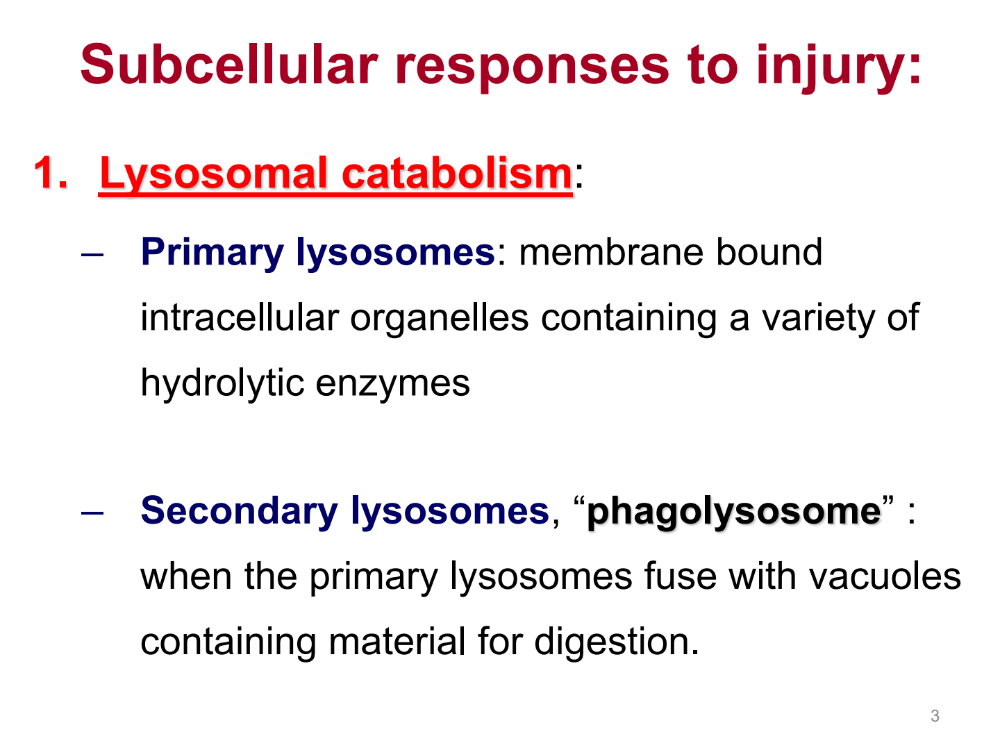

## PDF page 4 — Autophagy and heterophagy

> Source: ch1-part-04, PDF page 4. Printed slide: 4. Classification: teaching.

### Preserved source text

1.Lysosomal catabolism:

• Two ways:

     1.autophagy

     2.heterophagy

### Visual transcription / figure record

Heterophagy diagram: external material -> phagocytic vacuole -> primary lysosome fusion -> heterophagic phagolysosome/secondary lysosome -> residual body/exocytosis. Autophagy: intracellular organelles -> autophagic vacuole -> lysosome fusion -> residual body/lipofuscin. Electron micrograph highlights a vacuole.

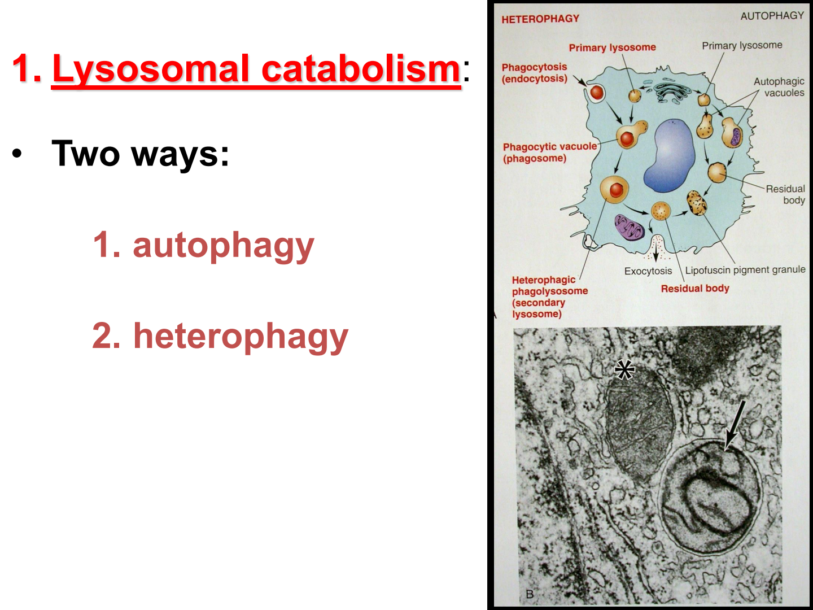

## PDF page 5 — Lysosomal pathways diagram

> Source: ch1-part-04, PDF page 5. Printed slide: not visibly labelled. Classification: teaching.

### Preserved source text

(No extractable text beyond the page label; see visual transcription and original image.)

### Visual transcription / figure record

Fluid -> pinocytosis -> pinocytotic absorptive vacuole. Particles -> phagocytosis -> phagosome. Primary lysosomes with acid hydrolases from Golgi fuse to form secondary lysosomal compartments. Autophagosome encloses mitochondria. Residual body -> exocytosis. Enzymes shown through DNA -> RNA -> RER -> Golgi, with PTM label.

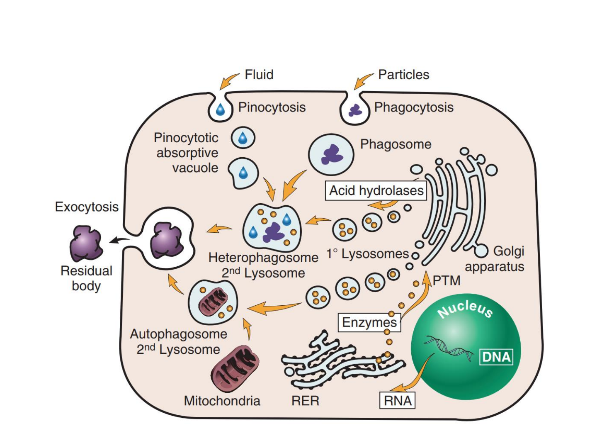

## PDF page 6 — Lysosomal processing diagram

> Source: ch1-part-04, PDF page 6. Printed slide: not visibly labelled. Classification: teaching.

### Preserved source text

(No extractable text beyond the page label; see visual transcription and original image.)

### Visual transcription / figure record

Bacterial phagocytosis -> heterophagosome -> secondary lysosome -> residual body. Intracellular organelle -> autophagosome -> lysosomal processing -> residual body/lipofuscin. Golgi produces primary lysosomes; RER and nucleus labelled.

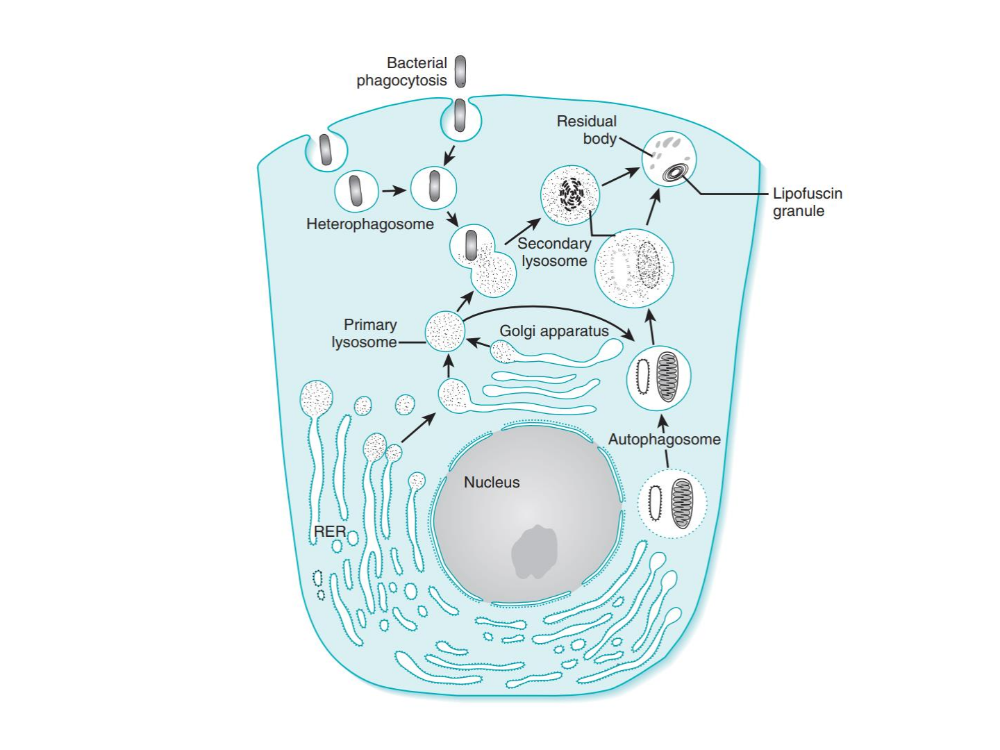

## PDF page 7 — Autophagy

> Source: ch1-part-04, PDF page 7. Printed slide: 7. Classification: teaching.

### Preserved source text

Type of phagocytosis:

• Autophagy:
   –  When intracellular organelles are sequestered from the
      cytoplasm in an autophagic vacuole. This combines with
      primary lysosome to form autophagolysosome.
   –  seen especially with atrophy and aging.

### Visual transcription / figure record

Autophagy sequence labels effete organelle, ER-derived membrane, early autophagic body, lysosomal hydrolase, tubulovesicular body, late autophagic body, residual body.

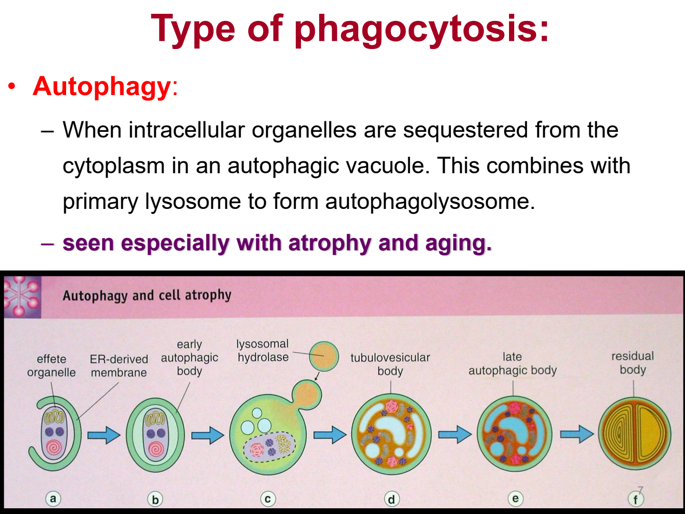

## PDF page 8 — Heterophagy and uptake types

> Source: ch1-part-04, PDF page 8. Printed slide: 8. Classification: teaching.

### Preserved source text

Type of phagocytosis:
• Heterophagy:
   – Inflammatory cells engulf and destroy foreign
     bodies
   – e.g. bacteria are ingested and degraded by
     neutrophils
   – e.g. macrophages engulf and catabolize necrotic
     cells.
Pinocytosis:  is engulfment of soluble small material
Phagocytosis: engulfment of large material

### Visual transcription / figure record

Full page visually inspected; extracted text and visible layout compared. Illustrative image retained in original full-page render.

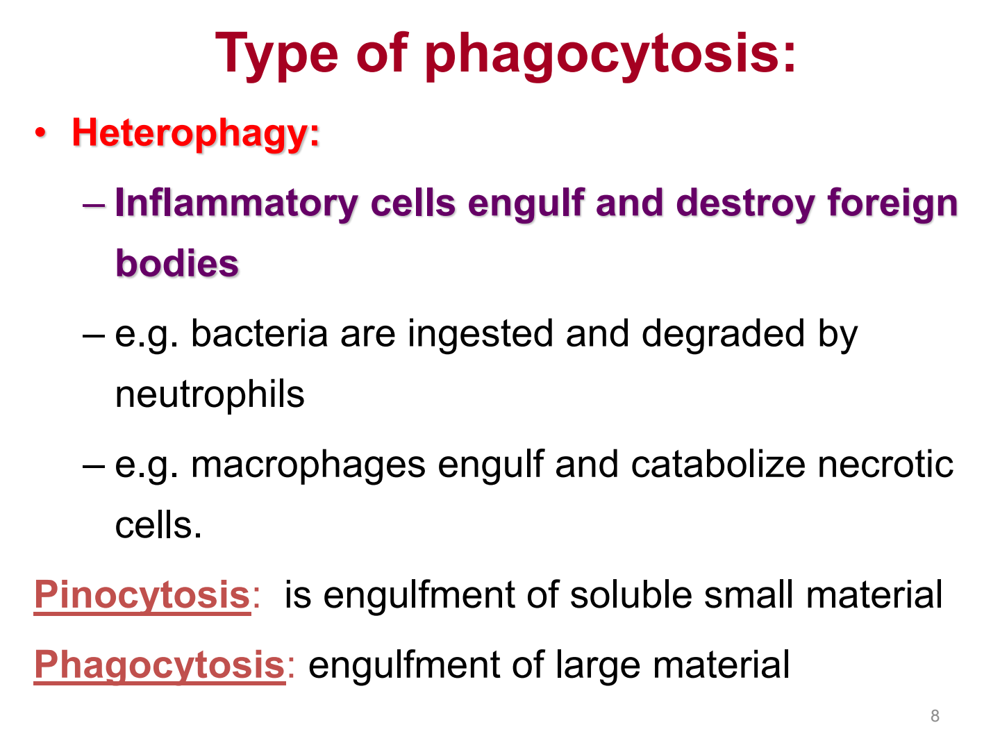

## PDF page 9 — Residual bodies and pigments

> Source: ch1-part-04, PDF page 9. Printed slide: 9. Classification: teaching.

### Preserved source text

Type of phagocytosis:

• Lysosomes      can completely catabolize most
  proteins and carbohydrates
• Lysosomes      with undigested debris may persist
  within cells as residual bodies       or may be extruded
• Lipofuscin pigment       granules represent indigestible
  material   resulting from intracellular lipid peroxidation.
  Certain indigestible pigments, such as carbon
  particles  inhaled from the atmosphere, can persist in
  phagolysosomes of macrophages for decades.
• Lysosomal storage diseases.                                9

### Visual transcription / figure record

Full page visually inspected; extracted text and visible layout compared. Illustrative image retained in original full-page render.

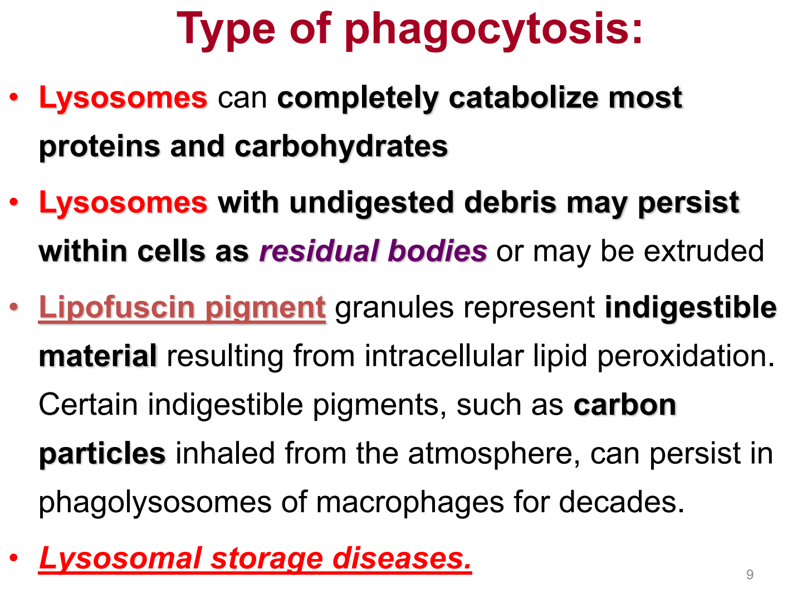

## PDF page 10 — Smooth ER induction

> Source: ch1-part-04, PDF page 10. Printed slide: 10. Classification: teaching.

### Preserved source text

2.    Hypertrophy of the           smooth endoplasmic
                             reticulum:
• Stimulation and activation of SER and its
  enzymes     (P-450 oxidase) to increase the solubility
  and excretion of various compounds.
• Increase solubility of drugs        (e.g., steroids, alcohol,
  insecticides) and thereby facilitate their excretion.
• E.g:  patients who increase their alcohol intake while
  taking phenobarbital      for epilepsy may end up with
  subtherapeutic levels.

### Visual transcription / figure record

Full page visually inspected; extracted text and visible layout compared. Illustrative image retained in original full-page render.

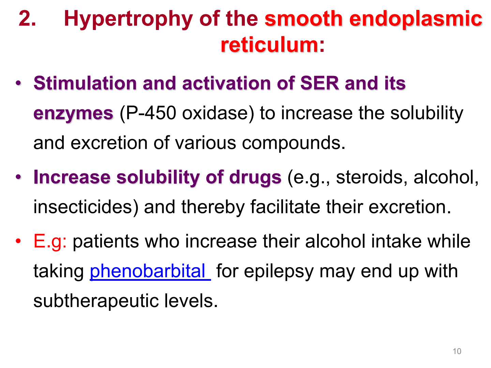

## PDF page 11 — Mitochondrial alterations

> Source: ch1-part-04, PDF page 11. Printed slide: 11. Classification: teaching.

### Preserved source text

3.   Mitochondrial alternations:

• Increase number in hypertrophy

• Decrease number in atrophy

• Example: alcoholic liver disease

  – large and abnormal shapes (megamitochondria)

### Visual transcription / figure record

Full page visually inspected; extracted text and visible layout compared. Illustrative image retained in original full-page render.

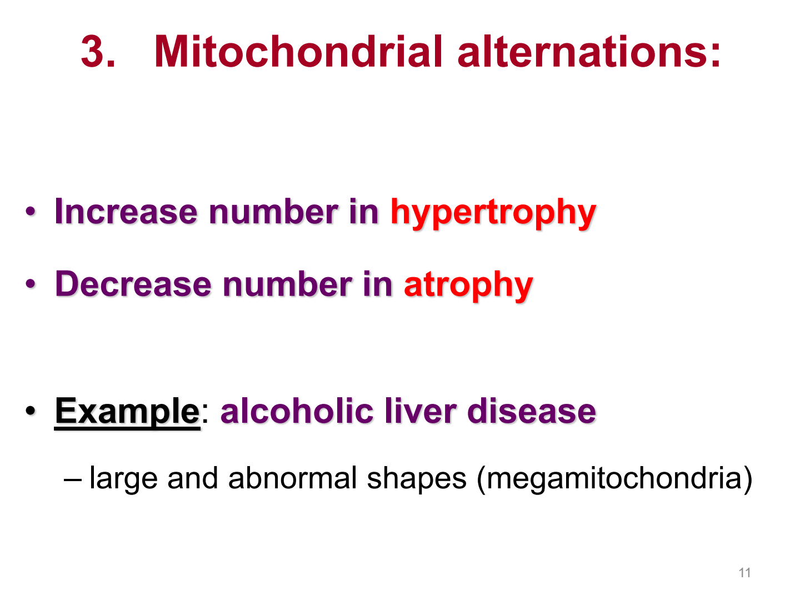

## PDF page 12 — Cytoskeletal abnormalities

> Source: ch1-part-04, PDF page 12. Printed slide: 12. Classification: teaching.

### Preserved source text

4.      Cytoskeletal abnormalities

•  Increase   or decrease with hypertrophy or atrophy
•  functional modification to withstand more stress.
e.g. immobilizing cilia of the respiratory epithelium, resulting in
   chronic infections due to defective clearance of inhaled bacteria
   (Kartagener, or the immotile cilia syndrome).
•  Microtubules are essential for leukocyte migration and
   phagocytosis.
e.g. Drugs that prevent microtubule polymerization (colchicine)
   are therefore useful in treating gout, in which symptoms are due
   to movement of macrophages toward urate             crystals with
   subsequent frustrated attempts at phagocytosis.                        12

### Visual transcription / figure record

Full page visually inspected; extracted text and visible layout compared. Illustrative image retained in original full-page render.

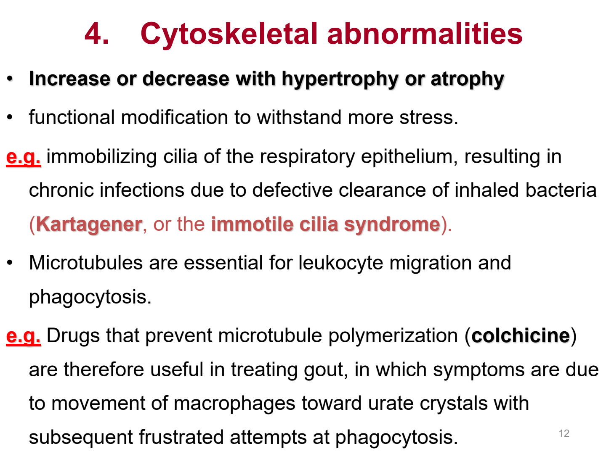

> **Source note (fresh checker):** Gout example specifically attributes symptoms to macrophage migration toward urate crystals. Preserve literal wording without extending it to a universal cell-specific therapeutic claim; microtubule/leukocyte mechanism remains assessable.

## PDF page 13 — Heat shock proteins

> Source: ch1-part-04, PDF page 13. Printed slide: 13. Classification: teaching.

### Preserved source text

5.   Heat shock proteins;              HSP

• Synonymous: stress proteins, molecular
  chaperones
• Cytoplasmic     proteins that are involved in
  protein kinesis and repair, like protein
  folding, disaggregation and transport         .
• Important adaptive response found in all
  species

### Visual transcription / figure record

Full page visually inspected; extracted text and visible layout compared. Illustrative image retained in original full-page render.

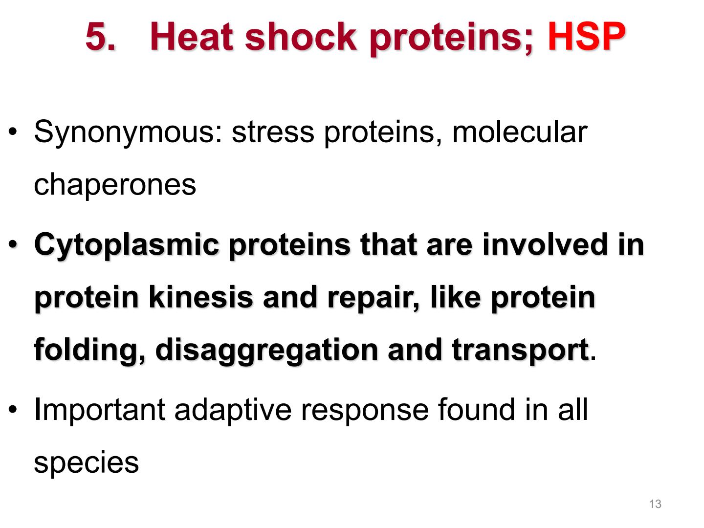

## PDF page 14 — Heat shock protein responses

> Source: ch1-part-04, PDF page 14. Printed slide: 14. Classification: teaching.

### Preserved source text

Heat shock proteins;              HSP

•   Two families:
   1.  Produced always in normal cells; HSP 60, 90
   2.  Produced only under stress; HSP 70
•   HSP   induced after injurious stimuli leads:
   1.  Refolding denatured proteins         before   causing
       death.
   2.  If not responding, the protein is directed to bind
       with ubiquitin-proteasome pathway, leading to
       degradation.

### Visual transcription / figure record

Full page visually inspected; extracted text and visible layout compared. Illustrative image retained in original full-page render.

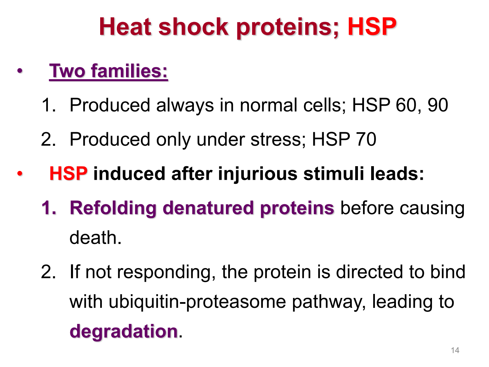

> **Source note:** Slide states HSP60/90 always produced and HSP70 only under stress. Absolute expression claims are not qualified; defer those claims, retain protein-refolding/degradation pathway.

## PDF page 15 — Protein repair or degradation

> Source: ch1-part-04, PDF page 15. Printed slide: 15. Classification: teaching.

### Preserved source text

Heat Shock Proteins;     HSP

### Visual transcription / figure record

Stress (UV, heat, free radical injury) -> nonfunctional protein aggregates -> cell death unless repaired/removed. Chaperone route refolds protein; ubiquitin -> proteasome route generates degraded peptide fragments.

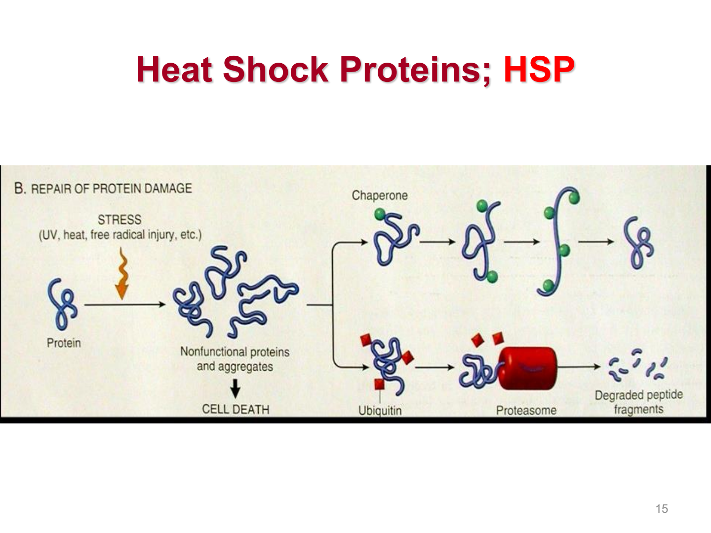

