# Chapter 1 — Part 5: Cover

Authority: unchanged supplied PDF only. Page headings use one-based PDF pages; printed labels are recorded only when visibly present. Original extracted text is preserved below, with separately identified visual transcription. No outside teaching content.

## PDF page 1 — Cover

> Source: ch1-part-05, PDF page 1. Printed slide: not reliably labelled. Classification: cover.

### Preserved source text

Reversible
       vs
Irreversible
 cell injury

Dr. Mahmoud Kiswani
Al-Quds University
Faculty of Medicine
                                                          1
Pathology Department

### Visual transcription / figure record

Full page visually inspected; extracted text and visible layout compared. Illustrative image retained in original full-page render.

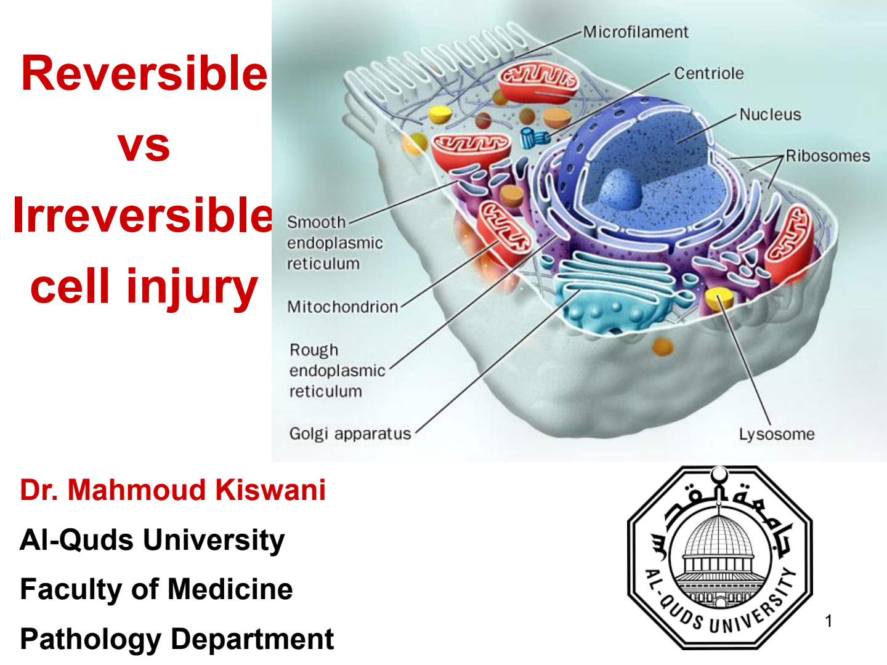

## PDF page 2 — Timing of injury changes

> Source: ch1-part-05, PDF page 2. Printed slide: 2. Classification: teaching.

### Preserved source text

2

### Visual transcription / figure record

Graph: x duration of injury; y effect. Cell function declines before cell death. Ultrastructural changes appear before light microscopic changes, which precede gross morphologic changes. Functional changes typically precede any morphologic changes.

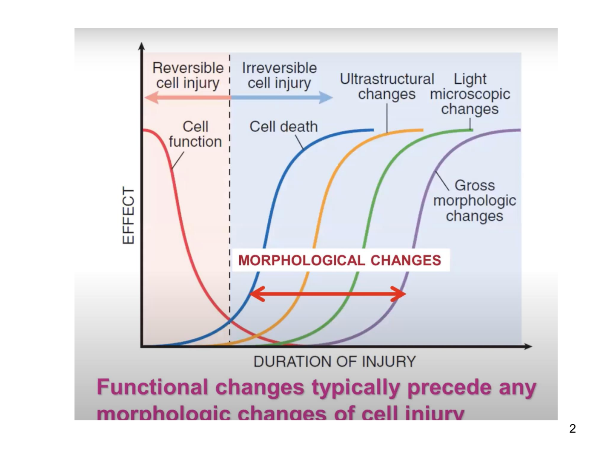

## PDF page 3 — Cell injury progression

> Source: ch1-part-05, PDF page 3. Printed slide: 3. Classification: teaching.

### Preserved source text

3

### Visual transcription / figure record

Healthy cell -> reversible injury with swelling, detached ribosomes, blebs, clumped chromatin/myelin figures -> irreversible membrane rupture, lysosome rupture, nuclear degradation, mitochondrial densities -> necrosis and cell lysis.

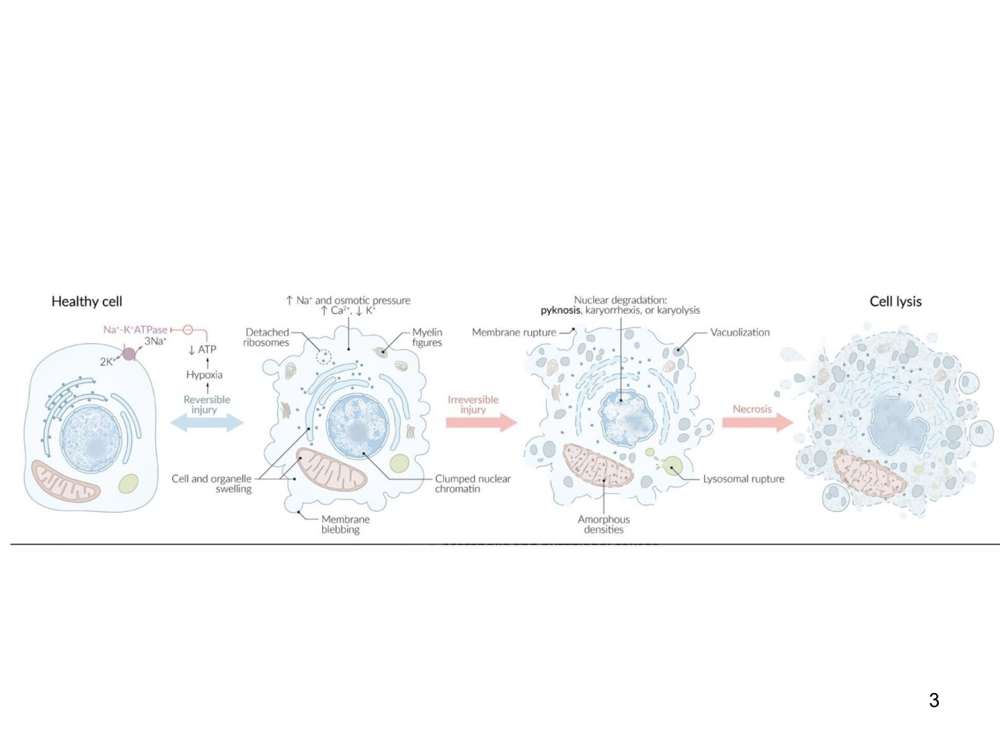

## PDF page 4 — Membrane alterations diagram

> Source: ch1-part-05, PDF page 4. Printed slide: 4. Classification: teaching.

### Preserved source text

4

### Visual transcription / figure record

Membrane diagram labels microvilli, desmosome, RER, mitochondrion; A–E identify illustrated alterations without a supplied textual answer key.

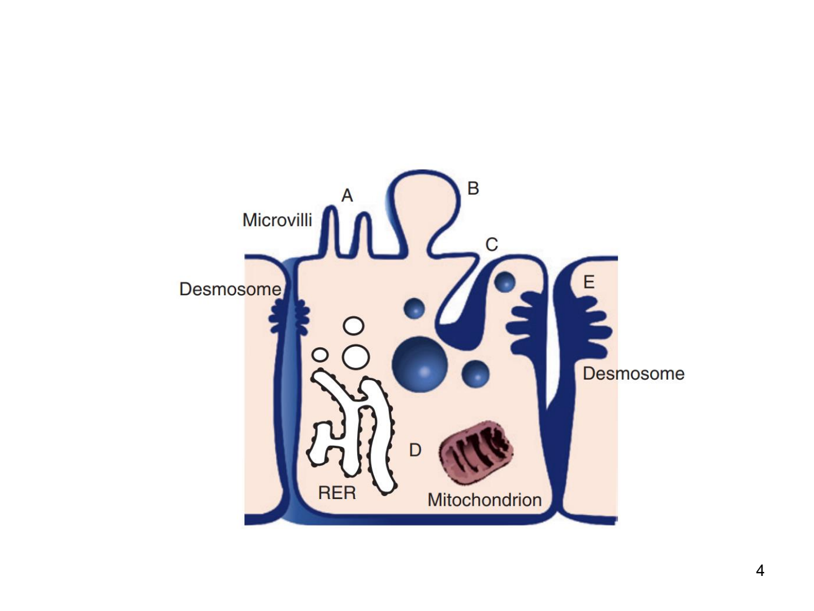

## PDF page 5 — Hydropic change micrograph

> Source: ch1-part-05, PDF page 5. Printed slide: 5. Classification: teaching.

### Preserved source text

5

### Visual transcription / figure record

Hydropic-change micrograph has N and H labels; clear vacuolated cell cytoplasm is illustrated. No additional text identification is invented.

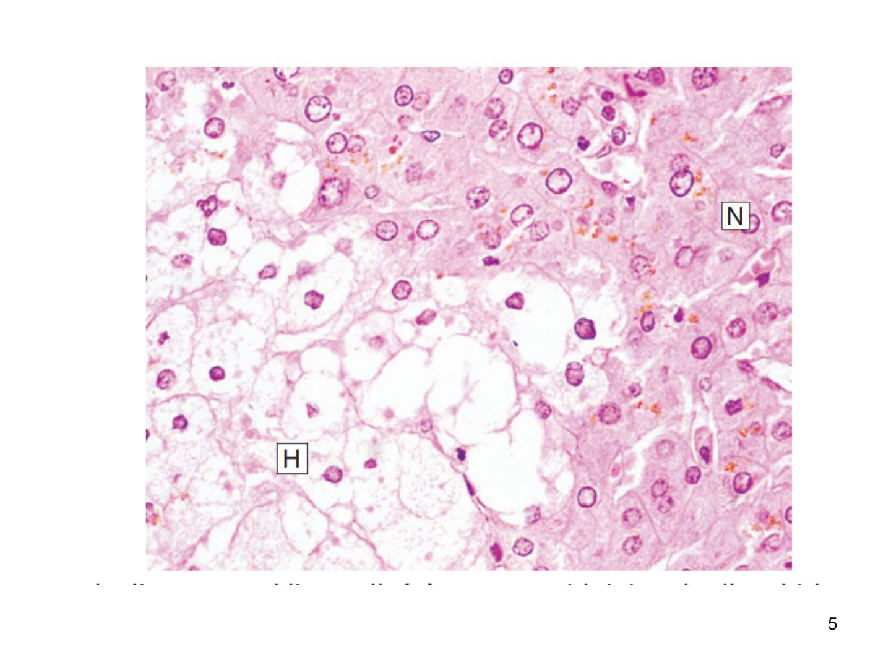

## PDF page 6 — Reversible injury and point of no return

> Source: ch1-part-05, PDF page 6. Printed slide: 6. Classification: teaching.

### Preserved source text

6

### Visual transcription / figure record

Graph illustrates reversible hypo/hyperfunction with stimulus removal returning to normal; a point of no return leads to irreversible injury/necrosis. Normal cell -> reversible swelling -> normal recovery or necrotic cell.

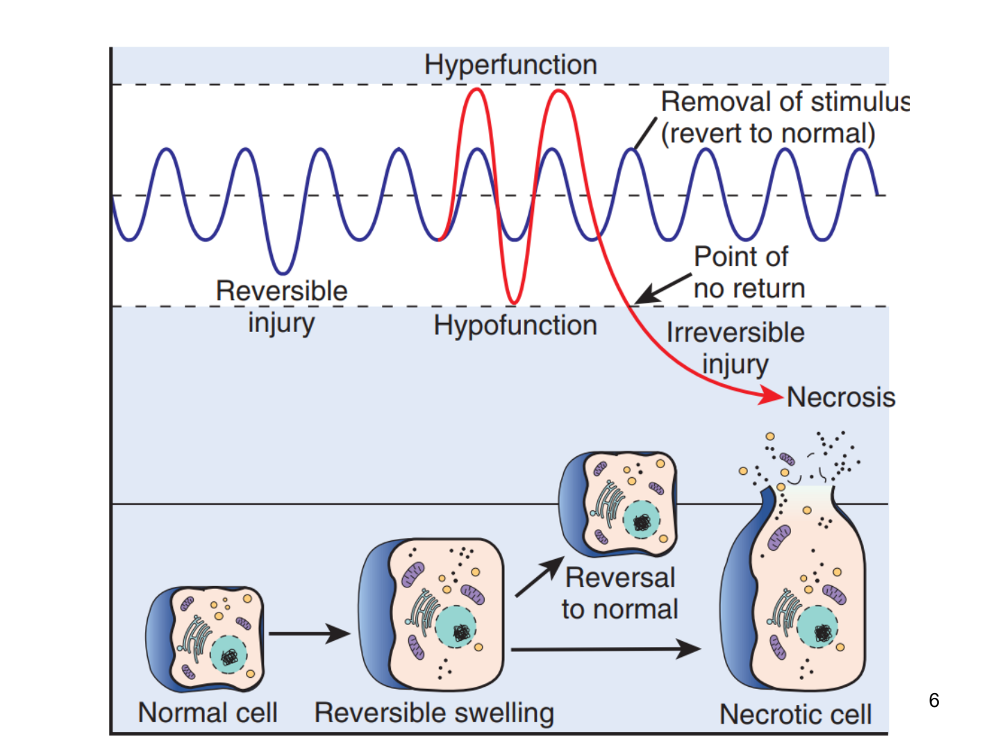

## PDF page 7 — Morphologic comparison

> Source: ch1-part-05, PDF page 7. Printed slide: 7. Classification: teaching.

### Preserved source text

reversible injury

                                    necrosis

irreversible injury                                         7

### Visual transcription / figure record

Reversible: blebs, generalized swelling, chromatin clumping, autophagy, intramembranous particle aggregation, ER swelling/ribosome dispersion, mitochondrial swelling/small densities. Irreversible: lysosomal rupture/autolysis, myelin figures, ER lysis, membrane defects, large mitochondrial densities, pyknosis/karyolysis/karyorrhexis.

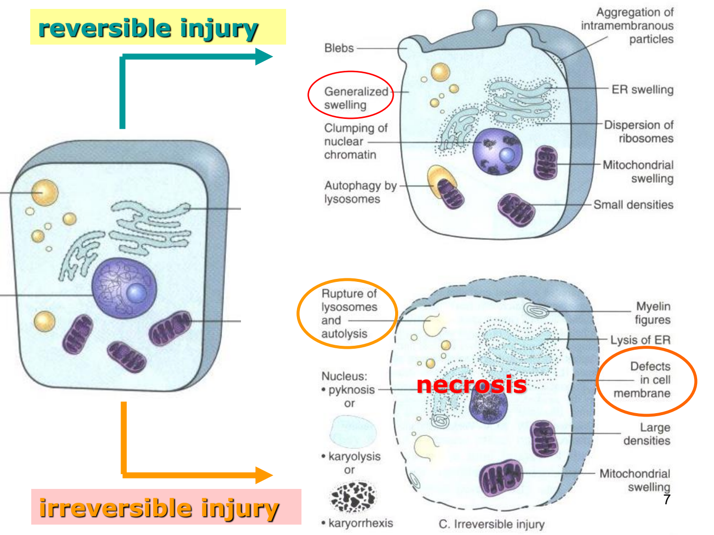

## PDF page 8 — Ultrastructural reversible changes

> Source: ch1-part-05, PDF page 8. Printed slide: 8. Classification: teaching.

### Preserved source text

MORPHOLOGY-             REVERSIBLE INJURY

•   The ultrastructural changes of reversible
    cell injury

(1) plasma membrane alterations

(2) mitochondrial changes

(3) dilation of the endoplasmic reticulum

(4) nuclear alterations

### Visual transcription / figure record

Full page visually inspected; extracted text and visible layout compared. Illustrative image retained in original full-page render.

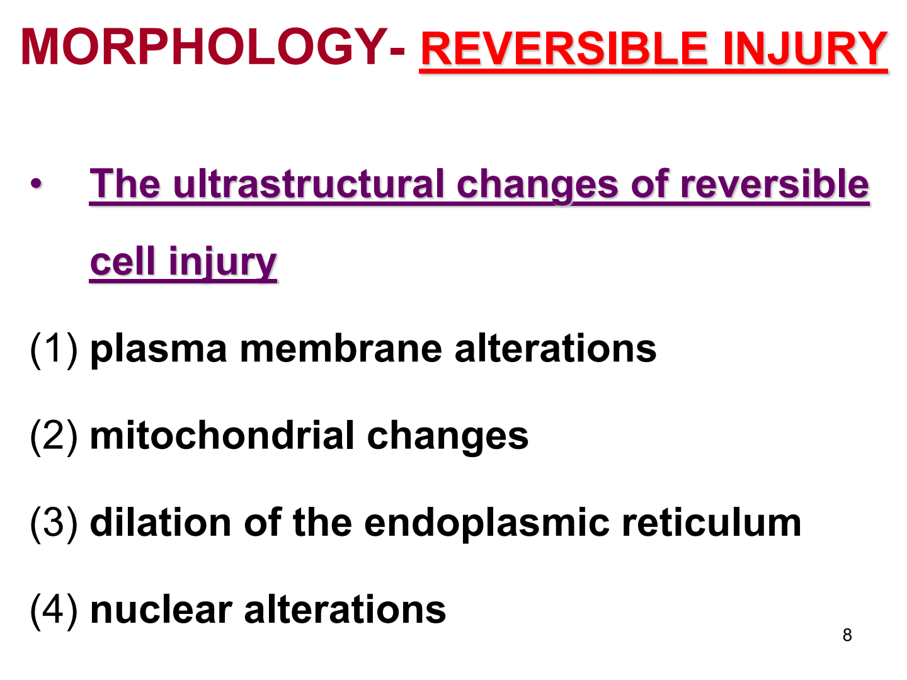

## PDF page 9 — Membrane and mitochondrial changes

> Source: ch1-part-05, PDF page 9. Printed slide: 9. Classification: teaching.

### Preserved source text

Reversible cell injury (Sublethal damage)

Ultrastructural      features:
1.  plasma membrane alteration:
   –   blebs, loss of microvilli, loosing of intercellular
       attachment
2.  mitochondrial alteration

   –   earliest manifestation of sublethal    injury
   –   swelling, appearance of phospholipid        rich
       amorphous densities                                9

### Visual transcription / figure record

Full page visually inspected; extracted text and visible layout compared. Illustrative image retained in original full-page render.

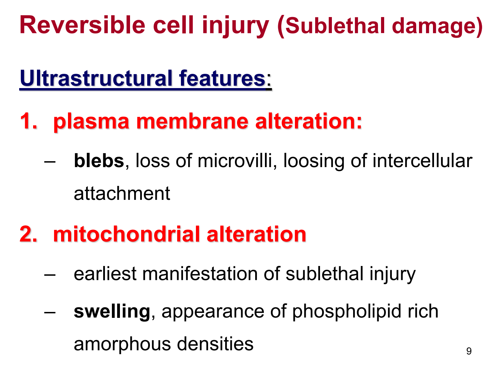

> **Source note:** Slide calls mitochondrial alteration the earliest manifestation and gives phospholipid-rich amorphous densities; irreversible p23 gives calcium-rich densities. Avoid unqualified earliest/density questions; preserve both.

## PDF page 10 — ER and nuclear changes

> Source: ch1-part-05, PDF page 10. Printed slide: 10. Classification: teaching.

### Preserved source text

Reversible cell injury

3.  dilation of endoplasmic reticulum
   –  loss of the ribosomes

4.  nuclear alteration
   –  clumping of nuclear chromatin

### Visual transcription / figure record

Full page visually inspected; extracted text and visible layout compared. Illustrative image retained in original full-page render.

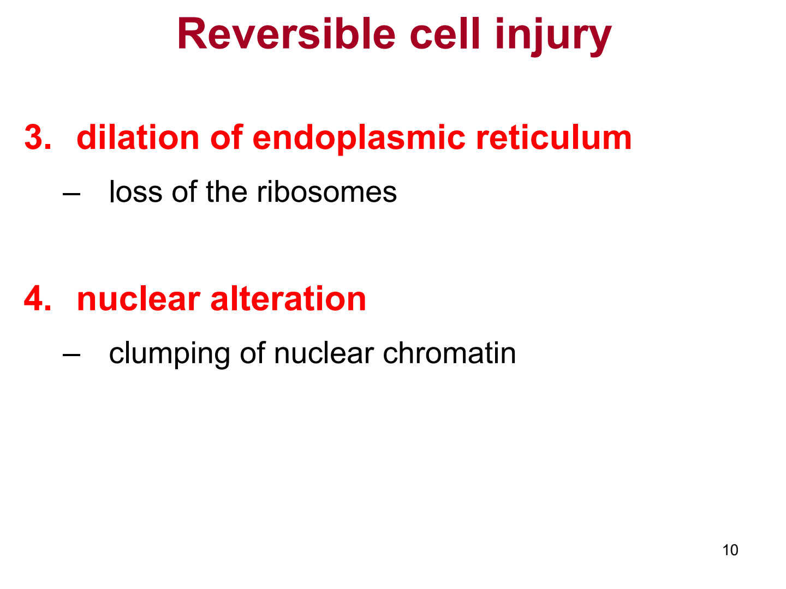

## PDF page 11 — Light microscopic reversible changes

> Source: ch1-part-05, PDF page 11. Printed slide: 11. Classification: teaching.

### Preserved source text

MORPHOLOGY-            REVERSIBLE INJURY

•   Two patterns of morphologic change can be
    recognized under the light microscope:

     1. Cellular swelling

     2. Fatty change

### Visual transcription / figure record

Full page visually inspected; extracted text and visible layout compared. Illustrative image retained in original full-page render.

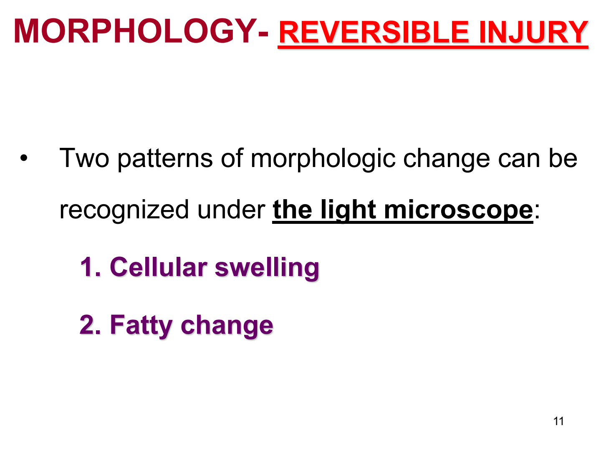

## PDF page 12 — Hydropic change

> Source: ch1-part-05, PDF page 12. Printed slide: 12. Classification: teaching.

### Preserved source text

Reversible cell changes

1.  Cell swelling

   –   Called hydropic    changes    or vacuolar
       degeneration

   –   universal to all cell types

   –   loss of ionic and fluid homoeostasis

   –   cells show clear vacuoles in the cytoplasm

   –   distended and pinched-off segments of ER          12

### Visual transcription / figure record

Full page visually inspected; extracted text and visible layout compared. Illustrative image retained in original full-page render.

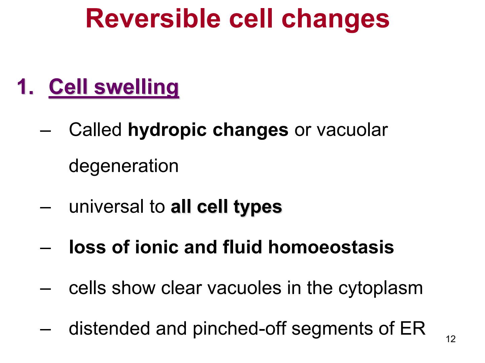

## PDF page 13 — Fatty change

> Source: ch1-part-05, PDF page 13. Printed slide: 13. Classification: teaching.

### Preserved source text

Reversible cell changes

2.  Fatty changes:
   –  Specific to cells   dealing with fat metabolism,
      liver and heart
   –  Lipid vacuoles    in the cytoplasm

### Visual transcription / figure record

Full page visually inspected; extracted text and visible layout compared. Illustrative image retained in original full-page render.

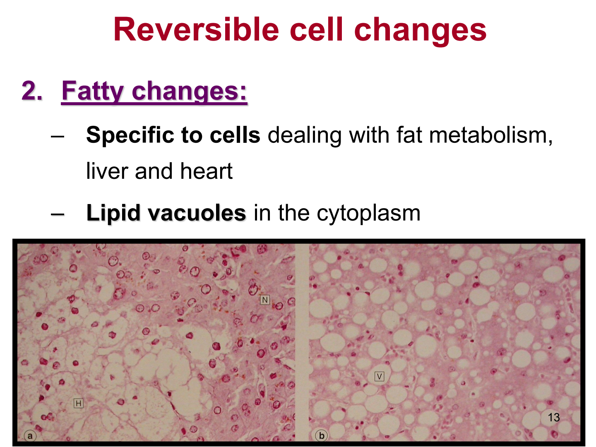

## PDF page 14 — Gross reversible changes

> Source: ch1-part-05, PDF page 14. Printed slide: 14. Classification: teaching.

### Preserved source text

Reversible cell changes

Macroscopic changes; gross features:

  – increase in the weight  of the organ

  – pallor of the organ

### Visual transcription / figure record

Full page visually inspected; extracted text and visible layout compared. Illustrative image retained in original full-page render.

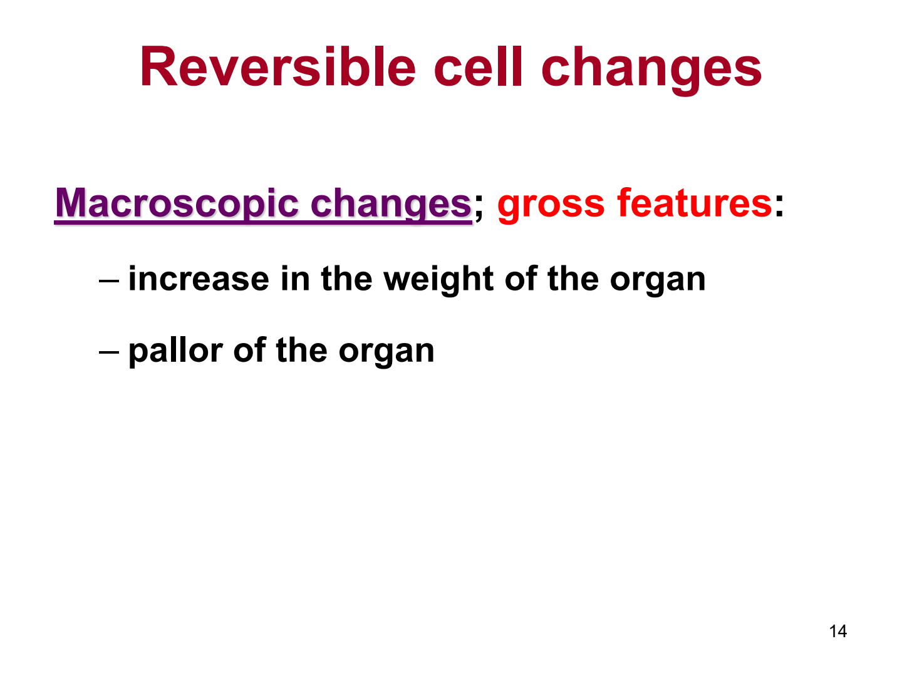

## PDF page 15 — Recovery versus death

> Source: ch1-part-05, PDF page 15. Printed slide: not reliably labelled. Classification: teaching.

### Preserved source text

Types of cell injury

                                                     15
irreversible injury

### Visual transcription / figure record

Normal -> sublethal injury: ER/mitochondrial swelling, ribosome loss, stress response. Recovery involves autophagic removal of damaged components. Death: nucleolus loss, no ribosomes, all mitochondria/ER swollen -> nuclear condensation, membrane holes/blebs, lysosome rupture -> fragmented inner membranes/nuclear breakup.

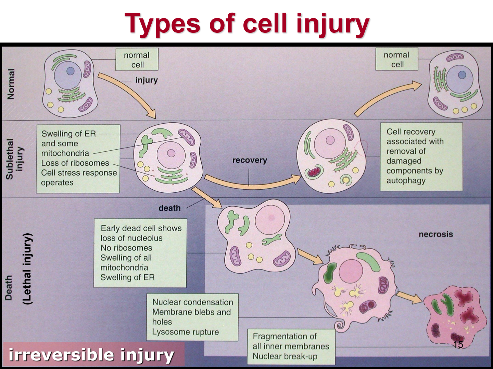

## PDF page 16 — Irreversible injury pathways

> Source: ch1-part-05, PDF page 16. Printed slide: 16. Classification: teaching.

### Preserved source text

Irreversible cell injury
                 (lethal damage)

• General pathways:

   – excessive damage to all membranes,

     cytosolic and organelles

   – Calcium   is a potential mediator of irreversible

     cell death.  Increase intracellular Ca content from

     the extracellular compartments, with activation of
     the different enzymes                               16

### Visual transcription / figure record

Full page visually inspected; extracted text and visible layout compared. Illustrative image retained in original full-page render.

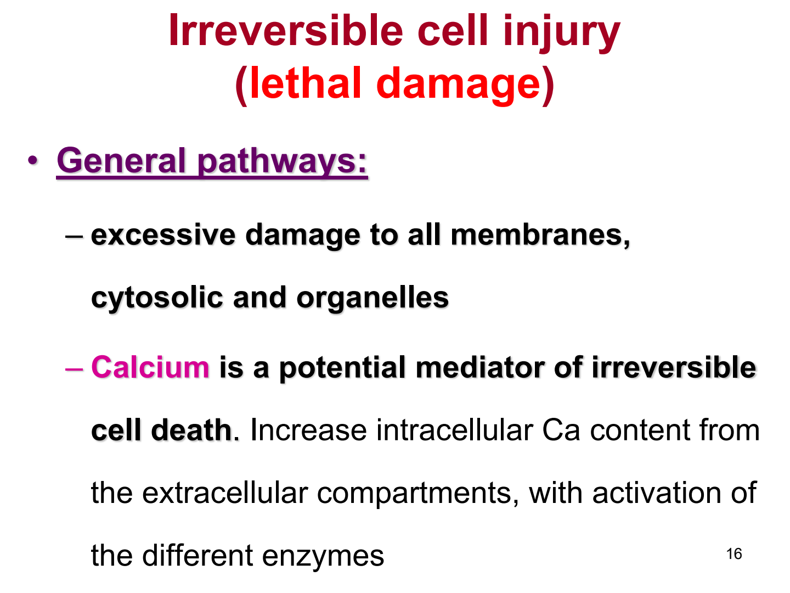

## PDF page 17 — Calcium activated enzymes

> Source: ch1-part-05, PDF page 17. Printed slide: 17. Classification: teaching.

### Preserved source text

17

### Visual transcription / figure record

Increased cytosolic Ca from extracellular influx and mitochondrial/ER release -> ATPase (ATP decreases), phospholipase (phospholipids decrease), protease (membrane/cytoskeleton disrupted), endonuclease (nuclear chromatin damage).

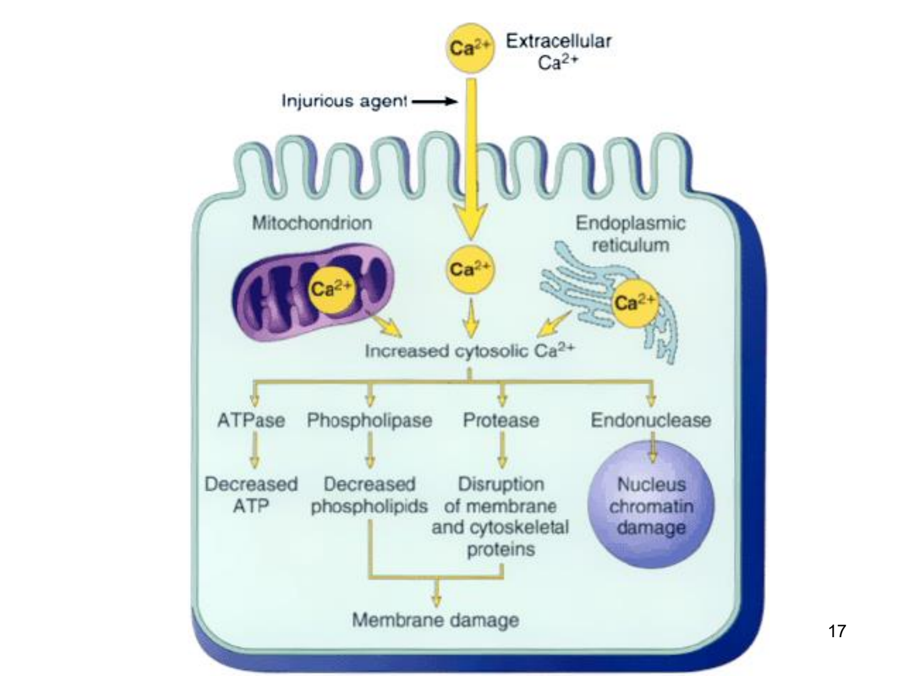

## PDF page 18 — Autolysis versus heterolysis

> Source: ch1-part-05, PDF page 18. Printed slide: 18. Classification: teaching.

### Preserved source text

Irreversible cell injury

• Leakage of digestive enzymes from lysosomes.
  With the low pH, hydrolases       are activated. They
  begin to digest the cell components.

   – Autolysis: if the cells are digested by their own
     enzymes

   – Heterolysis: if the cells are digested by lysosomes
     from other cells

### Visual transcription / figure record

Full page visually inspected; extracted text and visible layout compared. Illustrative image retained in original full-page render.

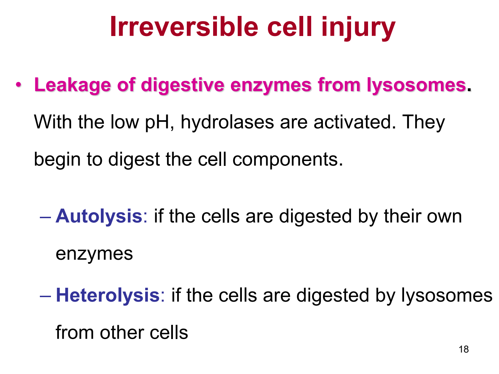

## PDF page 19 — Timing clearance and calcification

> Source: ch1-part-05, PDF page 19. Printed slide: 19. Classification: teaching.

### Preserved source text

Irreversible cell injury

•  Functional changes typically precede any morphologic
   changes of cell injury
•  These processes require hours to develop, and so there are
   no detectable changes in cells if, e.g., a myocardial infarct
   causes sudden death.
•  most necrotic cells     and their debris disappear by        a combined
   process of extracellular enzyme digestion and leukocyte
   phagocytosis.
•  If necrotic cells and cellular debris are not promptly eliminated,
   they tend to attract calcium salts and other minerals and
   undergo dystrophic calcification                                      19

### Visual transcription / figure record

Full page visually inspected; extracted text and visible layout compared. Illustrative image retained in original full-page render.

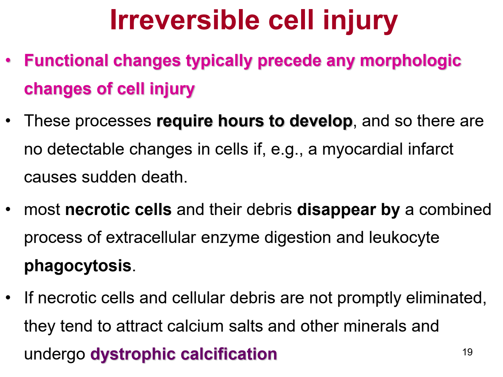

## PDF page 20 — Point of no return

> Source: ch1-part-05, PDF page 20. Printed slide: 20. Classification: teaching.

### Preserved source text

Mechanisms of irreversible
                      injury

Two phenomena characterize irreversibility:

1. Inability to reverse mitochondrial

   dysfunction

2. Development of severe membrane damage

This is the VITAL step at which “No Return”20

### Visual transcription / figure record

Full page visually inspected; extracted text and visible layout compared. Illustrative image retained in original full-page render.

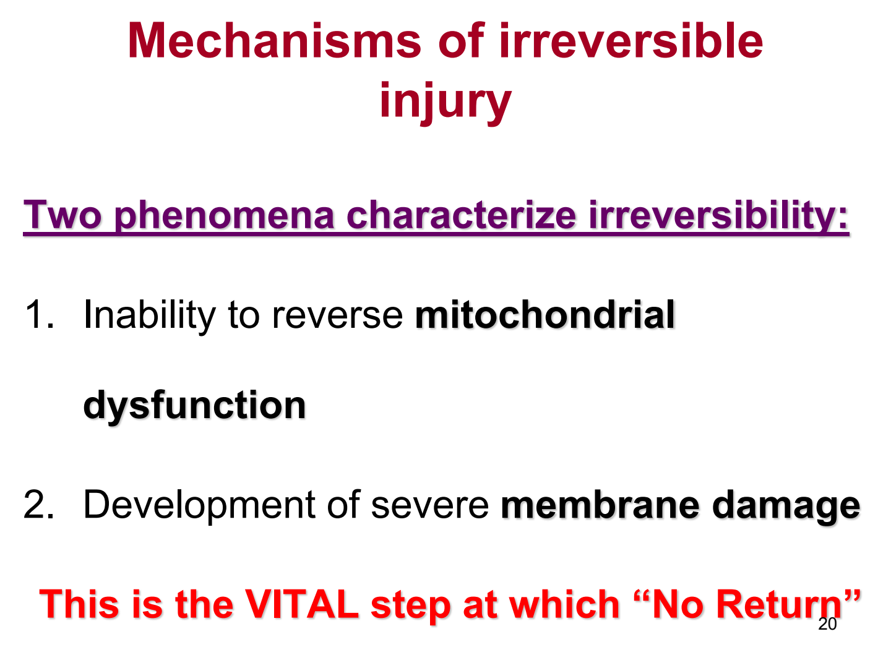

## PDF page 21 — Membrane damage mechanisms

> Source: ch1-part-05, PDF page 21. Printed slide: not reliably labelled. Classification: teaching.

### Preserved source text

Irreversible cell injury: mechanism
1.  Cell   membrane damage:
   –    Progressive loss of membrane phospholipids.
       By activation of phospholipases     by Ca, and decrease
        synthesis of proteins
   –    Cytoskeletal   abnormalities.
       Loss of the filaments between the cytoplasm and the
        cell membrane. So the cell membrane becomes loose
        and susceptible to rupture.
   –    Toxic oxygen radicals.
       This leads to peroxidation   of the membranes.
   –    Lipid breakdown products.
                                                                  21
       These act as detergents on the membranes.

### Visual transcription / figure record

Full page visually inspected; extracted text and visible layout compared. Illustrative image retained in original full-page render.

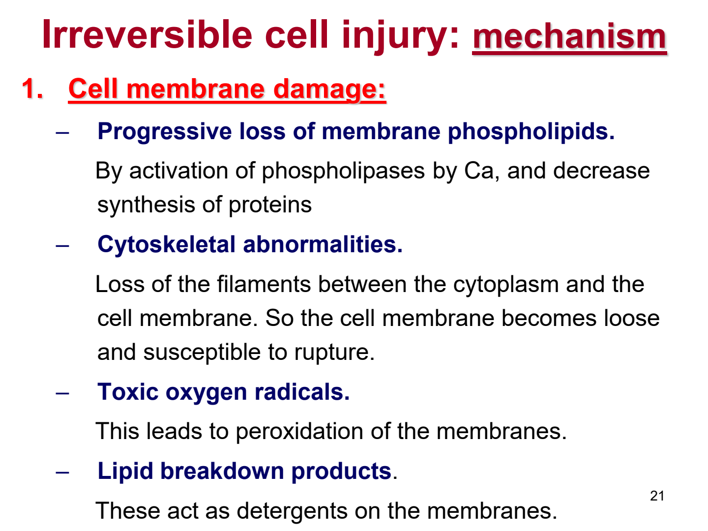

## PDF page 22 — Membrane injury diagram

> Source: ch1-part-05, PDF page 22. Printed slide: 22. Classification: teaching.

### Preserved source text

Cellmembrane damage                                22

### Visual transcription / figure record

Ischemia -> low O2 -> ATP decrease -> reduced phospholipid reacylation/synthesis. Ca increase -> phospholipase activation -> phospholipid degradation/lipid breakdown products; protease -> cytoskeleton damage with swelling. Leukocyte recruitment -> ROS (H2O2, hydroxyl, superoxide) -> lipid peroxidation. These routes damage membranes.

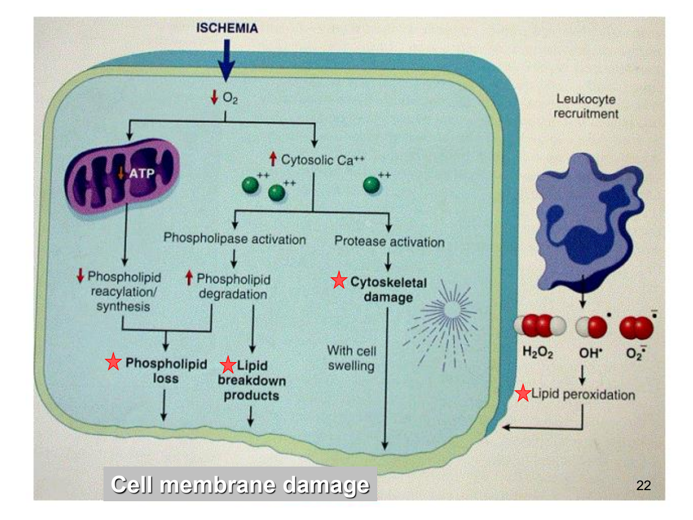

## PDF page 23 — Irreversible mitochondrial changes

> Source: ch1-part-05, PDF page 23. Printed slide: 23. Classification: teaching.

### Preserved source text

Irreversible cell injury: mechanism

2. mitochondrial dysfunction

•  One of the earliest manifestations of irreversible cell

   injury is the vacuolization of the mitochondria,

   and the accumulation of amorphous, calcium-rich

   densities in mitochondrial matrix

•  Affect the oxidative Phosphorylation, decrease ATP

### Visual transcription / figure record

Full page visually inspected; extracted text and visible layout compared. Illustrative image retained in original full-page render.

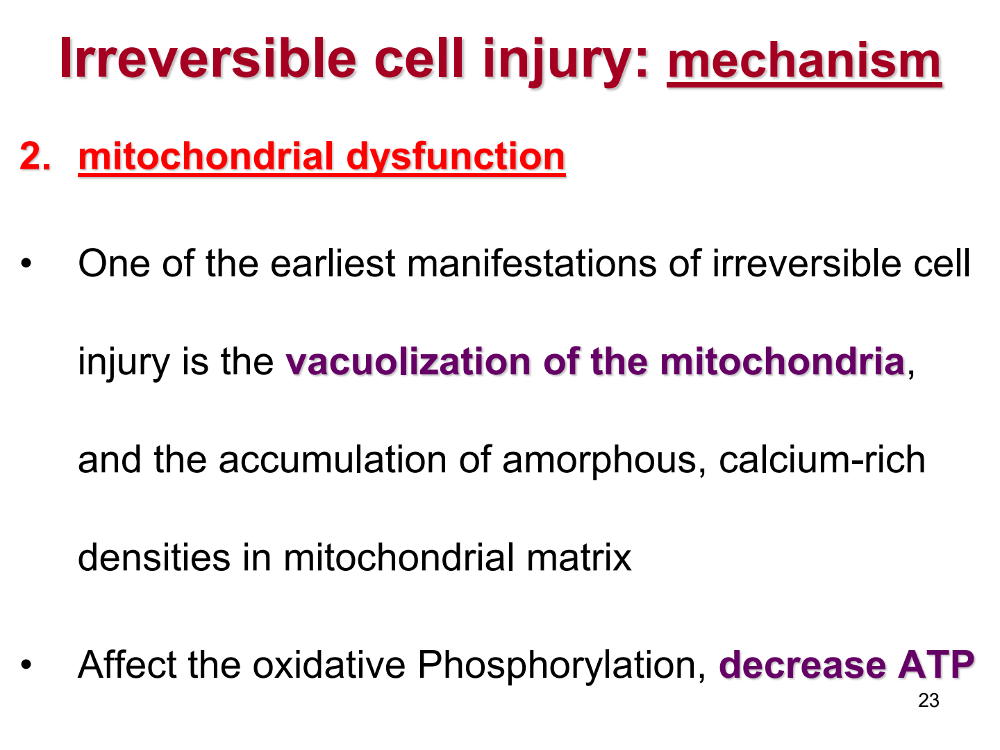

## PDF page 24 — Necrosis definition

> Source: ch1-part-05, PDF page 24. Printed slide: 24. Classification: teaching.

### Preserved source text

Morphology of irreversible cell
              injury: Necrosis

• The morphological correlate of irreversible

  cell injury

• Defined as the sequence of morphological

  changes that follows cell death      in living tissue

• These morphological changes require hours to

  develop.

### Visual transcription / figure record

Full page visually inspected; extracted text and visible layout compared. Illustrative image retained in original full-page render.

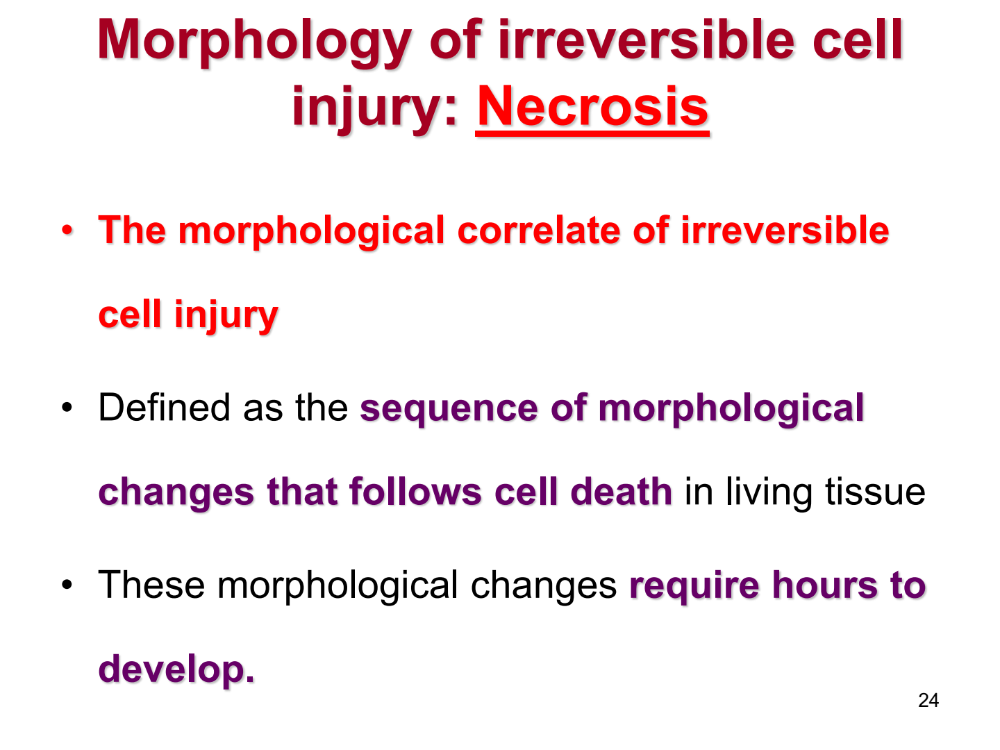

## PDF page 25 — Digestion denaturation and leakage

> Source: ch1-part-05, PDF page 25. Printed slide: 25. Classification: teaching.

### Preserved source text

Necrosis

morphological changes are the result of:

1-  enzymatic digestion of the cell

   * by lysosomal  enzymes:

     -autolysis.                          -heterolysis.

➔  Leakage of proteins and cellular constituents e.g:

  Cardiac muscle:   creatine   kinase  & troponins.

  Liver: alkaline phosphatase.
2-  denaturation        of proteins                                     25

### Visual transcription / figure record

Full page visually inspected; extracted text and visible layout compared. Illustrative image retained in original full-page render.

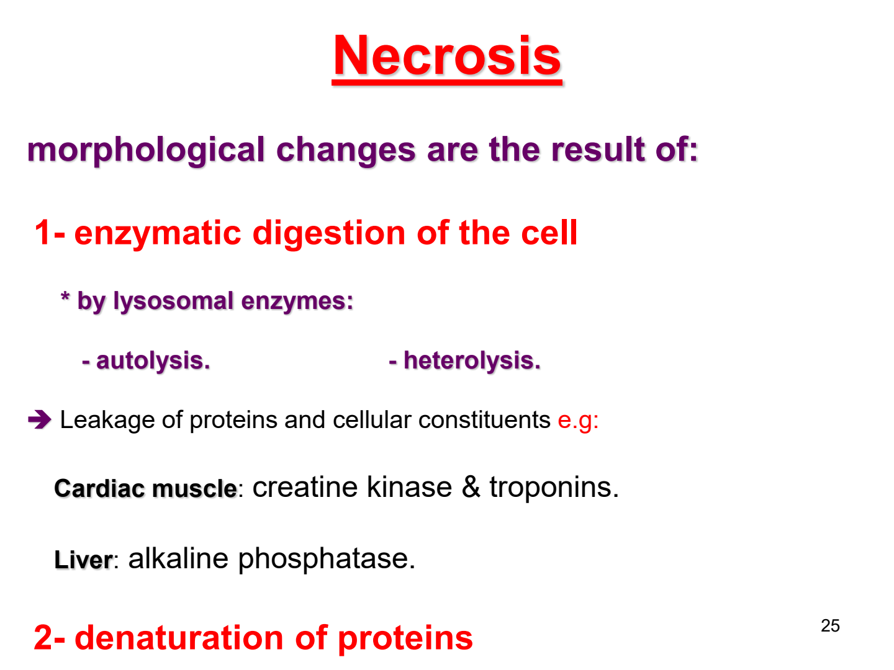

> **Source note:** Liver alkaline phosphatase is listed as a leakage example without context. Preserve it but do not use that isolated marker attribution as a scored target.

## PDF page 26 — Necrosis ultrastructure

> Source: ch1-part-05, PDF page 26. Printed slide: not reliably labelled. Classification: teaching.

### Preserved source text

Ultrastructural morphological
             changes: Necrosis
• Defects in cell membrane

• Mitochondrial swelling
  and large densities

• Swelling of the ER   and
  detachment of ribosomes

• Appearance of myelin
  figures

                                                      26
• Rupture of lysosomes

### Visual transcription / figure record

Full page visually inspected; extracted text and visible layout compared. Illustrative image retained in original full-page render.

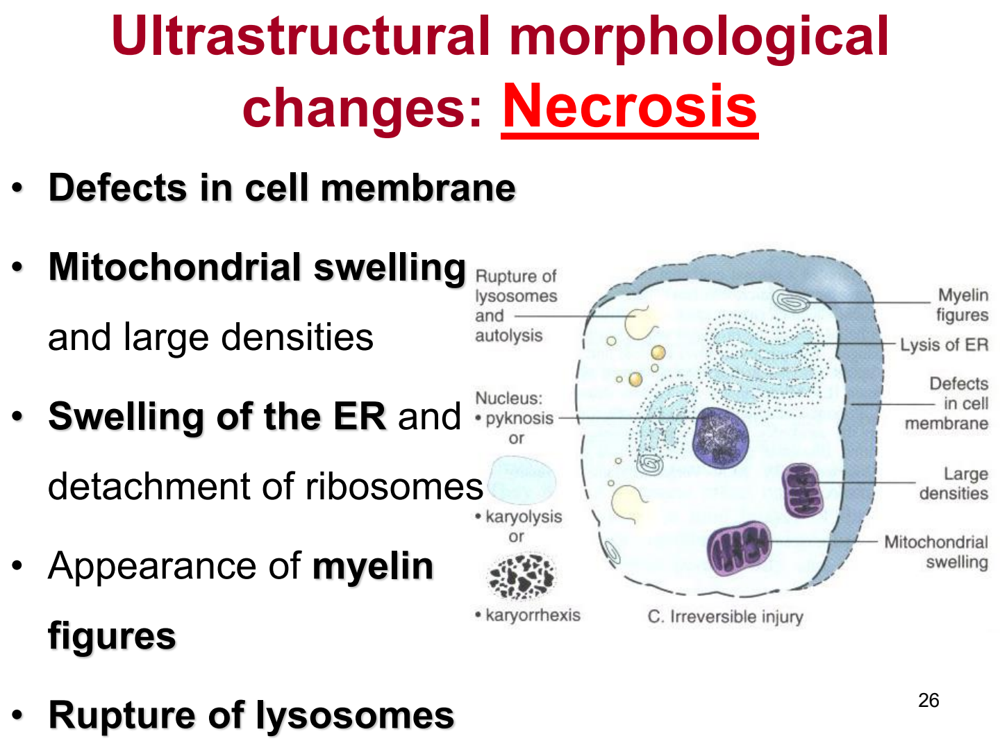

## PDF page 27 — Necrotic cytoplasm

> Source: ch1-part-05, PDF page 27. Printed slide: 27. Classification: teaching.

### Preserved source text

Necrosis: Light microscopic features

Acidophilia:   pink staining from the eosin      dye: "E" in H & E.
Basophilia:   blue staining from hematoxylin        dye: "H" in H & E

• Changes in the cytoplasm        in Necrosis:

   –  acidophilia   of the cytoplasm    (pink staining)

       • binding of eosins to denatured proteins

       • loss of basophilia  from the loss of RNA

   –  glassy cytoplasm: loss of glycogen

   –  vacuolated cytoplasm: degeneration of organelles
   –  calcification of cells                                        27

### Visual transcription / figure record

Full page visually inspected; extracted text and visible layout compared. Illustrative image retained in original full-page render.

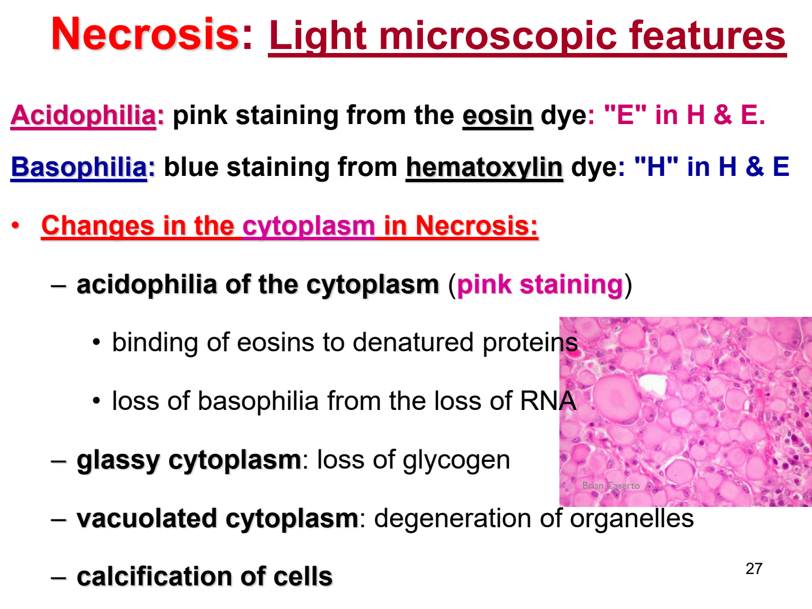

## PDF page 28 — Nuclear changes

> Source: ch1-part-05, PDF page 28. Printed slide: not reliably labelled. Classification: teaching.

### Preserved source text

Light microscopic features
•   Changes in the nucleus             in
    Necrosis:
    1. Pyknosis: increased basophilia
       due to shrinkage of the nucleus
    2. Karyorrhexis: fragmentation        of
       the pyknotic nucleus by nucleases
    3. Karyolysis: loss of the
       basophilia    of the chromatin,
       secondary to DNAase activity.

    1-2 days following death, the
    nucleus disappears completely                                    28
                                                     Karyolysis

### Visual transcription / figure record

Full page visually inspected; extracted text and visible layout compared. Illustrative image retained in original full-page render.

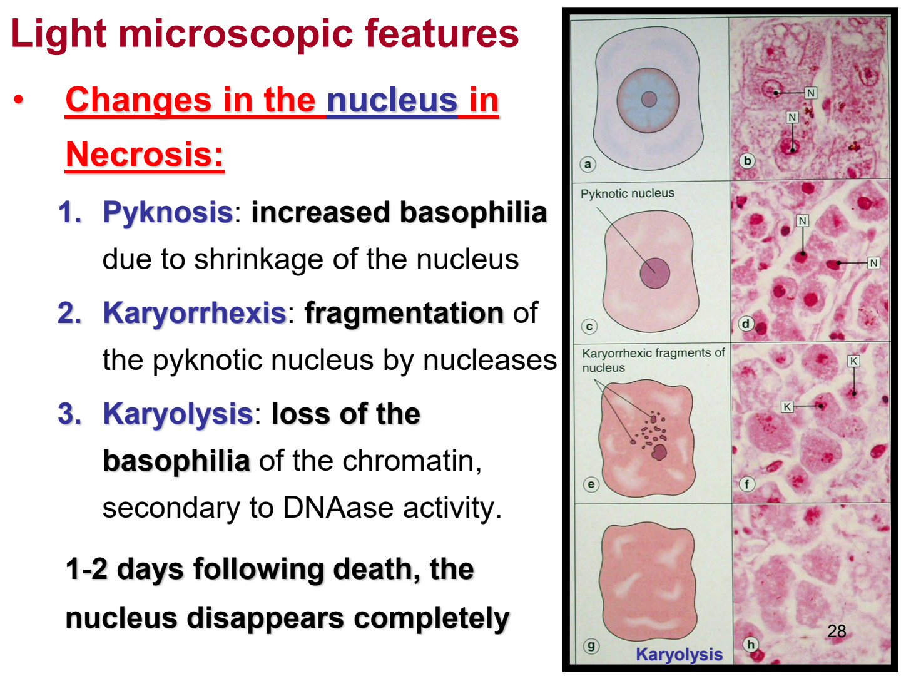

## PDF page 29 — Nuclear morphology diagram

> Source: ch1-part-05, PDF page 29. Printed slide: 29. Classification: teaching.

### Preserved source text

29

### Visual transcription / figure record

Normal nucleus contrasted separately with A pyknosis (small dense), B karyorrhexis (fragments), C karyolysis (faded). Arrows branch from normal rather than imposing a mandatory order.

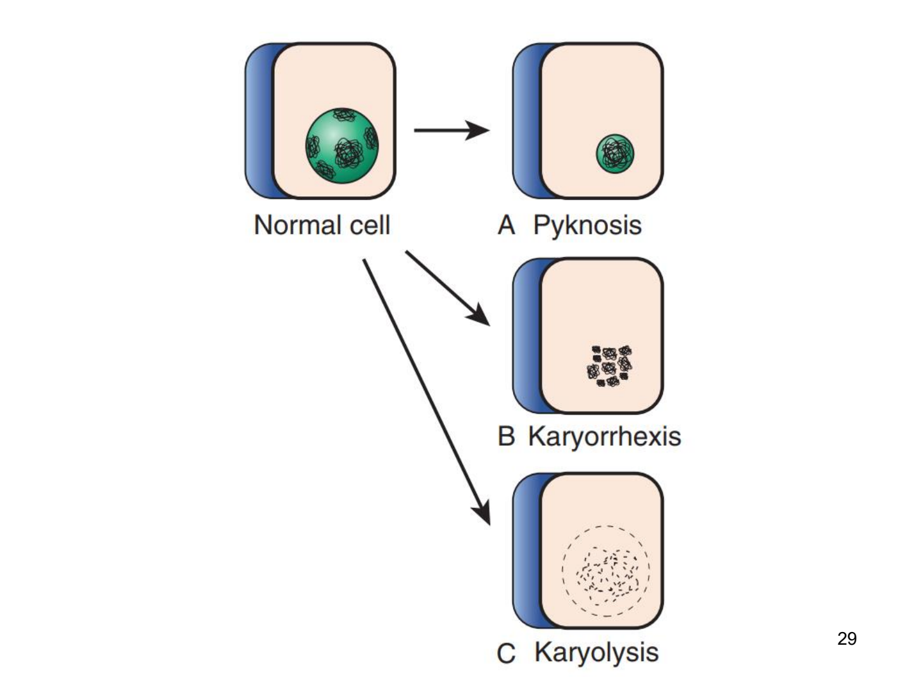

> **Source note (fresh checker):** Diagram branches from normal nucleus to three changes. Do not infer a universal pyknosis-karyorrhexis-karyolysis ordering; individual meanings remain assessable.

## PDF page 30 — Injury summary

> Source: ch1-part-05, PDF page 30. Printed slide: 30. Classification: teaching.

### Preserved source text

Types of cell injury: summary

### Visual transcription / figure record

Summary: ischemia -> mitochondrial oxidative phosphorylation decrease -> ATP decrease -> Na pump decrease, ionic/water influx and K efflux -> swelling, lost microvilli, blebs, ER swelling, myelin figures. Glycolysis increase -> glycogen/pH decrease -> chromatin clumping. Detached ribosomes -> reduced protein synthesis -> lipid deposition. Membrane injury causes enzyme leakage and Ca influx; lysosomal enzymes cause protein digestion/nuclear changes/lost basophilia.

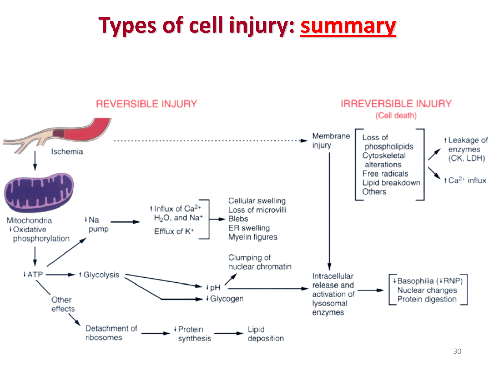

