# Chapter 1 — Part 6: Cover

Authority: unchanged supplied PDF only. Page headings use one-based PDF pages; printed labels are recorded only when visibly present. Original extracted text is preserved below, with separately identified visual transcription. No outside teaching content.

## PDF page 1 — Cover

> Source: ch1-part-06, PDF page 1. Printed slide: 1. Classification: cover.

### Preserved source text

Types of
necrosis

Dr. Mahmoud Kiswani
Al-Quds University
Faculty of Medicine
Pathology Department                                         1

### Visual transcription / figure record

Full page visually inspected; extracted text and visible layout compared. Illustrative image retained in original full-page render.

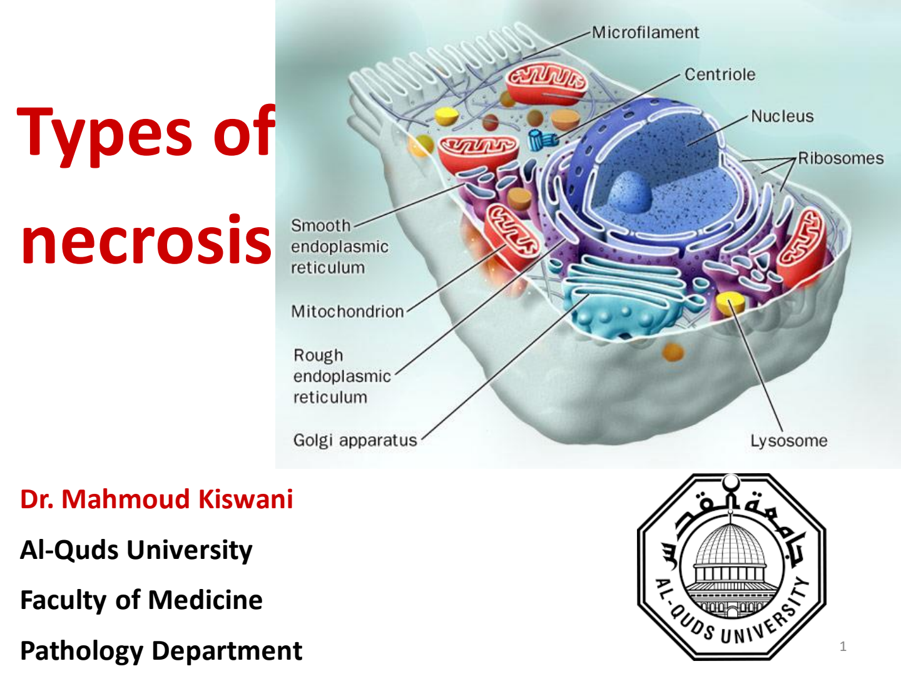

## PDF page 2 — Necrosis classification

> Source: ch1-part-06, PDF page 2. Printed slide: 2. Classification: teaching.

### Preserved source text

Types of Necrosis
I.   Coagulative    necrosis

II.  Liquefactive    necrosis

III. Caseous    necrosis

IV.  Fatty necrosis

V.   Gangrenous necrosis

VI.  Fibrinoid   necrosis

### Visual transcription / figure record

Full page visually inspected; extracted text and visible layout compared. Illustrative image retained in original full-page render.

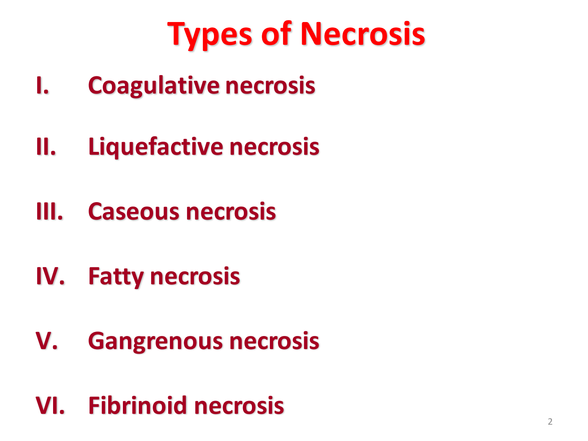

## PDF page 3 — Coagulative necrosis

> Source: ch1-part-06, PDF page 3. Printed slide: 3. Classification: teaching.

### Preserved source text

I. Coagulative necrosis
➢ The most common type of necrosis
➢ Defined as   death   of cells with preservation of the
  basic structural outlines    of the cells  for days, with
  preservation of the general tissue architecture
➢ Protein denaturation     overcomes enzymatic
  digestion
➢ Seen in most organs after hypoxia/ischemia           except
  brain

### Visual transcription / figure record

Full page visually inspected; extracted text and visible layout compared. Illustrative image retained in original full-page render.

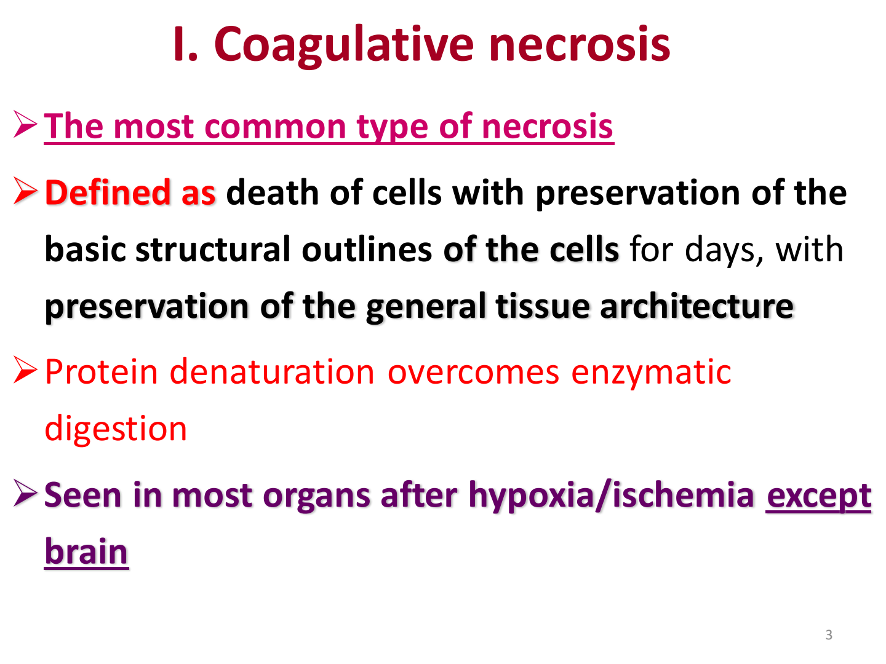

## PDF page 4 — Ischemic organ examples

> Source: ch1-part-06, PDF page 4. Printed slide: 4. Classification: teaching.

### Preserved source text

I. Coagulative necrosis

                   Ischemia

myocardium                kidney

### Visual transcription / figure record

Full page visually inspected; extracted text and visible layout compared. Illustrative image retained in original full-page render.

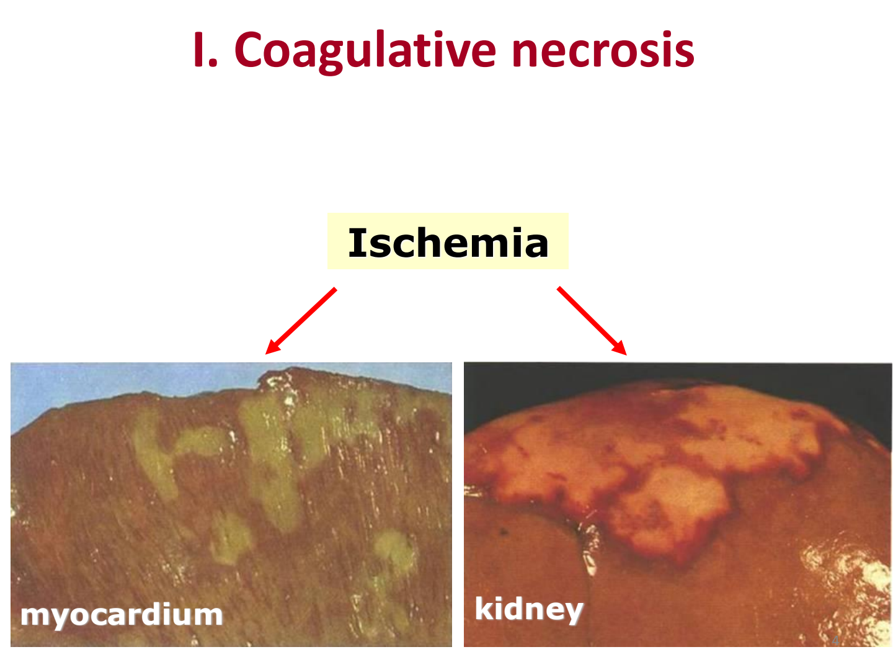

## PDF page 5 — Renal infarct

> Source: ch1-part-06, PDF page 5. Printed slide: not visibly labelled. Classification: teaching.

### Preserved source text

(No extractable text beyond the page label; see visual transcription and original image.)

### Visual transcription / figure record

Unlabelled kidney with pale wedge-shaped focus, preserved as an illustration adjacent to the labelled kidney-infarct slide.

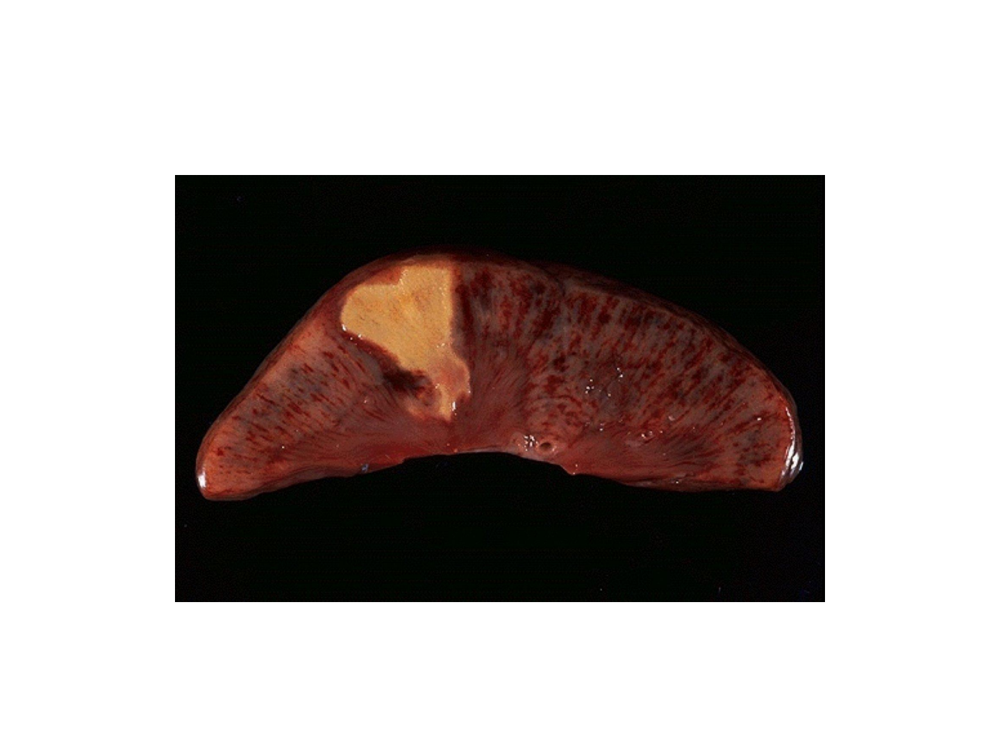

## PDF page 6 — Coagulative renal morphology

> Source: ch1-part-06, PDF page 6. Printed slide: 6. Classification: teaching.

### Preserved source text

Kidney infarct exhibiting coagulative necrosis, with loss of nuclei and
clumping of the cytoplasm but with preservation of basic outlines of
glomerular and tubular architecture

### Visual transcription / figure record

Full page visually inspected; extracted text and visible layout compared. Illustrative image retained in original full-page render.

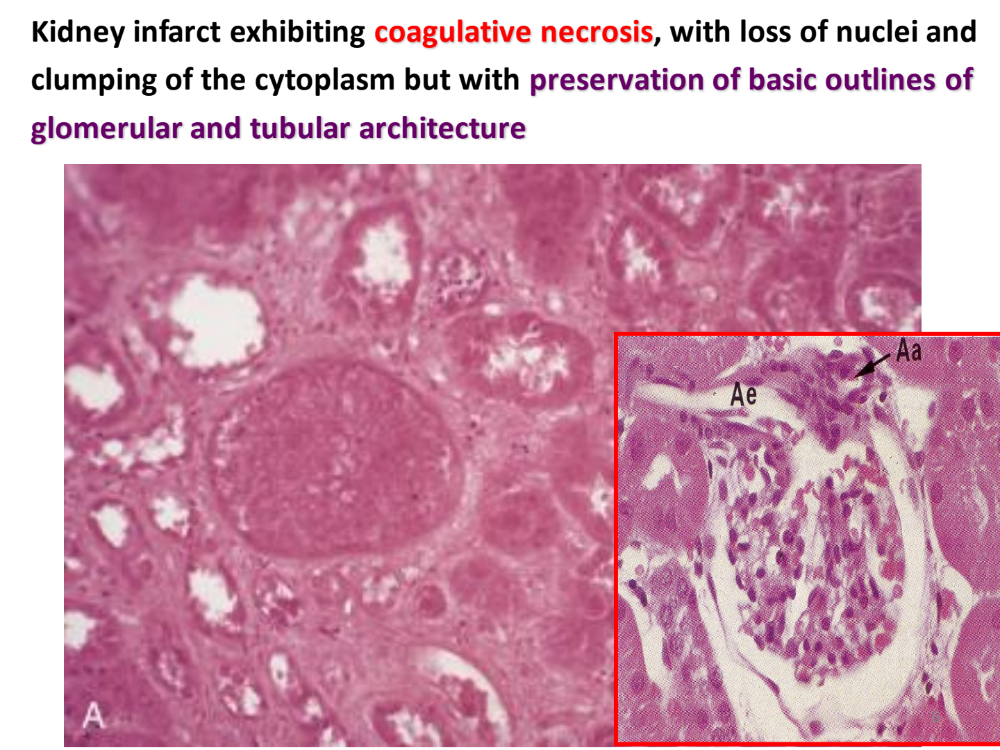

## PDF page 7 — Normal kidney labels

> Source: ch1-part-06, PDF page 7. Printed slide: not visibly labelled. Classification: teaching.

### Preserved source text

(No extractable text beyond the page label; see visual transcription and original image.)

### Visual transcription / figure record

Normal kidney micrograph labels renal distal tubule, renal proximal tubules, renal corpuscle, Bowman capsule and Bowman space.

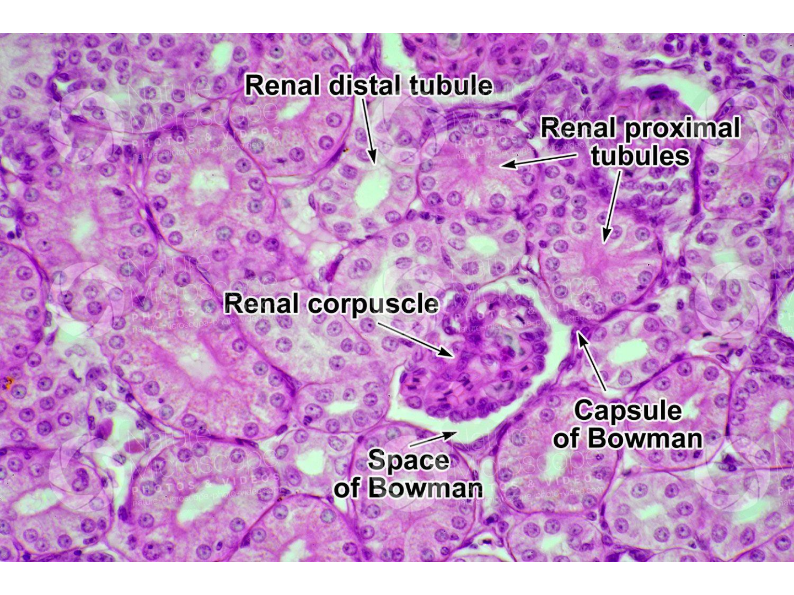

## PDF page 8 — Myocardial infarction

> Source: ch1-part-06, PDF page 8. Printed slide: not reliably labelled. Classification: teaching.

### Preserved source text

Myocardial Infarction (Coagulative Necrosis)

myocardial infarct

### Visual transcription / figure record

Full page visually inspected; extracted text and visible layout compared. Illustrative image retained in original full-page render.

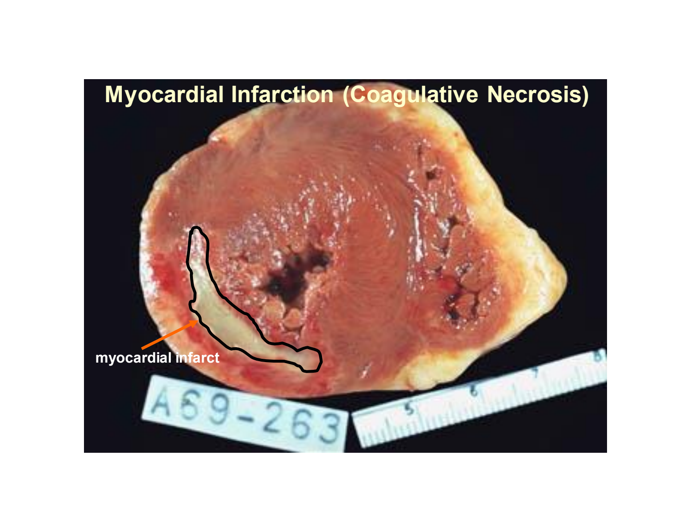

## PDF page 9 — Red and pale infarct illustrations

> Source: ch1-part-06, PDF page 9. Printed slide: not visibly labelled. Classification: teaching.

### Preserved source text

(No extractable text beyond the page label; see visual transcription and original image.)

### Visual transcription / figure record

Side-by-side unlabelled red and pale infarct gross images; comparison captions supplied on following page.

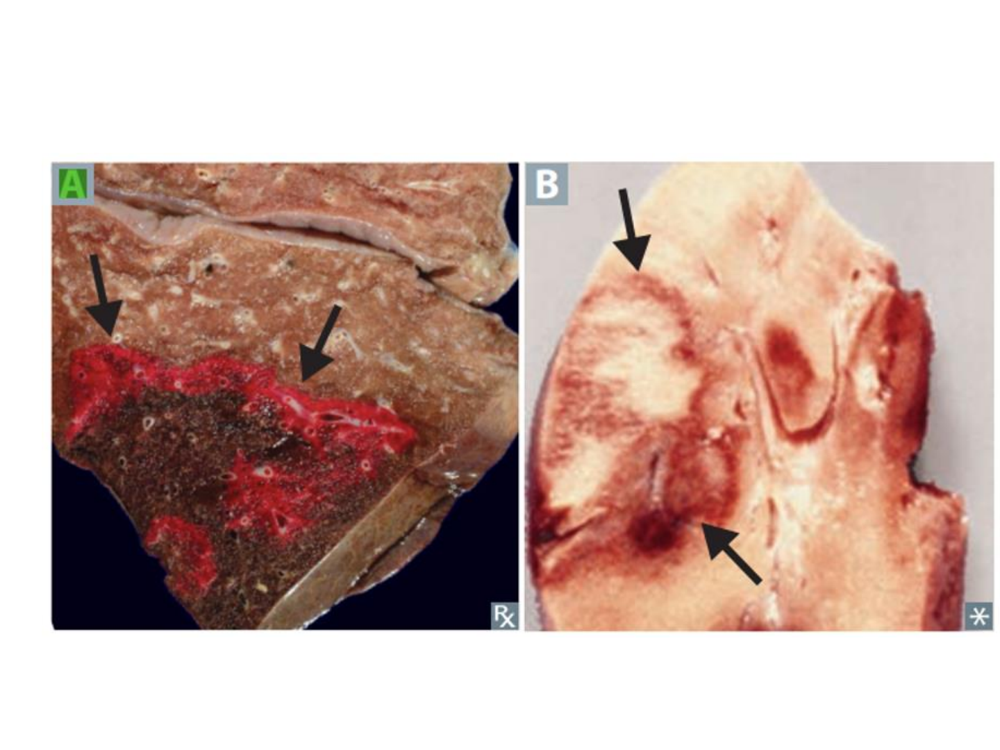

## PDF page 10 — Red and pale infarct comparison

> Source: ch1-part-06, PDF page 10. Printed slide: not visibly labelled. Classification: teaching.

### Preserved source text

(No extractable text beyond the page label; see visual transcription and original image.)

### Visual transcription / figure record

Table: red infarct occurs in venous occlusion, tissues with multiple supplies (liver, lung, intestine, testes), and reperfusion e.g. angioplasty; reperfusion injury due to free radicals. Pale infarct in solid organs with single end-arterial supply e.g. heart, kidney.

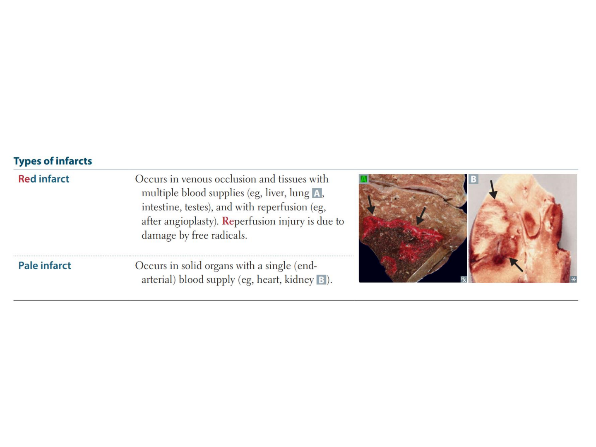

## PDF page 11 — Liquefactive necrosis

> Source: ch1-part-06, PDF page 11. Printed slide: 11. Classification: teaching.

### Preserved source text

II. Liquefactive necrosis
➢   Defined as    necrosis with complete digestion of
    the cells and destruction of the normal
    architecture
➢   Enzymatic digestion overcomes the
    denaturation
➢   Two situations:
   1.  hypoxic/ischemic    injury of the brain
   2.  bacterial/fungal infection, with accumulation of
       WBCs and release of enzymes                           11

### Visual transcription / figure record

Full page visually inspected; extracted text and visible layout compared. Illustrative image retained in original full-page render.

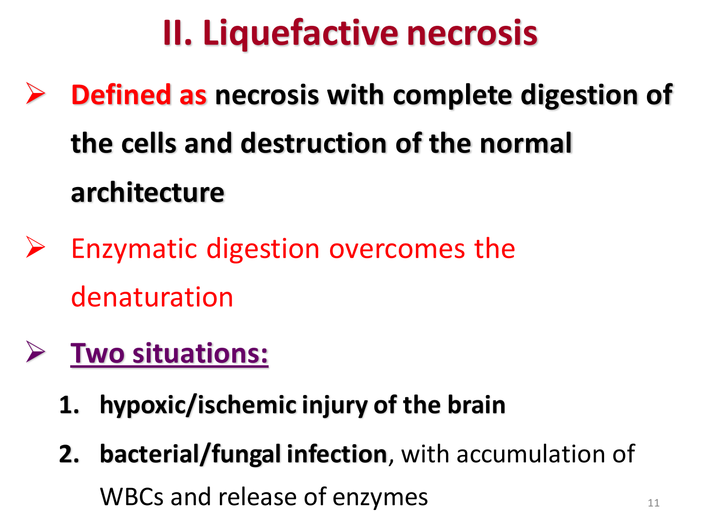

## PDF page 12 — Brain liquefaction

> Source: ch1-part-06, PDF page 12. Printed slide: 12. Classification: teaching.

### Preserved source text

II. Liquefactive necrosis

brain injury due to         cyst formation at the site
  hemorrhage                   of previous necrosis      12

### Visual transcription / figure record

Full page visually inspected; extracted text and visible layout compared. Illustrative image retained in original full-page render.

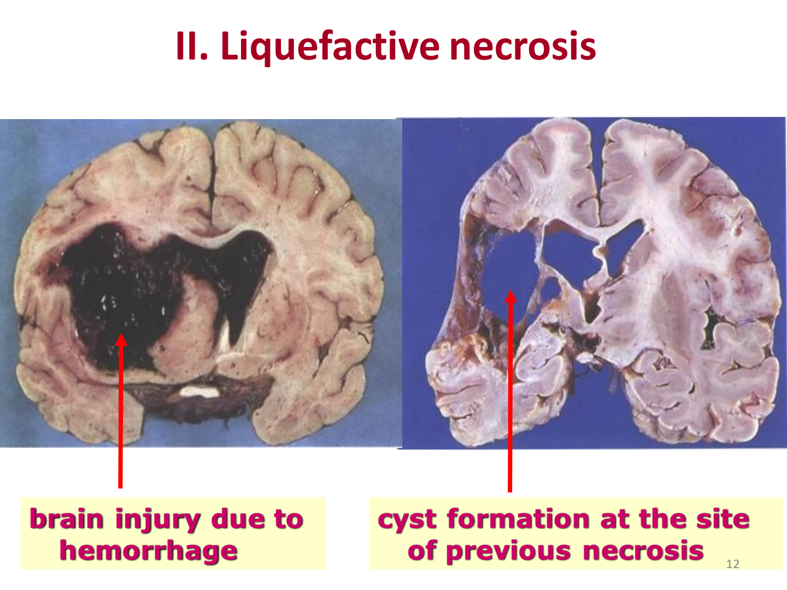

## PDF page 13 — Fungal renal abscess

> Source: ch1-part-06, PDF page 13. Printed slide: 13. Classification: teaching.

### Preserved source text

A focus of liquefactive necrosis        in the kidney caused by fungal
seeding. The focus is filled with white cells and cellular debris,
creating a renal abscess that obliterates the normal architecture

### Visual transcription / figure record

Full page visually inspected; extracted text and visible layout compared. Illustrative image retained in original full-page render.

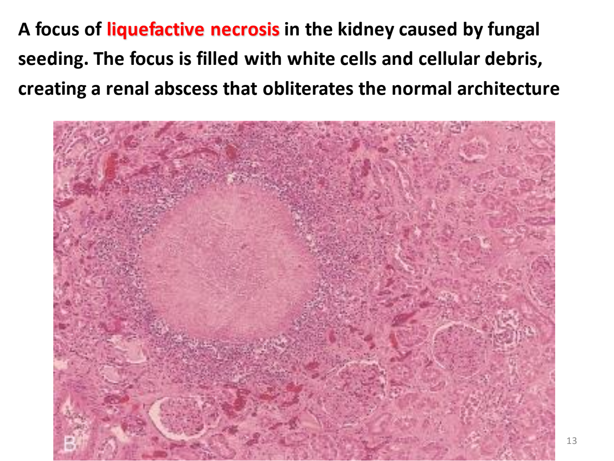

## PDF page 14 — Caseous necrosis

> Source: ch1-part-06, PDF page 14. Printed slide: 14. Classification: teaching.

### Preserved source text

III. Caseous necrosis

• Special type of necrosis, seen with tuberculus           infection
• the tissue architecture is completely obliterated
• Grossly:
  cheesy white appearance         to the necrotic focus
• Microscopically:
  the necrotic focus is composed of structure-less
  amorphous granular debris

### Visual transcription / figure record

Full page visually inspected; extracted text and visible layout compared. Illustrative image retained in original full-page render.

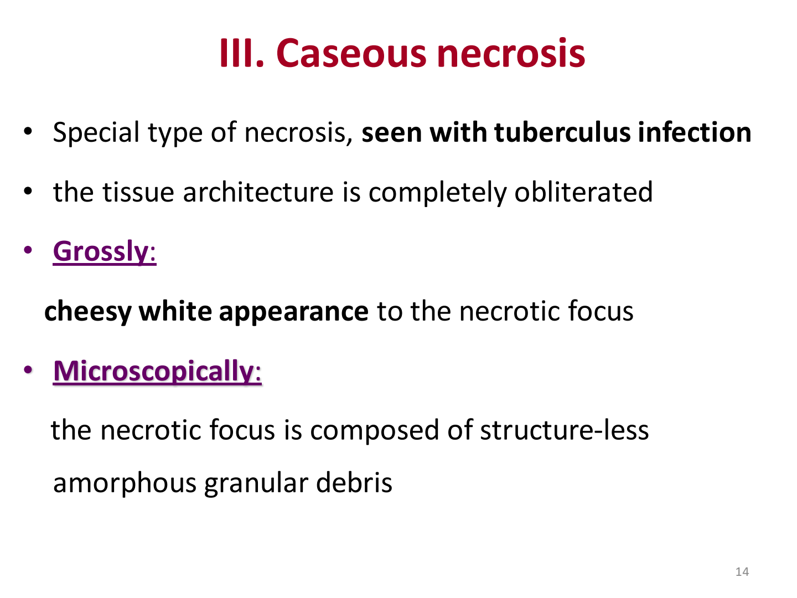

## PDF page 15 — Tuberculosis examples

> Source: ch1-part-06, PDF page 15. Printed slide: 15. Classification: teaching.

### Preserved source text

III. caseous necrosis

                       miliary TB             primary TB

cavitary TB

 tuberculosis of
     the lung                                    granuloma15

### Visual transcription / figure record

Full page visually inspected; extracted text and visible layout compared. Illustrative image retained in original full-page render.

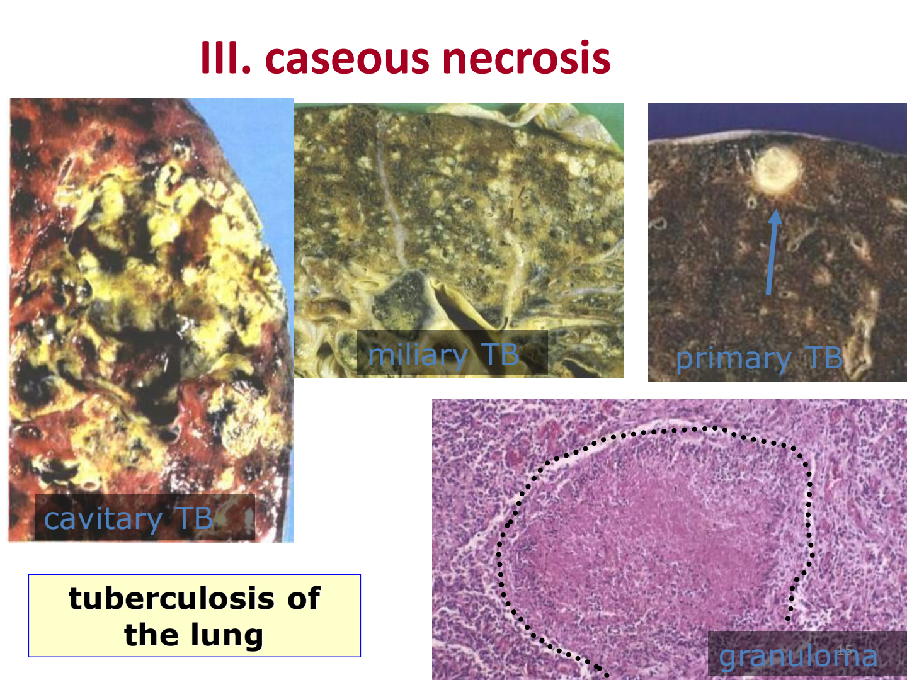

## PDF page 16 — Caseous lung morphology

> Source: ch1-part-06, PDF page 16. Printed slide: not visibly labelled. Classification: teaching.

### Preserved source text

Tuberculosis of the lung, with a large area                   Microscopic
of caseous necrosis containing yellow-
white (cheesy) debris.

### Visual transcription / figure record

Microscopic labels: caseous necrosis, Langhans giant cells, epithelioid macrophages, lymphocytes.

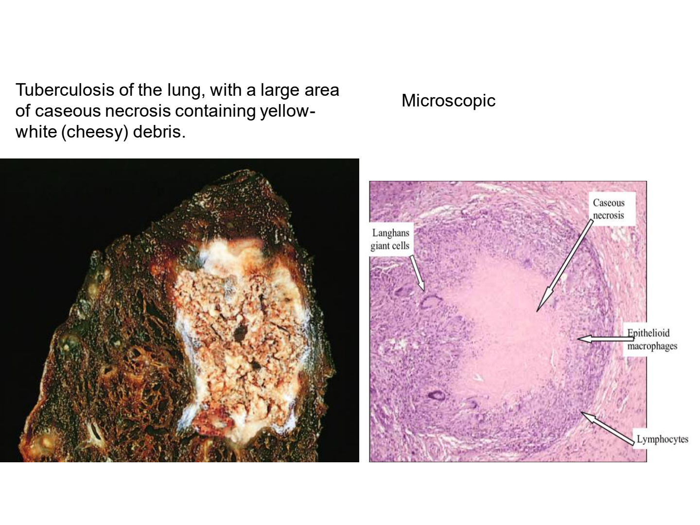

## PDF page 17 — Fat necrosis

> Source: ch1-part-06, PDF page 17. Printed slide: 17. Classification: teaching.

### Preserved source text

IV. Fatty necrosis

• Special type of necrosis with focal areas of fat
  destruction
• Seen with acute pancreatitis, due to release of
  enzymes from the injured pancreas
• Grossly:
  fat saponification: visible white chalky areas
• Microscopically:
  shadows of cells with calcification                         17

### Visual transcription / figure record

Full page visually inspected; extracted text and visible layout compared. Illustrative image retained in original full-page render.

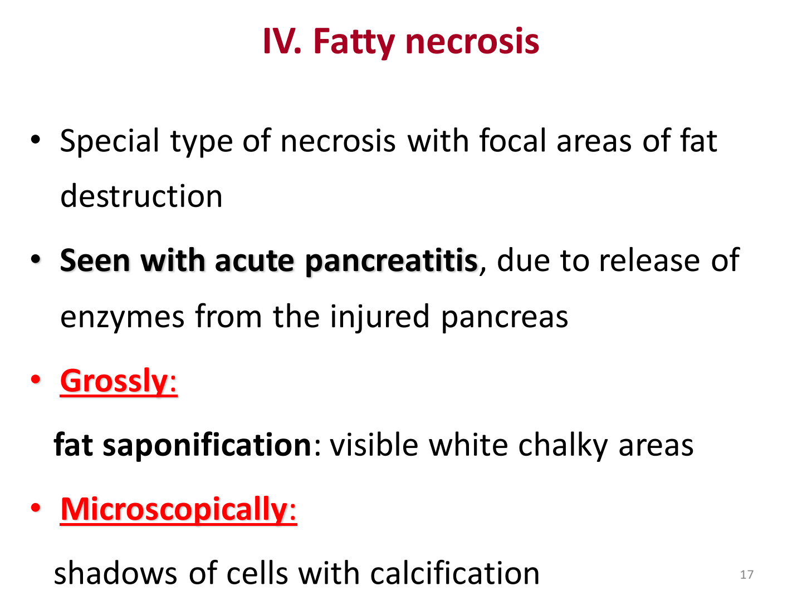

## PDF page 18 — Pancreatitis fat destruction

> Source: ch1-part-06, PDF page 18. Printed slide: 18. Classification: teaching.

### Preserved source text

IV. fat necrosis

acute pancreatitis

### Visual transcription / figure record

Full page visually inspected; extracted text and visible layout compared. Illustrative image retained in original full-page render.

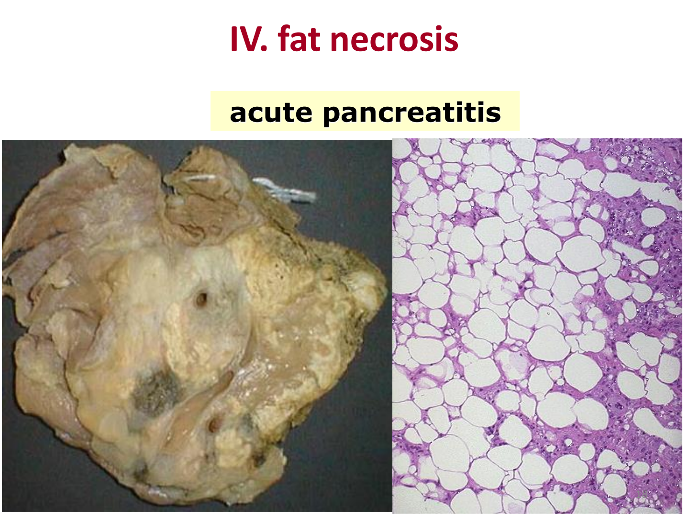

## PDF page 19 — Dry and wet gangrene

> Source: ch1-part-06, PDF page 19. Printed slide: 19. Classification: teaching.

### Preserved source text

V. Gangrenous necrosis

➢ It is not a distinctive pattern of cell death the
  term is still commonly used in surgical practice.
➢ It refers to ischemic coagulative necrosis         (Dry
  gangrene: frequently of a limb)
➢ When there is superimposed infection with a
  liquefactive component, the lesion is called "wet
  gangrene"

### Visual transcription / figure record

Full page visually inspected; extracted text and visible layout compared. Illustrative image retained in original full-page render.

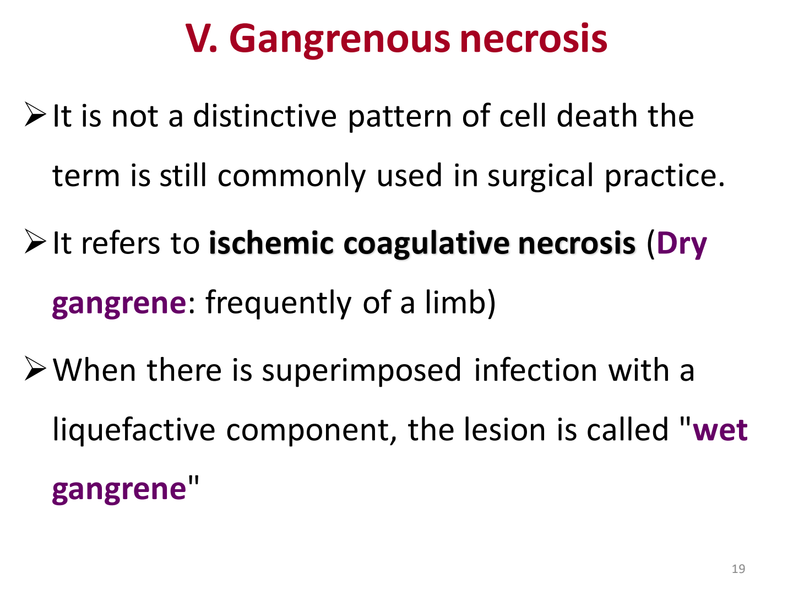

## PDF page 20 — Gangrene illustrations

> Source: ch1-part-06, PDF page 20. Printed slide: 20. Classification: teaching.

### Preserved source text

V. Gangrenous necrosis

                            fresh

                              old

bowel infarct:                  dry gangrene in
wet gangrene                         diabetes     20

### Visual transcription / figure record

Full page visually inspected; extracted text and visible layout compared. Illustrative image retained in original full-page render.

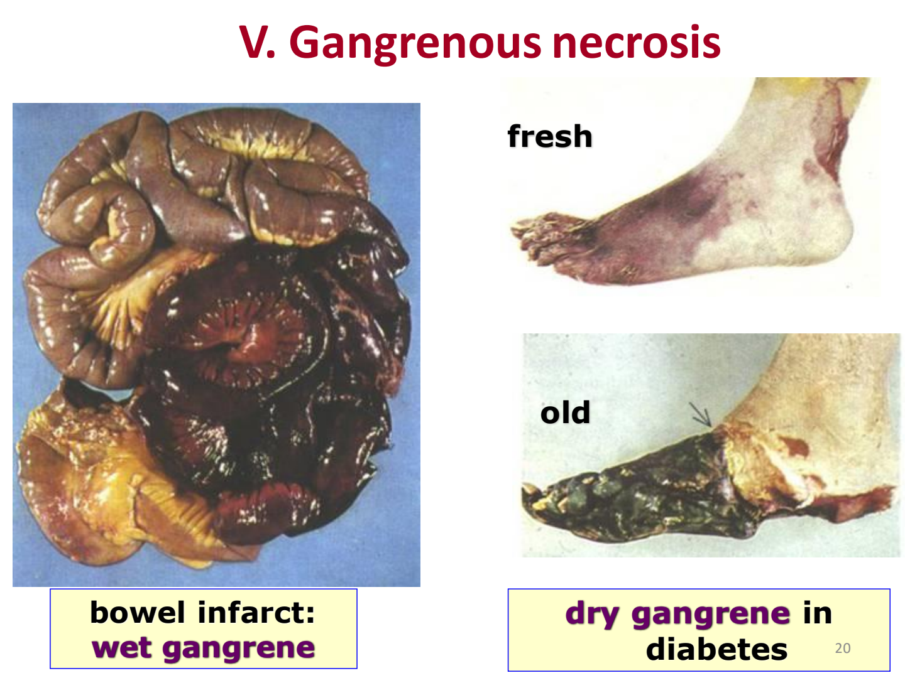

## PDF page 21 — Fibrinoid necrosis

> Source: ch1-part-06, PDF page 21. Printed slide: not visibly labelled. Classification: teaching.

### Preserved source text

(No extractable text beyond the page label; see visual transcription and original image.)

### Visual transcription / figure record

Fibrinoid necrosis: small blood-vessel injury with fibrin/plasma-protein accumulation. Immune-complex deposition e.g. type III hypersensitivity -> collagen/elastic-fiber fragmentation -> fibrin/plasma-protein leakage. Thick damaged walls contain cellular debris, serum, fibrin; intense red stain. Examples: rheumatoid arthritis, peptic ulcer disease, immune vasculitis/polyarteritis nodosa, vascular reactions (preeclampsia, hypertensive emergency).

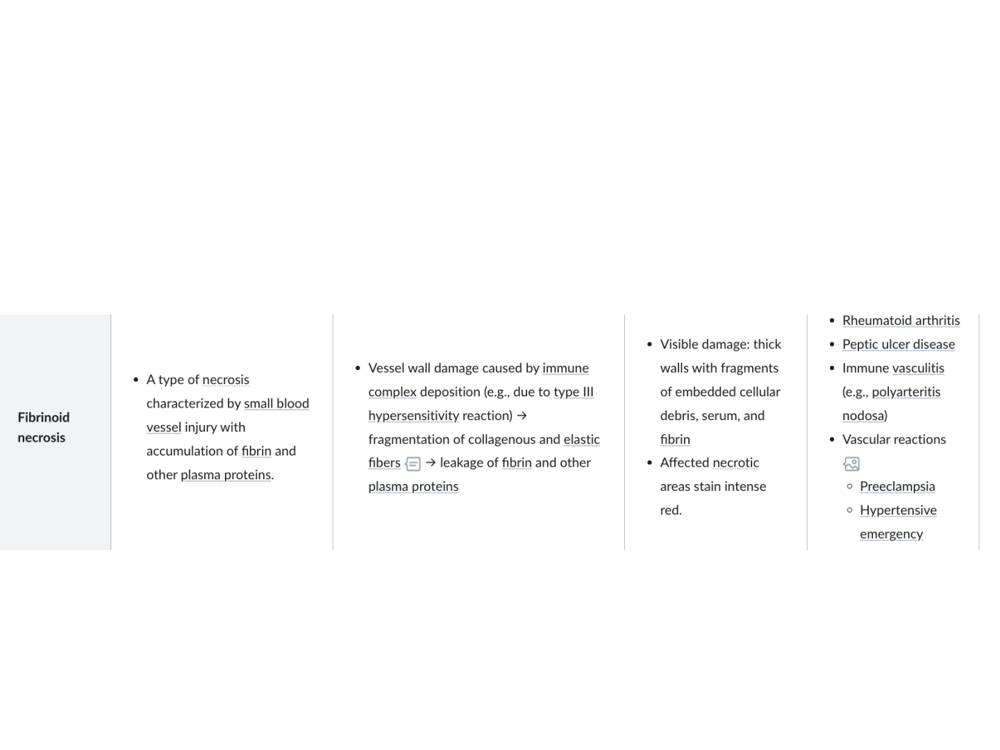

## PDF page 22 — Vascular micrograph

> Source: ch1-part-06, PDF page 22. Printed slide: not visibly labelled. Classification: teaching.

### Preserved source text

(No extractable text beyond the page label; see visual transcription and original image.)

### Visual transcription / figure record

Unlabelled vascular micrograph with intensely pink vessel-wall material; no additional diagnosis inferred beyond adjacent fibrinoid slide.

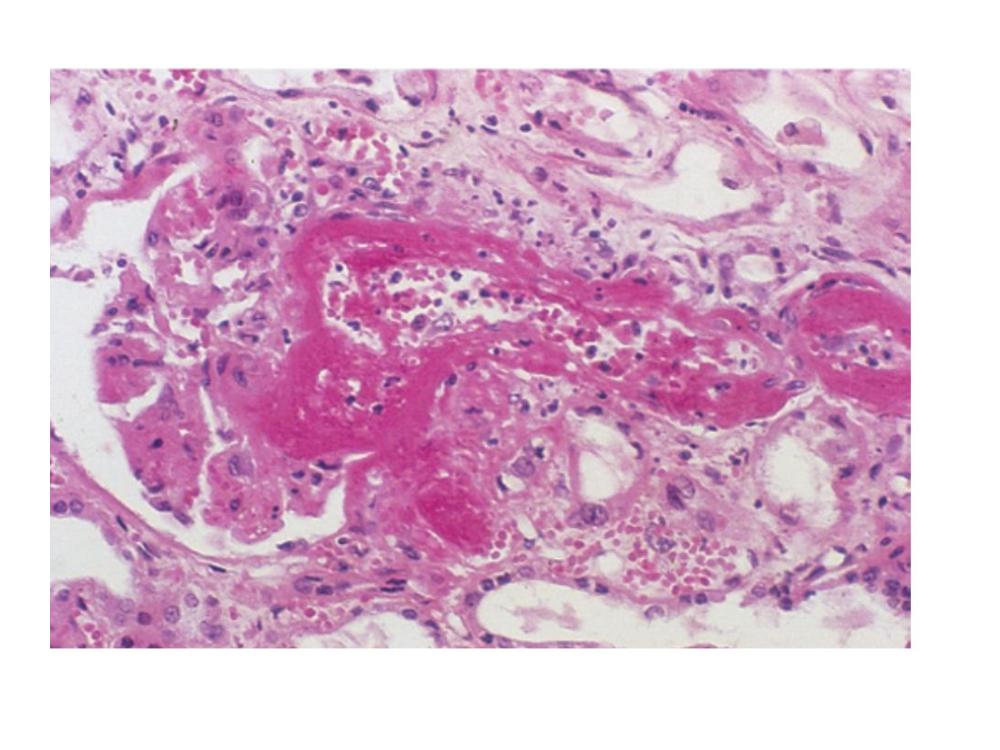

## PDF page 23 — Closing illustration

> Source: ch1-part-06, PDF page 23. Printed slide: not visibly labelled. Classification: administrative.

### Preserved source text

(No extractable text beyond the page label; see visual transcription and original image.)

### Visual transcription / figure record

Nonteaching closing paragliding illustration.

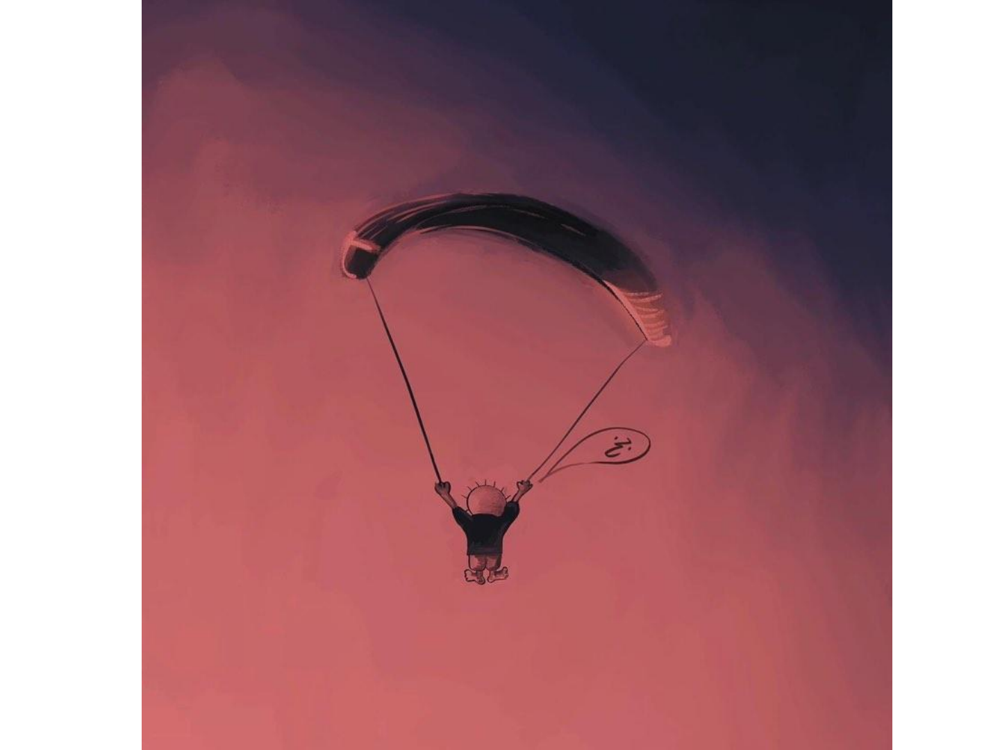

