# Chapter 1 — Part 7: Cover

Authority: unchanged supplied PDF only. Page headings use one-based PDF pages; printed labels are recorded only when visibly present. Original extracted text is preserved below, with separately identified visual transcription. No outside teaching content.

## PDF page 1 — Cover

> Source: ch1-part-07, PDF page 1. Printed slide: 1. Classification: cover.

### Preserved source text

Apoptosis

Al-Quds University
Faculty of Medicine
Pathology Department

### Visual transcription / figure record

Full page visually inspected; extracted text and visible layout compared. Illustrative image retained in original full-page render.

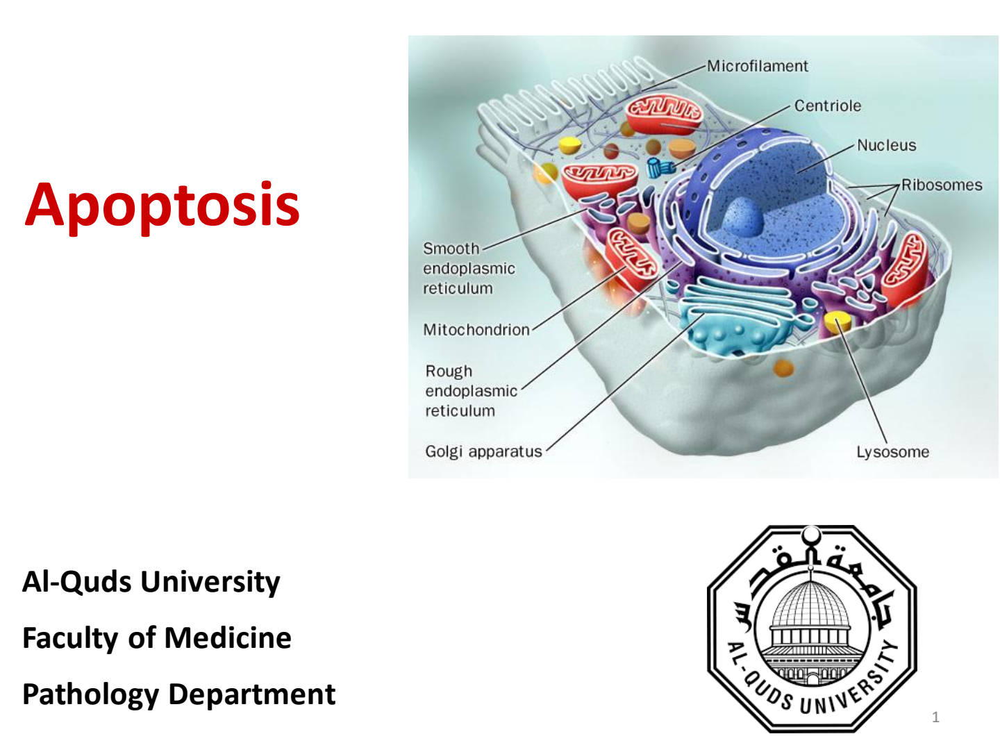

## PDF page 2 — Apoptosis and physiological examples

> Source: ch1-part-07, PDF page 2. Printed slide: 2. Classification: teaching.

### Preserved source text

APOPTOSIS: PROGRAMMED CELL DEATH

➢  important type of cell death: cell commits suicide

➢  Physiological or pathological:

➢  Examples:

1. Programmed destruction of cells      during embryogenesis

2. Hormone-dependent involution:

e.g. physiological, as in endometrium     during menstrual cycle

e.g. pathologic, as in the prostate atrophy after castration

3.Cell deletion in proliferating tissuese.g. cell death in tumors         2

### Visual transcription / figure record

Etymology inset: ancient Greek apopiptein = falling off.

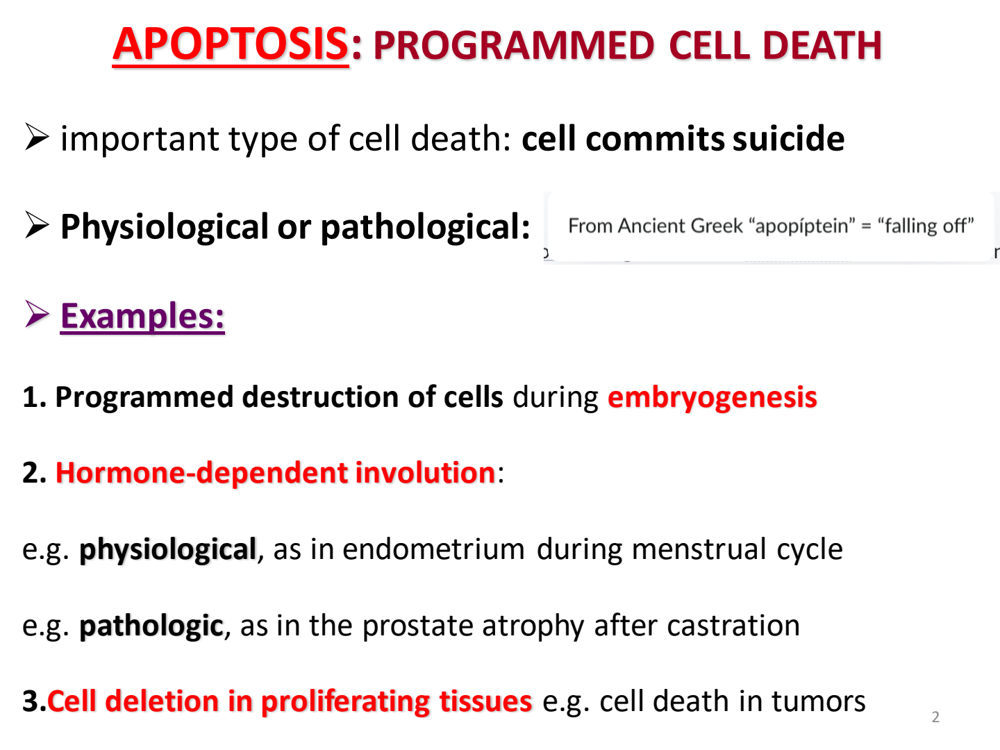

## PDF page 3 — Additional apoptosis examples

> Source: ch1-part-07, PDF page 3. Printed slide: 3. Classification: teaching.

### Preserved source text

APOPTOSIS: PROGRAMMED CELL DEATH

➢ Examples:

4.Immune cell death:

e.g. deletion of autoreactive T-lymphocytes in thymus

e.g. cell death induced by cytotoxic T cells

5. Mild injurious stimuli:

e.g. mild heat, radiation, cytotoxic treatment.

6. Death of neurons in disease processes

e.g. Alzheimer disease                                                3

### Visual transcription / figure record

Full page visually inspected; extracted text and visible layout compared. Illustrative image retained in original full-page render.

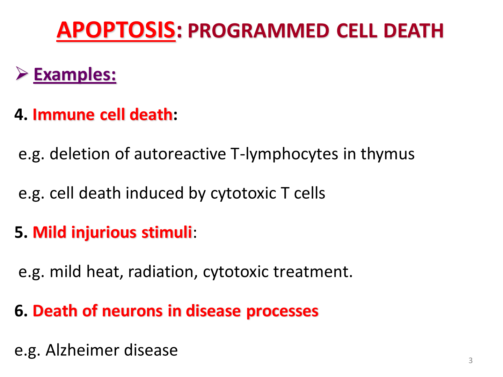

## PDF page 4 — Interdigital apoptosis

> Source: ch1-part-07, PDF page 4. Printed slide: not visibly labelled. Classification: teaching.

### Preserved source text

(No extractable text beyond the page label; see visual transcription and original image.)

### Visual transcription / figure record

Fetal hand diagram labels apoptosis of interdigital tissue; syndactyly shown alongside.

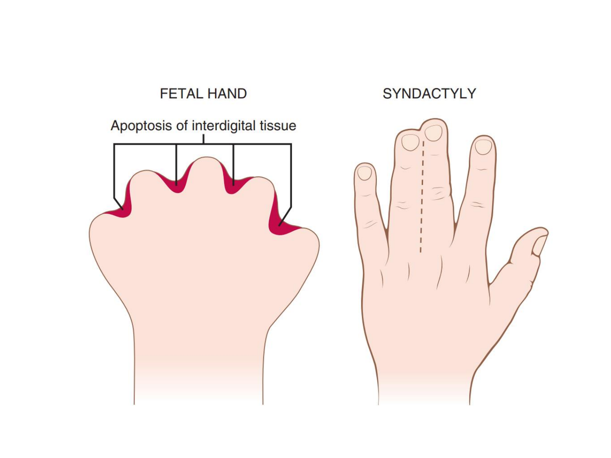

## PDF page 5 — Apoptosis molecular players

> Source: ch1-part-07, PDF page 5. Printed slide: 5. Classification: teaching.

### Preserved source text

Mechanisms of apoptosis

The main players are:

➢Cytosolic proteins called Caspases

➢Mitochondrial proteins called       BCL-2  family

### Visual transcription / figure record

Full page visually inspected; extracted text and visible layout compared. Illustrative image retained in original full-page render.

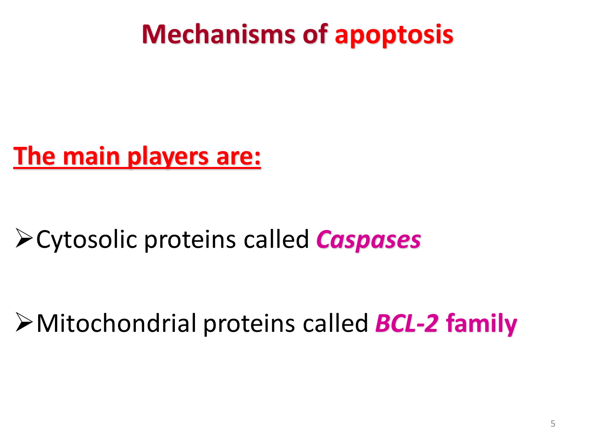

## PDF page 6 — Caspase definition

> Source: ch1-part-07, PDF page 6. Printed slide: 6. Classification: teaching.

### Preserved source text

Mechanisms of apoptosis:             Caspases

• Enzymes which are present in the cytoplasm and

  are key players in apoptosis

• Found in an inactive     form   in the cytoplasm.

• They are called Caspases       from  C; from   Cysteine

  active site, “asp”; from cleavage after aspartic

  acid residue.

### Visual transcription / figure record

Full page visually inspected; extracted text and visible layout compared. Illustrative image retained in original full-page render.

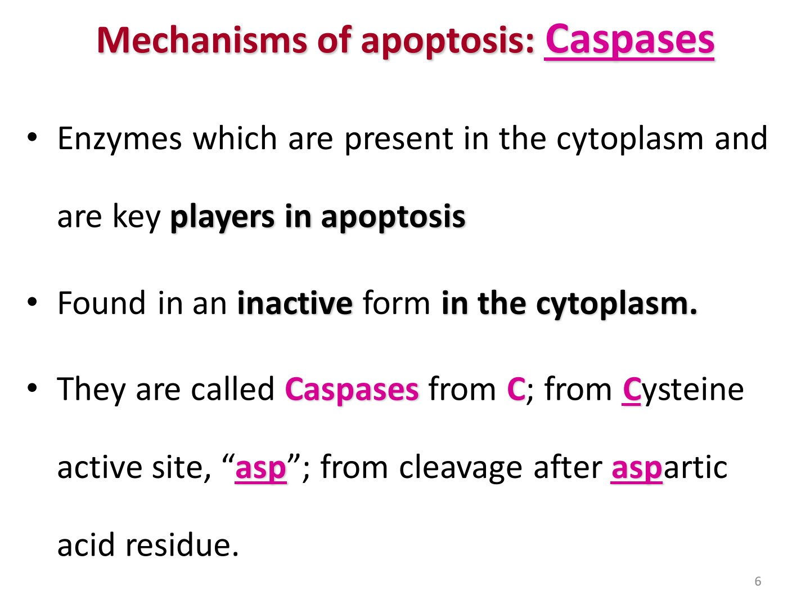

## PDF page 7 — Initiator and effector caspases

> Source: ch1-part-07, PDF page 7. Printed slide: 7. Classification: teaching.

### Preserved source text

Mechanisms of apoptosis: Caspases

There are two types:

1.   Initiators: signaling of these caspases results in
     commitment of cells to apoptotic cell death. These are
     found in certain cell types.

2.   Effectors:  these are proteases     which bring about the
     structural degradation of the cellsto give the classical
     morphology. They are present in all cell types.

### Visual transcription / figure record

Full page visually inspected; extracted text and visible layout compared. Illustrative image retained in original full-page render.

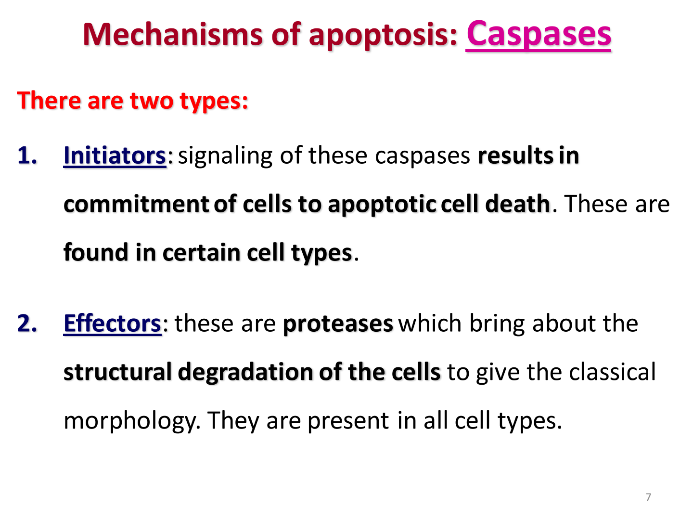

> **Source note (fresh checker):** Source assigns initiators to certain cell types and effectors to all cell types. Defer these absolute distribution claims; the functional initiator/executioner distinction remains clear.

## PDF page 8 — BCL2 family

> Source: ch1-part-07, PDF page 8. Printed slide: 8. Classification: teaching.

### Preserved source text

Mechanisms of apoptosis:                  BCL-2 family

• BCL-2 family    are group of proteins that either:

   –  suppress apoptosis, like BCL-2  / BCL-XL

   –  enhance apoptosis   like Bax / Bad

•  BCL-2   protects from apoptosis by stabilizing the
  mitochondrial membrane, thus preventing increase
  permeability, by binding and sequestering cytochrome-C,
  and stabilizing proteins like the Apaf, thus preventing its
  activation.

### Visual transcription / figure record

Full page visually inspected; extracted text and visible layout compared. Illustrative image retained in original full-page render.

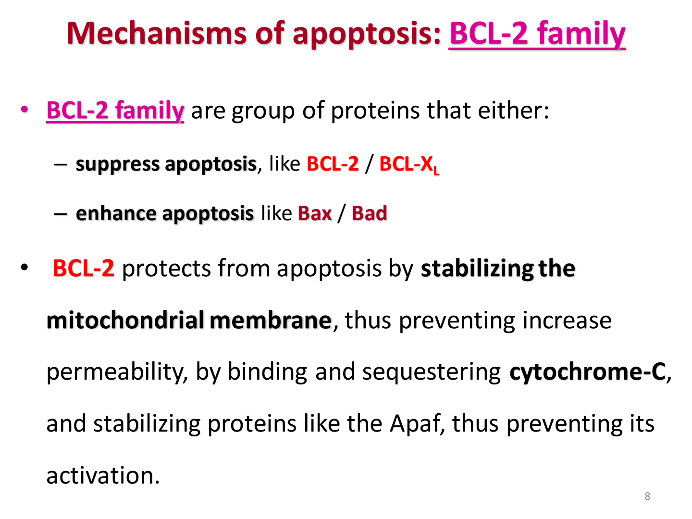

> **Source note:** Detailed BCL2 wording includes binding/sequestering cytochrome c and stabilizing Apaf; later diagrams describe regulation of permeability. Preserve wording, defer that detailed molecular binding claim.

## PDF page 9 — Mitochondrial permeability regulation

> Source: ch1-part-07, PDF page 9. Printed slide: 9. Classification: teaching.

### Preserved source text

Mechanisms of apoptosis:                    BCL-2 family

•  Factors that influence mitochondrial membrane
   permeability are important players in regulating
   apoptosis in the cells.

                                              (Apoptosis Inducing Factor)

### Visual transcription / figure record

Mitochondrial diagram: PTPC megachannel inhibited by Bcl2/BclXL, promoted by Bax/Bad; cytochrome C and AIF (apoptosis inducing factor) connected to caspase activation.

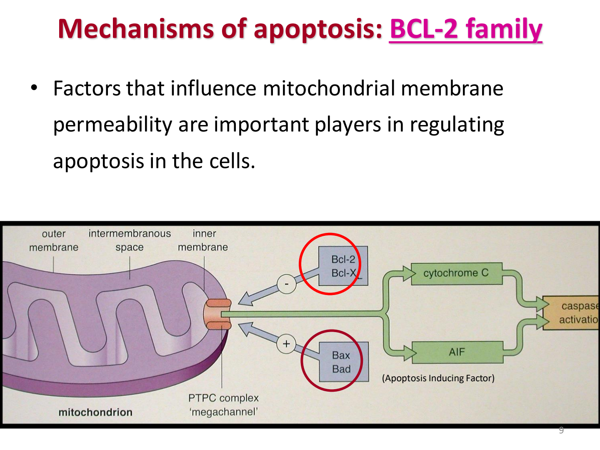

> **Source note:** AIF is depicted converging on caspase activation; this specific simplified route is unqualified. Do not score the AIF-caspase link.

## PDF page 10 — Cytochrome c pathway

> Source: ch1-part-07, PDF page 10. Printed slide: 10. Classification: teaching.

### Preserved source text

Mechanisms of apoptosis: mitochondrial damage

• Stimuli  like toxins, or signalling   will open  permeability

  transition pore complex (PTPC), or       mega channels, which

  will release   material mainly cytochrome-C        from the

  mitochondria to cytosol.

• Cytochrome-C will bind to Apaf        “pro-apoptotic protease-

  activating factor”  and activate effector caspases.

### Visual transcription / figure record

Full page visually inspected; extracted text and visible layout compared. Illustrative image retained in original full-page render.

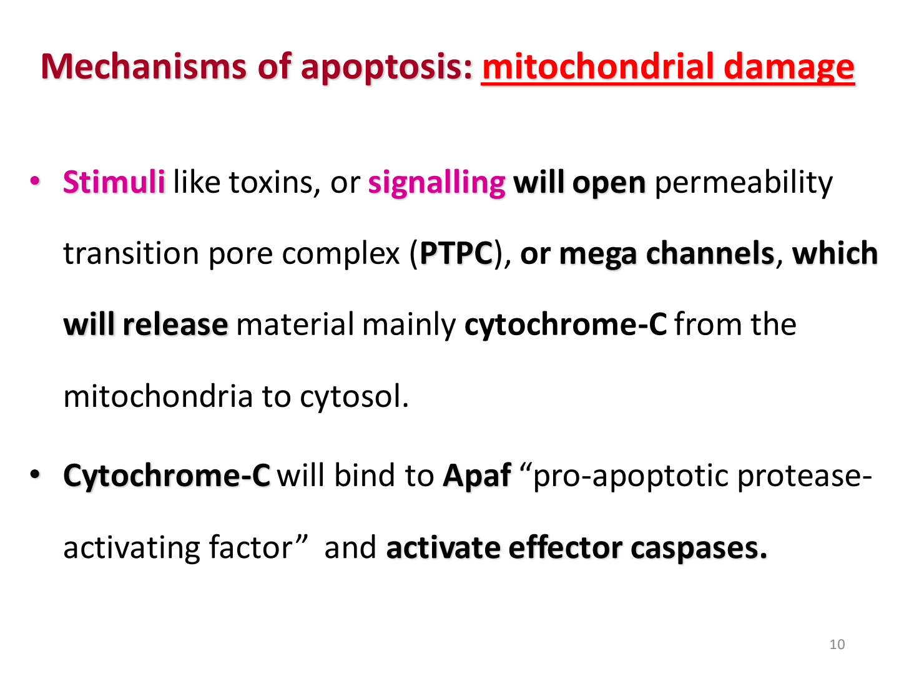

> **Source note:** Slide says cytochrome c/Apaf activates effector caspases directly, while p15 includes initiator then executioner stages. Assess overall mitochondrial/caspase route, not direct activation distinction.

## PDF page 11 — Mitochondrial apoptosis diagram

> Source: ch1-part-07, PDF page 11. Printed slide: 11. Classification: teaching.

### Preserved source text

Mechanisms of apoptosis: mitochondrial damage

              signalling

### Visual transcription / figure record

Signalling -> ATP reduction/ROS increase and membrane potential collapse; open PTPC megachannels/high-amplitude swelling -> cytochrome c -> apoptosome -> caspase activation -> apoptosis. A strip obscures part of diagram; it is not reconstructed.

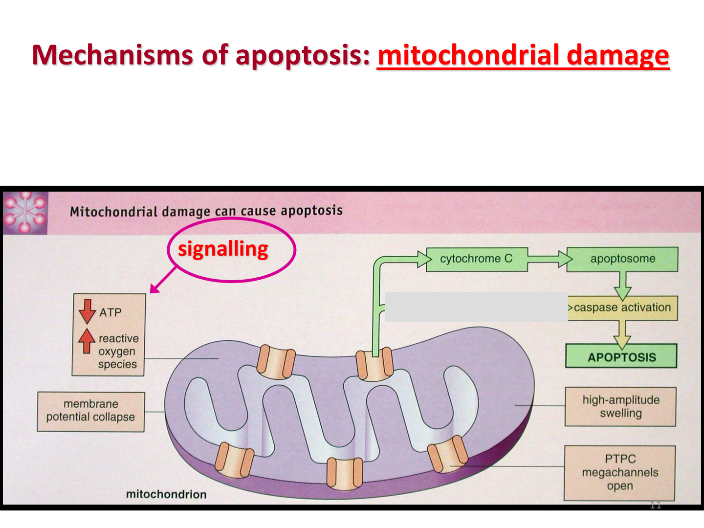

## PDF page 12 — Apoptosis stages

> Source: ch1-part-07, PDF page 12. Printed slide: 12. Classification: teaching.

### Preserved source text

Mechanisms of apoptosis

1. Signaling:  intrinsic or extrinsic triggers   to induce apoptosis

2. Control and integration:      by the BCL-2   family that can either inhibit
   or promote cell death.

3. Execution: by caspases      that activate   cytoplasmic endonuclease
   and proteases     that degrade cytoskeletal & nuclear proteins which
   results in breakdown of cytoskeletonand fragmentation of
   nuclear chromatin.

4. Removal of dead cells:      the formation of apoptotic bodies
   containing various intracellular organelles; they express new
   ligands that mediate phagocytic cell binding and uptake.                   12

### Visual transcription / figure record

Full page visually inspected; extracted text and visible layout compared. Illustrative image retained in original full-page render.

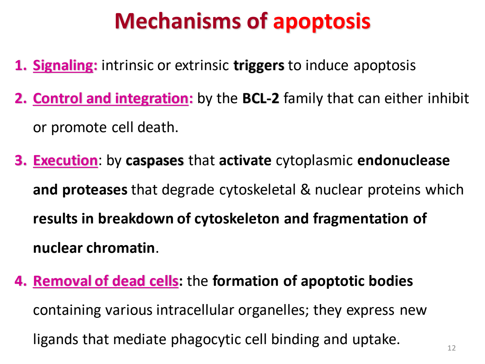

## PDF page 13 — Intrinsic and extrinsic pathways

> Source: ch1-part-07, PDF page 13. Printed slide: not visibly labelled. Classification: teaching.

### Preserved source text

(No extractable text beyond the page label; see visual transcription and original image.)

### Visual transcription / figure record

Extrinsic ligand/death receptor (FAS-L/TNF-alpha, FAS-R/TNFR) and NK/cytotoxic T-cell perforin/granzyme B routes. Intrinsic survival-signal loss, DNA damage/radiation/ROS/toxins, misfolded proteins or hypoxia -> p53; Bak/Bax/Bad increase and Bcl2 decrease -> cytochrome c/APAF1 apoptosome. Initiator caspases labelled 2,8,9,10; executioners 3,6,7 -> cytoskeletal/nuclear fragmentation, blebbing, apoptotic bodies -> macrophage uptake.

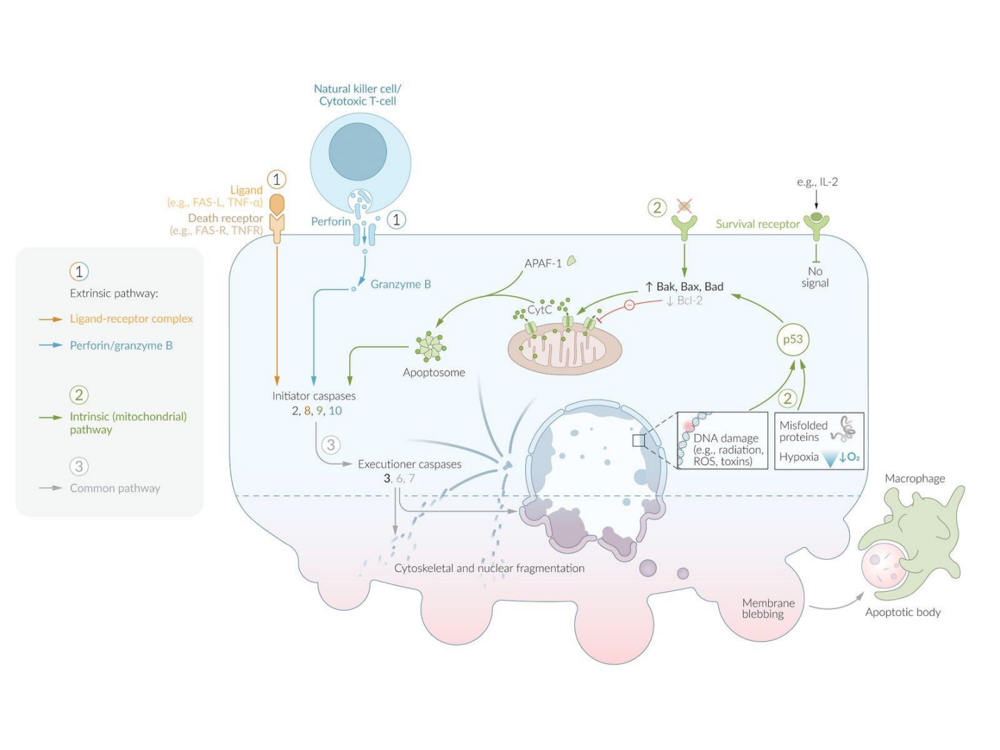

## PDF page 14 — Apoptosis integrated diagram

> Source: ch1-part-07, PDF page 14. Printed slide: 14. Classification: teaching.

### Preserved source text

Mechanisms of apoptosis

### Visual transcription / figure record

Withdrawal of growth factors/hormones, injury/radiation/toxins/free radicals, embryogenic signals, death receptor FAS/FASL or TNF/TNFR, cytotoxic T/granzyme B converge on initiator/execution caspases. BCL2/BCLXL inhibit; BAX/BAD promote. p53 and endonuclease activation -> DNA fragmentation; cytoskeleton catabolism -> buds/apoptotic bodies with phagocyte ligands -> macrophage or epithelial-cell uptake.

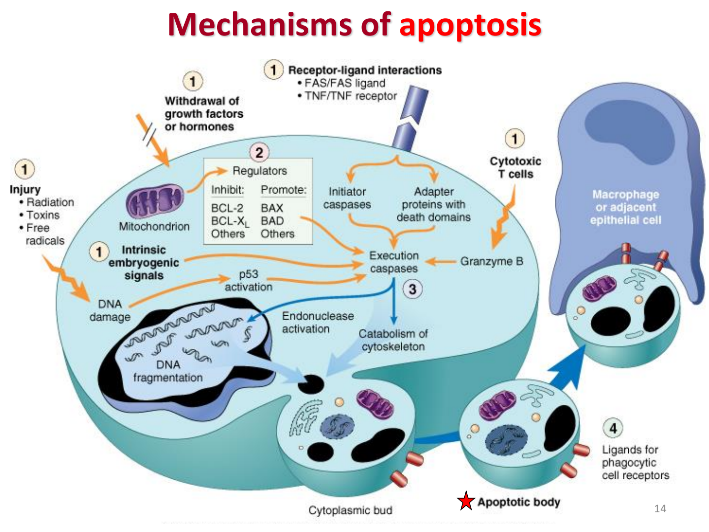

## PDF page 15 — Mitochondrial and death receptor pathways

> Source: ch1-part-07, PDF page 15. Printed slide: not visibly labelled. Classification: teaching.

### Preserved source text

(No extractable text beyond the page label; see visual transcription and original image.)

### Visual transcription / figure record

Intrinsic mitochondrial route: growth-factor withdrawal, DNA damage, protein misfolding/ER stress -> Bcl2 sensors/effectors Bax/Bak (inhibited by Bcl2/BclXL) -> cytochrome c/pro-apoptotic proteins. Extrinsic death receptor Fas/TNF -> adaptor proteins -> initiator caspases. Both -> executioners -> endonuclease/nuclear fragmentation and cytoskeleton breakdown -> bodies/phagocytosis.

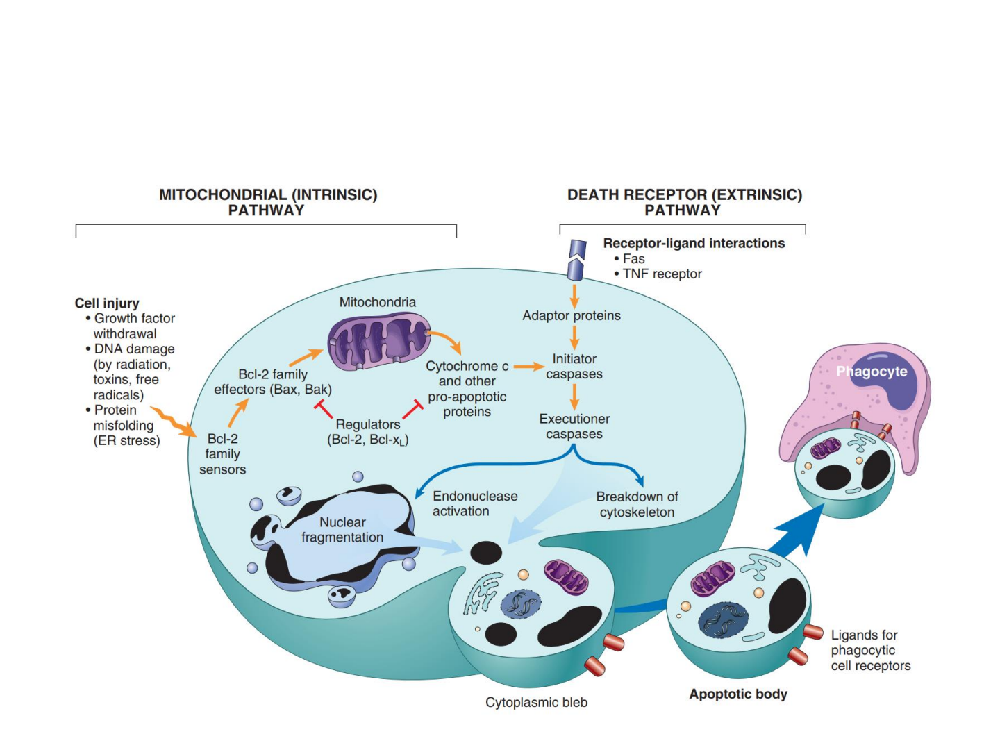

## PDF page 16 — Survival signals versus apoptosis

> Source: ch1-part-07, PDF page 16. Printed slide: not visibly labelled. Classification: teaching.

### Preserved source text

(No extractable text beyond the page label; see visual transcription and original image.)

### Visual transcription / figure record

Survival signal -> Bcl2/BclXL -> no cytochrome c leakage -> survival. Lack of survival signal, irradiation/DNA damage or misfolded proteins -> sensors -> Bcl2 antagonism and Bax/Bak channel activation -> cytochrome c leakage -> caspases -> apoptosis.

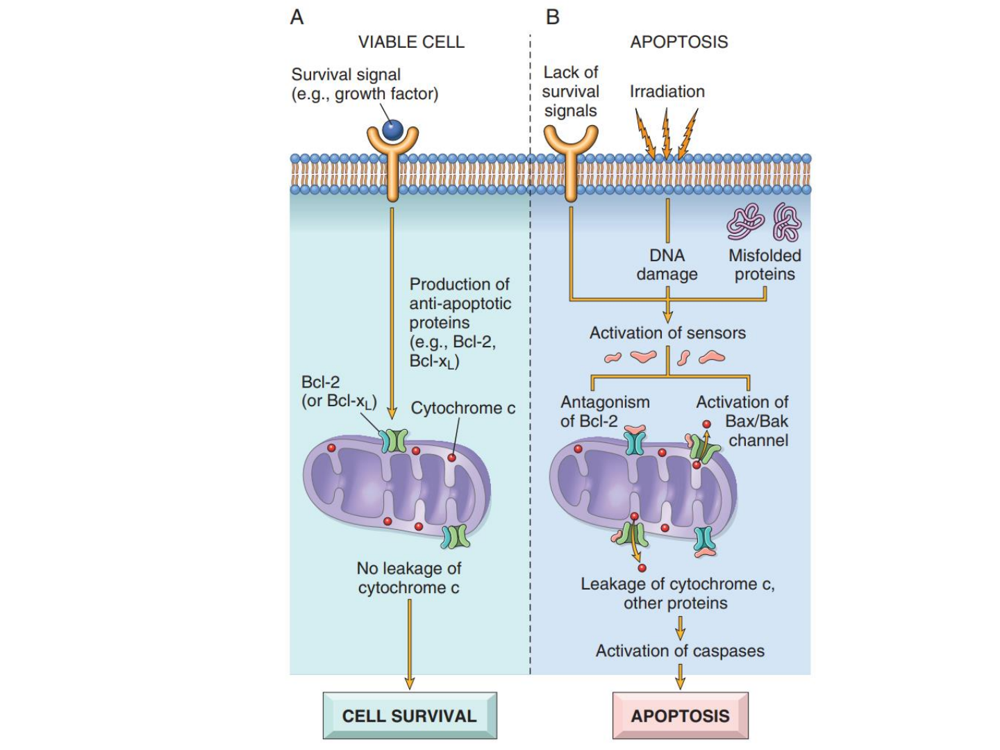

## PDF page 17 — Apoptotic morphology

> Source: ch1-part-07, PDF page 17. Printed slide: 17. Classification: teaching.

### Preserved source text

Apoptosis: Morphology

• Single cells or groups of cells
• Cells show intensely eosinophilic cytoplasm              and
  condensed pyknotic nucleus
• Cells are not surrounded by inflammatory cells
• Rapidly removed by fragmentation and
  engulfment by cells

Pyknosis: increased basophilia due to shrinkage of the nucleus

### Visual transcription / figure record

Full page visually inspected; extracted text and visible layout compared. Illustrative image retained in original full-page render.

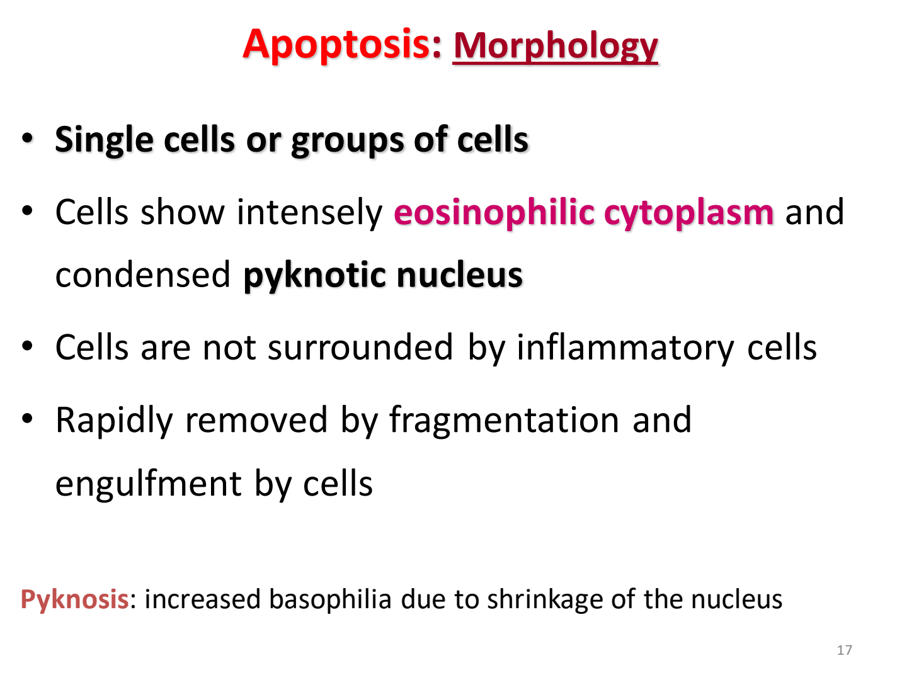

## PDF page 18 — Apoptotic bodies and removal

> Source: ch1-part-07, PDF page 18. Printed slide: 18. Classification: teaching.

### Preserved source text

Apoptosis: Morphology

Normal                       Apoptotic body

           removed                           18

### Visual transcription / figure record

Normal epithelium -> loss of microvilli/junctions and nuclear changes -> apoptotic body -> neighboring-cell phagocytosis/removal.

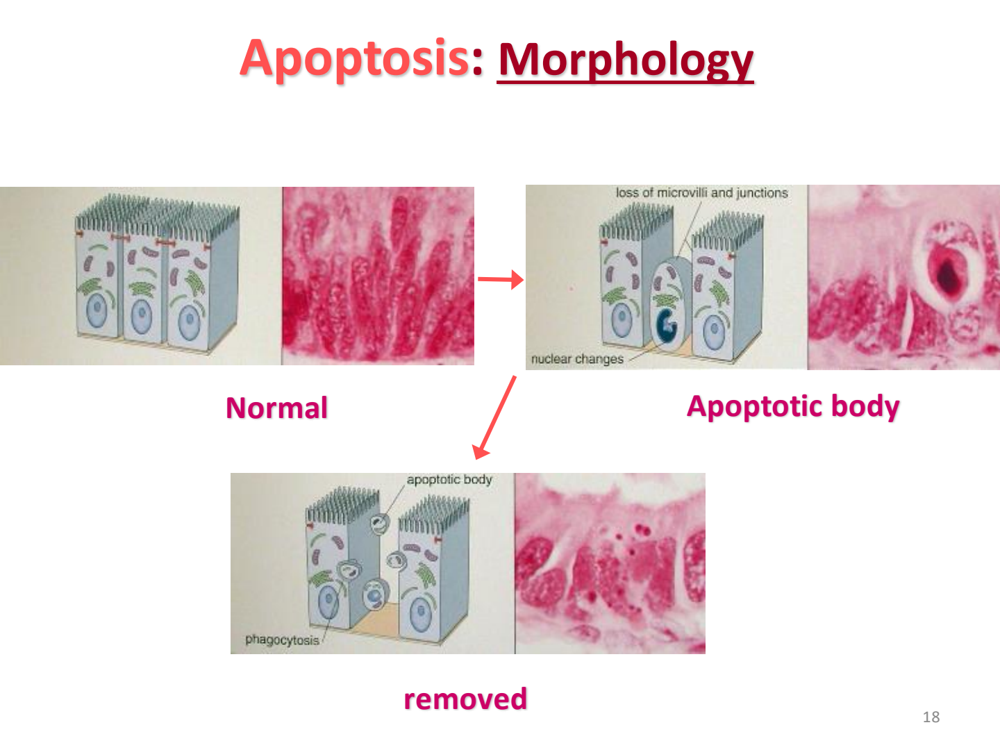

## PDF page 19 — Necrosis apoptosis ultrastructure

> Source: ch1-part-07, PDF page 19. Printed slide: 19. Classification: teaching.

### Preserved source text

Ultrastructural changes in necrosis & apoptosis

chromatin                                                  chromatin
clumping                                                   condensation

organellar                                                 chromatin
swelling                                                   fragmentation

membrane                                                   cytoplasmic
damage                                                     budding

                 necrosis                       apoptosis              19

### Visual transcription / figure record

Full page visually inspected; extracted text and visible layout compared. Illustrative image retained in original full-page render.

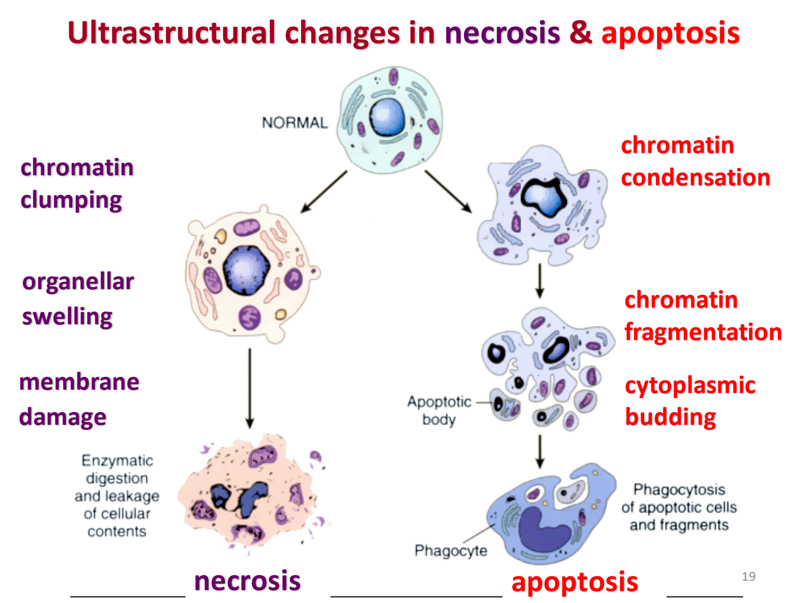

## PDF page 20 — Necrosis apoptosis distribution

> Source: ch1-part-07, PDF page 20. Printed slide: not visibly labelled. Classification: teaching.

### Preserved source text

(No extractable text beyond the page label; see visual transcription and original image.)

### Visual transcription / figure record

Necrosis (group of cells/exogenous injury): swollen mitochondria/RER, chromatin clumping -> membrane rupture -> nuclear fragments. Apoptosis (single cell/suicide-gene activation): nuclear changes/cytoplasmic fragmentation -> apoptotic bodies -> macrophage uptake.

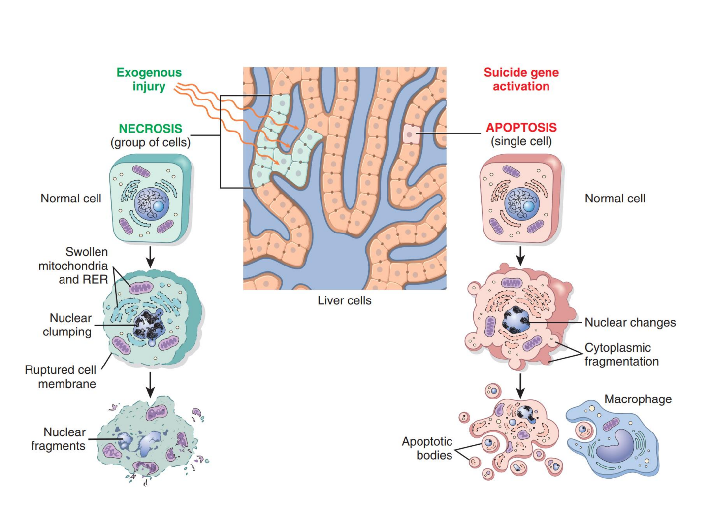

## PDF page 21 — Necrosis apoptosis comparison

> Source: ch1-part-07, PDF page 21. Printed slide: 21. Classification: teaching.

### Preserved source text

Feature                     Necrosis                     Apoptosis
Cell size                   Enlarged    (swelling)       Reduced     (shrinkage)
Nucelus                     Pyknosis                     Fragmentation     into
                            karyorrhexis                 nucleosome      size
                            karyolysis                   fragments
Plasma membrane             Disrupted                    Intact; altered
                                                         structure, especially
                                                         orientation of lipids
Cellular contents           Enzymatic digestion;         Intact; may be
                            may leak out of cell         released in apoptotic
                                                         bodies
Adjacent inflammation       Frequent                     No
Physiologic or              Invariably pathologic        Often  physiologic    ,
pathologic role             (irreversible cell           means of eliminating
                            injury)                      unwanted cells; may
                                                         be pathologic after
                                                         some forms of cell
                                                         injury, especially DNA
                                                         damage                 21

### Visual transcription / figure record

Full page visually inspected; extracted text and visible layout compared. Illustrative image retained in original full-page render.

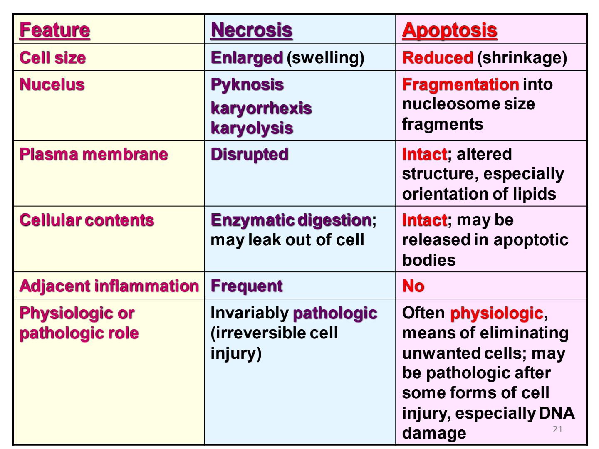

## PDF page 22 — Comparison summary

> Source: ch1-part-07, PDF page 22. Printed slide: not visibly labelled. Classification: teaching.

### Preserved source text

(No extractable text beyond the page label; see visual transcription and original image.)

### Visual transcription / figure record

Table: apoptosis non-inflammatory, shrinkage, blebs, intact membrane, single cell, DNA laddering, may be physiologic. Necrosis inflammatory, swelling, blebs, membrane damage, many cells, no laddering, always pathologic.

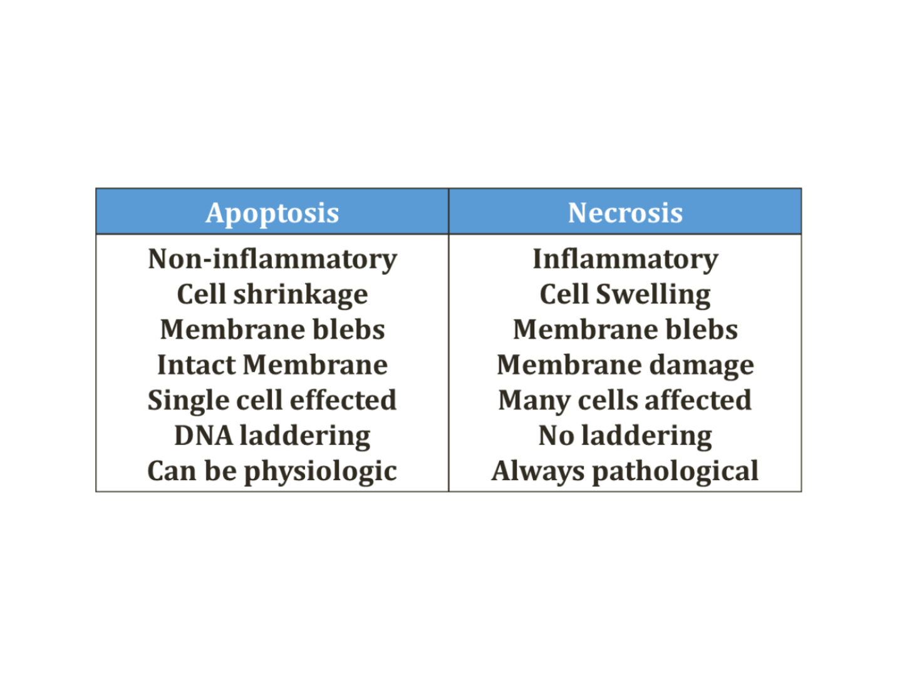

> **Source note (fresh checker):** Table says apoptosis affects one cell, but p17 allows single cells or groups. Do not score a prohibition against apoptotic groups.

## PDF page 23 — Closing quotation

> Source: ch1-part-07, PDF page 23. Printed slide: not visibly labelled. Classification: administrative.

### Preserved source text

(No extractable text beyond the page label; see visual transcription and original image.)

### Visual transcription / figure record

Closing Arabic quotation: الأدب يستر قليل العلم، والعلم لا يستر قليل الأدب، وفقدهما عراء وجمعهما ثراء.

