# Chapter 1 — Part 8: Cover

Authority: unchanged supplied PDF only. Page headings use one-based PDF pages; printed labels are recorded only when visibly present. Original extracted text is preserved below, with separately identified visual transcription. No outside teaching content.

## PDF page 1 — Cover

> Source: ch1-part-08, PDF page 1. Printed slide: 1. Classification: cover.

### Preserved source text

Intracellular
accumulation
        &
  Pathologic
Calcification

Al-Quds University
Faculty of Medicine
Pathology Department                                         1

### Visual transcription / figure record

Full page visually inspected; extracted text and visible layout compared. Illustrative image retained in original full-page render.

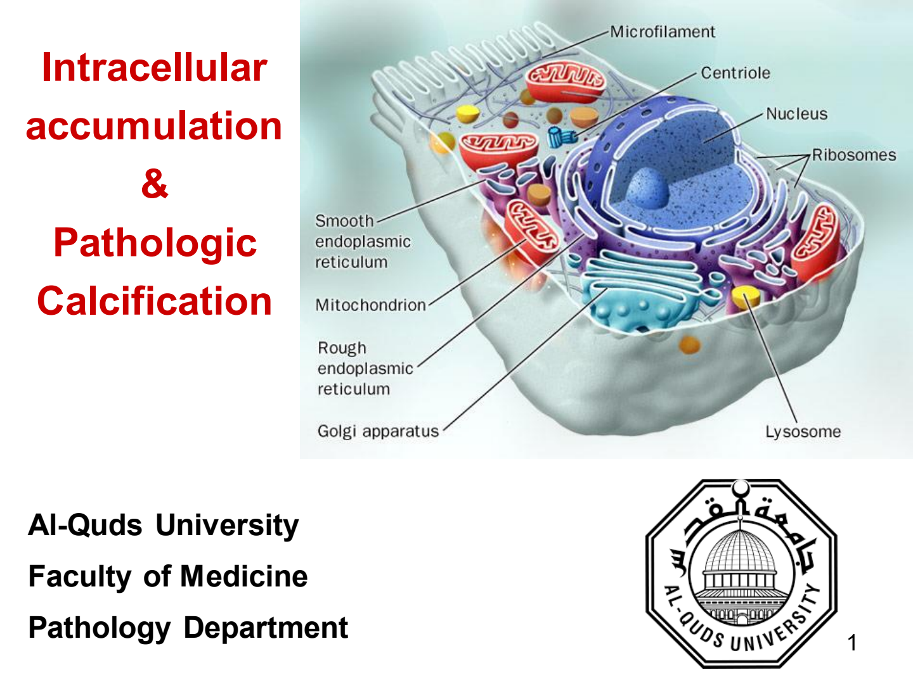

## PDF page 2 — Intracellular accumulation definition

> Source: ch1-part-08, PDF page 2. Printed slide: 2. Classification: teaching.

### Preserved source text

Intracellular accumulation

• Accumulation of abnormal amounts             of various

  substances either in the cytoplasm, within

  organelles    (typically lysosomes), or in the nucleus.

• May be harmless or may cause varied degrees of

  injury.

• The substance may be synthesized by the affected

  cells or may be produced elsewhere.

### Visual transcription / figure record

Full page visually inspected; extracted text and visible layout compared. Illustrative image retained in original full-page render.

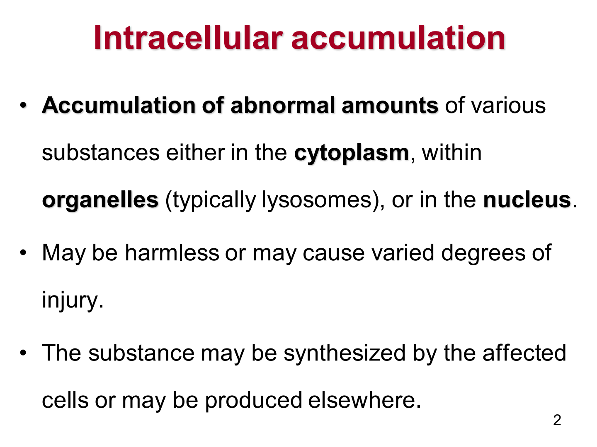

## PDF page 3 — Examples of intracellular accumulations

> Source: ch1-part-08, PDF page 3. Printed slide: 3. Classification: teaching.

### Preserved source text

3

### Visual transcription / figure record

Illustrated accumulation categories: protein, triglyceride, cholesterol, carbon, hemosiderin (iron), glycogen, lipofuscin, infectious organisms.

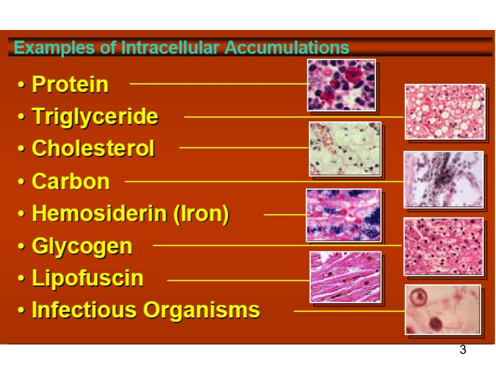

## PDF page 4 — Accumulation pathways

> Source: ch1-part-08, PDF page 4. Printed slide: 4. Classification: teaching.

### Preserved source text

General pathways for intracellular
                      accumulation
1.  Abnormal metabolism of substances
    e.g. fatty liver

2.  Defective folding and transport of proteins
    e.g. alpha-1 antitrypsin deficiency.

3.  Genetic or acquired lack of enzyme
    e.g. storage diseases.

4.  Accumulation of exogenous indigestible material
    e.g. carbon                                              4

### Visual transcription / figure record

Full page visually inspected; extracted text and visible layout compared. Illustrative image retained in original full-page render.

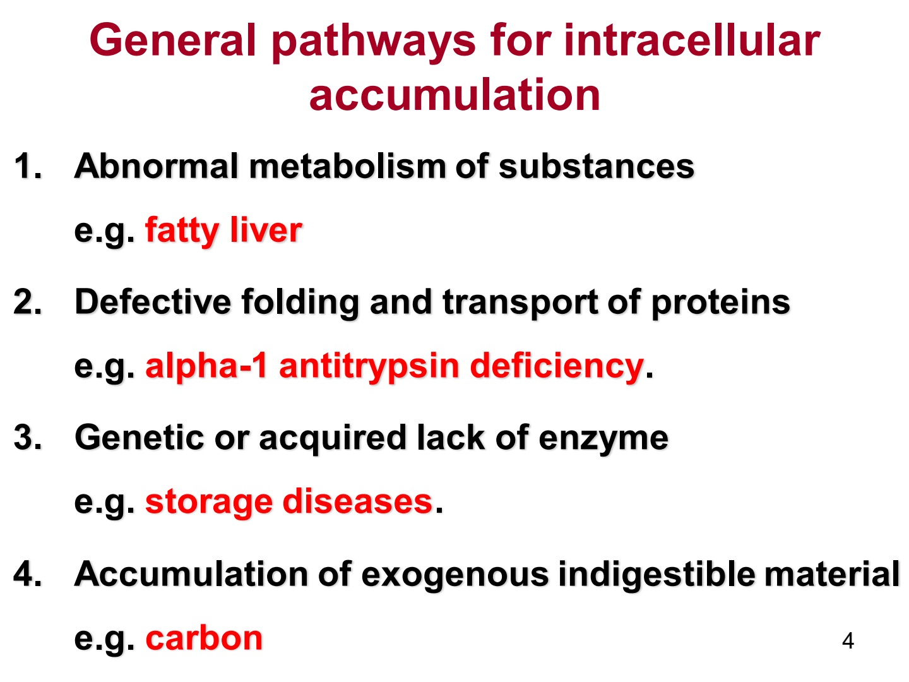

## PDF page 5 — Metabolism versus protein folding defects

> Source: ch1-part-08, PDF page 5. Printed slide: 5. Classification: teaching.

### Preserved source text

Causes            :

1)  Abnormal
    metabolism      of
    substances
    e.g. fatty liver

2)  Defective
    folding &
    transport of
    proteins
e.g. alpha-1
    antitrypsin
    deficiency   .                                                          5

### Visual transcription / figure record

Full page visually inspected; extracted text and visible layout compared. Illustrative image retained in original full-page render.

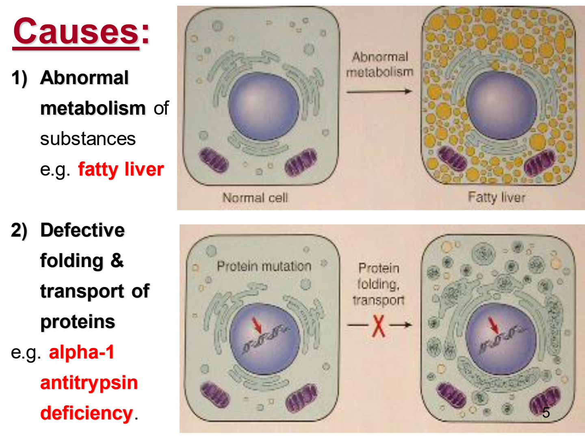

## PDF page 6 — Enzyme deficiency versus exogenous material

> Source: ch1-part-08, PDF page 6. Printed slide: 6. Classification: teaching.

### Preserved source text

3) Genetic or acquired
    lack of enzyme
    e.g. storage
    diseases.

4) Accumulation  of
    exogenous
    indigestible material
e.g. carbon

### Visual transcription / figure record

Full page visually inspected; extracted text and visible layout compared. Illustrative image retained in original full-page render.

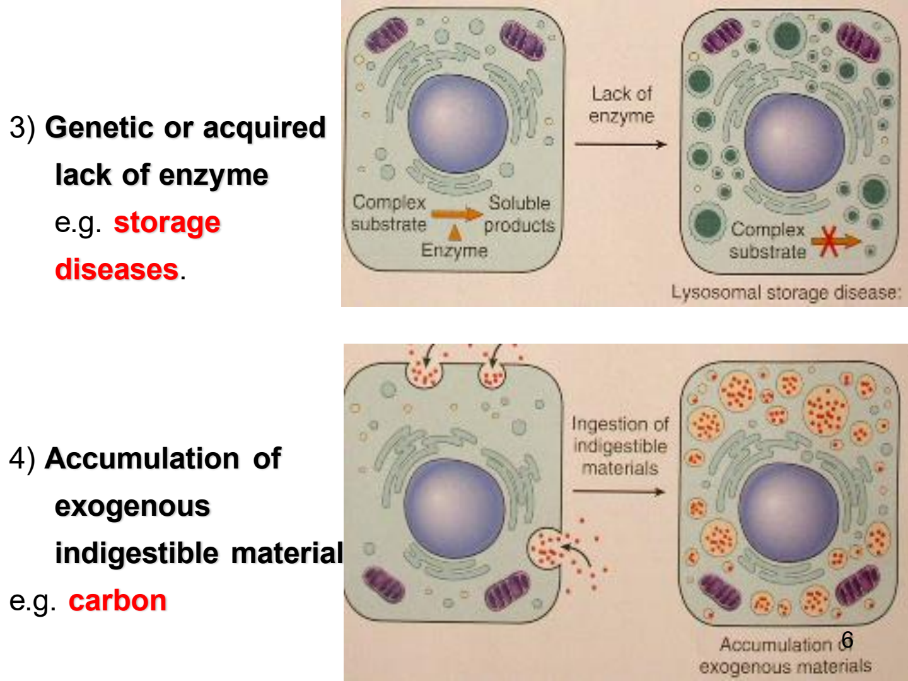

## PDF page 7 — Steatosis definition

> Source: ch1-part-08, PDF page 7. Printed slide: 7. Classification: teaching.

### Preserved source text

Fatty changes: Steatosis

• Defined as abnormal accumulation of

  triglycerides   within parenchymal cells.

• Liver  is the most common organ affected,

  but heart, skeletal muscles and kidney may

  be affected.

• Fatty changes are reversible.

### Visual transcription / figure record

Full page visually inspected; extracted text and visible layout compared. Illustrative image retained in original full-page render.

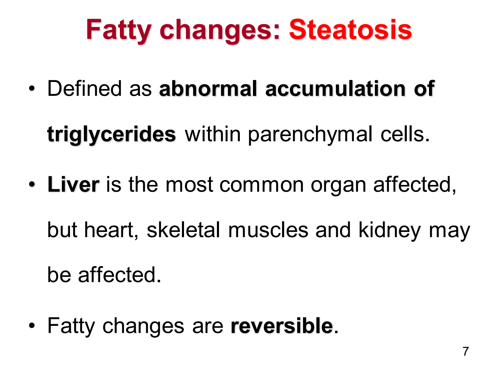

## PDF page 8 — Causes of steatosis

> Source: ch1-part-08, PDF page 8. Printed slide: 8. Classification: teaching.

### Preserved source text

Causes of Fatty changes

• Toxins:   alcohol  is the most common cause.

• Protein malnutrition    : due to decrease in the

  synthesis of  apolipoproteins   .

• Diabetes mellitus

• Obesity

• Anoxia and starvation                             8

### Visual transcription / figure record

Full page visually inspected; extracted text and visible layout compared. Illustrative image retained in original full-page render.

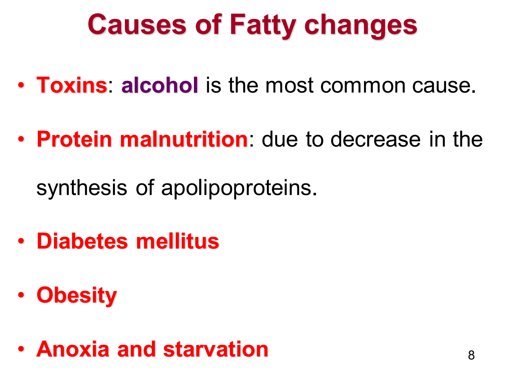

## PDF page 9 — Alcohol metabolism diagram

> Source: ch1-part-08, PDF page 9. Printed slide: 9. Classification: teaching.

### Preserved source text

9

### Visual transcription / figure record

Alcohol --alcohol dehydrogenase/NAD+ to NADH--> acetaldehyde --acetaldehyde dehydrogenase/NAD+ to NADH--> acetate --acetyl-CoA synthetase--> acetyl CoA. DHAP --glycerol-phosphate dehydrogenase/NADH to NAD+--> G3-P + 3 fatty acids -> TG. Some source text above/below diagrams is visibly clipped and not guessed.

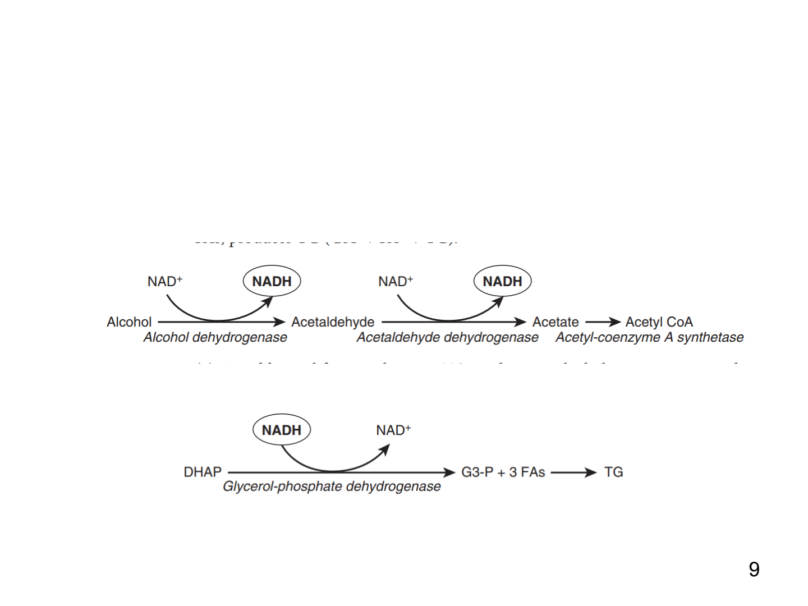

> **Source note:** Some diagram-adjacent text is clipped in original, not merely missing from extraction. Preserve legible pathways and flag clipped text; do not guess it.

## PDF page 10 — Hepatic lipid handling

> Source: ch1-part-08, PDF page 10. Printed slide: 10. Classification: teaching.

### Preserved source text

10

### Visual transcription / figure record

Hepatic free-fatty-acid influx and acetate contribute fatty acids. Fatty acids -> oxidation to ketone bodies/CO2, phospholipids, cholesterol esters, or + alpha-glycerophosphate -> triglycerides. Triglycerides + apoprotein -> lipoproteins -> export. Steps labelled 1–6.

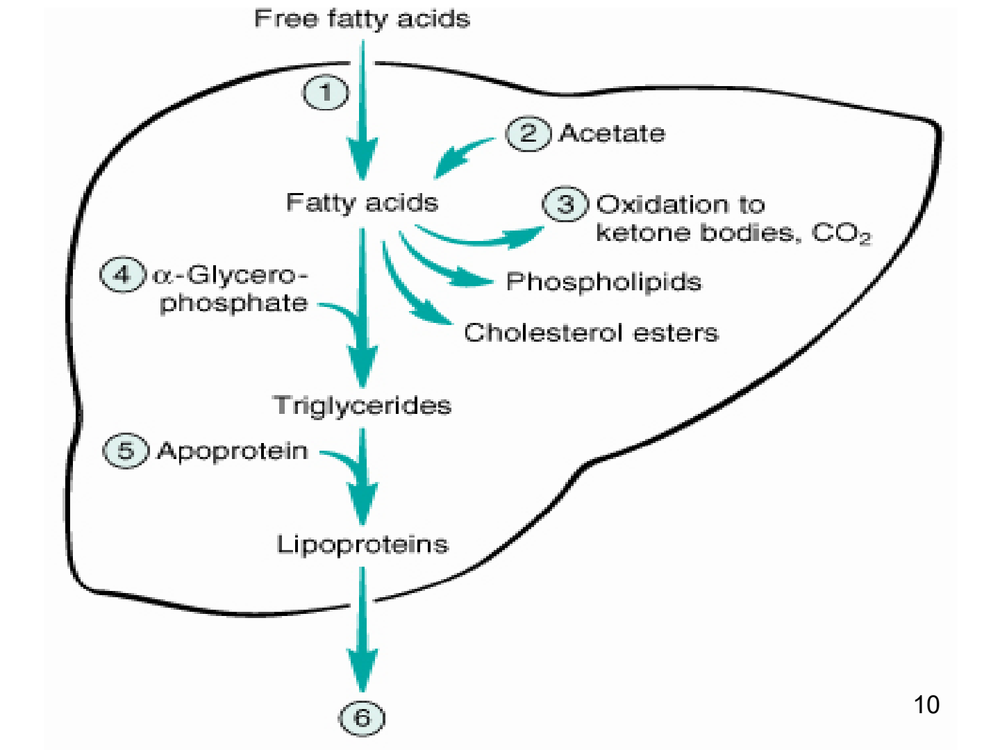

## PDF page 11 — Fatty liver mechanisms

> Source: ch1-part-08, PDF page 11. Printed slide: 11. Classification: teaching.

### Preserved source text

Causes
of Fatty
changes

### Visual transcription / figure record

Diabetes/starvation -> increased FFA supply. Ethanol links to increased FFA supply, increased esterification and decreased oxidation. Hypoxia/toxins -> decreased FFA oxidation; toxins/malnutrition -> reduced apoprotein availability -> impaired triglyceride export via lipoproteins. These converge on triglyceride accumulation.

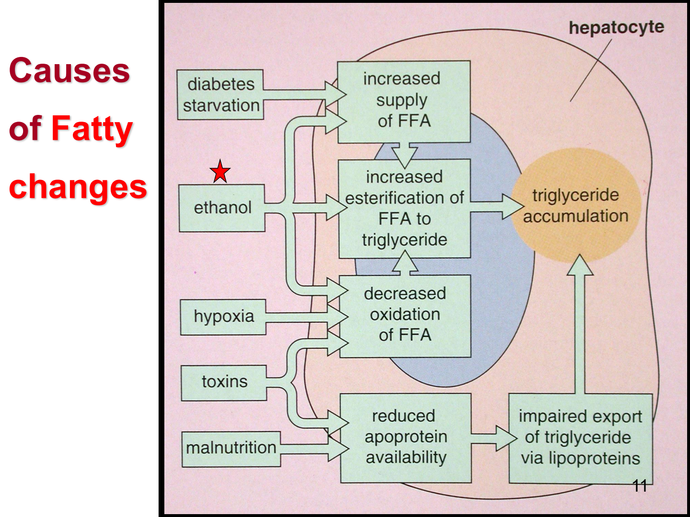

## PDF page 12 — Steatosis morphology

> Source: ch1-part-08, PDF page 12. Printed slide: 12. Classification: teaching.

### Preserved source text

MORPHOLOGY:
Early fatty change is seen
by light microscopy as
small fat vacuoles in the
cytoplasm around the
nucleus.

With accumulation, the
organ enlarges      and
becomes progressively
yellow, greasy     & soft.                                  12

### Visual transcription / figure record

Full page visually inspected; extracted text and visible layout compared. Illustrative image retained in original full-page render.

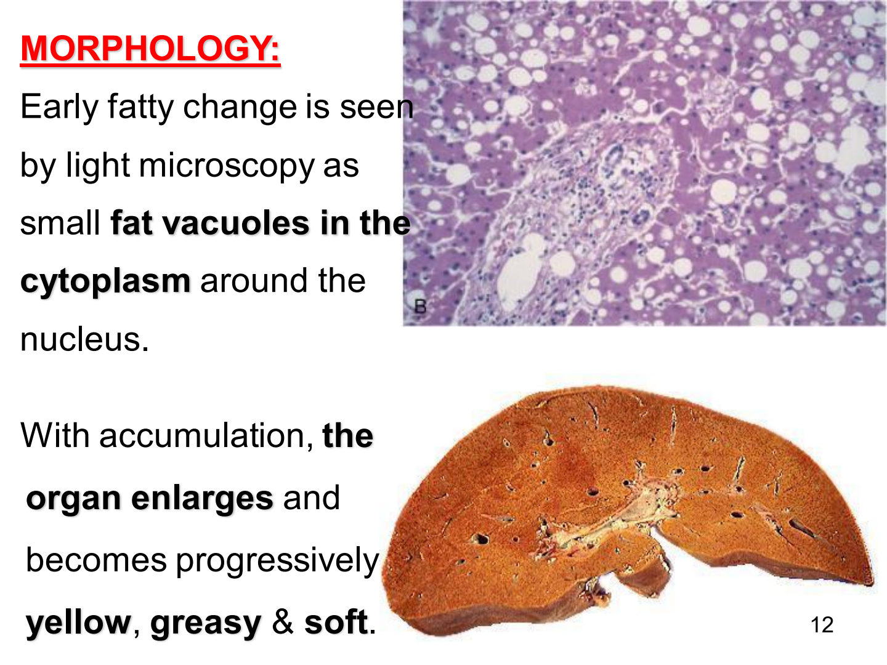

## PDF page 13 — Fat vacuoles micrograph

> Source: ch1-part-08, PDF page 13. Printed slide: 13. Classification: teaching.

### Preserved source text

13

### Visual transcription / figure record

Unlabelled hepatic micrograph with prominent clear cytoplasmic vacuoles; no stain/diagnosis beyond context is added.

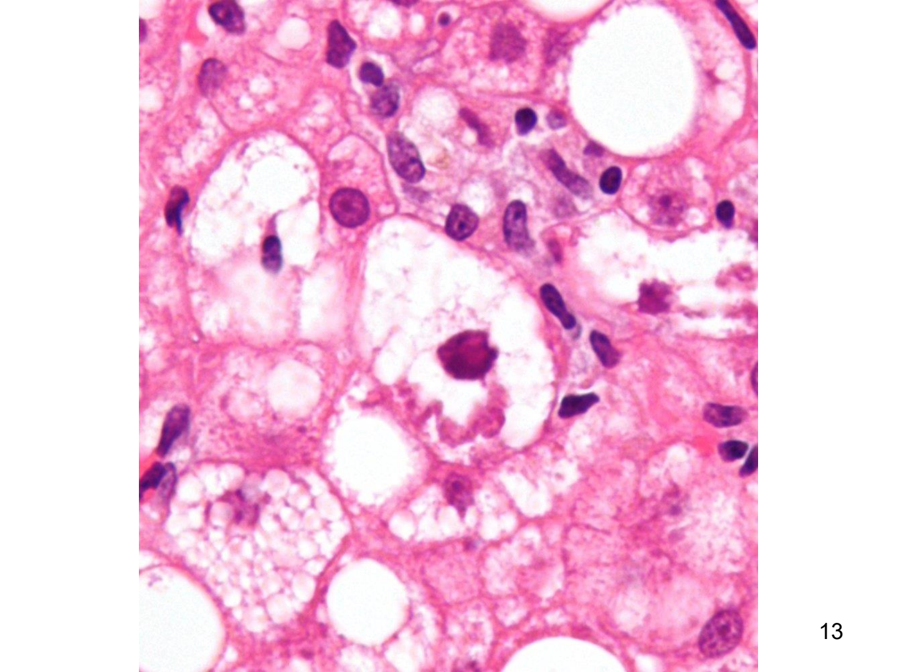

## PDF page 14 — Vacuolated hepatocytes micrograph

> Source: ch1-part-08, PDF page 14. Printed slide: 14. Classification: teaching.

### Preserved source text

14

### Visual transcription / figure record

Unlabelled vacuolated hepatocyte micrograph. No additional diagnostic inference.

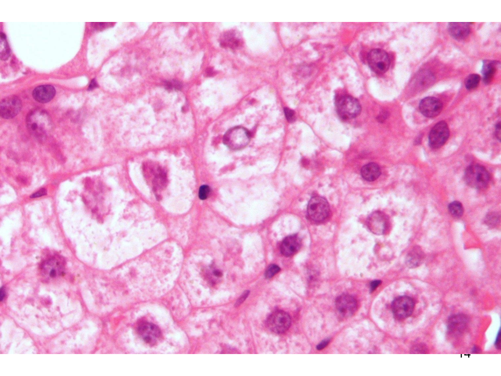

## PDF page 15 — Cholesterol and foam cells

> Source: ch1-part-08, PDF page 15. Printed slide: 15. Classification: teaching.

### Preserved source text

Cholesterol & cholesterol esters
• Mainly accumulates in
  macrophages, leading
  to the formation of foam
  cells.

 •  Example 1:
    In atherosclerosis, smooth muscle cells and
    macrophages are filled with lipid vacuoles
    composed of cholesterol and cholesterol esters;
    these give atherosclerotic plaques their yellow color.15

### Visual transcription / figure record

Full page visually inspected; extracted text and visible layout compared. Illustrative image retained in original full-page render.

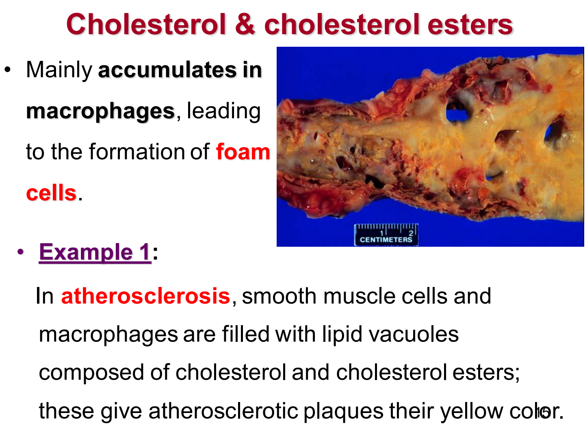

## PDF page 16 — Xanthomas

> Source: ch1-part-08, PDF page 16. Printed slide: not reliably labelled. Classification: teaching.

### Preserved source text

Cholesterol & cholesterol esters

Example 2:

  In hereditary  and acquired
  hyperlipidemic  syndromes,
  macrophages accumulate
  intracellular  cholesterol;  when                       xanthomas

  present in the subepithelial
  connective  tissue of skin or in
  tendons,  clusters of these
  foamy  macrophages form
  masses called     xanthomas.                                      16
                                            XANTHELASMA

### Visual transcription / figure record

Full page visually inspected; extracted text and visible layout compared. Illustrative image retained in original full-page render.

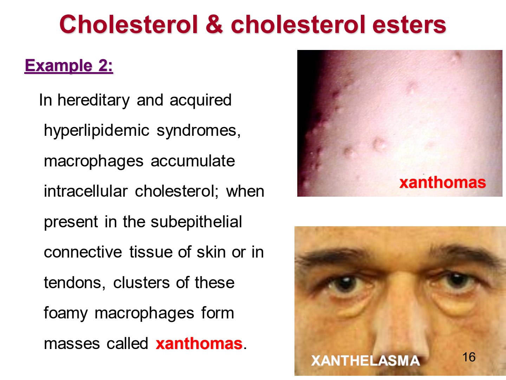

## PDF page 17 — Protein droplets and Russell bodies

> Source: ch1-part-08, PDF page 17. Printed slide: 17. Classification: teaching.

### Preserved source text

Proteins

1.In nephrotic    syndrome, there is an increased
  pinocytic  reabsorption    of the protein. Fusion of
  these pinocytic     vesicles with lysosomes     results in
  the histologic  appearance of pink, hyaline
  cytoplasmic     droplets
2.Russell bodies; accumulation of newly
  synthesized immunoglobulins          within the RER in
  plasma cells.

### Visual transcription / figure record

Full page visually inspected; extracted text and visible layout compared. Illustrative image retained in original full-page render.

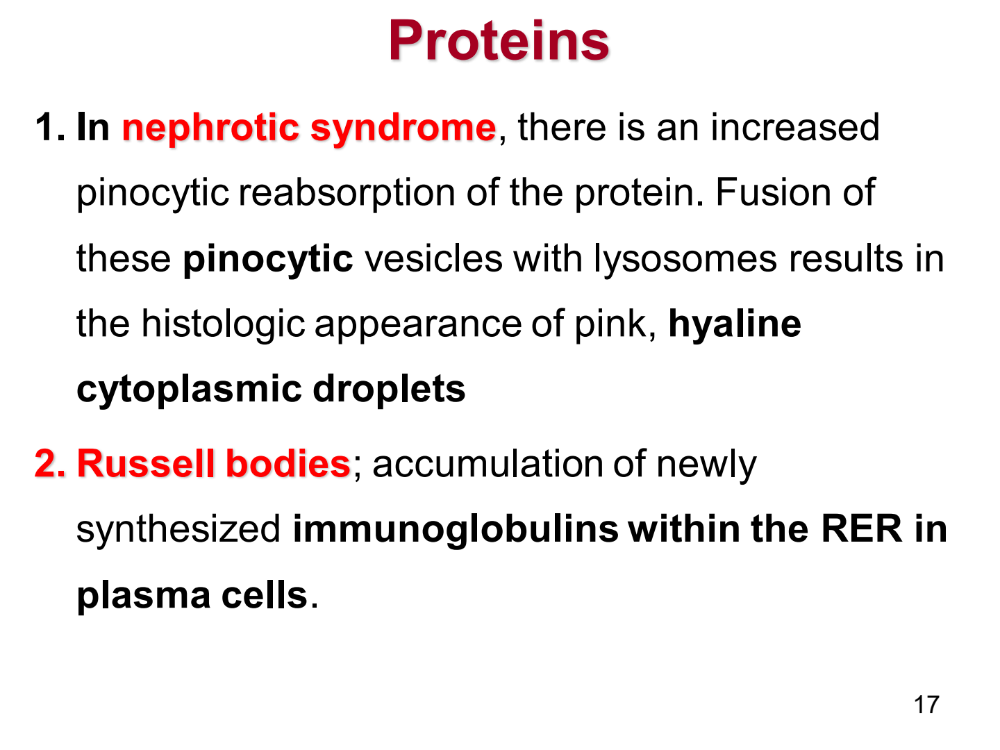

## PDF page 18 — Mallory bodies and tangles

> Source: ch1-part-08, PDF page 18. Printed slide: 18. Classification: teaching.

### Preserved source text

Proteins

3.  Mallory bodies      or “alcoholic hyaline”;
    accumulation of eosinophilic intracytoplasmic
    inclusions    (prekeratin filaments)      in liver cells in
    alcoholic liver disease.

4.  Neurofibrillary tangle      found in the brain    in
    Alzheimer     disease; aggregated protein        inclusion
    contains microtubule-associated proteins and
    neurofilaments.                                         18

### Visual transcription / figure record

Full page visually inspected; extracted text and visible layout compared. Illustrative image retained in original full-page render.

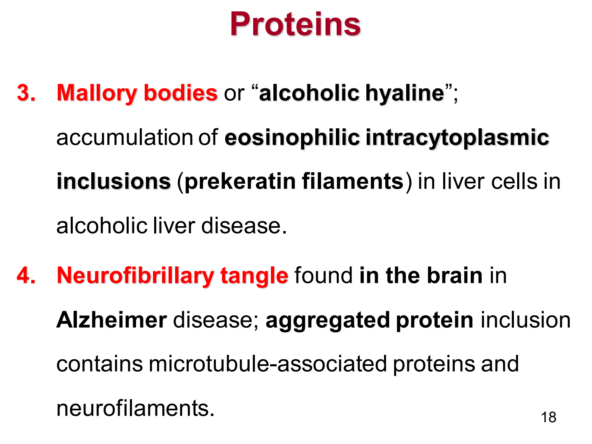

## PDF page 19 — Protein accumulation morphology

> Source: ch1-part-08, PDF page 19. Printed slide: 19. Classification: teaching.

### Preserved source text

A, Protein reabsorption
  droplets in the renal
  tubular epithelium; the
  droplets are contained
  within pinocytic
  vacuoles and within
  lysosomes.
                                        Fig. 1-15A
B, Mallory bodies
  (arrow). Also note the
  intracellular fat
  accumulation
  (asterisks), associated
  with acute alcohol
  intake.                                                        19

### Visual transcription / figure record

Full page visually inspected; extracted text and visible layout compared. Illustrative image retained in original full-page render.

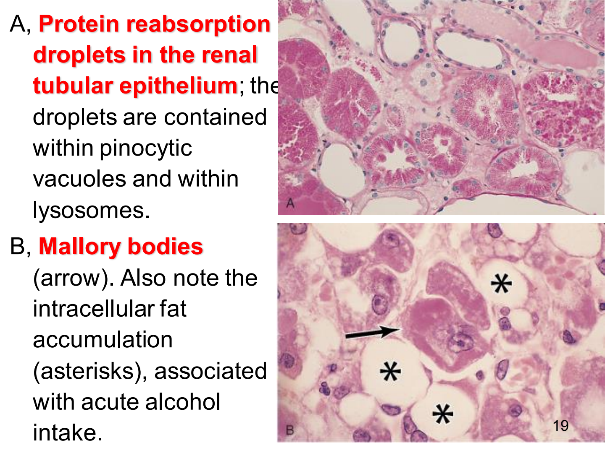

## PDF page 20 — Russell bodies micrograph

> Source: ch1-part-08, PDF page 20. Printed slide: 20. Classification: teaching.

### Preserved source text

Russell bodies

### Visual transcription / figure record

Full page visually inspected; extracted text and visible layout compared. Illustrative image retained in original full-page render.

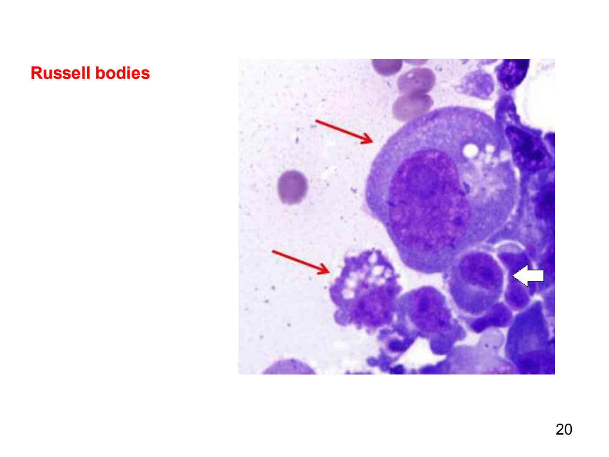

## PDF page 21 — Glycogen accumulation

> Source: ch1-part-08, PDF page 21. Printed slide: 21. Classification: teaching.

### Preserved source text

Glycogen

• Associated with abnormalities in the metabolism of
  either glucose or glycogen.

• Examples:

1) In diabetes mellitus; glycogen accumulates in
  renal tubular epithelium, cardiac myocytes, and
  beta cells of the islets in the pancreas.

2) Glycogen storage diseases           due to enzymatic
  defects

### Visual transcription / figure record

Full page visually inspected; extracted text and visible layout compared. Illustrative image retained in original full-page render.

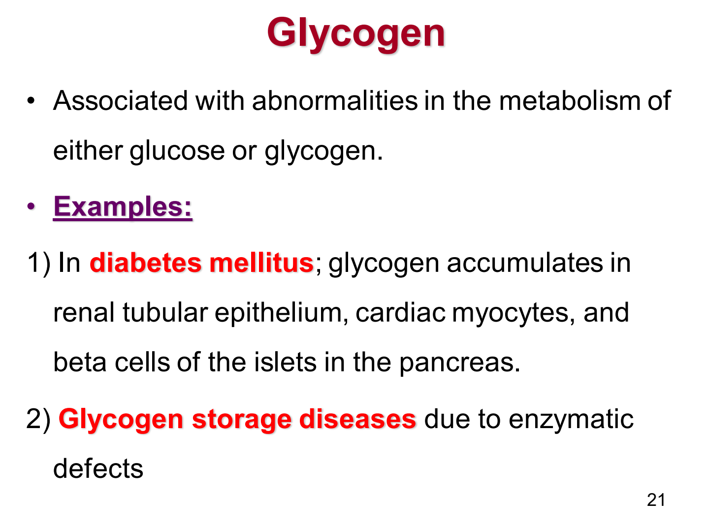

## PDF page 22 — Exogenous and endogenous pigments

> Source: ch1-part-08, PDF page 22. Printed slide: 22. Classification: teaching.

### Preserved source text

Pigments
• Colored substances      that are either exogenous or
  endogenous.
• Carbon   is the most common exogenous pigment.
  In the lung  and the hilar lymph nodes      carbon
  aggregates are called anthracosis.

• Endogenous pigments include:
  lipofuscin, melanin, and hemosiderin

### Visual transcription / figure record

Full page visually inspected; extracted text and visible layout compared. Illustrative image retained in original full-page render.

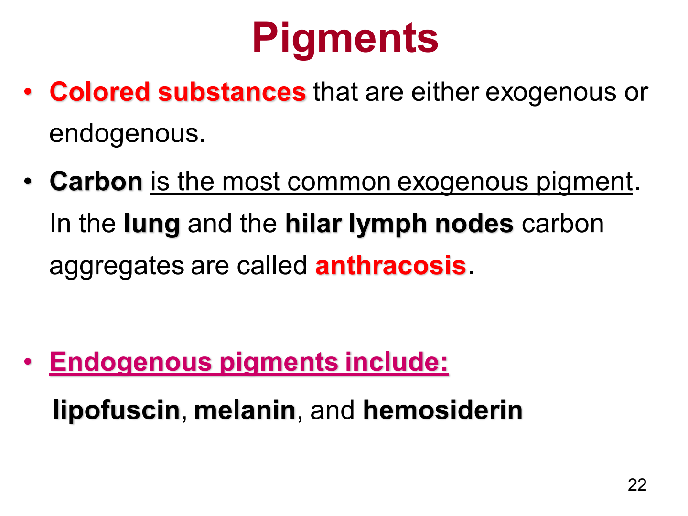

## PDF page 23 — Anthracosis

> Source: ch1-part-08, PDF page 23. Printed slide: 23. Classification: teaching.

### Preserved source text

Anthracosis

### Visual transcription / figure record

Anthracosis micrograph shows black particulate pigment; no outside cell identification added.

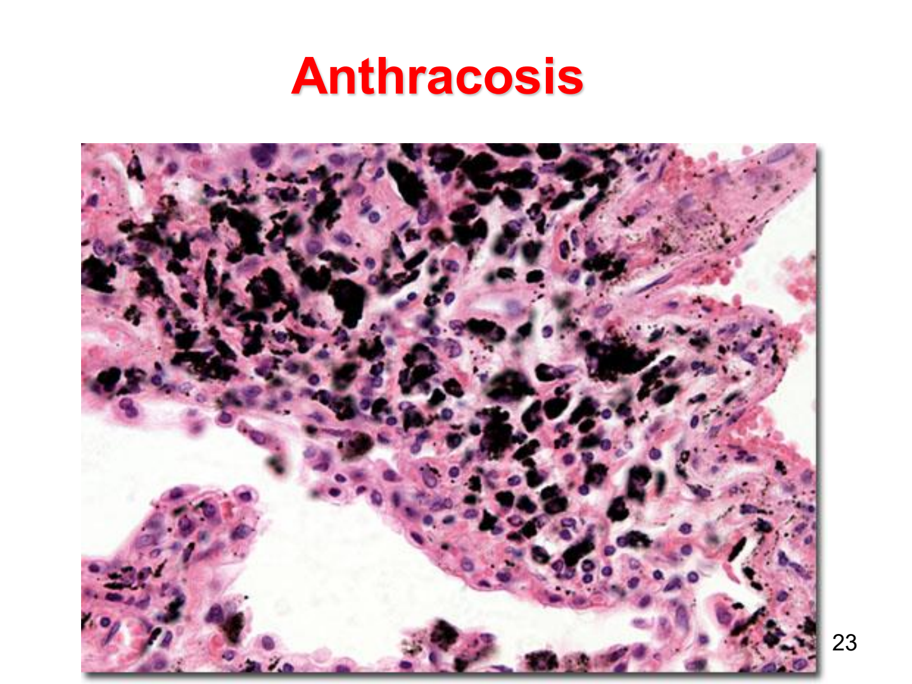

## PDF page 24 — Carbon pigment micrograph

> Source: ch1-part-08, PDF page 24. Printed slide: 24. Classification: teaching.

### Preserved source text

24

### Visual transcription / figure record

Unlabelled micrograph contains abundant black pigment; preserved alongside anthracosis page without assigning an unlabelled diagnosis.

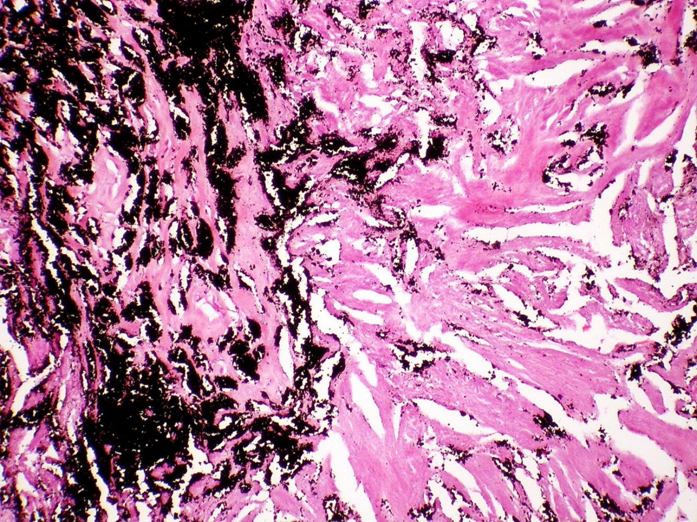

## PDF page 25 — Lipofuscin

> Source: ch1-part-08, PDF page 25. Printed slide: 25. Classification: teaching.

### Preserved source text

Pigments:          Lipofuscin

• an insoluble, brownish-yellow granular
  intracellular material     that accumulates as a function
  of age or atrophy.
• also called “Wear and tear pigment”.
• represents complexes of lipid and protein            that
  derive from the free radical-catalyzed           peroxidation
  of polyunsaturated lipids of subcellular membranes.
• not injurious to the cell      but is important marker of
  past free radical injury.                                  25

### Visual transcription / figure record

Full page visually inspected; extracted text and visible layout compared. Illustrative image retained in original full-page render.

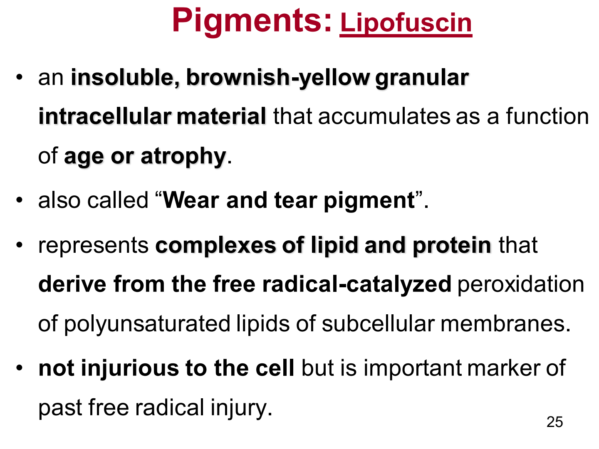

## PDF page 26 — Brown atrophy

> Source: ch1-part-08, PDF page 26. Printed slide: 26. Classification: teaching.

### Preserved source text

Pigments:          Lipofuscin

 •  the pigment appears as perinuclear electron        -dense
    granules
 •  called “brown atrophy” if apparent grossly

Lipofuscin
granules  in
cardiac
myocyte                                                      26

### Visual transcription / figure record

Full page visually inspected; extracted text and visible layout compared. Illustrative image retained in original full-page render.

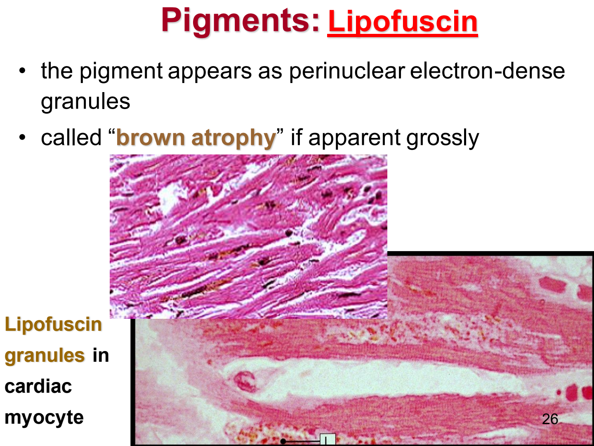

## PDF page 27 — Melanin

> Source: ch1-part-08, PDF page 27. Printed slide: 27. Classification: teaching.

### Preserved source text

Pigments:            Melanin

 •  an endogenous,      brown-
    black pigment    formed by
    melanocytes    .

 •  adjacent  basal
    keratinocytes    in the skin
    can also accumulate the
    pigment   (e.g., in freckles),
    or it may be accumulated  in
    dermal  macrophages.

### Visual transcription / figure record

Full page visually inspected; extracted text and visible layout compared. Illustrative image retained in original full-page render.

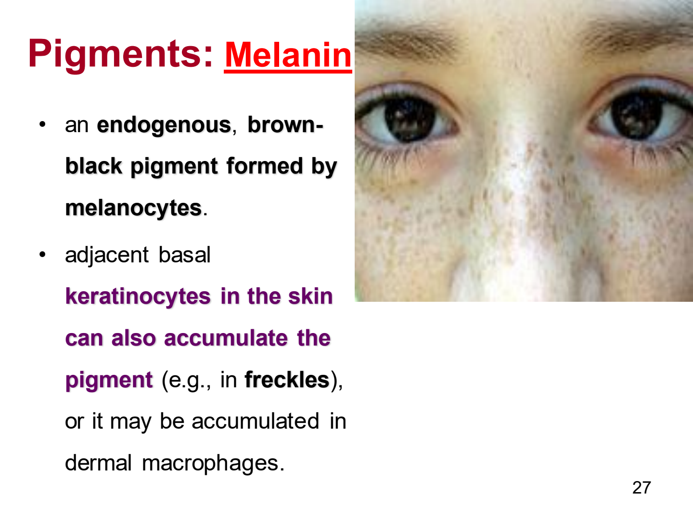

## PDF page 28 — Melanin micrograph

> Source: ch1-part-08, PDF page 28. Printed slide: 28. Classification: teaching.

### Preserved source text

28

### Visual transcription / figure record

Unlabelled skin section with brown basal pigment; no additional diagnosis inferred.

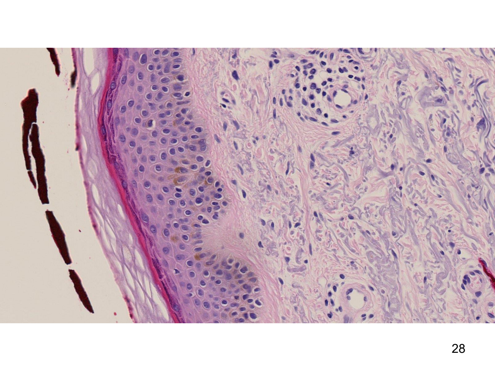

## PDF page 29 — Hemosiderin

> Source: ch1-part-08, PDF page 29. Printed slide: 29. Classification: teaching.

### Preserved source text

Pigments:           Hemosiderin

• Hemoglobin derived golden-yellow to brown pigment.
• accumulates in tissues when there is a local or
  systemic excess of iron
• Hemosiderin pigment represents large aggregates
  of ferritin
• Detected by special stain called “Prussian blue”.

Hemosiderin  in liver cells         Prussian blue reaction   29

### Visual transcription / figure record

Full page visually inspected; extracted text and visible layout compared. Illustrative image retained in original full-page render.

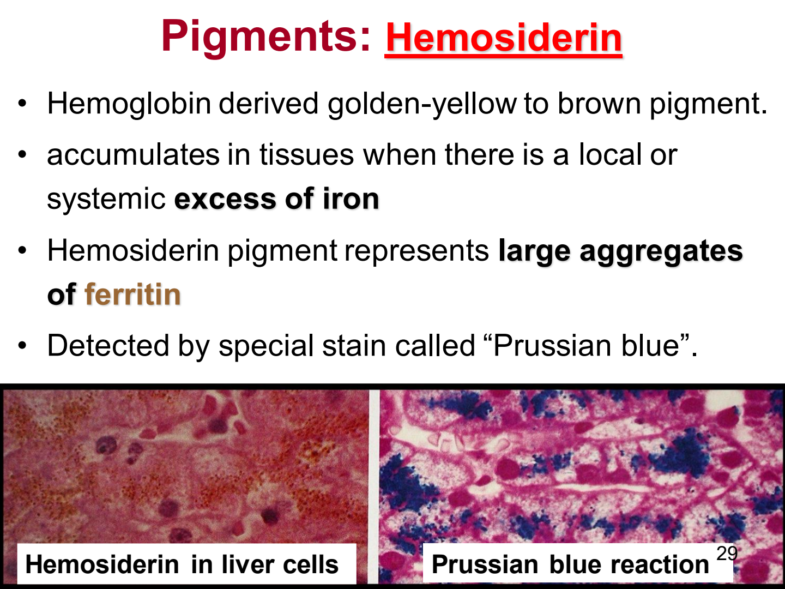

## PDF page 30 — Prussian blue micrograph

> Source: ch1-part-08, PDF page 30. Printed slide: 30. Classification: teaching.

### Preserved source text

30

### Visual transcription / figure record

Unlabelled blue-stained tissue micrograph adjacent to Prussian-blue discussion; no external interpretation added.

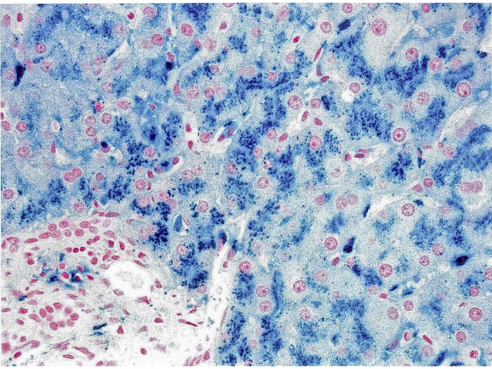

## PDF page 31 — Pathological calcification

> Source: ch1-part-08, PDF page 31. Printed slide: 31. Classification: teaching.

### Preserved source text

Pathological calcification

• Definition:   abnormal deposition of calcium salts,

  together with smaller amounts of iron,

  magnesium and other minerals.

• Types of pathological calcification:

   – Dystrophic calcification.

   – Metastatic calcification.

### Visual transcription / figure record

Full page visually inspected; extracted text and visible layout compared. Illustrative image retained in original full-page render.

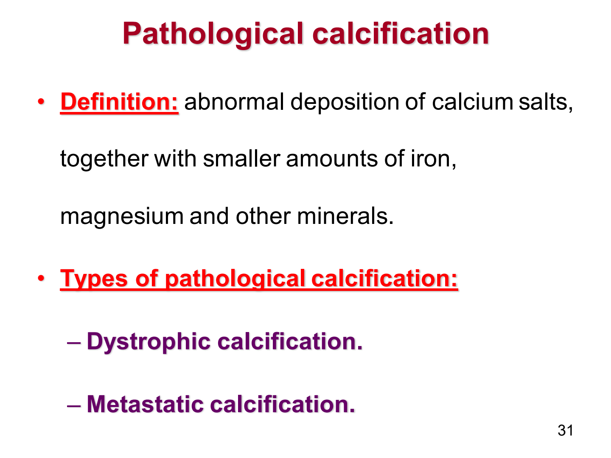

## PDF page 32 — Dystrophic calcification

> Source: ch1-part-08, PDF page 32. Printed slide: 32. Classification: teaching.

### Preserved source text

Dystrophic calcification

• Deposition of calcium on dead or dying
  cells.
• Normal levels of serum calcium.
• Associated with clinical organ dysfunction.
• Grossly    appears as fine white granules.
• Microscopically: intracellular or extracellular
  basophilic deposits.

### Visual transcription / figure record

Full page visually inspected; extracted text and visible layout compared. Illustrative image retained in original full-page render.

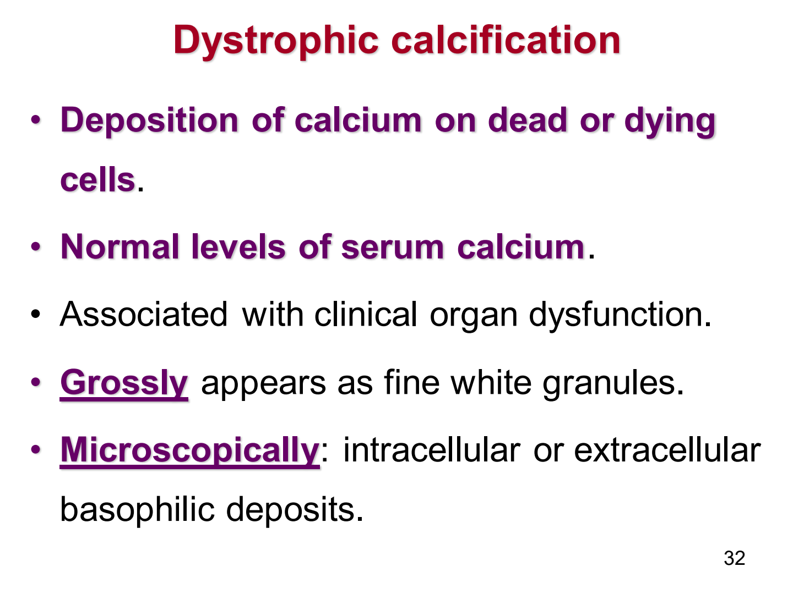

## PDF page 33 — Calcified aortic valve

> Source: ch1-part-08, PDF page 33. Printed slide: 33. Classification: teaching.

### Preserved source text

Dystrophic calcification       in aortic valve is an important
          cause of aortic stenosis        in the elderly

### Visual transcription / figure record

Full page visually inspected; extracted text and visible layout compared. Illustrative image retained in original full-page render.

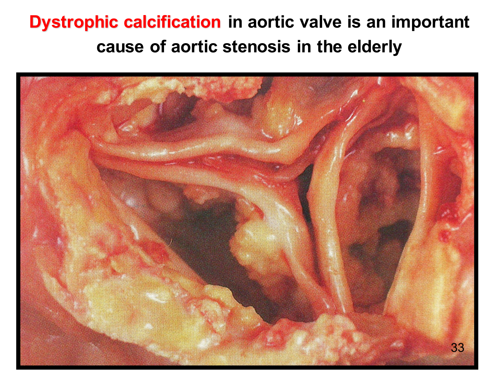

## PDF page 34 — Metastatic calcification

> Source: ch1-part-08, PDF page 34. Printed slide: 34. Classification: teaching.

### Preserved source text

Metastatic calcification

•   Deposition of calcium in normal tissue in the
    presence of hypercalcemia.

•   Causes of hypercalcemia:

      1.  Increased secretion of parathyroid hormone.

      2.  Destruction of bone by tumors.

      3.  Vitamin-D related disorders.

      4.  Renal failure.

### Visual transcription / figure record

Full page visually inspected; extracted text and visible layout compared. Illustrative image retained in original full-page render.

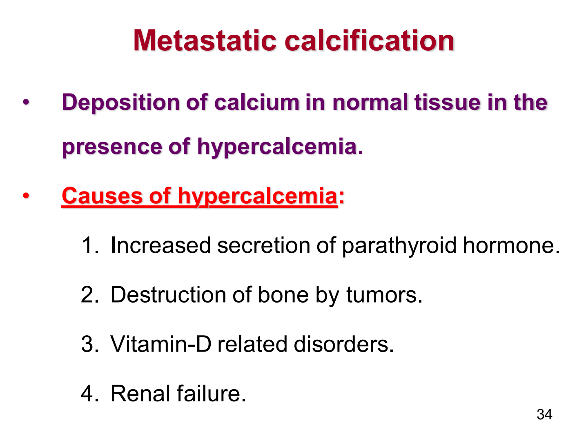

> **Source note (fresh checker):** Renal failure appears in an unqualified hypercalcemia-cause list. Preserve the source but do not infer that all renal failure causes hypercalcemia.

## PDF page 35 — Metastatic calcification sites and severity

> Source: ch1-part-08, PDF page 35. Printed slide: 35. Classification: teaching.

### Preserved source text

Metastatic
calcification

•  Affects mainly the interstitium of blood vessels,
   kidneys, lungs, and gastric mucosa.
•  Does not generally cause clinical dysfunction, unless
   the process is severe
  e.g. nephrocalcinosis                                      35

### Visual transcription / figure record

Full page visually inspected; extracted text and visible layout compared. Illustrative image retained in original full-page render.

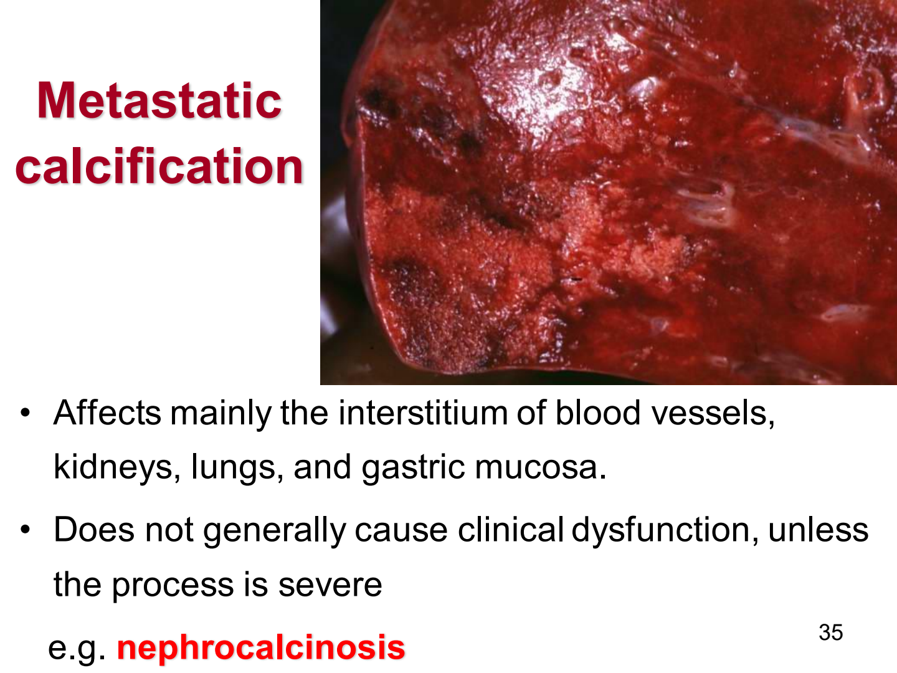

## PDF page 36 — Closing quotation

> Source: ch1-part-08, PDF page 36. Printed slide: not visibly labelled. Classification: administrative.

### Preserved source text

(No extractable text beyond the page label; see visual transcription and original image.)

### Visual transcription / figure record

Closing quotation: TWO THINGS DEFINE YOU: 1. YOUR PATIENCE WHEN YOU HAVE NOTHING. 2. YOUR ATTITUDE WHEN YOU HAVE EVERYTHING.

